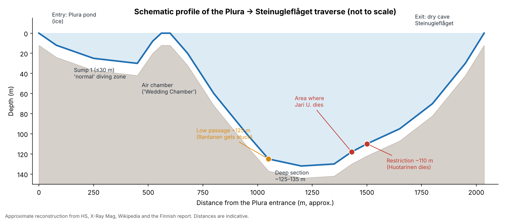
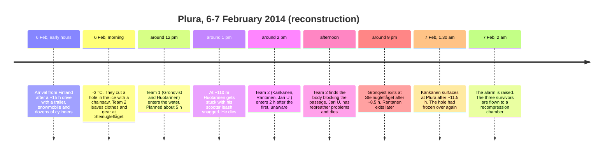
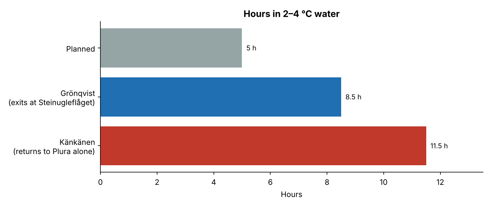
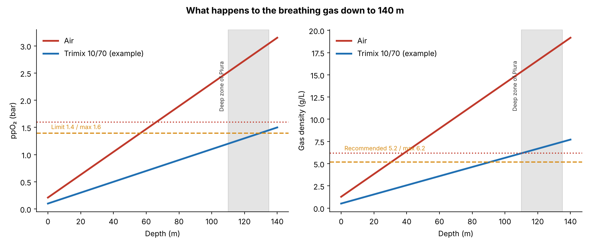
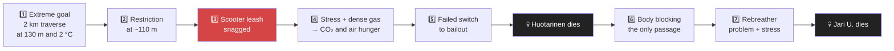

# 🧊 The Plura Cave Tragedy (Norway, 2014)

### Two deaths at 110–130 m under the ice, an abandoned official recovery and their friends' secret operation

> 🇪🇸 **[Versión en castellano](README.md)**

> **Educational study** · Author: Óscar Ramírez Martín · November 2026
> Based on cross-checked public sources and my own calculations.

> 🔗 **Related study:** [The Vaavu Cave Tragedy (Maldives, 2026)](https://github.com/Oskillar28/cueva-vaavu-maldivas). The divers who recovered the bodies in the Maldives are the main figures of this case.

> ⚠️ **A note of respect.** This study deals with the real deaths of two Finnish divers. It includes no images of the victims and no links to their helmet-camera footage of the accident. The aim is to understand **what happened**, **why**, and **what was learned**.

*The Plura river running through the Plurdalen valley (Rana, Nordland, Norway), July 2007. Beneath this valley lies the deepest flooded cave in Northern Europe. Photo: Sandivas, CC BY-SA 3.0, via Wikimedia Commons.*

---

## 📑 Contents

1. [Why this case](#1-why-this-case)
2. [The case in 30 seconds](#2-the-case-in-30-seconds)
3. [Who they were](#3-who-they-were)
4. [Plura cave](#4-plura-cave)
5. [Timeline of 6–7 February 2014](#5-timeline-of-67-february-2014)
6. [What went wrong: point-by-point analysis](#6-what-went-wrong-point-by-point-analysis)
7. [The chain of events](#7-the-chain-of-events)
8. [Could it have been prevented?](#8-could-it-have-been-prevented)
9. [The official recovery and the ban](#9-the-official-recovery-and-the-ban)
10. [The secret operation](#10-the-secret-operation)
11. [From Plura to Vaavu: the thread linking both studies](#11-from-plura-to-vaavu-the-thread-linking-both-studies)
12. [Other accidents and facts about Plura](#12-other-accidents-and-facts-about-plura)
13. [The documentary and videos](#13-the-documentary-and-videos)
14. [Source comparison: data that don't match](#14-source-comparison-data-that-dont-match)
15. [Myths vs reality](#15-myths-vs-reality)
16. [Technical glossary](#16-technical-glossary)
17. [Lessons](#17-lessons)
18. [Methodology, limits and confidence](#18-methodology-limits-and-confidence)
19. [Sources](#19-sources)
20. [Image credits](#20-image-credits)

---

## 1. Why this case

In May 2026, when five Italian divers died in the Vaavu cave (Maldives), DAN Europe sent three Finnish specialists to recover them: **Sami Paakkarinen, Patrik Grönqvist and Jenni Westerlund**. The first two were known worldwide for something that had happened twelve years earlier in Norway.

In February 2014, Grönqvist watched his friend die trapped in a restriction 110 m deep. Weeks later, after the Norwegian authorities declared the recovery impossible and closed the cave, he and Paakkarinen organised a **secret operation** with other divers to bring the bodies out. The story was told in the documentary *Diving Into the Unknown* (2016).

The two cases are opposites, and that is why each one explains the other:

- At **Vaavu**, a group with **no cave training** went in with recreational gear and died from lack of preparation.
- At **Plura**, five divers with **the highest training that exists** (full cave on rebreather) died or nearly died on a dive planned in detail. Plura shows that at those depths **a residual risk remains even when everything is done right**.

---

## 2. The case in 30 seconds

| Item | Most reliable value |
|---|---|
| **Date** | Thursday 6 February 2014 |
| **Place** | Plura cave (*Pluragrotta*), Plurdalen valley, Rana municipality, Nordland (Norway), near Mo i Rana, just south of the Arctic Circle |
| **Coordinates** | 66°13′10″ N · 14°46′21″ E ([view on OpenStreetMap](https://www.openstreetmap.org/?mlat=66.21944&mlon=14.77250#map=13/66.21944/14.77250)) |
| **Goal** | A full **~2 km underwater traverse**: in through the Plura pond, out through the Steinugleflåget dry cave |
| **Planned maximum depth** | ~129–135 m |
| **Water temperature** | ~2–4 °C, entering through a hole cut in the ice |
| **Equipment** | Closed-circuit rebreathers (CCR), scooters, and bailout cylinders and rebreathers |
| **Training** | All five were CCR Full Cave divers |
| **Victims** | **2 dead** (Jari Huotarinen and Jari U.) and **3 survivors** treated for decompression sickness |
| **Cause** | Huotarinen got stuck in a restriction at ~110 m with his scooter leash snagged, and drowned when the switch to bailout gas failed. Jari U. had rebreather problems shortly afterwards, near the same spot |
| **Official recovery** | Three elite British cave divers (Stanton, Volanthen and Mallinson) called it off as too dangerous. Police closed the cave |
| **Actual recovery** | A Finnish–Norwegian team brought the bodies out **without permission** in late March 2014: 101 hours of diving |

**In one sentence:** the cave did not forgive a snagged leash at 110 m; and their friends, against police orders, went back for them.

---

## 3. Who they were

| Name | Age | Who he was | What happened to him |
|---|---|---|---|
| **Patrik Grönqvist** ("Patte") | 42 | Firefighter from Porvoo. Made the first traverse of the cave in 2013 | Team 1. Watched his partner die and exited at Steinugleflåget after ~8.5 h |
| **Jari Huotarinen** ("Hamsteri") | 40 | Production manager from Valkeakoski. A calm diver; years earlier he had set an unofficial Finnish record with Känkänen | Team 1. His first traverse. **Died** trapped at ~110 m |
| **Kai Känkänen** ("Kaitsu") | 46 | Electrical contractor from Vantaa. Had lost his dive partner in a Finnish quarry a year earlier | Team 2. Swam back alone to the Plura entrance: ~11.5 h in the water |
| **Vesa Rantanen** ("Vesku") | 33 | Electrical designer from Hämeenlinna | Team 2. Removed gear to squeeze past Huotarinen's body. Decompression sickness |
| **Jari U.** | 34 | Mechanical engineer from Espoo. No previous Plura experience, but described as a methodical, careful diver | Team 2. **Died** after rebreather problems near the restriction |
| **Sami Paakkarinen** | — | The most experienced of the group. He was teaching a course in Mexico on the day of the accident | Led, with Grönqvist, the secret recovery of the bodies |

*The Finnish newspaper Helsingin Sanomat withheld Jari U.'s surname at his family's request. This study respects that decision, although other media did publish it.*

> 🧠 **Reasoning:** unlike Vaavu, there is no "amateur overconfidence" here. All five had top-level technical training, redundant gear and a detailed plan. What failed was the margin: at 110 m, in 2 °C water, inside a tight passage, **a single mechanical problem** can use up the whole margin in minutes.

---

## 4. Plura cave

### 4.1 The place

- **Plura** (*Pluragrotta*) lies in the **Plurdalen** valley, near Jordbru farm, in **Rana** municipality (Nordland), near the town of Mo i Rana and just south of the **Arctic Circle**.
- It is a **karst** cave in limestone and marble, carved by the Plura river. Rana has some 200 caves, but almost none can be dived.
- It has **two entrances**: the **Plura** pond (water) and the **Steinugleflåget** dry cave, reached by snowmobile in winter and requiring a vertical descent of over 100 m to its inner lake.
- It has about **3 km** of passages and reaches **at least 135 m** deep: the **deepest cave in Northern Europe** and the most visited by cave divers in Scandinavia.
- The water is **2–4 °C** and visibility can reach **20 m**. The hazards: tight passages, sharp rock, cold and side passages where divers can get lost.

### 4.2 The structure

*Schematic profile of the 2014 traverse. Not to scale: an approximate reconstruction from the sources. My own drawing.*

| Section | What is there | Depth |
|---|---|---|
| **Sump 1** | First flooded section from the pond, about 500 m. Most divers turn around here | ≤ 30 m |
| **Air chamber** | Large air-filled hall, known as the "Wedding Chamber" (see [§12](#12-other-accidents-and-facts-about-plura)) | Surface |
| **Deep sump** | The tunnel drops steeply towards the deepest zone | Down to ~130–135 m |
| **Low passage** | Opening less than 1 m high | ~125 m |
| **Restriction** | The passage where Huotarinen got stuck, already on the way up | ~110 m |
| **Rise to Steinugleflåget** | Connection climbing to the dry cave's inner lake | From ~130 m to surface |
| **Total traverse** | **2,036 m** underwater | |

### 4.3 Exploration history

| Year | Milestone |
|---|---|
| 1960s | The Kallvatnet dam reduces the river's flow and makes diving possible |
| 1980 | First known dive (Svein Grundstrøm and Bjørn Fagertun) |
| 1987–1997 | Ten Norwegian divers, mostly Oslo firefighters, survey almost 3 km on their own time |
| 2002 → | Norwegian teams (Reel Action Diving) continue exploring |
| Sept./Oct. 2013 | Finnish divers (Paakkarinen, Grönqvist, Känkänen) find the connection to Steinugleflåget and make the **first traverse** |
| 6 Feb 2014 | Attempt at the **second traverse**: two deaths |

For years there was **rivalry** between the Norwegian and Finnish teams exploring the cave.

---

## 5. Timeline of 6–7 February 2014

*Planned vs actual. Data from Helsingin Sanomat. My own chart.*

### 5.1 Team 1: Grönqvist and Huotarinen

1. They pass the deepest part (~130 m) and start climbing.
2. Grönqvist passes a restriction and, looking back, sees Huotarinen's torch moving up and down: the **distress** signal.
3. He goes back. Huotarinen is **stuck**: the leash tying him to his scooter has caught under a rock. The scooter is eventually torn free and lost.
4. Huotarinen asks for open-circuit bailout gas. Grönqvist hands him his own mouthpiece two or three times. When Huotarinen is left without one, Grönqvist purges a regulator to give him, but **Huotarinen inhales water and dies**.
5. Grönqvist's computer shows **more than 400 minutes** of mandatory decompression. He decides to continue towards Steinugleflåget.

### 5.2 Team 2: Känkänen, Rantanen and Jari U.

1. Rantanen carries **five large bailout cylinders**, which slows them in the tight passages.
2. At ~125 m Rantanen gets stuck in an opening less than 1 m high and removes two cylinders to pass. A fin catches on the guideline and Jari U. frees it.
3. Rantanen hears a **rebreather alarm**: it is Huotarinen's. His body **blocks the passage**. Rantanen tries to move it, cannot, and ends up removing gear to squeeze past.
4. Behind him, Jari U. starts swimming erratically and switches from his rebreather to bailout gas. Känkänen tries to help without knowing what is wrong. **Jari U. dies** shortly afterwards.
5. Känkänen shouts to Rantanen to turn back. Rantanen keeps going. Känkänen, convinced Grönqvist is also dead, **turns back alone**.

### 5.3 Känkänen's return

Känkänen retraces the route to Plura. In the air chamber he breathes the trapped air to save oxygen. His scooter fails, and a stretch meant to take 15 minutes takes 45. He surfaces at 1:30 a.m., after about **11.5 hours** in 2 °C water, to find the hole in the ice **covered again by 1 cm of ice**. He did not know whether he was the only survivor.

---

## 6. What went wrong: point-by-point analysis

The figures in this section are my own calculations with standard diving formulas ([`scripts/calculos_y_figuras.py`](scripts/calculos_y_figuras.py), output in [`calculos.txt`](calculos.txt)).

### 6.1 Pressure at 110–130 m

$$P_{\text{absolute}} = 1 + \frac{\text{depth (m)}}{10}$$

| Depth | Absolute pressure | One surface litre of gas takes up… |
|---|---|---|
| 30 m (end of sump 1) | 4 bar | 0.25 L |
| 110 m (restriction) | 12 bar | 0.08 L |
| **130 m** (deepest zone) | **14 bar** | **0.07 L** |

*(In fresh water pressure rises slightly more slowly than in the sea, ~1 bar every 10.3 m. Rounded to 10 m here.)*

### 6.2 Why you cannot breathe air down there

| At 130 m | Air | Trimix 10/70 (example) |
|---|---|---|
| ppO₂ | **2.94 bar** (seizures almost certain) | 1.40 bar |
| Narcosis (equivalent depth) | Like very heavy drunkenness | Like being at ~25 m |
| Gas density | **17.9 g/L** | **7.2 g/L** |

*Oxygen partial pressure and gas density for air and for an example trimix. The grey band is Plura's deep zone. My own calculation.*

That is why divers use **trimix** (oxygen + helium + nitrogen) in a **rebreather**, which holds oxygen at a set value and recycles exhaled gas. But look at the right-hand chart: **even with trimix, gas density at 130 m exceeds the recommended limit** (5.2 g/L) and approaches or passes the maximum (6.2 g/L).

### 6.3 CO₂: the rebreather's silent enemy

A rebreather removes CO₂ with a chemical scrubber (soda lime). With such dense gas:

- It takes more effort to move gas through the lungs and the unit's hoses.
- If the diver **gets agitated and breathes fast**, the scrubber may not keep up and **CO₂ builds up** (hypercapnia).
- Excess CO₂ causes **air hunger, panic and confusion**, and panic makes the diver breathe even faster.

The BBC explained it when telling the story: rebreathers can be overwhelmed if the diver breathes quickly, and at depth breathing is harder to control. It is the most likely explanation of why Huotarinen, trapped and stressed, **asked for open-circuit gas**, and why Jari U. began swimming erratically.

### 6.4 How long a bailout cylinder lasts at 130 m

When a rebreather fails, the diver switches to **open circuit** (bailout): breathing from a cylinder and exhaling into the water. At 14 bar every breath uses 14 times more gas than at the surface. Example with a typical 11 L cylinder at 200 bar (2,200 L):

| Situation | Surface consumption | Consumption at 130 m | Minutes |
|---|---|---|---|
| Relaxed | 15 L/min | 210 L/min | **≈ 10** |
| Normal | 20 L/min | 280 L/min | **≈ 8** |
| Effort | 30 L/min | 420 L/min | **≈ 5** |
| Stress | 45 L/min | 630 L/min | **≈ 3.5** |
| Panic | 60 L/min | 840 L/min | **≈ 2.5** |

> ⚖️ **Conclusion:** trapped and stressed, a bailout cylinder lasts **a few minutes**. And getting out from 130 m takes **hours** of decompression. That is why so much bailout gas is carried at Plura, and why Rantanen carried five cylinders.

### 6.5 The restriction and the scooter leash

- A **scooter** (diver propulsion vehicle) is tied to the diver with a leash so it cannot be lost.
- In a tight passage, **anything that dangles can snag**: the leash, a cylinder, a fin, the guideline. Rantanen's own fin had caught on the guideline shortly before.
- At 110 m and trapped, a diver cannot **ascend**, cannot easily **turn around**, and cannot **reach the surface**. The problem has to be solved on the spot, with the gas on hand and the buddy alongside.

### 6.6 A body blocking the only route

The second death is linked to the first. Huotarinen's body was left **in the passage team 2 had to go through**, and they knew nothing because they had entered two hours later. Finding a dead friend at 110 m, in a tight passage, with no possible rescue, is one of the most extreme stress scenarios there is. Norwegian police believe **Jari U. panicked** on reaching the scene of the first accident. Technical sources add that he also had rebreather problems.

### 6.7 Decompression and cold

- After passing 130 m, the survivors needed **hours** of decompression stops. Grönqvist had more than 400 minutes owed when his partner died.
- All three had to **cut** their decompression short. Rantanen had arm and knee pain (decompression sickness), and later tingling and difficulty walking.
- Spending **8 to 11 hours in 2 °C water** requires drysuits and heating. Cold tires the body, speeds up breathing and clouds thinking.

### 6.8 Decisions under pressure

- **Grönqvist** could not go back the way he had come (he would have had to cross the deepest zone again) and chose to continue towards the exit.
- **Känkänen** chose to **turn back** rather than pass the restriction with his friend's body; he did not know what other blockages lay ahead. Rantanen chose to **continue**. Both survived.
- In a cave like this there is no universally "right" decision. The cave-diving rule is that **every diver must be able to get out alone**, and all three did.

---

## 7. The chain of events

| Link | Confirmed? | Confidence |
|---|---|---|
| Huotarinen trapped in a restriction at ~110 m | Yes: all sources | 0.9 |
| Scooter leash snagged | Yes: Helsingin Sanomat, BBC | 0.85 |
| Failed switch to bailout (inhaled water) | Yes: Grönqvist's account in HS | 0.8 |
| CO₂ build-up as a factor | Likely: physics and the BBC's explanation; no public autopsy | 0.6 |
| Jari U.'s rebreather problems | Yes: Finnish report and HS | 0.75 |
| Jari U. panicking at the first accident scene | Norwegian police hypothesis | 0.6 |
| The three survivors cut decompression short | Yes: Finnish report | 0.85 |

---

## 8. Could it have been prevented?

This question is harder than for Vaavu, because here **almost everything was done right**. The honest approach is to separate what was done from what could have been done differently.

| Good practice | Done? |
|---|---|
| Full cave training on rebreather | ✅ All five |
| Rebreather with bailout gas for that depth | ✅ (each diver's exact mix has not been published) |
| Bailout gas and rebreathers | ✅ |
| Guideline on the route | ✅ There was a line: Rantanen's fin caught on it |
| Small teams, letting silt settle | ✅ Two teams two hours apart |
| Surface support | ❌ They only left clothes and gear at Steinugleflåget. Nobody waited outside: the alarm was not raised until 2 a.m., about 14 h after the first team went in |

| What could have been done differently | Why |
|---|---|
| **More prior experience on that route** before attempting the traverse | It was Huotarinen's first traverse, and Jari U. had never dived Plura. The traverse had been done only once, five months earlier |
| **A "cleaner" configuration** for tight passages | Nothing dangling: scooter leashes stowed or releasable with one hand, cylinders well secured. A quick-release clip can save a life |
| **Less dense gas** (more helium) on the deep section | Lower density reduces CO₂ risk and breathing effort. At 130 m safe values are hard to reach (see [§6.2](#62-why-you-cannot-breathe-air-down-there)) |
| **A surface support team** with an alarm deadline | If nobody waits outside, nobody raises the alarm when a team is overdue. Here it took about 14 h, and Känkänen found the hole in the ice frozen over again |
| **Communication between teams** | Team 2 did not know the passage was blocked. In a 2 km cave there is no simple way to warn others: only marks or notes on the line |
| **Accepting the goal carries high residual risk** | A 2 km traverse at 130 m and 2 °C is at the limit of the possible. The protagonists say so themselves in the documentary |

> 🧭 **Key difference from Vaavu:** at Vaavu, **one** properly placed safety layer (a guideline, a second cylinder, the rule of thirds) would probably have saved them. At Plura **almost every** layer was in place (surface support was missing), and still a snagged leash was enough to start the chain. That is why deep cave diving remains one of the most dangerous activities in the world.

*A cave diver running a guideline. At Plura the line was in place: the danger was something else. Photo: Ryan Cantey, CC BY-SA 3.0, via Wikimedia Commons.*

---

## 9. The official recovery and the ban

| Date | What happened |
|---|---|
| 7 Feb 2014 | Helgeland police mobilise 14 specialists. News breaks in Finland and Norway. The survivors give statements to police |
| ~20–21 Feb | **Rick Stanton, John Volanthen and Jason Mallinson**, British cave-rescue divers, arrive (the same men who in 2018 would find the boys in Thailand's Tham Luang cave) |
| 21–25 Feb | They enter from Steinugleflåget and survey the site. **They cannot free Huotarinen's body**, and passing the restriction to reach Jari U. is judged too dangerous |
| 25 Feb | The operation is **called off**. Stanton explains it would be a long job with many deep, cold dives, beyond their remit. The only alternative was another traverse from Plura, and it was ruled out |
| Afterwards | Police keep the **diving ban** and close the area. The bodies stay in the cave |

> 🧭 **The golden rule of rescue:** do not create more victims. The British divers' decision was professional and correct: recovering bodies never justifies risking the living.

---

## 10. The secret operation

### 10.1 "Kaveria ei jätetä"

Finnish soldiers in the Winter War (1939–1940) against the USSR had a motto: ***kaveria ei jätetä***, "never leave a friend behind". The survivors made it their own. They also had practical reasons:

- So the families could **bury** their dead.
- So **insurance and inheritance** matters, which get complicated without a body, could be settled.
- So the cave could **reopen**: with two bodies inside, the ban might become permanent.

They kept it **secret** because they believed police would stop them diving if they found out.

### 10.2 The operation

| Item | Detail |
|---|---|
| Date | Late March 2014: the bodies were brought out on **26 March**, about **seven weeks** after the accident; the operation lasted about 5 days |
| Leaders | **Sami Paakkarinen and Patrik Grönqvist** |
| Participants | Depending on the source, 10 divers (two of them women) and 7 helpers, or 17 Finns and 10 Norwegians |
| Dive time | **101 hours** in total |
| Preparation | **26 bailout cylinders** staged in the cave and an **underwater habitat** (an air-filled "bell" to rest in during decompression) |
| Method | Teams went in from **both entrances**. Grönqvist and Paakkarinen freed the bodies and brought them to the dry cave |
| Local support | A dozen local residents helped carry gear out; the farm owner heated the sauna for them |
| Notification | The next morning, Paakkarinen informed police. Norwegian rescuers brought the bodies out of the dry cave |

### 10.3 The authorities' reaction

- Helgeland police confirmed that the Finnish team **had informed them themselves** that they had brought up the two divers.
- Police said the ban remained in force but that **prosecuting the team was not a priority**. Paakkarinen said the officers seemed pleased with the outcome, though they made clear there would be an investigation.
- The group waited about **six months** before being cleared of any charges.
- The ban was **lifted on 31 March 2014**, four days later.
- The funerals took place in late April. Grönqvist was a pallbearer for his friend. Shortly afterwards, the three survivors left on a cave-diving trip to Spain and France, including **Pozo Azul** (Burgos).

---

## 11. From Plura to Vaavu: the thread linking both studies

| | **Plura (Norway, 2014)** | **Vaavu (Maldives, 2026)** |
|---|---|---|
| Depth | 110–135 m | 47–70 m |
| Water | Fresh, **2–4 °C**, under ice | Salt, **~28 °C** |
| Training | Full cave on CCR | No known cave training |
| Gear | Rebreathers, scooters, plenty of bailout | Air, a single 12 L cylinder |
| Guideline | In place | No |
| What failed | Entrapment in a restriction + CO₂/rebreather | Disorientation in a blind tunnel + air ran out |
| Deaths | 2 | 5 + 1 rescuer |
| First recovery attempt | British divers: **called off** as too dangerous | Maldivian military divers: **one died** |
| Who brought the bodies out | **Paakkarinen and Grönqvist** (and others) | **Paakkarinen, Grönqvist** and Westerlund (DAN Europe) |
| Lesson | Risk remains even when everything is done right | Without preparation, the risk is almost a certainty |

*An Inspiration closed-circuit rebreather, one of the models seen in the documentary. Photo: EMDX, CC BY-SA 4.0, via Wikimedia Commons.*

> 🔗 **Twelve years later.** The men who in 2014 had to hide from police to recover their friends became, in 2026, the **official** team a government and DAN Europe called on to recover five strangers. After the Maldives, the Italian president awarded them the Order of Merit. The experience gained at Plura (habitats, scooters, recoveries through restrictions) is what made Vaavu possible.

---

## 12. Other accidents and facts about Plura

| Date | Event |
|---|---|
| August 1988 | A diver tears his drysuit on a rock and suffers mild hypothermia. He survives |
| **16 August 2006** | Norwegian **Ståle Tveitane**, 37, dies about 1,300 m from the entrance after descending to ~110 m; the accident happens on the way back, around 75 m. A British team led by Mark Dougherty recovers the body on 28 August, because Norwegian regulations did not allow its own divers to take that risk. The **Norwegian Cave Diving Society** is founded after this accident |
| **6 February 2014** | Jari Huotarinen and Jari U. die (this study) |
| 10 August 2019 | **Underground wedding** in the air chamber, with 69 participants: a Guinness World Record. The couple were Finn Jani Santala and Norwegian Ina Trælnes. Since then it has been known as the "Wedding Chamber" |
| **3 April 2024** | American **Jared Hires**, 33, general manager of Dive Rite, dies. He had a **seizure** on the way back from the air chamber. DAN's preliminary report attributed it to a **medical event**, not equipment failure. Rana did not close the cave |

A curious detail: no fish are believed to live in the cave, yet one scene in the documentary clearly shows one.

---

## 13. The documentary and videos

### 13.1 *Diving Into the Unknown* (2016)

*Click the image to watch the official trailer on YouTube.*

| Item | Detail |
|---|---|
| Original title | *Takaisin pintaan* ("Back to the surface") |
| Director | **Juan Reina** (his first feature; not a diver) |
| Production | Monami Agency (producer: Juho Harjula) |
| Original idea | Cave divers Antti Apunen and Janne Suhonen. It was meant to be about a cave-diving **distance record**; the accident changed everything |
| Footage | Mostly from the divers' own **GoPro** cameras |
| Premiere | DocPoint Helsinki, 27 January 2016 |
| Running time | 82–85 min depending on the version |
| Featuring | Sami Paakkarinen, Kai Känkänen, Patrik Grönqvist, Vesa Rantanen |
| Awards | Among others, the 2016 EUROTEK Media Award |
| Reviews | 5/5 CineVue; 8/10 Film Threat; IMDb ~7.0 |

### 13.2 Where to watch and related videos

| Video | Link |
|---|---|
| 🎬 Official trailer | [YouTube](https://www.youtube.com/watch?v=mEDOeS782rc) |
| 🎬 UK trailer (2017) | [YouTube](https://www.youtube.com/watch?v=L5Qj91QGulM) |
| 🎬 Director's teaser | [Vimeo](https://vimeo.com/152946560) · [trailer on Vimeo](https://vimeo.com/147712008) |
| 🎙️ Extra: Sami Paakkarinen on diving | [YouTube](https://www.youtube.com/watch?v=Y4Z1ZYN1JNA) |
| 📺 Full film | Apple TV, Amazon Prime Video, YouTube (rental), Tubi or Filmzie, depending on country. Availability checked in 2026 reviews; it may change |
| 📰 Helsingin Sanomat interactive feature (English), with a cave map | [dynamic.hs.fi/2014/deep](https://dynamic.hs.fi/2014/deep/) |

> ⚠️ Clips from the divers' cameras recorded during the accident circulate online. This study **does not link to them** out of respect for the victims and their families.

---

## 14. Source comparison: data that don't match

| Item | Version A | Version B | Most likely and why |
|---|---|---|---|
| **Depth of the problem** | "~130 m" (first notice on the Rebreather World forum) | ~110 m (Finnish report, HS, X-Ray Mag) | **~110 m** for the restriction; 130 m is the deepest zone they had just crossed |
| **Jari U.'s surname** | Withheld (HS, at the family's request) | Uusimäki (BBC, other media) | The family's decision is respected |
| **Hospital** | Tromsø, all three (Finnish report, Norwegian press) | Rantanen treated in Bergen (HS) | Probably **Tromsø** initially; Bergen is not confirmed by another source |
| **Känkänen's hours** | ~11.5 h (HS) | 11 h (Film Threat) · 10 h (Dive Pacific) | **~11.5 h**: HS gives entry and exit times |
| **Date of the 1st traverse** | September 2013 (Wikipedia, HS) | October 2013 (ScubaBoard summary) | **Autumn 2013** |
| **Participants in the secret recovery** | 10 divers + 7 helpers (HS) | 17 Finns + 10 Norwegians (X-Ray Mag) | **Undetermined**; may depend on whether surface support is counted |
| **Year of the secret recovery** | March **2014** (HS, police, Wikipedia) | "2016" (*Undercurrent* review, 2026) | **2014**: 2016 is the documentary's year. The same review mixes up Plura and the Maldives |
| **Documentary running time** | 82 min (*Undercurrent*) · 83 (EIDF) | 85 min (X-Ray Mag, Rotten Tomatoes) · 90 (Filmuforia) | Different cuts; **~85 min** most cited |
| **Cave length** | ~3 km (Wikipedia) | 2 km system (Divernet) | 2 km is the **traverse**; ~3 km the total surveyed |

---

## 15. Myths vs reality

| Myth | Reality | Confidence |
|---|---|---|
| "They were reckless or beginners" | They had top-level training; every source describes them as experienced and not reckless | 0.9 |
| "They ran out of air" | They were not breathing air from a cylinder: they used rebreathers. What failed was the entrapment, CO₂ and the switch to bailout | 0.8 |
| "Police arrested them over the recovery" | No: there was an investigation, but prosecution was not a priority and they were cleared | 0.8 |
| "The secret recovery was in 2016" | It was in March 2014; 2016 is the documentary's year | 0.95 |
| "The British divers didn't dare" | They made survey dives and decided, on professional grounds, that the risk was not justified | 0.9 |
| "Plura has been closed ever since" | It reopened on 31 March 2014 and remains open, even after the 2024 death | 0.95 |

---

## 16. Technical glossary

| Term | Meaning |
|---|---|
| **Bailout** | Open-circuit rescue gas (or a second rebreather) for when the main unit fails |
| **Soda lime** | Chemical that absorbs CO₂ inside the rebreather |
| **CCR** (closed-circuit rebreather) | Unit that recycles exhaled gas, removes CO₂ and adds oxygen. Uses very little gas |
| **Open circuit** | "Normal" diving: breathing from a cylinder and exhaling into the water |
| **Gas density** | Mass per litre of breathing gas. Higher density means more effort and more CO₂ |
| **Decompression** | Stops on the ascent to release dissolved gas without forming bubbles |
| **Decompression sickness** (DCS) | Injury from gas bubbles when ascending or cutting stops short |
| **Restriction** | A passage so tight it forces the diver to go sideways, remove cylinders or push gear ahead |
| **Underwater habitat** | A gas-filled bell or bag where divers rest, eat or warm up during long decompressions |
| **Hypercapnia** | Excess CO₂ in the blood: air hunger, panic, confusion |
| **Guideline** | Continuous line marking the way through the cave |
| **Karst** | Landscape of soluble rock (limestone, marble) with water-carved caves |
| **Narcosis** | Anaesthetic effect of gases under pressure, mainly nitrogen |
| **ppO₂** | Oxygen partial pressure. Above ~1.4–1.6 bar it can cause seizures |
| **Scooter** (DPV) | Electric underwater propulsion vehicle that tows the diver |
| **Sump** | Fully flooded section of cave between two air spaces |
| **Traverse** | Entering through one cave entrance and exiting through another |
| **Trimix** | Mix of oxygen, helium and nitrogen for deep dives |

---

## 17. Lessons

1. **Training does not remove risk; it reduces it.** At 130 m and 2 °C the margin is measured in minutes.
2. **Nothing should dangle in a restriction.** Every leash or strap must be releasable with one hand.
3. **A rebreather has physical limits.** Dense gas + agitated breathing = CO₂. Breathing control is part of the equipment.
4. **Practise the bailout switch** until it is automatic, even when trapped and in an awkward position.
5. **Build experience on each route step by step.** Your first traverse should not be the deepest dive of your life.
6. **Every diver must be able to get out alone.** The three survivors did.
7. **In a rescue, the first life is the rescuer's.** The British divers applied it in 2014; at Vaavu in 2026 it was learned the hard way.
8. **Never leave a friend behind**, but go back only with the plan, the gear and the time it takes. The secret operation took seven weeks to prepare.

---

## 18. Methodology, limits and confidence

**How it was done:**

1. The case was broken into parts: place, cave, people, accident, physics, official recovery, secret recovery, documentary and the link with Vaavu.
2. Each fact was checked against at least two sources where possible (Finnish, Norwegian, British and diving magazines). Discrepancies are listed in [§14](#14-source-comparison-data-that-dont-match).
3. Pressure, ppO₂, density and gas-duration figures can be reproduced with the script in the repository. Trimix 10/70 and the 11 L cylinder are **examples**: each diver's exact mixes and cylinders have not been published.
4. All text is my own writing, with no paragraphs copied from any source.

**Limits:**

- The official Finnish report and the Norwegian investigation were not consulted in full; they are known through summaries.
- There are no public autopsies: the exact role of CO₂ or an equipment failure is **not confirmed**.
- The cave profile is **schematic**.
- The calculations are **educational** and must not be used to plan dives.

**Overall confidence:**

| Block | Confidence |
|---|---|
| Basic facts (who, when, where) | 0.95 |
| Sequence of the accident | 0.75 |
| Exact technical causes | 0.6 |
| Official and secret recoveries | 0.85 |
| Physics (calculations) | 0.95 |
| Link with Vaavu | 0.95 |

---

## 19. Sources

**The accident and the recovery**

- Wikipedia (en). *Pluragrotta*. https://en.wikipedia.org/wiki/Pluragrotta
- **Helsingin Sanomat** (2014). *The Finns' fateful cave dive in Norway was a ghastly struggle* (interactive feature in English). https://dynamic.hs.fi/2014/deep/
- **BBC** (May 2016). *The cave divers who went back for their friends*, republished by *The Daily Star*: https://www.thedailystar.net/world/the-cave-divers-who-went-back-their-friends-1221010
- **X-Ray Magazine**. *"Diving Into the Unknown" film now available to all*. https://old.xray-mag.com/node/8103
- **The Local Norway** (07/02/2014). *Two Finnish divers killed in Norway's Plura caves*. https://www.thelocal.com/20140207/two-finnish-divers-killed-in-norways-plura-caves
- **Scubaverse**. *Finnish divers recover bodies of countrymen from Norwegian cave system*. https://scubaverse.com/finnish-divers-recover-bodies-countymen-norwegian-cave-system/
- **Life in Norway**. *Plura Cave Disaster: When Cave Diving Went Wrong*. https://www.lifeinnorway.net/plura-cave-disaster
- **Dive Pacific**. *Cave rescue documentary: Diving into the unknown*. https://divepacific.co.nz/post/cave-rescue-documentary-diving-into-the-unknown
- ScubaBoard. Summary of the 2006 and 2014 accidents based on the Finnish report (Sukeltajaliitto). https://scubaboard.com/community/goto/post?id=7047793
- AP / KSL (02/2014). *2 Finns killed in Norway cave-diving accident*. https://www.ksl.com/article/28632417/2-finns-killed-in-norway-cave-diving-accident

**The documentary**

- **Divernet**. *Diving Into The Unknown, directed by Juan Reina*. https://divernet.com/scuba-diving/diving-into-the-unknown-directed-by-juan-reina/
- **Undercurrent** (June 2026). Review by John Bantin. https://undercurrent.org/UCnow/dive_magazine/2026/DivingIntoTheUnknown202606.html
- **Rotten Tomatoes**. https://www.rottentomatoes.com/m/diving_into_the_unknown
- **CineVue** (Edinburgh 2016). https://cine-vue.com/2016/06/edinburgh-2016-diving-into-the-unknown-review.html
- **Film Threat** (2017). https://filmthreat.com/reviews/diving-into-the-unknown/

**The link with Vaavu**

- **Divernet** (05/2026). *Finnish cave divers reach Maldives on recovery mission*. https://divernet.com/scuba-news/health-safety/death/finnish-cave-divers-reach-maldives-on-recovery-mission/
- My own study: *The Vaavu Cave Tragedy (Maldives, 2026)*. https://github.com/Oskillar28/cueva-vaavu-maldivas

**Other accidents**

- **DIVE Magazine** (04/2024). *Dive Rite's Jared Hires dies in Norway's Plura cave system* and *Jared Hires' cause of death – DAN preliminary report*. https://divemagazine.com/scuba-diving-news/dive-rites-jared-hires-dies-in-norways-plura-cave-system
- **X-Ray Magazine** (04/2024). *Jared Hires Dies at Plura Cave*. https://xray-mag.com/content/jared-hires-dies-plura-cave

**Physics and physiology**

- DDRC Healthcare. *Gas Density and SCUBA* (Anthony and Mitchell, 2016). https://www.ddrc.org/gas-density-and-scuba/
- See also the physics section of the Vaavu study.

---

## 20. Image credits

| Image | Author | Licence | Original page |
|---|---|---|---|
| Plura river in Plurdalen (cover) | Sandivas | CC BY-SA 3.0 | [Commons](https://commons.wikimedia.org/wiki/File:Plura_G.JPG) |
| Diver running a guideline | Ryan Cantey | CC BY-SA 3.0 | [Commons](https://commons.wikimedia.org/wiki/File:Cave_diver_running_a_reel.jpg) |
| Inspiration rebreather | EMDX | CC BY-SA 4.0 | [Commons](https://commons.wikimedia.org/wiki/File:Plongee-RecycleurInspiration_20040221-153656.jpg) |
| Trailer thumbnail | Monami Agency / Juan Reina | © their authors (link to the official video) | [YouTube](https://www.youtube.com/watch?v=mEDOeS782rc) |
| Profile, charts and diagrams (`figs/`) | Óscar Ramírez Martín | CC BY-SA 4.0 | My own work |

> **Licence of this document:** text and own charts under **CC BY-SA 4.0**. Each photograph keeps its author's licence.

---

*In memory of Jari Huotarinen and Jari U. And in recognition of those who went back for them.*
