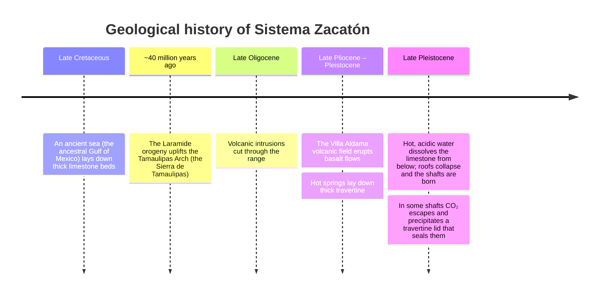
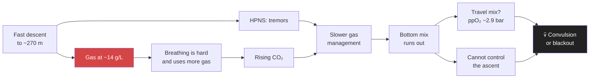

# 🕳️ El Zacatón: the warm-water shaft that swallowed Sheck Exley

### Volcanic origin, divers, records, one death and a NASA robot in the cenote of Aldama (Tamaulipas, Mexico)

> 🇪🇸 **[Versión en castellano](README.md)**

> **Popular-science study** · Author: Óscar Ramírez Martín, an amateur diver researching the case · November 2026
> I am not an expert in technical or cave diving. This work brings together cross-checked public sources and my own calculations with standard formulas, and says at each point what is confirmed and what is not.

> 📄 **PDF version:** [Zacaton_Sheck_Exley_Study.pdf](Zacaton_Sheck_Exley_Study.pdf)

> ⚠️ **A note of respect.** This study deals with the real death of Sheck Exley in 1994. It contains no photographs of his body or of the recovery. The aim is to understand **what Zacatón is and why it is so dangerous**.

> 📚 **Series of studies on diving accidents** by the same author:
> [Blue Hole, Dahab (Yuri Lipski, 2000)](https://github.com/Oskillar28/blue-hole-dahab-yuri-lipski) · [Boesmansgat (Deon Dreyer and Dave Shaw, 1994–2005)](https://github.com/Oskillar28/boesmansgat-deon-dreyer) · **Zacatón (Sheck Exley, 1994)** (this study) · [Plura cave (Norway, 2014)](https://github.com/Oskillar28/plura-cueva-noruega) · [Vaavu cave (Maldives, 2026)](https://github.com/Oskillar28/cueva-vaavu-maldivas)

---

## 📑 Contents

1. [Zacatón in 30 seconds](#1-zacatón-in-30-seconds)
2. [Where it is and what it is like](#2-where-it-is-and-what-it-is-like)
3. [How it formed: a shaft dug by a volcano](#3-how-it-formed-a-shaft-dug-by-a-volcano)
4. [History: from a 75 m sounding to a NASA robot](#4-history-from-a-75-m-sounding-to-a-nasa-robot)
5. [The divers](#5-the-divers)
6. [Every documented dive: good and bad](#6-every-documented-dive-good-and-bad)
7. [6 April 1994: the 1,000-foot day](#7-6-april-1994-the-1000-foot-day)
8. [Why Sheck Exley died: a physical analysis](#8-why-sheck-exley-died-a-physical-analysis)
9. [DEPTHX: the robot that touched the bottom (2007)](#9-depthx-the-robot-that-touched-the-bottom-2007)
10. [Life without light: Zacatón's microbes](#10-life-without-light-zacatóns-microbes)
11. [Is it the deepest in the world? Myths and reality](#11-is-it-the-deepest-in-the-world-myths-and-reality)
12. [Cross-checking sources: figures that disagree](#12-cross-checking-sources-figures-that-disagree)
13. [Photos, maps and videos](#13-photos-maps-and-videos)
14. [Visiting today](#14-visiting-today)
15. [Glossary](#15-glossary)
16. [Conclusions](#16-conclusions)
17. [Method, limits and confidence](#17-method-limits-and-confidence)
18. [Sources](#18-sources)

---

## 1. Zacatón in 30 seconds

| Item | Most reliable value |
|---|---|
| **What it is** | A near-vertical **cenote** (flooded sinkhole) of **warm, acidic** water |
| **Where** | Rancho La Azufrosa, **Aldama** municipality, Tamaulipas (north-east Mexico), ~12 km north-west of the town |
| **Water depth** | **319 m**, measured by the **DEPTHX** robot in May 2007 |
| **Total depth** | ~**335–339 m**, adding the 16–20 m of wall above the water |
| **Diameter** | ~**100–110 m** |
| **Water temperature** | ~**30 °C** all year round |
| **Origin** | **Volcanic**: water loaded with CO₂ and hydrogen sulphide dissolved the limestone from below (Pleistocene) |
| **Human record** | **Jim Bowden**, **282 m** (925 ft), 6 April 1994. Nobody has touched the bottom |
| **Documented death** | **Sheck Exley**, the same day, between **268 and 276 m** |
| **Name** | From the **floating islands of *zacate*** (grass) that the wind pushes across the surface |

**In one sentence:** a shaft of warm, sulphurous water carved by volcanism, which in 1994 saw the scuba depth record and the death of the best cave diver of his time, and which in 2007 helped NASA rehearse how to explore the ocean of one of Jupiter's moons.

---

## 2. Where it is and what it is like

Zacatón is the deepest of a group of shafts known as **Sistema Zacatón**, on **Rancho La Azufrosa**, next to the **Sierra de Tamaulipas**. Wikipedia describes it as the only one of the ranch's five sinkholes with noticeable water flow.

| Feature | Measurement | Source |
|---|---|---|
| Approximate coordinates | 22.993 N · 98.166 W | Wondermondo |
| Diameter | ~105–110 m | NBC/Space.com (105 m), Geo-Mexico (110 m) |
| Dry wall down to the water | 16.5 m (Stone Aerospace) · 20 m (Wikipedia) · 25 m (IEEE Spectrum) | Various |
| Water depth | 318–319 m | DEPTHX (CMU, Stone Aerospace, KARST'08 paper) |
| Bottom | Sloping: from **−276 m** in the south-east corner to **−319 m** in the north-west | Stone Aerospace, 16/05/2007 |
| Bottom relative to the sea | **More than 100 m below sea level** | Gary et al., GSA 2003 |
| Temperature | ~30 °C (NBC); 31 °C (Showcaves) | Various |
| Chemistry | Slightly acidic; CO₂ and hydrogen sulphide (smells of sulphur) | Wikipedia, Gary |
| Outflow | Linked by a passage at ~8 m to **El Nacimiento**, the spring where the river rises | aquaCORPS, Undercurrent |

### 2.1 The neighbours: Sistema Zacatón

| Cenote | Feature | Temperature (Showcaves) |
|---|---|---|
| **El Zacatón** | The deepest (319 m of water) | 31 °C |
| **La Pilita** | Over 100 m deep, bottle-necked; where DEPTHX trained | 34 °C (the warmest) |
| **Caracol** | The smallest, conical, turquoise blue | 30 °C |
| **Poza Verde** | The widest (~150 m); the only non-acidic one; swimming allowed | 28 °C, with thermoclines |
| **La Azufrosa** | Gives the ranch its name | 31 °C |
| **Poza Seca** and others | Sealed by a **travertine lid**: hidden lakes below | — |

> 🧠 **Reasoning:** the press talks about "five interconnected cenotes", but in 2007 DEPTHX found that Zacatón has **no tunnels** to its neighbours. What is proven is its shallow link to the El Nacimiento spring. *Confidence 0.8.*

---

## 3. How it formed: a shaft dug by a volcano

Most cenotes (those in Yucatán, for example) form **from the top down**: slightly acidic rainwater dissolves the limestone and the roof collapses. Zacatón formed **from the bottom up**. Hydrogeologist **Marcus Gary** (University of Texas) calls this **volcanogenic karstification**, a type of **hypogenic karst**.



**The four ingredients** of Gary's model:

1. A soluble rock: Cretaceous **limestone**.
2. **Fractures** for the water to flow through.
3. **Volcanism**, which adds **CO₂** and **hydrogen sulphide (H₂S)** to the deep water and makes it acidic. The H₂S oxidises into **sulphuric acid**.
4. **Groundwater flow**: rain falling on the Sierra de Tamaulipas runs down through the limestone to the volcanic zone, where it mixes with hot, mineralised water. That **mixing zone** is especially aggressive towards the rock.

Evidence in support:

- The bottom lies **more than 100 m below sea level**, too deep for normal dissolution from the surface.
- The surface rock is hot-spring **travertine** containing Pleistocene **mammoth fossils**.
- Strontium isotopes in the water do not match limestone alone; they point to a volcanic input.
- In 2006, **electrical resistivity** imaging detected **large water-filled voids under travertine lids**, such as the one at Poza Seca.

> 🔍 **Comparison:** Gary proposed that Zacatón has more in common with **Mammoth Hot Springs** (Yellowstone) than with other Mexican sinkholes, and that **Pozzo del Merro** (Italy, 392 m) formed in a similar way: limestone next to Pleistocene volcanic rocks.

*Confidence in the volcanic model: 0.8. It is the hypothesis of the person who has studied the system most, published in scientific papers and in his doctoral thesis, but it rests mainly on the work of one team.*

---

## 4. History: from a 75 m sounding to a NASA robot

| Date | What happened | Source |
|---|---|---|
| **1795** | First written mention, by the soldier **Félix María Calleja** (later viceroy of New Spain) | Showcaves *(single source; confidence 0.4)* |
| **1989** | **Jim Bowden**'s team, exploring the Nacimiento Santa Clara cave, spots the group of shafts on **topographic maps** | aquaCORPS, Showcaves, Undercurrent |
| **April 1990** | The ranch owner gives permission to dive | Showcaves |
| **1990** | **Gary Walten** and **Ann Kristovich** drop a sounding line: it reads **75 m**. It was resting on a ledge, not the bottom | aquaCORPS |
| **2 May 1990** | **Bowden and Walten** enter through El Nacimiento, follow a ~180–220 m passage and come out into Zacatón at **8 m** | Undercurrent, aquaCORPS, Popular Science |
| **April 1993** | First deep dives with **Sheck Exley**. The next day, a sounding swallows more than **1,000 ft** of line: the bottom is at ~**329 m** | Undercurrent, aquaCORPS |
| **2 Sept 1993** | **Ann Kristovich**: **169 m**, women's world record | aquaCORPS |
| **1993–1994** | Six trips to Mexico and seven dives below 152 m in twelve months | Undercurrent |
| **6 April 1994** | **Bowden** reaches **282 m** (world record). **Exley** dies | All |
| **1995** | Bowden prepares another attempt with a decompression habitat. He aborts several times because of technical problems and **gives up** the project | aquaCORPS/TDI |
| **1994–2000** | **Marcus Gary**, who was on the 1994 support team, starts studying the system with Bowden and Kristovich | Gary, AMCS Activities Newsletter 24 |
| **2002** | First 3D mapping trials and the article *Demystifying El Zacatón* (Astrobiology Magazine) | Wikipedia, mexicancaves.org |
| **June 2006** | Electrical resistivity survey: hidden lakes under travertine lids | GSA 2006 |
| **Jan–Mar 2007** | DEPTHX trains in **La Pilita** | Stone Aerospace |
| **May 2007** | **DEPTHX** descends into Zacatón and finds the bottom at **318–319 m** | CMU, Stone Aerospace, UT Austin |
| **2010** | Gary's thesis published as *AMCS Bulletin 21*; Sahl et al. paper on the microbes (*Astrobiology*) | AMCS, CMU |

> 🧠 **Reasoning:** the 1993 sounding (~329 m) came very close to the robot's figure (319 m). The difference fits a line that does not hang straight and a sloping bottom. *Confidence 0.7.*

---

## 5. The divers

| Person | Role | Key fact |
|---|---|---|
| **Jim Bowden** (USA) | Discoverer and leader of the *Proyecto de Buceo Espeleológico México y América Central* | **282 m** in 1994: the first scuba diver beyond 900 ft. His dive inspired the opening chapter of the novel *Yucatan Deep* (Tom Morrisey, 2002) |
| **Sheck Exley** (USA, 1949–1994) | Cave-diving pioneer; maths teacher in Live Oak (Florida) | First person to log 1,000 cave dives; more than 4,000 in 29 years. Died in Zacatón aged 45 |
| **Dr Ann Kristovich** (USA) | Co-discoverer; diver and support | **169 m** on 2/9/1993, women's record. Co-author of the medical report on Exley's death |
| **Gary Walten** | Early exploration | Found the passage from El Nacimiento with Bowden (1990) |
| **Mary Ellen Eckhoff** | Exley's partner, support in 1994 | Deepest woman before Kristovich (122 m at Mante, 1987) |
| **Karen Hohle** | Bowden's safety diver | In the water on 6/4/1994 |
| **Liz Hunt** | Diver on the 2000 science trips | Deep training dives |
| **Marcus Gary** | Hydrogeologist, support in 1994 and DEPTHX science coordinator | Author of the volcanic explanation of the system |
| **Bill Stone** | Engineer and cave diver; Stone Aerospace | DEPTHX principal investigator |

---

## 6. Every documented dive: good and bad

> ⚠️ **Important limit:** there is **no public log** of every dive in Zacatón. This table lists **the dives that appear in cross-checked sources**. There were more support, cylinder-staging and sampling dives that are not recorded in detail.

**Key:** ✅ no incident · ⚠️ injury · ❌ fatal

| # | Date | Diver | Depth | Gas | Outcome |
|---|---|---|---|---|---|
| 1 | 2/5/1990 | Bowden and Walten | 8 m (link from El Nacimiento) | Air | ✅ |
| 2 | Apr 1993 | Bowden | 79 m (258 ft) | Air | ✅ |
| 3 | Apr 1993 | Exley | 124 m (407 ft), without seeing the bottom | Air | ✅ |
| 4 | 1993 | Bowden | 154 m (504 ft) | Trimix | ✅ |
| 5 | 1993 | Exley | 220 m (721 ft) | Trimix | ✅ |
| 6 | 2/9/1993 | **Kristovich** | **169 m** (554 ft), women's record, ~4 h | Air → trimix (heliair 9.5) | ✅ |
| 7 | 2/9/1993 | Bowden | 227 m (744 ft) | Trimix | ✅ |
| 8 | Before Apr 1994 | Bowden | 125 m (411 ft), acclimatisation | Air | ✅ |
| 9 | 4/4/1994 | Exley | 128 m (420 ft), acclimatisation | Air | ✅ |
| 10 | **6/4/1994** | **Bowden** | **282 m** (925 ft), world record | Trimix | ⚠️ Nearly ran out of gas; ~10 h of decompression; **decompression sickness** in the left shoulder, treated in the water |
| 11 | **6/4/1994** | **Exley** | **268–276 m** | Trimix | ❌ **Dies** |
| 12 | 1995 | Bowden | Two dives below 152 m | Trimix | ✅ (final attempt aborted) |
| 13 | 2000 | Bowden, Kristovich, Hunt, Gary | Science and training dives | Various | ✅ |
| 14 | 2007 | **DEPTHX robot** (no people) | **318–319 m**, the bottom | — | ✅ About 50 robot dives in total, according to LiveScience |

### 6.1 Tally

| | Number |
|---|---|
| Human dives documented in detail | ~13 |
| Without incident | 11 |
| With serious injury | **1** (Bowden, 1994) |
| Fatal | **1** (Exley, 1994) |
| People who have touched the bottom | **0** (only the robot) |

> 🔍 **Check:** a tourism website (Mexican Routes) claims that "several divers have died" in Zacatón. **I found no other documented death.** Every serious source (University of Texas, NBC, Undercurrent, Wikipedia) mentions **one** death. *Confidence that only one death is documented: 0.85.*

> 🧠 **Reasoning:** "good and bad" is a little misleading. Of the two 1994 dives, the "good" one nearly ended in death too: by the time he reached 137 m on the way up, Bowden had emptied his bottom and travel mixes, and he had to breathe by opening and closing the valve of a cylinder whose regulator was free-flowing. **Both dives below 260 m ended with one injured and one dead.**

---

## 7. 6 April 1994: the 1,000-foot day

### 7.1 The plan

- **Goal:** pass **300 m** (1,000 ft) and try to touch the bottom.
- **Two separate lines** about 8–9 m apart. Each man descended **alone**, unable to see or help the other.
- **Fast descent:** 10–12 minutes to the planned bottom, slowing near 229 m because of the risk of **HPNS**, which both had felt before.
- **Gases:** air to 92 m; trimix 10.5/50 travel mix to ~177 m; then a bottom mix with only **6 % oxygen** (Exley: trimix 6/29; Bowden: trimix 6.4/31).
- The decompression cylinders (air, nitrox, argon-oxygen and oxygen) were staged on the lines **during the two days before**.

### 7.2 What happened

They started down at 9:50 am. At around 268 m Bowden found he had far less gas than planned (1,000 psi instead of 1,800) and turned at 282 m. On the way up, at 40 m, he saw Exley's decompression cylinders unused and assumed Exley was still deeper. Exley never came back. Bowden surfaced about 10 hours later with a decompression injury in his shoulder.

```mermaid
timeline
    title 6 April 1994
    9:50 am : Bowden and Exley wish each other luck and start down
    ~2 min : Both bubble trails disappear at the 76 m ledge
    ~244 m : Bowden last sees Exley's light in the distance
    ~268 m : Bowden checks his gas. He expected 1,800 psi and has 1,000
    282 m : Bowden turns the dive. World record
    Ascent : By 137 m he has emptied his bottom and travel mixes
           : At 40 m he sees Exley's unused cylinders on his line and assumes Exley is still deeper
    ~18 min : The surface team stops seeing Exley's bubbles (according to the medical report)
    ~47 min : Kristovich goes down to meet Bowden and finds Exley's cylinders untouched
    ~10 h later : Bowden surfaces with a decompression injury in his shoulder
```

### 7.3 The recovery

- **Nobody went down to look for him.** The only person able to reach that depth was Bowden, who was decompressing.
- **Two or three days later** (sources disagree), while **hauling up the line** with the decompression cylinders, the crew found Exley's body **wrapped in the line**: several turns around his arms and the valves of his side cylinders.
- His back cylinders read **500 psi** (nearly empty); one side cylinder had its regulator unclipped at 500 psi and the other was **full (3,600 psi)** with its regulator stowed.
- His BC worked and held gas. His mask was in place; **there was no regulator in his mouth**.
- The autopsy **explained nothing**: several days had passed.

> 🧭 **The wrapped line.** Bowden, Gilliam and other experts believe Exley wrapped himself deliberately, perhaps to steady himself or as a "last resort", so that his body could be recovered **without anyone having to go down for it**. It is a hypothesis (*confidence 0.5*). Eleven years later, Dave Shaw died in Boesmansgat doing exactly that: trying to recover a body from ~270 m.

Local people placed a **simple cross with flowers** by the cenote.

---

## 8. Why Sheck Exley died: a physical analysis

### 8.1 What the medical report says

The analysis published in 1994 in *Pressure*, the newsletter of the Undersea and Hyperbaric Medical Society, by **Hamilton, Daughtery, Kristovich and Bowden**, concludes:

> The cause **is not clear**. Most likely Exley **fell behind on gas management**, ran out of bottom mix and **could not control his buoyancy to ascend**. **HPNS** stress, **narcosis**, **CO₂** build-up and **excess oxygen** contributed, until he lost consciousness. A mechanical failure (a free-flowing regulator) or a medical problem **cannot be ruled out**.

### 8.2 The numbers (my own calculation)

Pressure in fresh water at sea level: *P ≈ 1.013 + 0.0979 × depth (m)*. Water temperature: 30 °C.

| Gas | At 268 m (27.3 bar) | At 282 m (28.6 bar) | Reference limit |
|---|---|---|---|
| **Exley's bottom mix** (trimix 6/29) · ppO₂ | 1.64 bar | 1.72 bar | 1.4–1.6 bar |
| · Density | **13.7 g/L** | 14.4 g/L | **6.2 g/L maximum** |
| **Travel mix** (trimix 10.5/50) · ppO₂ | **2.86 bar** | 3.01 bar | High risk of convulsions |
| · Density | 17.8 g/L | 18.6 g/L | 6.2 g/L |
| **Air** · density | 31.2 g/L | 32.8 g/L | — |

*My own calculation using the ideal gas law. My ppO₂ for the travel mix (2.86 bar) matches the medical report's (~2.9 atm), which validates the method. For narcosis, my equivalent-depth figure is somewhat higher than the report's (~92 m against 74 m) because different conventions are used.*

### 8.3 What it means

1. **The gas was more than twice as dense as today's maximum limit.** At ~14 g/L, breathing is exhausting work. **CO₂** builds up even when there is plenty of gas. It is the same physics that killed Dave Shaw in Boesmansgat in 2005, but **even more extreme**: Shaw's gas was ~9.7 g/L.
2. **The gas runs out in minutes.** At 296 m, a standard 72 cu ft cylinder gives **less than 2.5 usable cubic feet**, about **2–3 minutes** of breathing. Bowden used far more than planned; it is reasonable to think Exley did too.
3. **The travel-mix trap.** If Exley emptied his bottom mix and switched to the travel mix (10.5/50), he was breathing almost **3 bar of oxygen**: a **convulsion** or **blackout** is very likely.
4. **HPNS** (tremors from descending fast on helium) had affected him in Boesmansgat in 1993. Strong tremors make it very hard to switch cylinders.



| Link | Verified? | Confidence |
|---|---|---|
| Gas far denser than today's limit | Calculated from the published mixes | 0.9 |
| Higher gas consumption than planned | It happened to Bowden in the same conditions | 0.7 |
| He ran out of bottom mix | Back cylinders at 500 psi | 0.75 |
| HPNS as a factor | History in 1993; symptoms anticipated in the plan | 0.6 |
| Oxygen toxicity on the travel mix | Consistent, not proven | 0.5 |
| Equipment failure | Cannot be ruled out | 0.2 |

> 🧠 **Reasoning:** Exley wrote the manual that spread rules such as the rule of thirds. But that rule assumes that **you can breathe the gas you have left** and that there is time to use it. At 270 m and ~14 g/L, every minute costs whole cylinders and the body cannot get rid of CO₂. **No rule makes up for that physics.**

---

## 9. DEPTHX: the robot that touched the bottom (2007)

| Item | Value |
|---|---|
| Name | **DEPTHX** (*DEep Phreatic THermal eXplorer*) |
| Purpose | Test a robot able to explore the **ocean beneath the ice of Europa**, a moon of Jupiter |
| Funding | NASA, ASTEP programme; ~US$5 million over 3.5 years (CMU) |
| Team | **Stone Aerospace** (Bill Stone), **Carnegie Mellon** (navigation and mapping), Southwest Research Institute (arm and cameras), Colorado School of Mines (microbiology), UT Austin (geology, Marcus Gary), University of Arizona, UANL and Universidad del Noreste |
| Shape and mass | Ellipsoid ~2 × 1.5 m; **1.35 t** (Stone) or ~1.5 t (NASA) |
| Equipment | **54 sonars**, more than 100 sensors, 36 computers, ~100,000 lines of code, an arm to sample the walls |
| What was new | First real use of **3D SLAM**: the robot builds the map as it navigates and uses it to return |

**The three campaigns:**

1. **January–February 2007:** tests in La Pilita, on a tether.
2. **March 2007:** more tests in La Pilita, now untethered.
3. **May 2007:** Zacatón. On 16 May the robot's sonars see the bottom at **−319 m**. It slopes down from −276 m (south-east) to −319 m (north-west), where there is an **alcove** that may be the source of the hot water.

**Results:**

- Bottom at **318–319 m** of water (339 m including the wall, according to the KARST'08 paper).
- **No side tunnels were found**: Zacatón does not connect underwater with the neighbouring cenotes.
- 3D maps of Zacatón, Caracol, Poza Verde and La Pilita.
- Samples of the water and of the **microbial mat** on the walls.

> 🔍 Divers with closed-circuit helium rescue gear could only recover the robot down to **200 m**. Below that, any error meant **losing it for ever**. Not even a NASA robot approached the bottom without fear.

The same technology was later used in the **ENDURANCE** project under the ice of Lake Bonney (Antarctica).

---

## 10. Life without light: Zacatón's microbes

- The water is warm, lacks dissolved oxygen at depth and is rich in **sulphur** compounds, which serve as **food** for some microbes (chemosynthesis).
- The walls are covered in **microbial mats** (a slimy layer of bacteria).
- The study by **Sahl et al. (2010, *Astrobiology* 10(2): 201–213)**, using DEPTHX samples, found **more than 100 types of microbes**, including **three bacterial phyla never described before**.
- That is why astrobiologists care: if there is life in a dark, hot, sulphurous shaft, there could be life in similar places on other worlds.

> ⚠️ Some Mexican press reports mention "nine new species". This **does not match** the scientific paper, which talks about phyla (a classification level far above species). The paper's figure is used here.

---

## 11. Is it the deepest in the world? Myths and reality

| Myth | Reality | Confidence |
|---|---|---|
| "It is the deepest flooded pit in the world" | **Not any more.** **Hranice** (Czech Republic) exceeds **450 m** of water (UX1-Neo robot, 2022) and **Pozzo del Merro** (Italy) is **392 m**. Zacatón (319 m) is one of the deepest and perhaps the deepest **cenote** | 0.85 |
| "It is 380 m deep" or "over 360 m" | The robot measured **319 m of water** and ~335–339 m in total | 0.9 |
| "Five cenotes connected by tunnels" | DEPTHX **found no side tunnels**. There is a shallow passage to El Nacimiento | 0.8 |
| "Beyond 150 m, tunnels connect it to the whole cave network" | Contradicted by the robot's map | 0.8 |
| "Exley died touching the bottom" | He reached 268–276 m; the bottom under his line was deeper | 0.85 |
| "Bowden reached the bottom" | He turned at 282 m for lack of gas, **without seeing it** | 0.95 |
| "Several divers have died" | Only **one** death is documented | 0.85 |
| "NASA used it to go to Jupiter" | It used it to **test** a robot meant for a future mission to **Europa**, a moon of Jupiter | 0.9 |

---

## 12. Cross-checking sources: figures that disagree

| Item | Version A | Version B | Most likely |
|---|---|---|---|
| Exley's maximum depth | **276 m** (906 ft): Undercurrent, Wikipedia *Sheck Exley* | **268 m** (879 ft): medical analysis in *Pressure* | **Range 268–276 m**, as in Wikipedia *Zacatón*. The medical report itself cites an earlier report giving 904 ft (275.5 m) |
| Bowden's depth | **282 m** (925 ft): almost all | 274 m (898 ft) in the medical analysis; 276 m in aquaCORPS (a wrong conversion of 925 ft) | **282 m**, the record figure |
| When the body was found | 2 days later: *Pressure* | 3 days later: Undercurrent | **8 or 9 April 1994** |
| When Exley's bubbles stopped | ~18 min: *Pressure* | A few seconds after Bowden's, around 2 min, at the 76 m ledge: Kristovich, in Undercurrent | **Cannot be resolved**; bubbles are lost at the ledge |
| Water depth | 319 m (Stone, KARST'08) | 318 m (CMU, Sahl) | **318–319 m** |
| Total depth | 335 m (319 + 16.5) | 339 m (319 + 20) | **~335–339 m**, depending on water level |
| Diameter | 105–110 m (NBC, Geo-Mexico, CMU) | 140 m (Mexican Routes) | **~105–110 m** |
| Temperature | 30 °C (NBC) | 31 °C (Showcaves) | **~30–31 °C** |
| DEPTHX mass | 1.35 t (Stone Aerospace) | ~1.5 t / 3,300 lb (NASA release) | **1.35–1.5 t** |
| New microbes | 3 new phyla (*Astrobiology*) | 9 new species (*El Cronista*) | **3 phyla** |
| Year divers discovered it | 1989 (aquaCORPS, Showcaves, Popular Science) | 1990 (dives and link) | **Identified in 1989; dived from 1990** |
| Number of cenotes in the system | 5 (press) | 8 (Posta) / more than 20 karst features (Gary) | **Depends on what is counted** |

> ℹ️ **Note for the Boesmansgat study:** there, the 276 m reading from Exley's computer and the recovery of his body on 9 April were given as single facts. With the sources of this study, the accurate wording is **268–276 m** and **8 or 9 April**.

---

## 13. Photos, maps and videos

> ⚠️ No photos are embedded in this document because I could not check their licences. These links point to the original sources. **No material showing Exley's body is linked.**

### 13.1 Photos and maps

| Resource | What it contains |
|---|---|
| [Wikipedia: *Zacatón*](https://en.wikipedia.org/wiki/Zacat%C3%B3n) | Photos of the cenote, the *zacate* islands (2010), another shaft in the system (2013) and DEPTHX; a profile of the shaft |
| [Stone Aerospace: DEPTHX field notes](https://stoneaerospace.com/category/depthx/) | Dozens of photos from May 2007 (José Antonio Soriano): the cenote, the 60 t crane, the floating platform and the robot |
| [Stone Aerospace: DEPTHX description](https://stoneaerospace.com/depthx/) | Diagrams of the robot and its sonar, and 3D maps of Zacatón |
| [Gary (2010), *AMCS Bulletin 21* (free PDF)](https://digitalcommons.usf.edu/cgi/viewcontent.cgi?article=3979&context=kip_articles) | The full thesis: photos of every cenote, El Nacimiento and Cueva de los Cuarteles; maps and profiles |
| [Gary's Figure 18 (ResearchGate)](https://www.researchgate.net/figure/maximUm-depths-reached-By-scUBa-in-el-ZACATON-This-profile-and-aerial-view-of-the_fig4_280491806) | Profile of Zacatón showing where Bowden's and Exley's lines hung and their maximum depths |
| [Sistema Zacatón maps (mexicancaves.org, PDF)](https://www.mexicancaves.org/maps/3254.pdf) | Colour plans and profiles of Zacatón, Caracol, Poza Verde and La Pilita |
| [NBC News: *Deep-diving robot finds microbial zoo*](https://www.nbcnews.com/id/wbna38585035) | Photo of DEPTHX entering the water beside a kayak (John Spear) |
| [Wondermondo: *El Zacatón sinkhole*](https://wondermondo.com/el-zacaton-sinkhole) | Photos and a composite profile with the DEPTHX map |
| [Popular Science: *DepthX: Mission 1 Accomplished*](https://www.popsci.com/military-aviation-space/article/2007-03/depthx-mission-1-accomplished) | Photos of the first test and of El Nacimiento |

### 13.2 Videos

Checked in November 2026 (title and channel confirmed on YouTube):

| Video | Channel · language | What it adds |
|---|---|---|
| 🎬 [*3D maps produced by DEPTHX of the Zacatón Cenote System*](https://www.youtube.com/watch?v=KHEQfaqYkwI) | **Stone Aerospace** (original source) · English | A tour of the robot's 3D maps. **The most reliable** |
| 🎬 [*La última inmersión de la leyenda Sheck Exley*](https://www.youtube.com/watch?v=XznOAbeYGC4) | Aterrador y Fascinante · Spanish | The 1994 day: plan, cylinders, search and recovery |
| 🎬 [*Sheck Exley: su último descenso a 270 metros*](https://www.youtube.com/watch?v=ZYQts00VPBM) | Archivo Subterráneo · Spanish | The rule of thirds and why it is not enough at that depth |
| 🎬 [*The Zacatón Cave Diving Disaster*](https://www.youtube.com/watch?v=VzRHoe9k-c0) | Disasterthon · English · 2021 · ~8 min | A short summary of Exley's life and death |
| 🎬 [*El cenote más profundo del mundo está en México: El Zacatón*](https://www.youtube.com/watch?v=w8_uQKZsCS0) | Popurrí de Viajes · Spanish | A tourist visit: the cenote and El Nacimiento |
| 🎬 [*El Zacatón, el cenote más profundo del mundo*](https://www.youtube.com/watch?v=b85IKZvot1I) | Sergio Cervantes · Spanish | Footage of the cenote and its surroundings |
| 🎬 [*Este es el cenote más profundo del mundo: El Zacatón*](https://www.youtube.com/watch?v=gFeJpJSyNWM) | Rofer · Spanish | A visit and an explanation of the NASA work |

Others:

- *Cave Diving Depth Record Gone Wrong | The Zacaton Sinkhole Incident*, from the **Scary Interesting** channel (English, 17/12/2023). I could not find the direct link; search for the title on YouTube.
- [*The Legend Who Chose to Die at 900 Feet*](https://www.youtube.com/watch?v=KtPZujNwOl8) (Waterline Stories), cited in the Boesmansgat study: **I could not confirm today that it is still available**.

> ⚠️ **The videos contain errors.** Some tourism videos give 360 or 380 m, and others round Exley's depth to 270 m. This study uses the figures from written sources.

---

## 14. Visiting today

- **Getting there:** from Tampico take Highway 80 to Estación Manuel, then Highway 180 towards Aldama–Soto la Marina; the cenote route starts at **ejido El Nacimiento**.
- **What you can do:** according to the tourism press, **swimming is not allowed** in Zacatón; it is viewed from a **lookout** and **kayaking** is allowed. To swim, go to **Poza Verde**.
- **Diving:** only with permits, for technical or scientific diving.

*Confidence 0.6: the rules are set by the owner and local authorities and may change. Ask Tamaulipas Tourism before you go.*

---

## 15. Glossary

| Term | Meaning |
|---|---|
| **Cenote** | From the Maya *dz'onot*, "hole": a natural flooded shaft in limestone |
| **Karst / karstification** | Landscape and process of dissolving rocks such as limestone |
| **Hypogenic karst** | Caves formed **from below** by deep, hot or acidic water, not by rain |
| **Volcanogenic karstification** | Dissolution driven by volcanic CO₂ and H₂S (Gary's model) |
| **Travertine** | Limestone that precipitates at hot springs as CO₂ escapes |
| **Zacate** | Mexican name for several grasses |
| **Trimix / heliair** | Mixes of oxygen, helium and nitrogen. "6/29" = 6 % oxygen and 29 % nitrogen (the rest helium) |
| **ppO₂** | Partial pressure of oxygen; above ~1.6 bar it can cause convulsions |
| **Gas density** | Mass per litre (g/L). Above 6.2 g/L, breathing under effort builds up CO₂ |
| **HPNS** (high-pressure nervous syndrome) | Tremors, nausea and disturbances when descending fast below ~150 m on helium |
| **Narcosis** | Anaesthetic effect of gases under pressure, similar to drunkenness |
| **Decompression sickness** | Gas bubbles in the body on ascent; joint pain, paralysis or death |
| **SLAM** | Technique a robot uses to build a map and locate itself in it at the same time |
| **Phylum** | A major group in the classification of living things, far above species |

---

## 16. Conclusions

1. **Zacatón is unusual because of its origin.** It is not a Yucatán cenote: it was dug **from below**, by hot, acidic water of volcanic origin. That explains its vertical-shaft shape, its temperature, its sulphur smell and its travertine lids.
2. **No person has reached the bottom.** A NASA robot did in 2007: **319 m**. The human record is still Bowden's **282 m** (1994).
3. **Two extreme dives, one dead and one injured.** The dives down to 220 m went well. The two that went beyond 260 m ended with Exley dead and Bowden injured.
4. **Physics rules.** At 270 m the gas was more than twice today's safety limit and was being used at an impossible rate. The best cave diver in the world had no margin.
5. **No buddy, no rescue.** Descending alone on separate lines was a conscious choice, but it meant that if anything went wrong, **nobody could help**.
6. **Much of what is published is wrong.** Zacatón is **no longer** the deepest flooded pit in the world, it is not 380 m deep and there is no evidence of "several deaths".
7. **Its legacy is scientific.** It made it possible to test autonomous 3D navigation, it revealed three bacterial phyla, and it improved our understanding of how volcanism can dig caves.

---

## 17. Method, limits and confidence

**How it was done:** the subject was split into parts (geology, history, divers, dives, accident, robot, microbes, myths). Each fact was cross-checked in at least two sources where possible. Feet-to-metre conversions and the pressure, ppO₂ and gas-density calculations were done in Python.

**Limits:**

- There is no complete log of dives in Zacatón; the table in §6 covers only documented dives.
- I did not read the original *Pressure* report, only its reproduction by IUCRR.
- I could not check photo licences or open Wikimedia Commons, so photos are only linked.
- The 1795 mention comes from a single source.
- The current visiting rules come from the tourism press.

| Block | Confidence |
|---|---|
| Geography and robot measurements | 0.9 |
| Volcanic formation model | 0.8 |
| Exploration timeline (1989–1995) | 0.85 |
| Data on the 1993–1994 dives | 0.8 |
| Cause of Exley's death | 0.6 |
| Physics calculations | 0.9 |
| Current visiting rules | 0.6 |

---

## 18. Sources

**The 1994 accident and the dives**

- Hamilton, R. W.; Daughtery, G.; Kristovich, A.; Bowden, J. (1994). *What happened to Sheck Exley?* *Pressure* (UHMS). Reproduced by IUCRR: https://iucrr.org/accident-analysis/articles/miscellaneous-incidents/
- Gilliam, B. (15/11/2013). *Zacaton: The Tragic Death of Sheck Exley*. **Undercurrent**. https://www.undercurrent.org/blog/?p=1553
- Menduno, M. (1995). *Absolutely Risky Business* (interview with Jim Bowden). aquaCORPS No. 11, reprinted by TDI. https://www.tdisdi.com/aquacorps/jim-bowden/
- *Dr. Ann: Zacatón Explorers*. aquaCORPS No. 11 (PDF at InDepth). https://indepthmag.com/wp-content/uploads/2021/03/Dr.-Ann-Zacaton-Explorers.aquaCorps_N11_Final-1-1.pdf
- *Eulogy for an Explorer* (Northwestern University). https://sites.northwestern.edu/monroyrios/resources/sheck_exley
- **Valdosta Daily Times** (2019). *Remembering Suwannee: Exley dies attempting world record dive*. https://valdostadailytimes.com/?p=510594
- Wikipedia (en). *Sheck Exley*, *Jim Bowden (diver)*, *Zacatón*.

**Geology**

- Gary, M. O.; Sharp, J. M. (2006). *Volcanogenic karstification of Sistema Zacatón, Mexico*. GSA Special Paper 404. https://www.jsg.utexas.edu/gary/files/Gary_and_Sharp2006.pdf
- Gary, M. O. (2010). *Karst Hydrogeology and Speleogenesis of Sistema Zacatón*. AMCS Bulletin 21. https://www.mexicancaves.org/bul/bul21.html
- Gary, M. O. *Geology* (UT Austin). https://www.jsg.utexas.edu/gary/geology
- Gary, M. O. et al. (2003). *Volcanically influenced speleogenesis: forming El Sistema Zacatón, Mexico and Pozzo Merro, Italy*. GSA. https://gsa.confex.com/gsa/2003AM/webprogram/Paper62638.html
- Gary, M. O. et al. (2006). *Electrical resistivity imaging of travertine-capped sinkholes*. GSA. https://gsa.confex.com/gsa/2006AM/webprogram/Paper111256.html
- Showcaves. *Cenote Zacatón*. https://showcaves.com/english/mx/karst/Zacaton.html

**DEPTHX and microbiology**

- Gary, M. et al. (2008). *3D Mapping and Characterization of Sistema Zacatón from DEPTHX*. ASCE, KARST'08. https://ascelibrary.com/doi/10.1061/41003%28327%2920
- Stone Aerospace. *DEPTHX* and field notes. https://stoneaerospace.com/depthx/ · https://stoneaerospace.com/category/depthx/
- Carnegie Mellon / Phys.org (2007). *NASA-funded robotic sub finds bottom of world's deepest sinkhole*. https://phys.org/news/2007-05-nasa-funded-robotic-bottom-world-deepest.amp
- UT Austin, Jackson School (14/05/2007). *NASA-funded Robotic Sub Makes Final Dive*. https://www.jsg.utexas.edu/news/2007/05/robotic-sub-earths-deepest-sinkhole/
- SwRI (2007). *NASA robot uses SwRI-developed tools to sample life deep underwater*. https://www.swri.org/newsroom/press-releases/nasa-robot-uses-swri-developed-tools-sample-life-deep-underwater
- IEEE Spectrum. *Swimming to Europa*. https://spectrum.ieee.org/swimming-to-europa
- Sahl, J. et al. (2010). *Novel Microbial Diversity Retrieved by Autonomous Robotic Exploration of the World's Deepest Vertical Phreatic Sinkhole*. *Astrobiology* 10(2): 201–213. https://ri.cmu.edu/?p=120357
- NASA Astrobiology (2010). *Diving Robot Discovers Life in the Slow Lane*. https://astrobiology.nasa.gov/news/diving-robot-discovers-life-in-the-slow-lane/
- NBC News (2010). *Deep-diving robot finds microbial zoo in sinkhole*. https://www.nbcnews.com/id/wbna38585035

**Comparison with other shafts**

- Wikipedia (en). *Hranice Abyss*, *Pozzo del Merro*.
- Eos (AGU). *World's deepest freshwater cave may be a kilometer deep*. https://eos.org/research-spotlights/worlds-deepest-freshwater-cave-may-be-a-kilometer-deep

**Tourism and Mexican press**

- México Desconocido. *El Zacatón es el cenote más profundo del mundo*. https://www.mexicodesconocido.com.mx/cenote-el-zacaton.html
- *El Cronista*. *Este cenote es conocido como las puertas del inframundo*. https://www.cronista.com/mexico/vida-estilo/este-cenote-es-conocido-como-las-puertas-del-inframundo-tiene-mas-de-300-metros-de-profundidad-y-sus-aguas-son-sulfurosas
- *Por Esto!* (2022). *No solo Yucatán tiene cenotes*. https://www.poresto.com/yucatan/2022/4/25/no-solo-yucatan-tiene-cenotes-conoce-el-mas-profundo-del-planeta.html
- *Posta*. *Ruta de los cenotes en Tamaulipas*. https://www.posta.com.mx/tamaulipas/en-este-verano-conoce-la-ruta-de-los-cenotes-en-tamaulipas/vl2076918
- Geo-Mexico. *El Zacatón*. https://geo-mexico.com/?p=899
- MexConnect. *Mexico has the deepest water-filled sinkhole in the world*. https://www.mexconnect.com/articles/3026-did-you-know-mexico-has-the-deepest-water-filled-sinkhole-in-the-world-in-tamaulipas/

**Books**

- Exley, S. (1994). *Caverns Measureless to Man*. Cave Books.
- Exley, S. (1986). *Basic Cave Diving: A Blueprint for Survival*. NSS.
- Morrisey, T. (2002). *Yucatan Deep* (a novel inspired by Bowden's dive).

---

> **Licence:** original text and diagrams under **CC BY-SA 4.0**.

*In memory of Sheck Exley (1949–1994).*
