# 🚂 SS Thistlegorm: el museo de la Segunda Guerra Mundial en el fondo del mar Rojo

### El barco, el bombardeo de 1941, Cousteau, el redescubrimiento, millones de inmersiones, la vida que lo cubre, cómo se está deshaciendo y si se debería subir algo a la superficie

> 🇬🇧 **[English version](README.en.md)**

> **Estudio divulgativo** · Autor: Óscar Ramírez Martín, buceador aficionado que investiga · Noviembre 2026
> No soy arqueólogo ni biólogo marino. Este trabajo reúne fuentes públicas contrastadas (artículos científicos, prensa de buceo, Wikipedia y webs de proyectos), cálculos propios con fórmulas estándar y un razonamiento por partes. En cada punto indico qué está confirmado y con qué confianza (0–1).

> ⚠️ **Nota de respeto.** El Thistlegorm es la tumba de **nueve hombres** que murieron el 6 de octubre de 1941. Este estudio no anima a tocar ni a llevarse nada del pecio.

> 📚 **Serie de estudios sobre pecios y accidentes de buceo** del mismo autor:
> [RMS Titanic](https://github.com/Oskillar28/titanic-pecio-historia) · [Britannic (Carl Spencer, 2009)](https://github.com/Oskillar28/britannic-carl-spencer) · **SS Thistlegorm** (este estudio) · [Blue Hole de Dahab](https://github.com/Oskillar28/blue-hole-dahab-yuri-lipski) · [Boesmansgat](https://github.com/Oskillar28/boesmansgat-deon-dreyer) · [Zacatón](https://github.com/Oskillar28/zacaton-cenote-mexico) · [Cueva de Plura](https://github.com/Oskillar28/plura-cueva-noruega) · [Cueva de Vaavu](https://github.com/Oskillar28/cueva-vaavu-maldivas)

  
   <i>El pecio del SS Thistlegorm, mar Rojo (Egipto), 29/3/2022. Foto: Diego Delso, CC BY-SA 4.0, vía Wikimedia Commons.</i>

---

## 📑 Índice

1. [El pecio en 30 segundos](#1-el-pecio-en-30-segundos)
2. [El barco](#2-el-barco)
3. [El último viaje (junio–octubre de 1941)](#3-el-último-viaje-juniooctubre-de-1941)
4. [La noche del 6 de octubre de 1941](#4-la-noche-del-6-de-octubre-de-1941)
5. [La carga: qué llevaba de verdad](#5-la-carga-qué-llevaba-de-verdad)
6. [Cousteau y el primer descubrimiento](#6-cousteau-y-el-primer-descubrimiento)
7. [El redescubrimiento y el boom del buceo](#7-el-redescubrimiento-y-el-boom-del-buceo)
8. [¿Cuántas veces se ha buceado?](#8-cuántas-veces-se-ha-buceado)
9. [Las expediciones científicas: lo que se consiguió y lo que no](#9-las-expediciones-científicas-lo-que-se-consiguió-y-lo-que-no)
10. [Cómo es la inmersión hoy](#10-cómo-es-la-inmersión-hoy)
11. [Accidentes y riesgos para el buceador](#11-accidentes-y-riesgos-para-el-buceador)
12. [Animales y «vegetación» del pecio](#12-animales-y-vegetación-del-pecio)
13. [El estado del pecio: cómo se está deshaciendo](#13-el-estado-del-pecio-cómo-se-está-deshaciendo)
14. [Lo que ya se ha llevado la gente](#14-lo-que-ya-se-ha-llevado-la-gente)
15. [¿Se debería tocar o subir algo a la superficie?](#15-se-debería-tocar-o-subir-algo-a-la-superficie)
16. [Contraste de fuentes: datos que no coinciden](#16-contraste-de-fuentes-datos-que-no-coinciden)
17. [Mitos frente a realidad](#17-mitos-frente-a-realidad)
18. [Fotos y vídeos](#18-fotos-y-vídeos)
19. [Glosario técnico](#19-glosario-técnico)
20. [Conclusiones](#20-conclusiones)
21. [Metodología, límites y comprobación de originalidad](#21-metodología-límites-y-comprobación-de-originalidad)
22. [Fuentes](#22-fuentes)

---

## 1. El pecio en 30 segundos

| Dato | Valor más fiable |
|---|---|
| **Barco** | **SS Thistlegorm**, carguero británico armado (no buque de guerra) |
| **Nombre** | En gaélico, «cardo azul» |
| **Construcción** | J.L. Thompson & Sons, Sunderland (Inglaterra). Botado el **9 de abril de 1940** |
| **Eslora** | **126,5 m** |
| **Hundimiento** | **6 de octubre de 1941, hacia la 01:30**, por dos bombas de un Heinkel He 111 alemán |
| **Muertos** | **9** (4 marineros mercantes y 5 artilleros de la Royal Navy) |
| **Dónde** | Estrecho de Gubal, norte del mar Rojo (Egipto), cerca de Sha'ab Ali y a ~40 km de Sharm el-Sheikh |
| **Posición publicada** | 27° 48,849′ N · 33° 55,222′ E (Divernet) |
| **Profundidad** | Fondo de arena a **~30–32 m**; cubierta a ~16–17 m |
| **Primer descubrimiento** | **Jacques-Yves Cousteau**, hacia **1955** (las fechas varían, §16) |
| **Redescubrimiento** | **1992**, gracias a un pescador israelí y al barco de buceo *Poolster* |
| **Fama** | Uno de los pecios más buceados del mundo: **miles a decenas de miles de buceadores al año** |
| **Protección legal** | **Ninguna específica** según el estudio científico más reciente (2025) |

**En una frase:** un carguero que nunca llegó a entregar camiones, motos, fusiles y locomotoras a las tropas británicas en Egipto se ha convertido en un arrecife artificial lleno de vida y en un museo bajo el agua, pero el mismo turismo que lo hace famoso lo está destruyendo poco a poco.

---

## 2. El barco

  
   <i>Vista hacia popa desde la zona del puente. Foto: Woodym555 (Wikipedia en inglés), 2007, CC BY-SA 3.0, vía Wikimedia Commons.</i>

| Dato | Valor | Fuente |
|---|---|---|
| Astillero | J.L. Thompson & Sons, Sunderland, número de astillero 599 | Wikipedia |
| Botadura | 9 de abril de 1940 | Wikipedia, Thistlegorm Project |
| Terminado | 24 de junio de 1940 | Wikipedia |
| Armador | **Albyn Line** (Albyn, Black & Co.), naviera de Sunderland fundada en 1901 | Wikipedia, Thistlegorm Project |
| Financiación | En parte, el **Ministerio de Transporte de Guerra** británico | Wikipedia |
| Arqueo | 4.898 toneladas de registro bruto (TRB) | Wikipedia |
| Medidas | 126,5 m de eslora × 17,7 m de manga | Wikipedia |
| Máquina | Una máquina de vapor de **triple expansión** de 1.850 CV, una hélice | Wikipedia, Divernet |
| Armamento | Un cañón a popa y una ametralladora pesada antiaérea (el calibre varía según la fuente, §16) | Wikipedia, Divernet |

### 2.1 ¿Por qué «SS» y no «HMS»?

**SS** significa *steamship* (buque de vapor). Era un barco **mercante privado**, aunque iba armado para defenderse. Por eso no se llama HMS, que es el prefijo de los buques de la Marina Real. Los artilleros a bordo eran **DEMS**: marinos militares embarcados en mercantes (§19).

### 2.2 Sus viajes anteriores

Antes del último viaje hizo **tres** travesías: a **Estados Unidos** (raíles de acero y piezas de avión), a **Argentina** (grano) y a las **Antillas** (ron). Divernet cita otro orden (África e India). En lo que todas coinciden es en que **no** se hundió en su primer viaje, como a veces se dice en las charlas de buceo. Antes de salir por última vez pasó unos dos meses en reparación en el río Clyde (Glasgow).

---

## 3. El último viaje (junio–octubre de 1941)

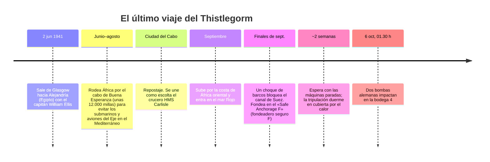

> 🧠 **Razonamiento:** el fondeadero se llamaba «seguro» porque se creía fuera del alcance de los bombarderos alemanes. Pero en 1941 la Luftwaffe ya operaba desde **Creta**, a más de 1.000 km, con aviones capaces de llegar. Un buque grande, quieto y lleno de munición era un blanco ideal. *Confianza 0,8.*

---

## 4. La noche del 6 de octubre de 1941

### 4.1 Por qué atacaron

El espionaje militar alemán (**Abwehr**) creía que un gran **transporte de tropas** —algunas fuentes dicen que el *Queen Mary*— iba a llevar refuerzos a Egipto. La Luftwaffe envió **dos bombarderos Heinkel He 111** del **II./KG 26** desde Creta para buscarlo. No lo encontraron. Uno de ellos, ya corto de combustible, vio los barcos fondeados y eligió **el más grande**: el Thistlegorm.

### 4.2 Qué pasó

| Hecho | Detalle | Confianza |
|---|---|---|
| Hora | ~01:30 del 6 de octubre | 0,9 |
| Bombas | **Dos**, ambas en la **bodega 4**, cerca de popa | 0,9 |
| Explosión | Las bombas incendiaron la **munición** de la bodega 4; la explosión partió el barco | 0,9 |
| Hundimiento | Muy rápido; un testigo del *Carlisle* habla de menos de un minuto | 0,6 |
| Posición final | El barco se asentó **derecho sobre la quilla**, con la popa desplazada y torcida | 0,85 |
| Locomotoras | Las dos que iban en cubierta salieron despedidas, una a cada lado | 0,9 |
| El avión alemán | Según Divernet, fue derribado al volver; sobrevivieron dos de sus cinco tripulantes, entre ellos el teniente **Heinrich Menge**, que acabó prisionero | 0,5 |

> 🔍 **Comprobación:** solo he encontrado el nombre de Menge en Divernet (2006) y en webs de centros de buceo que parecen copiarlo. Una de ellas añade que emigró a Argentina y dio una entrevista en 1992; no he podido confirmarlo. Lo dejo como **hipótesis**. *Confianza 0,4.*

### 4.3 Las víctimas

Murieron **nueve hombres**. Los nombres del memorial que recoge el Thistlegorm Project son:

| Nombre | Edad |
|---|---|
| Arthur Cain | 26 |
| Archibald Giffin | 18 |
| Alfred Oswald Kean | 68 |
| Donald Masterson | 32 |
| Joseph Munro Rolfe | 17 |
| Kahil Sakando | 49 |
| Christopher Todds | 25 |
| Alexander Neil Brian Watt | 21 |
| Thomas Woolaghan | 24 |

- El mayor tenía **68 años** y el más joven **17**.
- Murieron sobre todo los artilleros que estaban junto a los cañones de **popa**, al lado del impacto.
- Que mucha tripulación durmiera en cubierta por el calor probablemente **redujo** el número de muertos.
- Los supervivientes los recogió el **HMS Carlisle**.
- El capitán **William Ellis** recibió la **OBE** (Orden del Imperio Británico).
- El marinero **Angus McLeay** recibió la **Medalla de Jorge** y la medalla de guerra de Lloyd's por salvar a un compañero.
- Según Divernet, la naviera dejó de pagar los sueldos desde el momento del hundimiento, y los supervivientes se pagaron la vuelta a casa, como era costumbre.

### 4.4 Una víctima indirecta: el Rosalie Moller

Dos días después, el **8 de octubre de 1941**, los alemanes hundieron en la misma zona el carguero **Rosalie Moller**, que llevaba carbón de Durban a Alejandría. Murieron dos personas. Divernet sugiere que el incendio del Thistlegorm pudo delatar la posición del fondeadero. *Confianza en esa relación: 0,4 (hipótesis).* Hoy es otro pecio famoso, más profundo (~50 m).

---

## 5. La carga: qué llevaba de verdad

El manifiesto solo decía «material de transporte motorizado», pero la carga real era mucho más variada. Juntando Wikipedia, el Thistlegorm Project y Divernet:

| Tipo | Material | Dónde se ve hoy |
|---|---|---|
| **Vehículos** | Camiones **Bedford**, Morris Commercial, Albion, Leyland, Tilling-Stevens, Ford; coches Morris | Bodegas 1 y 2 |
| **Cisternas** | Camiones cisterna de combustible y agua (Bedford OCY, Albion) | Bodega 1, nivel inferior |
| **Orugas** | **Universal Carrier** (Bren Carrier): pequeños vehículos blindados de cadenas | Junto a la zona de la explosión |
| **Motos** | **BSA M20**, **Norton 16H** y Matchless G3L | Bodegas 1 y 2 |
| **Armas** | Ametralladoras **Bren**, fusiles **Lee-Enfield .303**, munición, minas, proyectiles | Bodegas y fondo de popa |
| **Aviación** | Alas de Lysander, piezas de motores Bristol Mercury, colas de Blenheim | Bodega 2 |
| **Ferrocarril** | **Dos locomotoras LMS Stanier 8F** con sus ténderes de carbón y agua, y vagones | Fondo, a babor y estribor |
| **Otros** | **Botas de goma** (Wellington), radios, material de hospital, acumuladores de la RAF, «lámparas Pundit» (balizas luminosas) | Bodega 1 y otras |

  
   <i>Motos en una bodega del Thistlegorm. Foto: Roland Unger, 16/9/2007, CC BY-SA 3.0, vía Wikimedia Commons.</i>

### 5.1 ¿Para quién era?

- Las **locomotoras** eran para los **Ferrocarriles Nacionales de Egipto**.
- El resto, para la **Western Desert Force** (fuerza británica del desierto occidental), que poco después pasó a formar parte del **8.º Ejército**.

> 🔍 **Comprobación de un mito:** se suele decir que la carga era para el «8.º Ejército de Montgomery». Montgomery no tomó el mando hasta **agosto de 1942**, casi un año después del hundimiento. *Confianza en que el mito es falso: 0,9.*

### 5.2 El misterio de las botas

Las botas Wellington han generado leyendas (que eran todas del pie izquierdo, o gigantes para asustar al enemigo). Divernet da una explicación práctica: servían para **evitar la electricidad estática** cuando el personal de tierra repostaba aviones. *Confianza 0,6* (una sola fuente, aunque es coherente con el uso militar del caucho).

### 5.3 La munición y las armas, hoy

En el pecio siguen proyectiles, cajas de munición, cordita y los dos cañones del barco. **No se deben tocar**: la munición antigua puede ser inestable (§11).

| Foto | Qué se ve | Autor · fecha | Licencia |
|---|---|---|---|
|  | Proyectiles de la bodega 4 que no explotaron en el bombardeo | Diver ZorG · 22/9/2010 | CC BY-SA 4.0 |
|  | Munición en el pecio | Roland Unger · 16/9/2007 | CC BY-SA 3.0 |
|  | Cañón antiaéreo de popa | Roland Unger · 27/7/2008 | CC BY-SA 3.0 |
|  | El cañón de popa, descrito por el autor como antiaéreo de 4 pulgadas | Tim Sheerman-Chase · 4/9/2007 | CC BY 2.0 |

---

## 6. Cousteau y el primer descubrimiento

| Fuente | Qué dice |
|---|---|
| Wikipedia y Thistlegorm Project | Cousteau lo encontró a principios de los años 50 gracias a pescadores locales |
| Divernet (2006) | Se le atribuye el descubrimiento en **1955**; parte del barco aún asomaba cerca de la superficie |
| Brown y Henderson (2025) | Una moto BSA M20 desapareció «hacia la visita de Cousteau de **1954**» |
| Thistlegorm Project | El pecio ya aparecía en una **carta náutica del Almirantazgo de 1948** |

**Qué hizo Cousteau:**

- Bajó con su equipo del barco *Calypso* y filmó el pecio.
- Según Wikipedia, sacó **una moto, la caja fuerte del capitán y la campana**.
- La revista **National Geographic de febrero de 1956** publicó fotos con la campana todavía en su sitio y buzos en el pañol de faroles.
- Contó las inmersiones en su libro *The Living Sea* («El mar vivo»).
- Divernet añade que retiró la parte del mástil que asomaba y que publicó unas **coordenadas erróneas**, quizá para que nadie más encontrara el pecio.

> 🧠 **Razonamiento:** en los años 50 no existía la idea actual de «patrimonio sumergido». Llevarse un recuerdo era normal en la exploración de la época. Aun así, varios autores consideran a Cousteau **el primer saqueador** del Thistlegorm, porque abrió una costumbre que siguieron miles de buceadores. *Las dos cosas son ciertas a la vez.*

> 🔍 **Comprobación:** no he podido confirmar que el Thistlegorm aparezca en la película *El mundo del silencio* (1956), aunque se rodó en parte en el mar Rojo con el *Calypso*. Lo dejo como **sin confirmar**.

---

## 7. El redescubrimiento y el boom del buceo

- Después de Cousteau, el pecio solo lo conocían los **pescadores beduinos**, que pescaban sobre él porque acumulaba muchos peces.
- A principios de los 90, **Sharm el-Sheikh** se convirtió en un gran destino de buceo.
- En **1992**, con datos de un **capitán de pesca israelí**, el barco de buceo ***Poolster*** volvió a bucearlo. Ese mismo año las autoridades egipcias lo declararon **punto oficial de buceo recreativo** (Brown y Henderson 2025).
- En **2007**, *The Times* lo incluyó entre los **diez mejores pecios del mundo**.

  
   <i>Un buceador junto al pasillo cubierto bajo el puente. Foto: Trewornan (Wikipedia en inglés), 2006, dominio público, vía Wikimedia Commons.</i>

---

## 8. ¿Cuántas veces se ha buceado?

**Nadie lleva la cuenta oficial.** Estas son las cifras publicadas:

| Fuente | Cifra |
|---|---|
| PADI (blog) | Unos **200 buceadores al día** |
| Lee *et al.* (PLOS ONE, 2023), citando a Brown *et al.* (2021) | **Hasta 175.000 buceadores al año** |
| Thistlegorm Project (2017) | Una media de **ocho barcos al día** desde Sharm y Hurghada en verano |
| Brown y Henderson (2025) | Al menos cinco barcos de excursión cada dos días en verano; a veces **más de 15 barcos amarrados a la vez** |
| HEPCA (2026) | «Miles de buceadores al año» |
| Brown y Henderson (2025) | El pecio genera unos **4 millones de euros al año** a la economía local |

### 8.1 Estimación propia (1992–2026)

| Escenario | Buceadores al año | Total en 34 años |
|---|---|---|
| Bajo | 30.000 | ~1,0 millones |
| Medio (~200 al día) | 73.000 | ~2,5 millones |
| Alto (cifra máxima citada) | 175.000 | ~6,0 millones |

*Cálculo propio ([`scripts/calculos.py`](scripts/calculos.py)). Supone visitas parecidas todos los años, lo que no es cierto: el turismo cayó con la Primavera Árabe (2011), el atentado contra el avión ruso de 2015 y la pandemia de 2020.*

> 🧠 **Conclusión:** lo más razonable es hablar de **entre uno y varios millones de inmersiones** desde 1992. *Confianza en el orden de magnitud: 0,6; en una cifra exacta: 0,1.*

---

## 9. Las expediciones científicas: lo que se consiguió y lo que no

| Año | Quién | Qué se consiguió | Qué no |
|---|---|---|---|
| **~1955** | Cousteau (*Calypso*) | Primeras fotos y filmaciones; artículo en National Geographic (1956) | Se perdió la campana y otros objetos; coordenadas erróneas |
| **1992** | *Poolster* | Redescubrimiento y apertura al buceo recreativo | Sin ningún plan de protección |
| **Dic. 2007** | **HEPCA** (asociación ecologista de Hurghada) | Cerró el pecio un mes, instaló **32 amarres** en el fondo y taladró agujeros para que salga el aire de los buceadores | En **2009 ya no quedaba ninguno**: los bloques pesaban poco y los cabos eran demasiado largos con corriente fuerte |
| **2007–2014** | Universidad de Bolonia, programa **STE** | 8 años de datos de fauna con **390 cuestionarios** de buceadores voluntarios | Pocos datos en los últimos años por la caída del turismo |
| **Jul. 2017** | **Thistlegorm Project** (Universidades de Nottingham, Alejandría y Ain Shams; Jon Henderson, Simon Brown) | Uno de los mayores estudios **fotogramétricos** hechos en un pecio: **24.307 fotos** en **12 inmersiones** (13 h 43 min bajo el agua) y vídeo 360° | — |
| **2018** | Henderson, Alex Mustard, Simon Brown, Mike Postons | Libro digital en 3D (*iBook*) | — |
| **2021** | Simon Brown | Premio de la Royal Photographic Society por una ortofoto del pecio hecha con **15.005 fotos** | — |
| **2021** | Henderson y otros | Libro *Diving the Thistlegorm* (Dived Up) | — |
| **Mayo 2022** | Brown y Henderson | **Segundo estudio 3D**, para comparar con 2017 | — |
| **2023** | Universidad de Bolonia | Artículo en **PLOS ONE** sobre la fauna | — |
| **2024** | Brown y Henderson | Artículo sobre el método fotogramétrico | — |
| **Nov. 2025** | Brown y Henderson (*Heritage*) | **Primera medida cuantitativa del deterioro** entre 2017 y 2022 (§13) | — |
| **2026** | HEPCA con el Ministerio de Medio Ambiente egipcio y la CDWS | **23 boyas de amarre** alrededor del pecio | Hay que ver si duran más que las de 2007 |

> 🔍 **Lección de 2007:** poner amarres no basta; tienen que aguantar las corrientes del estrecho de Gubal y alguien tiene que mantenerlos. *Confianza 0,8.*

---

## 10. Cómo es la inmersión hoy

  
   <i>El cañón de popa. Foto: Woodym555, 28/8/2007, CC BY-SA 3.0, vía Wikimedia Commons.</i>

### 10.1 El recorrido

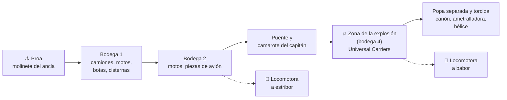

- Normalmente se hacen **dos inmersiones**: una **exterior** (recorrer el casco, la popa y las locomotoras) y otra **interior** (bodegas 1 y 2).
- Lonely Planet lo clasifica como **nivel intermedio–avanzado**, de 17 a 30 m.
- Según PADI, los centros suelen pedir como mínimo el nivel **Advanced Open Water** y **más de 20 inmersiones registradas**; Discover Wildlife da la misma cifra. *No he encontrado una norma oficial egipcia publicada: depende del centro de buceo.*

### 10.2 Los números de una inmersión (cálculo propio)

| Profundidad | Presión | ppO₂ con aire | ppO₂ con nitrox 32 | El gas dura… |
|---|---|---|---|---|
| 17 m (cubierta) | 2,7 bar | 0,57 bar | 0,87 bar | 2,7 veces menos que en superficie |
| 24 m (bodegas) | 3,4 bar | 0,72 bar | 1,10 bar | 3,4 veces menos |
| 30 m (fondo) | 4,0 bar | 0,85 bar | 1,29 bar | 4 veces menos |
| 32 m (máximo) | 4,2 bar | 0,89 bar | **1,35 bar** | 4,2 veces menos |

- La **profundidad máxima del nitrox 32** con 1,4 bar de ppO₂ es de **~33 m**: justo por debajo del fondo del Thistlegorm. Por eso el nitrox 32 es la mezcla típica para este pecio. Con nitrox 36, el límite (~29 m) quedaría **por encima** del fondo.
- Con una botella de 12 L a 200 bar y un consumo tranquilo de 20 L/min en superficie, a **30 m** se llega a la reserva de 50 bar en unos **23 minutos**. Con corriente o nervios, bastante antes.

*Cálculos con Python ([`scripts/calculos.py`](scripts/calculos.py)), fórmulas estándar de agua de mar. Son orientativos: la planificación real la hace el buceador con su ordenador y su formación.*

---

## 11. Accidentes y riesgos para el buceador

### 11.1 Muertes de buceadores en el Thistlegorm

> ⚠️ **Lo que he encontrado:** **no hay un registro público** de accidentes en el pecio. He encontrado relatos en foros de buceo (por ejemplo, un blog sobre «un accidente mortal en el Thistlegorm» comentado en ScubaBoard), pero **ninguna fuente oficial ni de prensa fiable con nombres, fechas y causas** que pueda contrastar. No incluyo ningún caso concreto para no difundir datos falsos sobre personas reales. *Confianza en que ha habido accidentes graves a lo largo de millones de inmersiones: 0,8. Confianza en cualquier caso concreto: sin datos.*

### 11.2 Los riesgos reales

| Riesgo | Por qué | Fuente |
|---|---|---|
| **Corriente** | El estrecho de Gubal tiene corrientes fuertes; se baja por el cabo y hay que poder volver a él | Foros, centros de buceo |
| **Hélices** | Con muchos barcos juntos, un buceador en superficie puede quedar cerca de una hélice que se pone en marcha | ScubaBoard (relatos) |
| **Aglomeración** | Hasta 15 barcos amarrados y decenas de buceadores en las bodegas | Brown y Henderson 2025 |
| **Penetración** | Dentro del pecio: poca luz, sedimento que se levanta y estructuras que se debilitan | Aquarius, scubadiving.com |
| **Derrumbes** | Partes del casco «en riesgo de desprenderse» | CDWS, noviembre de 2023 |
| **Munición sin explotar** | Proyectiles, minas y cordita siguen en el pecio | Brown y Henderson 2025 |
| **Seguridad de los barcos** | En el mar Rojo ha habido naufragios de barcos de turismo y vida a bordo (por ejemplo, el *Sea Story* en 2024, con 11 muertos) | Wikipedia |

> 🧠 **Razonamiento:** el Thistlegorm es poco profundo para un pecio famoso, pero eso no lo hace fácil. Lo que más complica la inmersión no es la profundidad, sino **la corriente, el número de personas y el interior del barco**.

---

## 12. Animales y «vegetación» del pecio

  
   <i>Peces murciélago orbiculares (<i>Platax orbicularis</i>) en el Thistlegorm, 29/3/2022. Foto: Diego Delso, CC BY-SA 4.0, vía Wikimedia Commons.</i>

### 12.1 Un arrecife que nadie plantó

El Thistlegorm está sobre un **fondo de arena**. Antes de 1941, allí había poco donde agarrarse. El acero del barco dio a los corales y a otros animales una **superficie dura** para crecer. Es un **arrecife artificial accidental**.

### 12.2 Lo que dice la ciencia (PLOS ONE, 2023)

El equipo de **Chloe Lee y Stefano Goffredo** (Universidad de Bolonia) analizó **390 cuestionarios** de buceadores voluntarios entre **2007 y 2014**:

- Se vigilaban **72 grupos** de animales y algas fáciles de reconocer. Se vieron **71**; solo faltó la **manta raya**.
- La comunidad **cambió de un año a otro**, pero **sin tendencia a empeorar**: los autores la describen como **estable y bien desarrollada**.
- Lo más abundante fue el **coral blando arborescente** (*Dendronephthya*) y la **morena gigante** (*Gymnothorax javanicus*).
- Concluyen que el pecio podría servir de **refugio** para la vida del mar Rojo.
- Limitación: los datos son de **aficionados**, no de biólogos, y bajaron mucho tras la Primavera Árabe.

### 12.3 Animales que se ven

Pulsa cada foto para abrir su página en Wikimedia Commons, con la imagen grande, el autor y la licencia. Las marcadas con 📍 están hechas **en el propio Thistlegorm**; las demás son de la **misma especie en el mar Rojo** (o cerca), para que se vea cómo es el animal. Mis propias fotos del pecio (pez murciélago, pez león, pez escorpión, peces soldado, pez sargento) están en el [§18.0](#180-mis-fotos-del-thistlegorm-24-y-25-de-mayo-de-2021).

| Foto | Animal | Nombre científico | Dónde suele estar | Autor · licencia |
|---|---|---|---|---|
|  | **Pez murciélago 📍** | *Platax* spp. | Bancos sobre la cubierta | Diego Delso · CC BY-SA 4.0 |
|  | **Morena gigante** | *Gymnothorax javanicus* | Huecos de la estructura | Diego Delso · CC BY-SA 4.0 |
|  | **Pez ardilla** | *Sargocentron* spp. | Sombras y bodegas | Hatem Moushir (acuario) · CC BY-SA 4.0 |
|  | **Pez payaso del mar Rojo** | *Amphiprion bicinctus* | En anémonas | Diego Delso · CC BY-SA 4.0 |
|  | **Napoleón** | *Cheilinus undulatus* | Alrededor del casco | Diego Delso · CC BY-SA 4.0 |
|  | **Jurel de aleta azul (carángido)** | *Caranx melampygus* | Cazando en aguas abiertas | Diego Delso · CC BY-SA 4.0 |
|  | **Atún dientes de perro (casarte ojón)** | *Gymnosarda unicolor* | Aguas abiertas | Diego Delso · CC BY-SA 4.0 |
|  | **Barracuda** | *Sphyraena barracuda* | Aguas abiertas | Kora27 · CC BY-SA 4.0 |
|  | **Pez león** | *Pterois miles* | Sobre la estructura | Diego Delso · CC BY-SA 4.0 |
|  | **Pez piedra (¡venenoso, no tocar!)** | *Synanceia verrucosa* | Camuflado en el metal | NasserHalaweh · CC BY-SA 4.0 |
|  | **Pez escorpión 📍** | *Scorpaenopsis oxycephala* | Camuflado en el metal | Roland Unger · CC BY-SA 3.0 |
|  | **Pez cocodrilo** | *Papilloculiceps longiceps* | Camuflado en el fondo | Diego Delso · CC BY-SA 4.0 |
|  | **Tortuga carey** | *Eretmochelys imbricata* | A veces, junto al casco | Kora27 · CC BY-SA 4.0 |
|  | **Mero (mero del mar Rojo)** | *Plectropomus pessuliferus* | Sobre todo a primera hora | Hectonichus · CC BY-SA 4.0 |
|  | **Tiburón de punta negra** | *Carcharhinus melanopterus* | Ocasional, alrededor del pecio | Daviddarom · Dominio público |
|  | **Peces cristal (barrenderos)** | *Parapriacanthus ransonneti* | Nubes dentro de las bodegas | Ditch Townsend · CC BY-SA 4.0 |

> ℹ️ El pez ardilla es una foto de acuario (Red Sea Aquarium, Hurghada) y la barracuda no indica el lugar: son la misma especie que se ve en el pecio, no fotos del pecio.

### 12.4 ¿Hay «vegetación»?

A 30 m bajo el mar **no hay plantas** como en tierra. Lo que parece vegetación son, en su mayoría, **animales**:

| Foto | Lo que se ve | Qué es en realidad | Autor · licencia |
|---|---|---|---|
|  | «Arbolitos» de colores | **Corales blandos** (*Dendronephthya*): animales coloniales. El grupo más abundante en el pecio (PLOS ONE) | Diego Delso · CC BY-SA 4.0 |
|  | Abanicos | **Gorgonias**: corales con esqueleto flexible | Derek Keats · CC BY 2.0 |
|  | Ramas o costras duras | **Corales duros** (aquí *Acropora*): construyen esqueleto de calcio | Diego Delso · CC BY-SA 4.0 |
|  | Costras rosadas | **Algas coralinas**: estas sí son algas, con calcio en sus paredes | Derek Keats · CC BY 2.0 |
|  | «Pelusa» o matas verdes y marrones | **Algas**, que hacen fotosíntesis con la luz que llega (ejemplo del mar Rojo: alga parda *Turbinaria*) | Diego Delso · CC BY-SA 4.0 |
|  | Bultos con agujeros | **Esponjas**: animales filtradores | Diego Delso · CC BY-SA 4.0 |

> 🧠 **Por qué llega luz:** el agua del mar Rojo es muy clara. A 30 m todavía hay luz suficiente para que vivan algas y corales con **zooxantelas** (algas microscópicas dentro del coral). Por eso hay colores, aunque el rojo se pierde en los primeros metros y todo se ve azul sin linterna. *Confianza 0,85.*

  
   <i>Corales sobre la estructura. Foto: Roland Unger, 16/9/2007, CC BY-SA 3.0, vía Wikimedia Commons.</i>

---

## 13. El estado del pecio: cómo se está deshaciendo

El dato más importante viene del artículo de **Simon Brown y Jon Henderson** (*Heritage*, noviembre de 2025), que compara los modelos 3D de **2017** y **2022**:

| Cambio medido | 2017 → 2022 |
|---|---|
| **Campo de restos** | De ~10,9 a **al menos 21,9 hectáreas** (el doble), con piezas hasta a **200 m** del barco. *Ojo: la cifra antigua se basaba en posiciones sin comprobar* |
| **Eje de la hélice** | **203 mm** en su punto más fino; diseñado para unos **317 mm**. *Mi cálculo: ha perdido ~59 % de su sección* |
| **Ancla de babor** | La cadena se rompió en **2019** y el ancla de **3,5 toneladas** cayó al fondo |
| **Rueda de locomotora** | Un conjunto de **2 toneladas** giró unos **29°** |
| **Ametralladora de estribor** | Su montaje giró **~90°** |
| **Bodega 1** | **Casi sin cambios**: la parte más estable del barco |
| **Popa** | Desplazada ~7 m desde el hundimiento; parte de la bodega 5 doblada sobre la superestructura |

### 13.1 Las causas

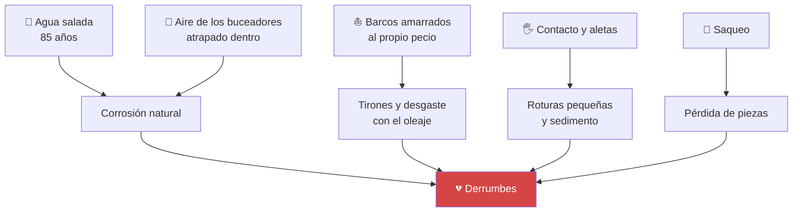

- **Amarres:** los barcos se atan al pecio. Con oleaje, cada tirón arranca o dobla metal. Como los cabos de cuerda se cortan con los bordes afilados, algunos operadores empezaron a usar **cables de acero**, que cortan aún más el casco (Thistlegorm Project).
- **Aire atrapado:** el aire que exhalan los buceadores se queda bajo los techos de las bodegas. El oxígeno y la mezcla de aire y agua **aceleran la corrosión**. Por eso HEPCA taladró agujeros en 2007.
- **Avisos oficiales:** en **febrero de 2012**, la CDWS recibió quejas por un guía que se amarró al cañón de popa. En **noviembre de 2023** avisó de que algunas partes estaban dañadas y otras «en riesgo de desprenderse».

> 🧠 **Razonamiento:** que la bodega 1 apenas cambie y la popa sí, encaja con lo que se espera: la popa ya quedó destrozada en 1941 y es donde se amarran muchos barcos y se concentran los buceadores. *Confianza 0,6.*

### 13.2 ¿Está protegido por la ley?

| Fuente | Qué dice |
|---|---|
| Brown y Henderson (2025) | **Sin protección legal**. La Convención de la UNESCO de 2001 solo cubre restos de **más de 100 años**; el Thistlegorm cumplirá 100 años en **2041** |
| Lee *et al.* (2023) | El pecio no tiene protección legal, por eso hay saqueo |
| PADI (blog) | Lo describe como **tumba de guerra** designada |

> 🔍 **Comprobación:** no he encontrado ninguna ley ni decreto que lo designe oficialmente como tumba de guerra. Lo interpreto así: **moralmente** es una tumba de guerra (murieron nueve hombres), pero **legalmente** no consta una protección específica. *Confianza 0,7.*

---

## 14. Lo que ya se ha llevado la gente

Lista de piezas perdidas o arrancadas según Brown y Henderson (2025) y otras fuentes:

| Pieza | Cuándo | Fuente |
|---|---|---|
| **Campana del barco** | Época de Cousteau; hoy en paradero desconocido | Wikipedia, Brown y Henderson |
| Caja fuerte del capitán | Época de Cousteau | Wikipedia |
| Una moto **BSA M20** | Hacia la visita de Cousteau | Brown y Henderson |
| Parte del **mástil** | Cousteau, y otra parte a finales de los 70 | Divernet, Brown y Henderson |
| Un mástil de radio de unos 2 m | Se dice que acabó en un jardín de Sharm el-Sheikh | Brown y Henderson |
| Volante de un coche **Morris** | 2008–2009 | Brown y Henderson |
| Filtros de combustible de las cisternas Bedford | Principios de 2015 | Brown y Henderson |
| Válvulas de latón de las cisternas Albion | — | Brown y Henderson |
| Un gran tambor de cable de cobre de la bodega 5 | Antes de 2022 | Brown y Henderson |
| Una manivela del cañón de popa y un grifo de la bañera | — | Brown y Henderson |
| Grafitis y mamparos cortados por buceadores | — | Brown y Henderson |

> 🧠 **Patrón:** lo que más desaparece es el **metal no férreo** (latón, cobre, bronce): no se oxida, brilla y tiene valor como recuerdo o como chatarra. El hierro se queda… y se corroe. *Confianza 0,75.*

---

## 15. ¿Se debería tocar o subir algo a la superficie?

### 15.1 Argumentos

| A favor de subir algunos objetos | En contra |
|---|---|
| El pecio **se está deshaciendo**: lo que no se rescate se perderá | Es la **tumba de nueve hombres** |
| Si no lo sube un museo, **se lo lleva un saqueador** | Fuera del agua, el hierro se **destruye rápido** si no se trata (§19, desalinización) |
| En un museo lo puede ver **todo el mundo**, no solo quien bucea | Conservar una pieza grande cuesta **mucho dinero** y años de trabajo |
| Permite estudiar materiales y procedimientos de la guerra | El valor del pecio es verlo **en su sitio**: un camión en una bodega cuenta más que en una vitrina |
| — | Muchos objetos son ya **casa de animales** (§12) |
| — | Hay **munición** sin explotar |
| — | El turismo de buceo genera ~**4 millones de euros al año**: un pecio vacío atrae menos |

### 15.2 Objeto por objeto (mi valoración)

| Objeto | ¿Subirlo? | Por qué | Confianza |
|---|---|---|---|
| Camiones, motos, orugas | **No** | Son el alma del pecio; muy pesados; el hierro se rompería; tienen corales | 0,8 |
| Locomotoras | **No** | Toneladas de hierro corroído; imposibles de conservar enteras | 0,85 |
| Munición, minas, cordita | **No tocar** | Peligro real de explosión; solo especialistas | 0,95 |
| Restos humanos (si los hubiera) | **Nunca** | Respeto a los muertos | 1,0 |
| Piezas pequeñas de latón o cobre (válvulas, grifos, placas) | **Solo un museo oficial, con permiso egipcio** | Son lo que se roba primero; se conservan mejor que el hierro | 0,6 |
| Piezas ya **caídas al fondo** fuera del barco | **Quizá, documentadas antes en 3D** | Ya se han movido; se pierden en la arena | 0,5 |
| Campana del barco | Ya no está; habría que **encontrarla** y devolverla a un museo | Es el objeto con más valor simbólico | 0,7 |

> 🔗 **Comparación con el resto de la serie:** en el [Titanic](https://github.com/Oskillar28/titanic-pecio-historia), a 3.800 m, se subieron miles de objetos y el debate fue enorme. En el [Britannic](https://github.com/Oskillar28/britannic-carl-spencer) se subió en 2025 una selección pequeña con permiso del Estado griego y para un museo público. El Thistlegorm es lo contrario: **está al alcance de cualquier buceador**, y por eso el problema no es quién sube objetos de forma oficial, sino **quién se los lleva sin permiso**.

> 🧠 **Mi conclusión (opinión razonada, no una verdad):** lo mejor es **dejar el pecio en su sitio** y protegerlo con (1) **boyas de amarre** que se mantengan, (2) **protección legal** antes de 2041, (3) **vigilancia y guías** que no permitan tocar, y (4) **modelos 3D repetidos** para medir los cambios. Solo deberían subirse piezas pequeñas en riesgo inmediato de robo, por un museo egipcio y con conservación preparada. *Confianza 0,65.*

---

## 16. Contraste de fuentes: datos que no coinciden

| Dato | Versión A | Versión B | Más probable |
|---|---|---|---|
| Botadura | Abril de 1940 (Wikipedia, Thistlegorm Project) | Junio de 1940 (Divernet, scubadiving.com) | **9/4/1940** botadura; **24/6/1940** entrega |
| Descubrimiento de Cousteau | Principios de los 50 (Wikipedia) · 1954 (Brown y Henderson) | 1955 (Divernet) · 1956 (PADI, Divernet en otro artículo) | **Hacia 1955**; publicado en 1956 |
| Tiempo de hundimiento | Menos de un minuto (testigo del *Carlisle*, Thistlegorm Project) | Menos de 10 minutos (PADI en español) | **Muy rápido**; la cifra exacta no se puede comprobar |
| Personas a bordo | 41 (Wikipedia, Aquarius) | 42 (Divernet, scubadiving.com) | **41–42** |
| Cañón de popa | 4,7 pulgadas (Thistlegorm Project, Wikipedia en el texto) | 4 pulgadas (ficha de Wikipedia) · 4,5 pulgadas (Divernet) | **Sin resolver** |
| Viajes anteriores | EE. UU., Argentina, Antillas (Wikipedia) | EE. UU., África, India (Divernet) | **Tres viajes**; destinos inciertos |
| Eslora | 126,5 m (Wikipedia) | 129 m (Lonely Planet) · 131 m (blog francés) | **126,5 m** |
| Locomotoras | 2 (casi todas las fuentes) | 3 (mito de algunas charlas) | **2** |
| Distancia de Sharm | ~40 km (Brown y Henderson) | ~70 km por barco (PLOS ONE) | **40 km en línea recta**; más por la ruta del barco |
| Buceadores | ~200 al día (PADI) | Hasta 175.000 al año (PLOS ONE) | **Decenas de miles al año** |
| Tumba de guerra | Sí (PADI) | Sin protección legal (Brown y Henderson) | **Moralmente sí; legalmente no consta** |

---

## 17. Mitos frente a realidad

| Mito | Realidad | Confianza |
|---|---|---|
| «Se hundió en su primer viaje» | Era su **cuarto** viaje | 0,9 |
| «Lo torpedeó un submarino» | Lo hundieron **dos bombas** de un avión | 0,95 |
| «Lleva tanques» | Lleva **Universal Carriers** (pequeños blindados de cadenas), no tanques | 0,85 |
| «Hay tres locomotoras» | Hay **dos**; el «tercer» resto es parte de una de ellas | 0,85 |
| «La carga era para Montgomery» | Montgomery llegó en **1942** | 0,9 |
| «Las botas eran todas del pie izquierdo» | Sin pruebas; probablemente eran para evitar la electricidad estática | 0,6 |
| «Los espaguetis del fondo son comida» | Son **cordita**, un propulsor de artillería | 0,7 |
| «Está protegido por la ley» | No consta protección legal específica | 0,7 |
| «Hay que ser buceador técnico» | Basta un nivel avanzado recreativo, pero con experiencia en corriente | 0,8 |

---

## 18. Fotos y vídeos

### 18.0 Mis fotos del Thistlegorm (24 y 25 de mayo de 2021)

Fotos hechas por mí en mis inmersiones en el pecio y publicadas en mi Instagram ([@oskillar28](https://www.instagram.com/oskillar28/)) con la ubicación «SS Thistlegorm». Cámara: Olympus Tough TG-6.

<table>
<tr><td align="center" width="33%"><a href="fotos/mastil-cabos-amarre.jpg">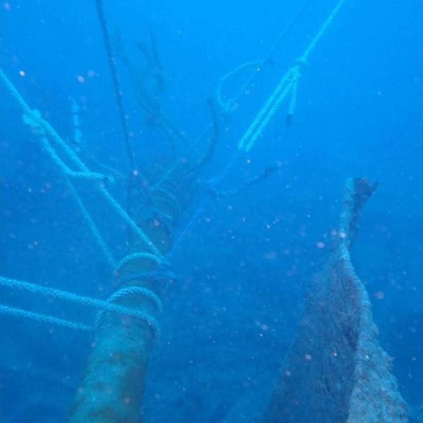</a> El mástil con los cabos de amarre de los barcos de buceo atados al pecio (ver §13)</td><td align="center" width="33%"><a href="fotos/motos-bodega.jpg">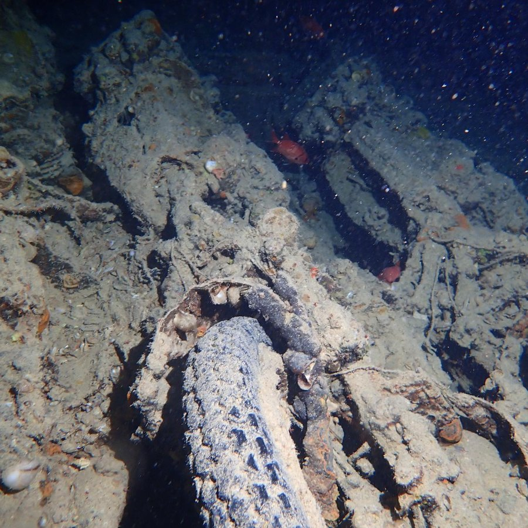</a> Motos de la carga en una bodega, cubiertas de sedimento</td><td align="center" width="33%"><a href="fotos/rueda-camion.jpg">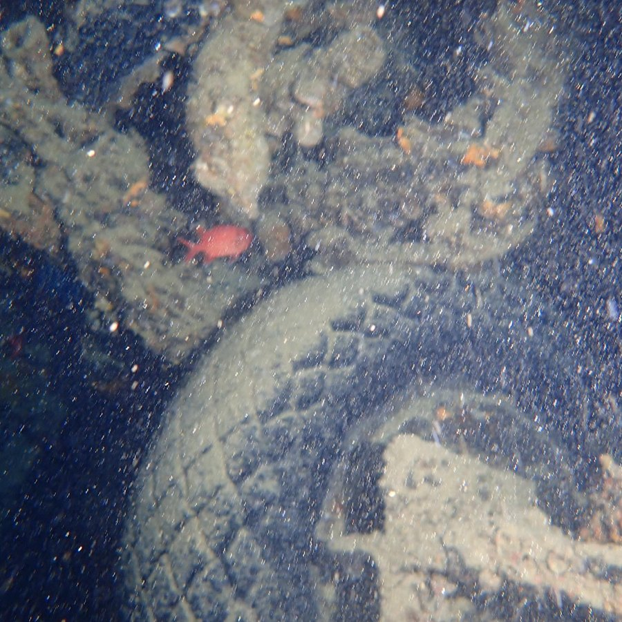</a> Rueda de un camión en la bodega y un pez soldado</td></tr>
<tr><td align="center" width="33%"><a href="fotos/pez-murcielago.jpg">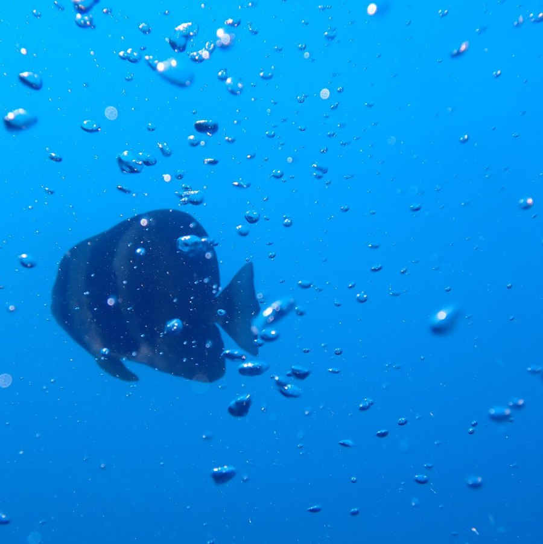</a> Pez murciélago (*Platax*) entre las burbujas de los buceadores</td><td align="center" width="33%"><a href="fotos/pez-leon.jpg">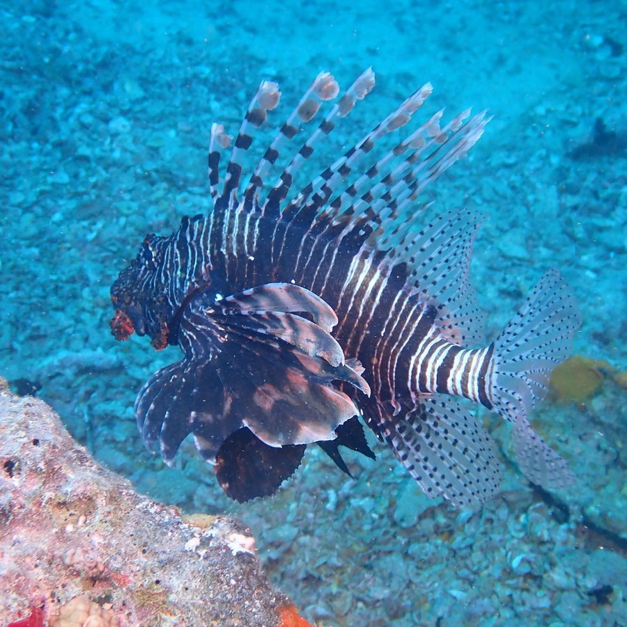</a> Pez león (*Pterois miles*)</td><td align="center" width="33%"><a href="fotos/pez-escorpion.jpg">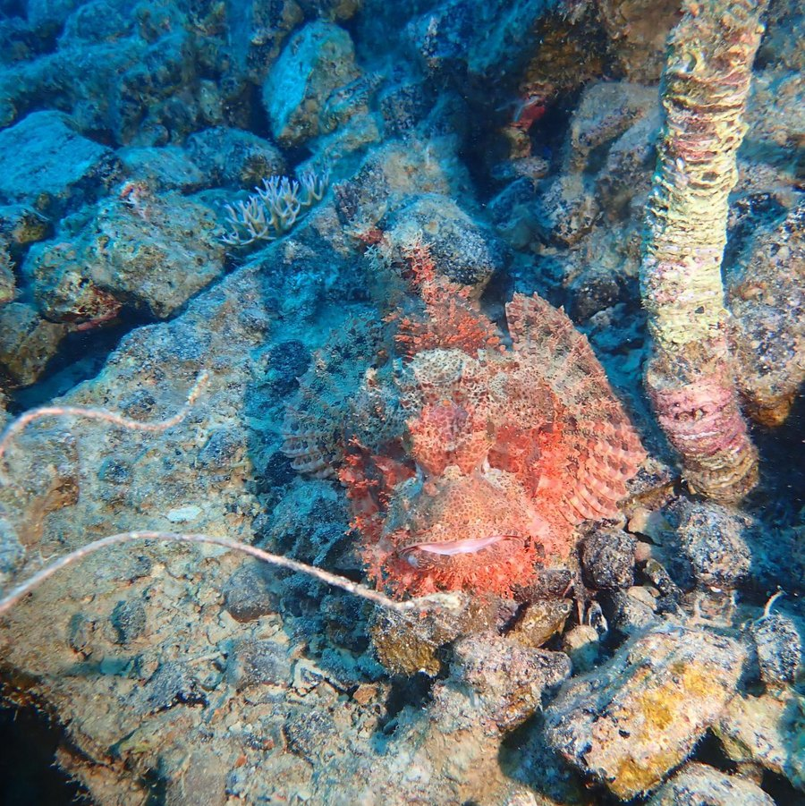</a> Pez escorpión camuflado</td></tr>
<tr><td align="center" width="33%"><a href="fotos/pez-sargento.jpg">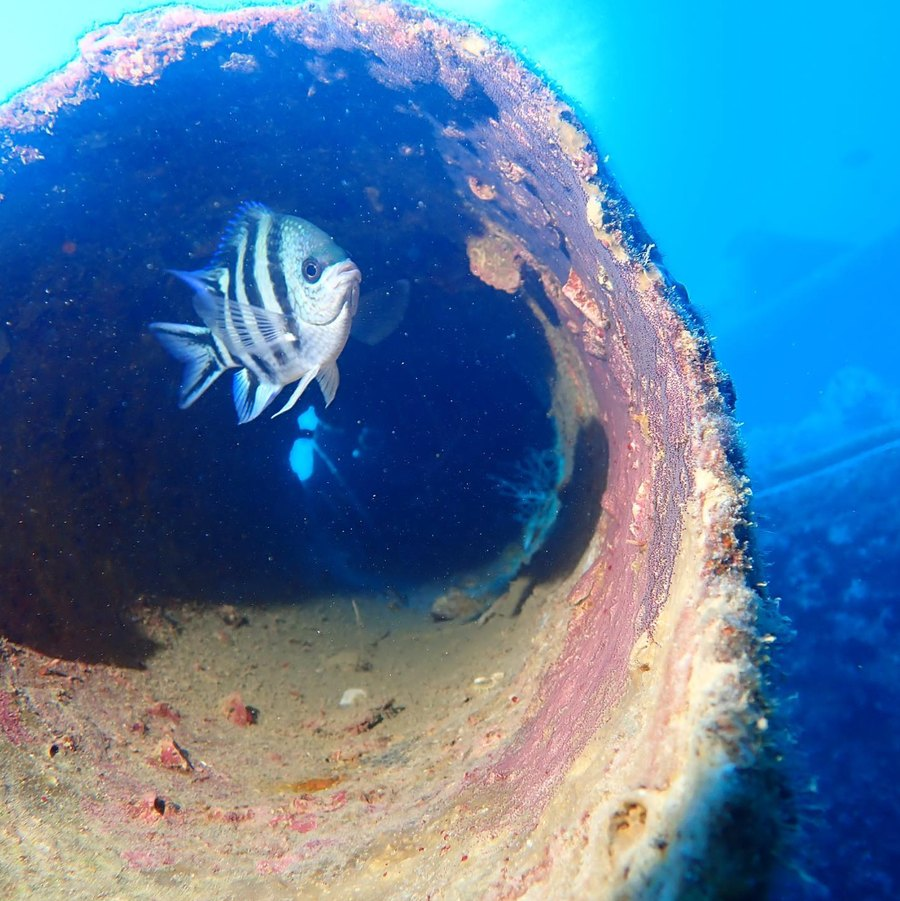</a> Pez sargento (*Abudefduf*) dentro de un tubo del barco</td><td align="center" width="33%"><a href="fotos/peces-soldado.jpg">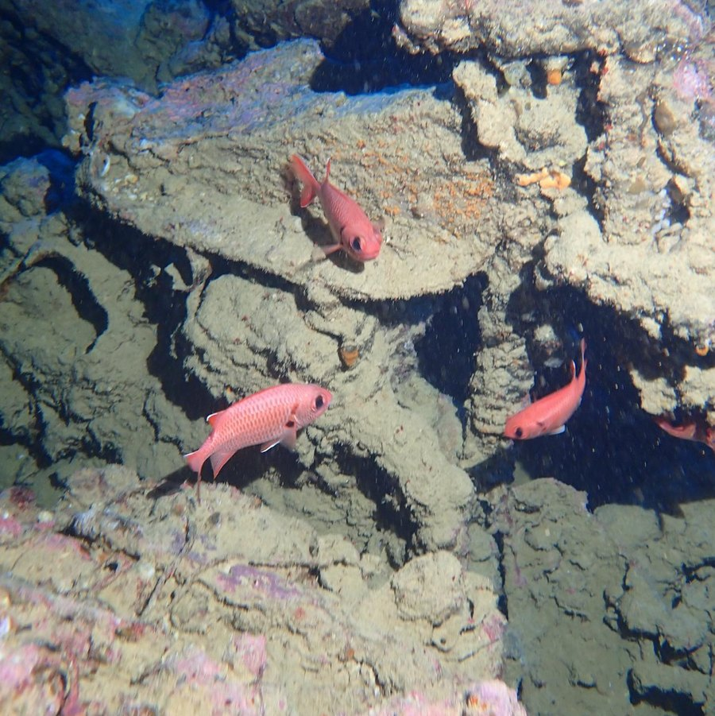</a> Peces soldado (familia de los peces ardilla, probablemente *Myripristis*) en la estructura</td><td align="center" width="33%"><a href="fotos/coral.jpg">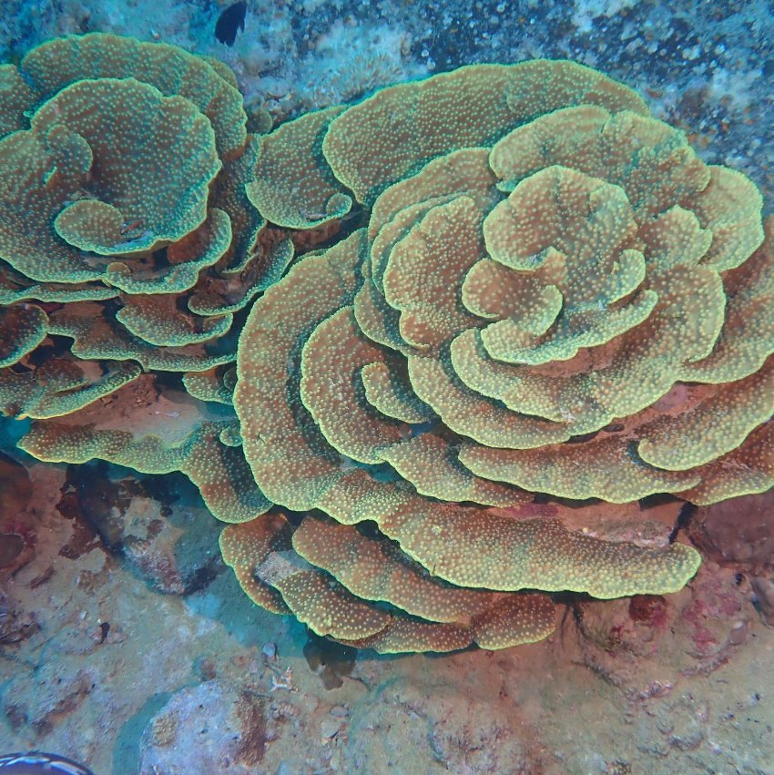</a> Coral duro en láminas</td></tr>
</table>

> 📷 **© Óscar Ramírez Martín.** Estas fotos no están bajo la licencia libre del texto: para reutilizarlas hay que pedirme permiso. Las del coral y el pez león se publicaron con la ubicación del pecio, pero podrían ser del arrecife cercano en la misma salida.

### 18.1 Fotos con licencia libre (Wikimedia Commons)

Licencias comprobadas el **25/11/2026** en los datos de cada archivo. Para reutilizarlas fuera de GitHub hay que citar al autor y la licencia.

| Foto | Autor · fecha | Licencia |
|---|---|---|
| [El pecio en 2022 (vista general)](https://commons.wikimedia.org/wiki/File:Pecio_SS_Thistlegorm,_mar_Rojo,_Egipto,_2022-03-29,_DD_01.jpg) | Diego Delso · 29/3/2022 | CC BY-SA 4.0 |
| [El pecio en 2022 (otra vista)](https://commons.wikimedia.org/wiki/File:Pecio_SS_Thistlegorm,_mar_Rojo,_Egipto,_2022-03-29,_DD_06.jpg) | Diego Delso · 29/3/2022 | CC BY-SA 4.0 |
| [El pecio en 2022 (detalle)](https://commons.wikimedia.org/wiki/File:Pecio_SS_Thistlegorm,_mar_Rojo,_Egipto,_2022-03-29,_DD_12.jpg) | Diego Delso · 29/3/2022 | CC BY-SA 4.0 |
| [Peces murciélago](https://commons.wikimedia.org/wiki/File:Peces_murci%C3%A9lago_orbiculares_(Platax_orbicularis),_SS_Thistlegorm,_mar_Rojo,_Egipto,_2022-03-29,_DD_24.jpg) | Diego Delso · 29/3/2022 | CC BY-SA 4.0 |
| [Vista hacia popa desde el puente](https://commons.wikimedia.org/wiki/File:Aft_view_Thistlegorm.jpg) | Woodym555 · 2007 | CC BY-SA 3.0 |
| [Cañón de popa](https://commons.wikimedia.org/wiki/File:Thistlegorm_stern_gun.jpg) | Woodym555 · 28/8/2007 | CC BY-SA 3.0 |
| [Hélice](https://commons.wikimedia.org/wiki/File:Thistlegorm_propellor.jpg) | Woodym555 · 28/4/2007 | CC BY-SA 3.0 |
| [Piezas sobre la cubierta](https://commons.wikimedia.org/wiki/File:Thistlegorm_train_parts.jpg) | Woody · 28/4/2007 | CC BY-SA 3.0 |
| [Buceador bajo el puente](https://commons.wikimedia.org/wiki/File:Thistlegorm.jpg) | Trewornan · 2006 | Dominio público |
| [Motos en el pecio](https://commons.wikimedia.org/wiki/File:Ssthistlegorm.jpg) | Javi Pérez · mayo de 2006 | Dominio público |
| [Motos en la bodega](https://commons.wikimedia.org/wiki/File:ThistlegormMotorbikes.jpg) | Roland Unger · 16/9/2007 | CC BY-SA 3.0 |
| [Munición](https://commons.wikimedia.org/wiki/File:ThistlegormMunition.jpg) | Roland Unger · 16/9/2007 | CC BY-SA 3.0 |
| [Cisterna de agua](https://commons.wikimedia.org/wiki/File:ThistlegormTankwagen.jpg) | Roland Unger · 16/9/2007 | CC BY-SA 3.0 |
| [Corales](https://commons.wikimedia.org/wiki/File:ThistlegormCorals.jpg) | Roland Unger · 16/9/2007 | CC BY-SA 3.0 |
| [Pez escorpión](https://commons.wikimedia.org/wiki/File:ThistlegormDrachenkopf.jpg) | Roland Unger · 16/9/2007 | CC BY-SA 3.0 |
| [Camión](https://commons.wikimedia.org/wiki/File:Thistlegormtruck.jpg) | Albert Kok · sin fecha | CC BY-SA 3.0 |
| [Molinete](https://commons.wikimedia.org/wiki/File:Winch_thistlegorm.jpg) | Albert Kok · sin fecha | CC BY-SA 3.0 |
| [Cubierta superior](https://commons.wikimedia.org/wiki/File:SS_Thistlegorm_upper_deck.jpg) | Hagainativ · 8/10/2010 | CC BY-SA 3.0 |
| [Cámara de vídeo dentro del pecio](https://commons.wikimedia.org/wiki/File:Videographer_in_Thistlegorm.jpg) | Tim Sheerman-Chase · 4/9/2007 | CC BY 2.0 |

Además, el §5.3 tiene 4 fotos de la munición y los cañones, y el §12 tiene 16 fotos de animales y 6 de «vegetación», todas con licencia libre y enlace a su página.

Hay más de 70 archivos buscando «Thistlegorm» en [Wikimedia Commons](https://commons.wikimedia.org/w/index.php?search=Thistlegorm&title=Special:MediaSearch&type=image).

  
   <i>Uno de los camiones de la carga. Foto: Albert Kok, CC BY-SA 3.0, vía Wikimedia Commons.</i>

### 18.2 Modelos 3D y fotos con copyright (solo enlaces)

| Recurso | Qué contiene |
|---|---|
| [The Thistlegorm Project](https://thethistlegormproject.com/) | Modelos 3D, vídeos 360° y la historia del barco |
| [Brown y Henderson, *Heritage* (2025)](https://www.mdpi.com/2571-9408/8/12/504) | Comparación 3D 2017–2022 con figuras. *Artículo en acceso abierto CC BY 3.0: sus figuras se podrían reutilizar citando a los autores* |
| [Lee *et al.*, PLOS ONE (2023)](https://journals.plos.org/plosone/article?id=10.1371/journal.pone.0282239) | Estudio de la fauna (CC BY 4.0) |
| [Divernet: *The Truth Behind the Icon*](https://divernet.com/world-dives/middle-east/the-truth-behind-the-icon-dispelling-myths-of-the-thistlegorm-65-years-later/) | Fotos y mitos del pecio |
| [Discover Wildlife](https://www.discoverwildlife.com/animal-facts/marine-animals/thistlegorm-ship-egypt) | Galería de fauna (Getty Images) |

### 18.3 Vídeos

> ⚠️ Encontrados en YouTube en noviembre de 2026. **No los he visto uno a uno**: he comprobado el título y el enlace, no el contenido completo.

| Vídeo | Qué aporta |
|---|---|
| 🎬 [*Diving the Thistlegorm (1/3) – Exterior Dive*](https://www.youtube.com/watch?v=1mLRKW7Y5vU) | Recorrido exterior completo |
| 🎬 [*Diving the Thistlegorm (3/3) – Interior Dive*](https://www.youtube.com/watch?v=lFy6KPnzfng) | Bodegas y carga |
| 🎬 [*SS Thistlegorm in 360° – Insta360 X4 Wreck Dive*](https://www.youtube.com/watch?v=am0zIoTcXDA) | Vídeo 360° |
| 🎬 [*World War II Wreck of the THISTLEGORM*](https://www.youtube.com/watch?v=malGCjXU6os) | Inmersión con historia |
| 🎬 [*Scuba Diving The Greatest Wreck In THE WORLD SS THISTLEGORM!*](https://www.youtube.com/watch?v=ynZK7Oc3xRA) | Desde un barco de vida a bordo |
| 🎬 [*Thistlegorm wreck Red Sea scuba dive plans*](https://www.youtube.com/watch?v=q1vn1MGrJ8M) | Planos y planificación de la inmersión |

---

## 19. Glosario técnico

| Término | Significado |
|---|---|
| **SS** | *Steamship*: buque de vapor. Prefijo de los mercantes, no de los buques de guerra |
| **HMS** | *His/Her Majesty's Ship*: buque de la Marina Real británica |
| **TRB (arqueo bruto)** | Medida del **volumen** interior del barco, no de su peso (1 tonelada de registro = 2,83 m³) |
| **Eslora / manga** | Largo / ancho del barco |
| **Babor / estribor** | Lado izquierdo / derecho mirando hacia proa |
| **Proa / popa** | Parte delantera / trasera |
| **Bodega** | Espacio grande bajo cubierta para la carga |
| **Mamparo** | Pared interior que separa compartimentos |
| **Superestructura** | La parte del barco que está por encima de la cubierta principal (puente, camarotes) |
| **Molinete** | Máquina de proa que sube y baja el ancla |
| **Máquina de triple expansión** | Motor de vapor que aprovecha el vapor tres veces en tres cilindros de tamaño creciente |
| **DEMS** | *Defensively Equipped Merchant Ships*: programa británico que armaba a los mercantes y embarcaba artilleros militares |
| **Convoy** | Grupo de barcos que navegan juntos con escolta |
| **Fondeadero** | Zona donde los barcos anclan esperando |
| **He 111** | Heinkel He 111, bombardero alemán bimotor |
| **KG 26** | *Kampfgeschwader 26*: «ala de bombardeo 26» de la Luftwaffe |
| **Abwehr** | Servicio de inteligencia militar alemán |
| **Universal Carrier** | Pequeño vehículo blindado británico de cadenas (también llamado Bren Carrier) |
| **Bren** | Ametralladora ligera británica |
| **Lee-Enfield .303** | Fusil británico; .303 es el calibre en pulgadas |
| **Cordita** | Explosivo propulsor en forma de cordones, usado en artillería |
| **Stanier 8F** | Modelo de locomotora de vapor británica de mercancías |
| **OBE / Medalla de Jorge** | Condecoraciones británicas por servicio y valentía |
| **Pecio** | Restos de un barco hundido |
| **Penetración** | Entrar dentro de un pecio o cueva, donde no se puede subir directamente a la superficie |
| **Nitrox (EAN32)** | Aire enriquecido con oxígeno (32 %). Reduce el nitrógeno y alarga el tiempo sin descompresión |
| **ppO₂** | Presión parcial de oxígeno. Por encima de ~1,4–1,6 bar puede causar convulsiones |
| **MOD** | Profundidad máxima a la que se puede respirar una mezcla sin superar la ppO₂ límite |
| **Narcosis** | Efecto «borrachera» del nitrógeno a presión, que se nota a partir de ~30 m |
| **Fotogrametría** | Técnica que crea un modelo 3D a partir de miles de fotos solapadas |
| **Ortofoto** | Imagen sin deformación de perspectiva, como un mapa, hecha uniendo fotos |
| **Arrecife artificial** | Estructura humana sobre la que crece vida marina |
| **Zooxantelas** | Algas microscópicas que viven dentro de los corales y les dan energía con la luz |
| **Coral blando** | Coral sin esqueleto duro de calcio, flexible (como *Dendronephthya*) |
| **Gorgonia** | Coral en forma de abanico |
| **Ciencia ciudadana** | Investigación en la que voluntarios (aquí, buceadores) recogen datos |
| **PERMANOVA** | Prueba estadística que compara comunidades de especies entre grupos (por ejemplo, entre años) |
| **Desalinización** | Proceso de quitar la sal de un objeto sacado del mar para que no se destruya al secarse |
| **HEPCA** | Asociación egipcia de protección del medio ambiente de Hurghada |
| **CDWS** | Cámara egipcia de buceo y deportes acuáticos |
| **Convención UNESCO 2001** | Tratado que protege el patrimonio cultural subacuático de más de 100 años |

---

## 20. Conclusiones

1. **El Thistlegorm se hundió por mala suerte y por error de cálculo**: los alemanes buscaban otro barco, y el fondeadero «seguro» ya no lo era. *Confianza 0,8.*
2. **Su valor único es la carga**: casi nada se ha movido de las bodegas desde 1941, y por eso es un museo de la guerra en el desierto. *0,9.*
3. **Cousteau lo dio a conocer y también empezó a vaciarlo**: la campana, la caja fuerte y una moto salieron en los años 50. *0,8.*
4. **Se ha buceado del orden de millones de veces** desde 1992, pero nadie lleva la cuenta. *0,6.*
5. **Es un arrecife artificial sano**: el estudio de 2023 encontró una comunidad estable, con 71 de 72 grupos vigilados. *0,75.*
6. **Se está deshaciendo, y no solo por el tiempo**: el campo de restos se ha duplicado, el eje de la hélice ha perdido más de la mitad de su sección y el ancla cayó en 2019. Los amarres al propio pecio, el aire atrapado y el saqueo aceleran el proceso. *0,8.*
7. **No tiene protección legal específica** y no la tendrá por la UNESCO hasta 2041. *0,7.*
8. **Lo mejor es dejarlo en su sitio** y protegerlo con boyas, leyes, guías y vigilancia 3D. *Opinión razonada, 0,65.*

---

## 21. Metodología, límites y comprobación de originalidad

### 21.1 Cómo se ha hecho

1. **Dividir el problema:** barco, último viaje, ataque, víctimas, carga, Cousteau, redescubrimiento, número de inmersiones, ciencia, fauna, deterioro, saqueo y debate ético.
2. **Resolver cada parte** con al menos dos fuentes cuando fue posible, priorizando artículos científicos revisados (PLOS ONE 2023, *Heritage* 2025) y proyectos de universidades.
3. **Verificar** fechas y cifras entre fuentes (§16) y separar hechos de opiniones.
4. **Combinar** con un nivel de confianza en cada punto.
5. **Calcular** presiones, mezclas, consumo de gas e inmersiones acumuladas con Python ([`scripts/calculos.py`](scripts/calculos.py)).

### 21.2 Límites

- **No hay un registro público de accidentes** de buceadores en el pecio; no incluyo casos concretos.
- El nombre del piloto alemán y su historia posterior tienen **una sola fuente**.
- No he visto los vídeos enteros ni he leído el libro *Diving the Thistlegorm*.
- Las cifras de buceadores son **estimaciones** de distinto origen y año.
- El calibre del cañón de popa sigue **sin resolver**.
- Para los cálculos supuse agua de mar (1,025 kg/L) y un consumo de 20 L/min en superficie.

### 21.3 Comprobación de que el texto no está copiado

- Todo el texto está **redactado por mí con mis palabras** a partir de las fuentes; no hay párrafos copiados. Las pocas expresiones entre comillas son cortas y van atribuidas.
- La **estructura** (índice, tablas de confianza, contraste de fuentes, estimación de inmersiones, valoración objeto por objeto) es **propia** y sigue el formato del resto de mi serie.
- Comprobé en buscadores varias frases características del texto (por ejemplo, la valoración objeto por objeto o la estimación de inmersiones acumuladas) y **no aparecen publicadas en otro sitio**.
- Los **datos** (fechas, cifras, nombres) sí aparecen en las fuentes citadas, como es lógico: lo que no se copia es la redacción.
- Las fotos **no son mías**: cada una lleva su autor y su licencia.

| Bloque | Confianza |
|---|---|
| Historia del barco y del ataque | 0,85 |
| Víctimas | 0,85 |
| Carga | 0,8 |
| Cousteau y fechas de descubrimiento | 0,6 |
| Número de inmersiones | 0,5 |
| Fauna (PLOS ONE) | 0,75 |
| Deterioro medido (*Heritage* 2025) | 0,85 |
| Cálculos físicos | 0,95 |
| Valoración sobre subir objetos | 0,65 (opinión) |

---

## 22. Fuentes

**Artículos científicos (acceso abierto)**

- Brown, S. y Henderson, J. C. (2025). *Documenting Change on the SS Thistlegorm, Red Sea, Egypt: Using Underwater Photogrammetry to Record Natural Deterioration and Human Impacts on a World War II Shipwreck*. *Heritage*, 8(12), 504. https://doi.org/10.3390/heritage8120504
- Lee, C., Caroselli, E., Toffolo, M. M., Mancuso, A., Marchini, C., Meschini, M. y Goffredo, S. (2023). *Eight years of community structure monitoring through recreational citizen science at the "SS Thistlegorm" wreck (Red Sea)*. *PLOS ONE*, 18(3), e0282239. https://doi.org/10.1371/journal.pone.0282239
- Universidad de Edimburgo (2024). *Recording the SS Thistlegorm: Rapid multi-image underwater photogrammetric survey of a large Second World War wreck*. https://www.research.ed.ac.uk/en/publications/recording-the-ss-thistlegorm-rapid-multi-image-underwater-photogr/

**Proyectos y universidades**

- The Thistlegorm Project. *Wreck History* y *Conservation*. https://thethistlegormproject.com/history/ · https://thethistlegormproject.com/conservation/
- Universidad de Nottingham (2017). *Bringing the sunken secrets of WWII to the surface*. https://www.nottingham.ac.uk/news/pressreleases/2017/october/bringing-the-sunken-secrets-of-wwii-to-the-surface.aspx
- Universidad de Nottingham (2018). *New iBook… SS Thistlegorm*. https://www.nottingham.ac.uk/news/pressreleases/2018/october/thistlegorm-ibook.aspx
- Universidad de Edimburgo (2021). *New book on the detailed survey of one the most famous shipwrecks in the world*. https://hca.ed.ac.uk/news-events/news-archive/2021/new-book-most-famous-shipwreck

**Organismos de protección**

- HEPCA (2026). *Underwater heritage protection* (23 boyas). https://www.hepca.org/news/almasry-alyoum-article-underwater-heritage-protection
- HEPCA / *Diver* (2008). Reapertura tras la instalación de 32 amarres. https://www.hepca.org/files/resources/90e00-DIVER_208_FEB08_1450268601.pdf
- CDWS (15/11/2023). *Follow-up on announcement #55*. https://www.cdws.travel/news/fu-announcement-55-of-2023

**Historia y buceo**

- Wikipedia (en). *SS Thistlegorm*. https://en.wikipedia.org/wiki/SS_Thistlegorm
- Tunney, J. (2006). *The Truth Behind the Icon: Dispelling Myths of the Thistlegorm 65 Years Later*. Divernet. https://divernet.com/world-dives/middle-east/the-truth-behind-the-icon-dispelling-myths-of-the-thistlegorm-65-years-later/
- PADI (2019). *A Brief History of the SS Thistlegorm*. https://blog.padi.com/a-brief-history-of-the-ss-thistlegorm/ · versión en español: https://blog.padi.com/es/breve-historia-del-pecio-thistlegorm-egipto/
- Myers, R. (2017). *History of the Red Sea's Thistlegorm Shipwreck*. Scuba Diving. https://www.scubadiving.com/history-red-sea-thistlegorm-shipwreck
- British Diver (2012). *Thistlegorm mooring complaints*. https://britishdiver.co.uk/?p=662
- Gronfeldt, T. (2015). *Bubble Trouble on the Thistlegorm*. Scuba Diver Life. https://scubadiverlife.com/bubble-trouble/
- Discover Wildlife. *This giant ship sank off the Egyptian coast in 1941…* https://www.discoverwildlife.com/animal-facts/marine-animals/thistlegorm-ship-egypt
- Lonely Planet. *Thistlegorm*. https://www.lonelyplanet.com/egypt/sinai/sharm-el-sheikh-and-naama-bay/attractions/thistlegorm/a/poi-sig/1453637/1316052
- Divernet. *Observant divers fed Thistlegorm wildlife probe*. https://divernet.com/scuba-news/observant-divers-fed-thistlegorm-wildlife-probe/
- Wikipedia (en). *2024 Red Sea tourist boat disaster*. https://en.wikipedia.org/wiki/2024_Red_Sea_tourist_boat_disaster
- Wikipedia (en). *The Silent World*. https://en.wikipedia.org/wiki/The_Silent_World

**Libros**

- Cousteau, J.-Y. (1963). *The Living Sea*. Harper & Row.
- Henderson, J., Mustard, A., Brown, S. y Postons, M. (2021). *Diving the Thistlegorm*. Dived Up.

---

> **Licencia:** texto, tablas, diagramas y script propios bajo **CC BY-SA 4.0**. Las fotos conservan la licencia indicada en cada pie.

*En memoria de Arthur Cain, Archibald Giffin, Alfred Oswald Kean, Donald Masterson, Joseph Munro Rolfe, Kahil Sakando, Christopher Todds, Alexander Neil Brian Watt y Thomas Woolaghan, muertos el 6 de octubre de 1941.*
