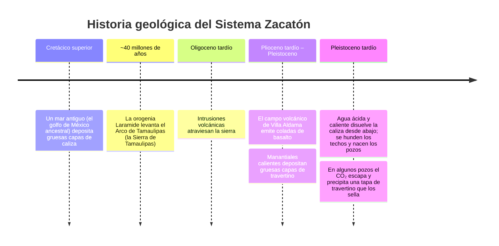
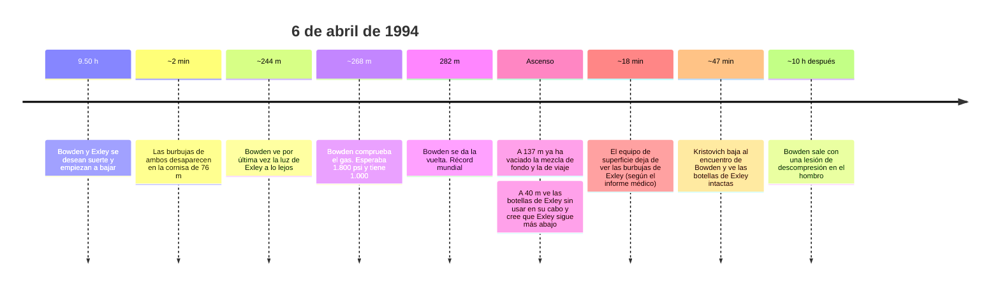
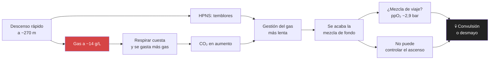

# 🕳️ El Zacatón: el pozo de agua caliente que se tragó a Sheck Exley

### Origen volcánico, buceadores, récords, una muerte y un robot de la NASA en el cenote de Aldama (Tamaulipas, México)

> 🇬🇧 **[English version](README.en.md)**

> **Estudio divulgativo** · Autor: Óscar Ramírez Martín, buceador aficionado que investiga el caso · Noviembre 2026
> No soy experto en buceo técnico ni en cuevas. Este trabajo reúne fuentes públicas contrastadas y cálculos propios con fórmulas estándar, y señala en cada punto qué está confirmado y qué no.

> 📄 **Versión PDF:** [Estudio_Zacaton_Sheck_Exley.pdf](Estudio_Zacaton_Sheck_Exley.pdf)

> ⚠️ **Nota de respeto.** Este estudio trata la muerte real de Sheck Exley en 1994. No incluye fotografías de su cuerpo ni de la recuperación. El objetivo es entender **qué es el Zacatón y por qué es tan peligroso**.

> 📚 **Serie de estudios sobre accidentes de buceo** del mismo autor:
> [Blue Hole de Dahab (Yuri Lipski, 2000)](https://github.com/Oskillar28/blue-hole-dahab-yuri-lipski) · [Boesmansgat (Deon Dreyer y Dave Shaw, 1994–2005)](https://github.com/Oskillar28/boesmansgat-deon-dreyer) · **Zacatón (Sheck Exley, 1994)** (este estudio) · [Cueva de Plura (Noruega, 2014)](https://github.com/Oskillar28/plura-cueva-noruega) · [Cueva de Vaavu (Maldivas, 2026)](https://github.com/Oskillar28/cueva-vaavu-maldivas)

---

## 📑 Índice

1. [El Zacatón en 30 segundos](#1-el-zacatón-en-30-segundos)
2. [Dónde está y cómo es](#2-dónde-está-y-cómo-es)
3. [Cómo se formó: un pozo excavado por un volcán](#3-cómo-se-formó-un-pozo-excavado-por-un-volcán)
4. [Historia: de la sonda de 75 m al robot de la NASA](#4-historia-de-la-sonda-de-75-m-al-robot-de-la-nasa)
5. [Los buceadores](#5-los-buceadores)
6. [Todas las inmersiones documentadas: buenas y malas](#6-todas-las-inmersiones-documentadas-buenas-y-malas)
7. [6 de abril de 1994: el día de los 1.000 pies](#7-6-de-abril-de-1994-el-día-de-los-1000-pies)
8. [Por qué murió Sheck Exley: análisis físico](#8-por-qué-murió-sheck-exley-análisis-físico)
9. [DEPTHX: el robot que tocó el fondo (2007)](#9-depthx-el-robot-que-tocó-el-fondo-2007)
10. [Vida sin luz: los microbios del Zacatón](#10-vida-sin-luz-los-microbios-del-zacatón)
11. [¿Es el más profundo del mundo? Mitos frente a realidad](#11-es-el-más-profundo-del-mundo-mitos-frente-a-realidad)
12. [Contraste de fuentes: datos que no coinciden](#12-contraste-de-fuentes-datos-que-no-coinciden)
13. [Fotos, mapas y vídeos](#13-fotos-mapas-y-vídeos)
14. [Visitarlo hoy](#14-visitarlo-hoy)
15. [Glosario](#15-glosario)
16. [Conclusiones](#16-conclusiones)
17. [Metodología y nivel de confianza](#17-metodología-límites-y-nivel-de-confianza)
18. [Fuentes](#18-fuentes)

---

## 1. El Zacatón en 30 segundos

| Dato | Valor más fiable |
|---|---|
| **Qué es** | Un **cenote** (dolina inundada) de agua **caliente y ácida**, casi vertical |
| **Dónde** | Rancho La Azufrosa, municipio de **Aldama**, Tamaulipas (noreste de México), ~12 km al noroeste del pueblo |
| **Profundidad del agua** | **319 m**, medida por el robot **DEPTHX** en mayo de 2007 |
| **Profundidad total** | ~**335–339 m**, sumando los 16–20 m de pared hasta el agua |
| **Diámetro** | ~**100–110 m** |
| **Temperatura del agua** | ~**30 °C** todo el año |
| **Origen** | **Volcánico**: agua cargada de CO₂ y sulfhídrico disolvió la caliza desde abajo (Pleistoceno) |
| **Récord humano** | **Jim Bowden**, **282 m** (925 pies), 6 de abril de 1994. Nadie ha tocado el fondo |
| **Muerte documentada** | **Sheck Exley**, el mismo día, entre **268 y 276 m** |
| **Nombre** | Por las **islas flotantes de zacate** (hierba) que el viento mueve por la superficie |

**En una frase:** un pozo de agua tibia y sulfurosa, excavado por el volcanismo, que en 1994 vio el récord de profundidad con botellas y la muerte del mejor buceador de cuevas de su época; y que en 2007 sirvió a la NASA para ensayar cómo explorar los océanos de una luna de Júpiter.

---

## 2. Dónde está y cómo es

El Zacatón es el más profundo de un grupo de pozos llamado **Sistema Zacatón**, en el **Rancho La Azufrosa**, junto a la **Sierra de Tamaulipas**. Wikipedia lo describe como el único de los cinco pozos del rancho con un flujo de agua apreciable.

| Elemento | Medida | Fuente |
|---|---|---|
| Coordenadas aproximadas | 22,993 N · 98,166 O | Wondermondo |
| Diámetro | ~105–110 m | NBC/Space.com (105 m), Geo-Mexico (110 m) |
| Pared seca hasta el agua | 16,5 m (Stone Aerospace) · 20 m (Wikipedia) · 25 m (IEEE Spectrum) | Varias |
| Profundidad del agua | 318–319 m | DEPTHX (CMU, Stone Aerospace, artículo KARST'08) |
| Fondo | En pendiente: de **−276 m** en la esquina sureste a **−319 m** en la noroeste | Stone Aerospace, 16/05/2007 |
| El fondo respecto al mar | **Más de 100 m bajo el nivel del mar** | Gary et al., GSA 2003 |
| Temperatura | ~30 °C (NBC); 31 °C (Showcaves) | Varias |
| Química | Ligeramente ácida; CO₂ y ácido sulfhídrico (olor a azufre) | Wikipedia, Gary |
| Salida de agua | Conectado por un pasaje a ~8 m con **El Nacimiento**, el manantial donde nace el río | aquaCORPS, Undercurrent |

### 2.1 Los vecinos: el Sistema Zacatón

| Cenote | Rasgo | Temperatura (Showcaves) |
|---|---|---|
| **El Zacatón** | El más profundo (319 m de agua) | 31 °C |
| **La Pilita** | Más de 100 m, forma de cuello de botella; donde se entrenó DEPTHX | 34 °C (el más caliente) |
| **Caracol** | El más pequeño, cónico, azul turquesa | 30 °C |
| **Poza Verde** | El más ancho (~150 m); el único de aguas no ácidas; se permite el baño | 28 °C, con termoclinas |
| **La Azufrosa** | Da nombre al rancho | 31 °C |
| **Poza Seca** y otros | Cerrados por una **tapa de travertino**: lagos ocultos debajo | — |

> 🧠 **Razonamiento:** la prensa dice «cinco cenotes interconectados», pero DEPTHX comprobó en 2007 que el Zacatón **no tiene túneles** hacia los cenotes vecinos. Lo que sí está demostrado es su conexión con el manantial de El Nacimiento a poca profundidad. *Confianza 0,8.*

---

## 3. Cómo se formó: un pozo excavado por un volcán

La mayoría de los cenotes (los de Yucatán, por ejemplo) se forman **de arriba abajo**: el agua de lluvia, algo ácida, disuelve la caliza y el techo se hunde. El Zacatón se formó **de abajo arriba**. Es lo que el hidrogeólogo **Marcus Gary** (Universidad de Texas) llama **carstificación volcanogénica**, un tipo de **carst hipogénico**.

**Los cuatro ingredientes** del modelo de Gary:

1. Una roca soluble: **caliza** del Cretácico.
2. **Fracturas** por donde circula el agua.
3. **Volcanismo**, que añade **CO₂** y **sulfhídrico (H₂S)** al agua profunda y la vuelve ácida. El H₂S se oxida y forma **ácido sulfúrico**.
4. **Flujo de agua subterránea**: la lluvia de la Sierra de Tamaulipas baja por la caliza hasta la zona del volcán, donde se mezcla con el agua caliente y mineralizada. Esa **zona de mezcla** es especialmente agresiva con la roca.

Pruebas que lo apoyan:

- El fondo está **a más de 100 m bajo el nivel del mar**, demasiado hondo para una disolución normal desde la superficie.
- La roca de la superficie es **travertino** de manantial caliente, con **fósiles de mamut** del Pleistoceno dentro.
- Los isótopos de estroncio del agua no cuadran con la caliza sola: indican aporte volcánico.
- En 2006, imágenes de **resistividad eléctrica** detectaron **grandes huecos llenos de agua bajo tapas de travertino**, como la de Poza Seca.

> 🔍 **Comparación:** Gary propuso que el Zacatón se parece más a **Mammoth Hot Springs** (Yellowstone) que a otros pozos de México, y que el **Pozzo del Merro** (Italia, 392 m) se formó de forma parecida: caliza junto a rocas volcánicas del Pleistoceno.

*Confianza en el modelo volcánico: 0,8. Es la hipótesis de quien más ha estudiado el sistema, publicada en revistas científicas y en su tesis doctoral, pero se basa sobre todo en el trabajo de un equipo.*

---

## 4. Historia: de la sonda de 75 m al robot de la NASA

| Fecha | Qué pasó | Fuente |
|---|---|---|
| **1795** | Primera mención escrita, del militar **Félix María Calleja** (luego virrey de Nueva España) | Showcaves *(una sola fuente; confianza 0,4)* |
| **1989** | El equipo de **Jim Bowden**, que exploraba la cueva del Nacimiento Santa Clara, identifica el grupo de pozos al verlos en **mapas topográficos** | aquaCORPS, Showcaves, Undercurrent |
| **Abril 1990** | El dueño del rancho da permiso para bucear | Showcaves |
| **1990** | **Gary Walten** y **Ann Kristovich** bajan una sonda: marca **75 m**. Era una cornisa, no el fondo | aquaCORPS |
| **2 mayo 1990** | **Bowden y Walten** entran por El Nacimiento, siguen un pasaje de ~180–220 m y salen al Zacatón a **8 m** de profundidad | Undercurrent, aquaCORPS, Popular Science |
| **Abril 1993** | Primeras inmersiones profundas con **Sheck Exley**. Al día siguiente, una sonda se traga más de **1.000 pies** de cabo: el fondo está a ~**329 m** | Undercurrent, aquaCORPS |
| **2 sep. 1993** | **Ann Kristovich**: **169 m**, récord femenino mundial | aquaCORPS |
| **1993–1994** | Seis viajes a México y siete inmersiones de más de 152 m en doce meses | Undercurrent |
| **6 abril 1994** | **Bowden** llega a **282 m** (récord mundial). **Exley** muere | Todas |
| **1995** | Bowden prepara otro intento con un hábitat de descompresión. Lo aborta varias veces por problemas técnicos y **abandona** el proyecto | aquaCORPS/TDI |
| **1994–2000** | **Marcus Gary**, que formaba parte del equipo de apoyo en 1994, empieza a estudiar el sistema con Bowden y Kristovich | Gary, AMCS Activities Newsletter 24 |
| **2002** | Primeras pruebas de cartografía 3D y artículo *Demystifying El Zacatón* (Astrobiology Magazine) | Wikipedia, mexicancaves.org |
| **Junio 2006** | Estudio de resistividad eléctrica: lagos ocultos bajo tapas de travertino | GSA 2006 |
| **Ene.–mar. 2007** | DEPTHX se entrena en **La Pilita** | Stone Aerospace |
| **Mayo 2007** | **DEPTHX** desciende al Zacatón y encuentra el fondo a **318–319 m** | CMU, Stone Aerospace, UT Austin |
| **2010** | Tesis de Gary publicada como *AMCS Bulletin 21*; artículo de Sahl et al. sobre los microbios (*Astrobiology*) | AMCS, CMU |

> 🧠 **Razonamiento:** la sonda de 1993 (~329 m) se acercó mucho al dato del robot (319 m). La diferencia encaja con un cabo que no baja recto y con que el fondo está en pendiente. *Confianza 0,7.*

---

## 5. Los buceadores

| Persona | Papel | Dato clave |
|---|---|---|
| **Jim Bowden** (EE. UU.) | Descubridor y jefe del *Proyecto de Buceo Espeleológico México y América Central* | **282 m** en 1994: primer buceador con botellas en pasar de los 900 pies. Su inmersión inspiró el primer capítulo de la novela *Yucatan Deep* (Tom Morrisey, 2002) |
| **Sheck Exley** (EE. UU., 1949–1994) | Pionero del buceo en cuevas; profesor de matemáticas en Live Oak (Florida) | Primero en registrar 1.000 inmersiones en cueva; más de 4.000 en 29 años. Murió en el Zacatón a los 45 años |
| **Dra. Ann Kristovich** (EE. UU.) | Codescubridora; buceadora y apoyo | **169 m** el 2/9/1993, récord femenino. Coautora del informe médico sobre la muerte de Exley |
| **Gary Walten** | Primeras exploraciones | Encontró con Bowden el pasaje desde El Nacimiento (1990) |
| **Mary Ellen Eckhoff** | Compañera de Exley, apoyo en 1994 | Fue la mujer más profunda antes que Kristovich (122 m en Mante, 1987) |
| **Karen Hohle** | Buceadora de seguridad de Bowden | En el agua el 6/4/1994 |
| **Liz Hunt** | Buceadora en las campañas científicas de 2000 | Inmersiones profundas de entrenamiento |
| **Marcus Gary** | Hidrogeólogo, apoyo en 1994 y coordinador científico de DEPTHX | Autor de la explicación volcánica del sistema |
| **Bill Stone** | Ingeniero y espeleobuceador; Stone Aerospace | Investigador principal de DEPTHX |

---

## 6. Todas las inmersiones documentadas: buenas y malas

> ⚠️ **Límite importante:** **no existe un registro público** de todas las inmersiones en el Zacatón. Esta tabla recoge **las que aparecen en fuentes contrastadas**. Hubo más inmersiones de apoyo, de colocación de botellas y de toma de muestras que no constan con detalle.

**Leyenda:** ✅ sin incidentes · ⚠️ con lesión · ❌ mortal

| # | Fecha | Buceador | Profundidad | Gas | Resultado |
|---|---|---|---|---|---|
| 1 | 2/5/1990 | Bowden y Walten | 8 m (conexión desde El Nacimiento) | Aire | ✅ |
| 2 | Abr. 1993 | Bowden | 79 m (258 pies) | Aire | ✅ |
| 3 | Abr. 1993 | Exley | 124 m (407 pies), sin ver el fondo | Aire | ✅ |
| 4 | 1993 | Bowden | 154 m (504 pies) | Trimix | ✅ |
| 5 | 1993 | Exley | 220 m (721 pies) | Trimix | ✅ |
| 6 | 2/9/1993 | **Kristovich** | **169 m** (554 pies), récord femenino, ~4 h | Aire → trimix (heliaire 9,5) | ✅ |
| 7 | 2/9/1993 | Bowden | 227 m (744 pies) | Trimix | ✅ |
| 8 | Antes de abr. 1994 | Bowden | 125 m (411 pies), aclimatación | Aire | ✅ |
| 9 | 4/4/1994 | Exley | 128 m (420 pies), aclimatación | Aire | ✅ |
| 10 | **6/4/1994** | **Bowden** | **282 m** (925 pies), récord mundial | Trimix | ⚠️ Casi se queda sin gas; ~10 h de descompresión; **enfermedad descompresiva** en el hombro izquierdo, tratada en el agua |
| 11 | **6/4/1994** | **Exley** | **268–276 m** | Trimix | ❌ **Muere** |
| 12 | 1995 | Bowden | Dos inmersiones de más de 152 m | Trimix | ✅ (intento final abortado) |
| 13 | 2000 | Bowden, Kristovich, Hunt, Gary | Inmersiones científicas y de entrenamiento | Varios | ✅ |
| 14 | 2007 | **Robot DEPTHX** (sin personas) | **318–319 m**, el fondo | — | ✅ Unas 50 inmersiones del robot en total, según LiveScience |

### 6.1 Balance

| | Número |
|---|---|
| Inmersiones humanas documentadas con detalle | ~13 |
| Sin incidentes | 11 |
| Con lesión grave | **1** (Bowden, 1994) |
| Mortales | **1** (Exley, 1994) |
| Personas que han tocado el fondo | **0** (solo el robot) |

> 🔍 **Comprobación:** una web de turismo (Mexican Routes) afirma que «varios buceadores han muerto» en el Zacatón. **No he encontrado ninguna otra muerte documentada.** Todas las fuentes serias (Universidad de Texas, NBC, Undercurrent, Wikipedia) hablan de **una** muerte. *Confianza en que solo hay una muerte documentada: 0,85.*

> 🧠 **Razonamiento:** «buenas y malas» engaña un poco. De las dos inmersiones de 1994, la «buena» también estuvo a punto de ser mortal: al llegar a 137 m en la subida, Bowden ya había vaciado la mezcla de fondo y la de viaje, y tuvo que respirar abriendo y cerrando la válvula de una botella cuyo regulador perdía gas. **Las dos inmersiones de más de 260 m acabaron con un herido y un muerto.**

---

## 7. 6 de abril de 1994: el día de los 1.000 pies

### 7.1 El plan

- **Objetivo:** pasar de los **300 m** (1.000 pies) e intentar tocar el fondo.
- **Dos cabos separados** por unos 8–9 m. Cada uno bajaba **solo**, sin poder ver ni ayudar al otro.
- **Descenso rápido:** 10–12 minutos hasta el fondo previsto, frenando cerca de los 229 m por el riesgo de **HPNS**, que ambos habían sufrido antes.
- **Gases:** aire hasta 92 m; trimix de viaje 10,5/50 hasta ~177 m; luego mezcla de fondo con solo **6 % de oxígeno** (Exley: trimix 6/29; Bowden: trimix 6,4/31).
- Las botellas de descompresión (aire, nitrox, argón-oxígeno y oxígeno) se colocaron en los cabos **los dos días anteriores**.

### 7.2 Lo que pasó

A las 9.50 h empezaron a bajar. Hacia los 268 m Bowden vio que le quedaba mucho menos gas del previsto (1.000 psi en lugar de 1.800) y se dio la vuelta a 282 m. En la subida, a 40 m, vio las botellas de descompresión de Exley sin usar y pensó que seguía más abajo. Exley no volvió. Bowden salió unas 10 horas después, con una lesión de descompresión en el hombro.

### 7.3 La recuperación

- **No se intentó bajar a por él.** La única persona capaz de llegar a esa profundidad era Bowden, que estaba descomprimiendo.
- **Dos o tres días después** (las fuentes no coinciden), al **subir el cabo** con las botellas de descompresión, apareció el cuerpo de Exley **enrollado en el cabo**: varias vueltas alrededor de los brazos y de las válvulas de las botellas laterales.
- Las botellas de la espalda marcaban **500 psi** (casi vacías); una lateral tenía el regulador suelto a 500 psi y la otra estaba **llena (3.600 psi)** con el regulador recogido.
- El chaleco funcionaba y tenía gas. La máscara estaba en su sitio; **no tenía el regulador en la boca**.
- La autopsia **no explicó nada**: habían pasado varios días.

> 🧭 **El cabo enrollado.** Bowden, Gilliam y otros expertos creen que Exley se enrolló a propósito, quizá para estabilizarse o como «última opción», para que su cuerpo pudiera recuperarse **sin que nadie tuviera que bajar a buscarlo**. Es una hipótesis (*confianza 0,5*). Once años después, Dave Shaw murió en Boesmansgat precisamente intentando recuperar un cuerpo a ~270 m.

Los vecinos de la zona pusieron una **cruz sencilla con flores** junto al cenote.

---

## 8. Por qué murió Sheck Exley: análisis físico

### 8.1 Lo que dice el informe médico

El análisis publicado en 1994 en *Pressure*, el boletín de la Undersea and Hyperbaric Medical Society, por **Hamilton, Daughtery, Kristovich y Bowden**, concluye:

> La causa **no está clara**. Lo más probable es que Exley **se retrasara en la gestión del gas**, se quedara sin mezcla de fondo y **no pudiera controlar la flotabilidad para subir**. Contribuyeron el estrés del **HPNS**, la **narcosis**, la acumulación de **CO₂** y el **exceso de oxígeno**, hasta que perdió la conciencia. **No se puede descartar** un fallo mecánico (un regulador en flujo libre) ni un problema médico.

### 8.2 Los números (cálculo propio)

Presión en agua dulce a nivel del mar: *P ≈ 1,013 + 0,0979 × profundidad (m)*. Temperatura del agua: 30 °C.

| Gas | A 268 m (27,3 bar) | A 282 m (28,6 bar) | Límite de referencia |
|---|---|---|---|
| **Mezcla de fondo de Exley** (trimix 6/29) · ppO₂ | 1,64 bar | 1,72 bar | 1,4–1,6 bar |
| · Densidad | **13,7 g/L** | 14,4 g/L | **6,2 g/L máximo** |
| **Mezcla de viaje** (trimix 10,5/50) · ppO₂ | **2,86 bar** | 3,01 bar | Riesgo alto de convulsiones |
| · Densidad | 17,8 g/L | 18,6 g/L | 6,2 g/L |
| **Aire** · densidad | 31,2 g/L | 32,8 g/L | — |

*Cálculo propio con la ecuación de los gases ideales. Mi ppO₂ de la mezcla de viaje (2,86 bar) coincide con la del informe médico (~2,9 atm), lo que valida el método. Para la narcosis, mi cálculo de profundidad equivalente da algo más que el informe (~92 m frente a 74 m) porque se usan convenciones distintas.*

### 8.3 Qué significa

1. **El gas era más del doble de denso que el límite máximo actual.** A ~14 g/L, respirar es un trabajo agotador. El **CO₂** se acumula aunque haya gas de sobra. Es la misma física que mató a Dave Shaw en Boesmansgat en 2005, pero **aún más extrema**: el gas de Shaw tenía ~9,7 g/L.
2. **El gas se acaba en minutos.** A 296 m, una botella estándar de 72 pies cúbicos da **menos de 2,5 pies cúbicos útiles**, unos **2 o 3 minutos** de respiración. Bowden gastó mucho más de lo previsto; es razonable pensar que Exley también.
3. **La trampa de la mezcla de viaje.** Si Exley agotó la mezcla de fondo y pasó a la de viaje (10,5/50), respiraba casi **3 bar de oxígeno**: muy probable **convulsión** o **desmayo**.
4. **El HPNS** (temblores por bajar deprisa con helio) le había afectado en Boesmansgat en 1993. Unos temblores fuertes hacen muy difícil cambiar de botella.

| Eslabón | ¿Comprobado? | Confianza |
|---|---|---|
| Gas mucho más denso que el límite actual | Cálculo con las mezclas publicadas | 0,9 |
| Consumo de gas mayor del previsto | Le pasó a Bowden, en las mismas condiciones | 0,7 |
| Se quedó sin mezcla de fondo | Botellas de la espalda a 500 psi | 0,75 |
| HPNS como factor | Antecedente en 1993; síntomas en el plan | 0,6 |
| Toxicidad del oxígeno con la mezcla de viaje | Compatible, no demostrado | 0,5 |
| Fallo de equipo | No se puede descartar | 0,2 |

> 🧠 **Razonamiento:** Exley escribió el manual que difundió reglas como la de los tercios. Pero esa regla supone que **puedes respirar el gas que te queda** y que hay tiempo para usarlo. A 270 m y con ~14 g/L, cada minuto cuesta botellas enteras y el cuerpo no se libra del CO₂. **Ninguna regla compensa esa física.**

---

## 9. DEPTHX: el robot que tocó el fondo (2007)

| Dato | Valor |
|---|---|
| Nombre | **DEPTHX** (*DEep Phreatic THermal eXplorer*) |
| Para qué | Ensayar un robot capaz de explorar el **océano bajo el hielo de Europa**, luna de Júpiter |
| Financiación | NASA, programa ASTEP; ~5 millones de dólares en 3,5 años (CMU) |
| Equipo | **Stone Aerospace** (Bill Stone), **Carnegie Mellon** (navegación y mapas), Southwest Research Institute (brazo y cámaras), Colorado School of Mines (microbiología), UT Austin (geología, Marcus Gary), Universidad de Arizona, UANL y Universidad del Noreste |
| Forma y peso | Elipsoide de ~2 × 1,5 m; **1,35 t** (Stone) o ~1,5 t (NASA) |
| Equipamiento | **54 sonares**, más de 100 sensores, 36 ordenadores, ~100.000 líneas de código, brazo para tomar muestras de las paredes |
| Novedad | Primer uso real de **SLAM en 3D**: el robot construye el mapa mientras navega y lo usa para volver |

**Las tres campañas:**

1. **Enero–febrero de 2007:** pruebas en La Pilita, atado a un cable.
2. **Marzo de 2007:** más pruebas en La Pilita, ya sin cable.
3. **Mayo de 2007:** el Zacatón. El 16 de mayo el robot ve con sus sonares el fondo a **−319 m**. El fondo baja en pendiente desde −276 m (sureste) hasta −319 m (noroeste), donde hay un **hueco** que podría ser la fuente del agua caliente.

**Resultados:**

- Fondo a **318–319 m** de agua (339 m con la pared, según el artículo KARST'08).
- **No se encontraron túneles laterales**: el Zacatón no comunica con los cenotes vecinos bajo el agua.
- Mapas en 3D del Zacatón, Caracol, Poza Verde y La Pilita.
- Muestras de agua y del **tapete microbiano** de las paredes.

> 🔍 Los buzos con equipo de rescate de helio en circuito cerrado solo podían recuperar el robot hasta **200 m**. Por debajo, cualquier error significaba **perderlo para siempre**. Ni siquiera un robot de la NASA se acercó al fondo sin miedo.

La misma tecnología se usó después en el proyecto **ENDURANCE**, bajo el hielo del lago Bonney (Antártida).

---

## 10. Vida sin luz: los microbios del Zacatón

- El agua es caliente, sin oxígeno disuelto en profundidad y rica en compuestos de **azufre**, que sirven de **alimento** a algunos microbios (quimiosíntesis).
- Las paredes están cubiertas de **tapetes microbianos** (una capa viscosa de bacterias).
- El estudio de **Sahl et al. (2010, *Astrobiology* 10(2): 201–213)**, con las muestras de DEPTHX, encontró **más de 100 tipos de microbios**, entre ellos **tres filos de bacterias nunca descritos**.
- Por eso interesa a la astrobiología: si hay vida en un pozo oscuro, caliente y sulfuroso, podría haberla en lugares parecidos de otros mundos.

> ⚠️ Alguna prensa mexicana habla de «nueve especies nuevas». **No coincide** con el artículo científico, que habla de filos (un nivel de clasificación muy superior a la especie). Se usa el dato del artículo.

---

## 11. ¿Es el más profundo del mundo? Mitos frente a realidad

| Mito | Realidad | Confianza |
|---|---|---|
| «Es el pozo inundado más profundo del mundo» | **Ya no.** El **Hranice** (Chequia) supera los **450 m** de agua (robot UX1-Neo, 2022) y el **Pozzo del Merro** (Italia) tiene **392 m**. El Zacatón (319 m) es uno de los más profundos y, quizá, el **cenote** más profundo | 0,85 |
| «Tiene 380 m» o «más de 360 m» | La medida del robot es **319 m de agua** y ~335–339 m en total | 0,9 |
| «Son cinco cenotes interconectados por túneles» | DEPTHX **no encontró túneles laterales**. Sí hay un pasaje somero hacia El Nacimiento | 0,8 |
| «A partir de 150 m hay túneles que lo comunican con toda la red de cuevas» | Lo contradice el mapa del robot | 0,8 |
| «Exley murió tocando el fondo» | Llegó a 268–276 m; el fondo, bajo su cabo, estaba más abajo | 0,85 |
| «Bowden llegó al fondo» | Se dio la vuelta a 282 m por falta de gas, **sin verlo** | 0,95 |
| «Han muerto varios buceadores» | Solo hay **una** muerte documentada | 0,85 |
| «La NASA lo usó para ir a Júpiter» | Lo usó para **ensayar** un robot pensado para una futura misión a **Europa**, luna de Júpiter | 0,9 |

---

## 12. Contraste de fuentes: datos que no coinciden

| Dato | Versión A | Versión B | Más probable |
|---|---|---|---|
| Profundidad máxima de Exley | **276 m** (906 pies): Undercurrent, Wikipedia *Sheck Exley* | **268 m** (879 pies): análisis médico de *Pressure* | **Rango 268–276 m**, como Wikipedia *Zacatón*. El propio informe médico cita un informe previo con 904 pies (275,5 m) |
| Profundidad de Bowden | **282 m** (925 pies): casi todas | 274 m (898 pies) en el análisis médico; 276 m en aquaCORPS (conversión errónea de 925 pies) | **282 m**, la cifra del récord |
| Cuándo apareció el cuerpo | 2 días después: *Pressure* | 3 días después: Undercurrent | **8 o 9 de abril de 1994** |
| Cuándo dejaron de verse las burbujas de Exley | ~18 min: *Pressure* | Unos segundos después de las de Bowden, hacia los 2 min, en la cornisa de 76 m: Kristovich, en Undercurrent | **No se puede resolver**; las burbujas se pierden en la cornisa |
| Profundidad del agua | 319 m (Stone, KARST'08) | 318 m (CMU, Sahl) | **318–319 m** |
| Profundidad total | 335 m (319 + 16,5) | 339 m (319 + 20) | **~335–339 m**, según el nivel del agua |
| Diámetro | 105–110 m (NBC, Geo-Mexico, CMU) | 140 m (Mexican Routes) | **~105–110 m** |
| Temperatura | 30 °C (NBC) | 31 °C (Showcaves) | **~30–31 °C** |
| Peso de DEPTHX | 1,35 t (Stone Aerospace) | ~1,5 t / 3.300 lb (nota de la NASA) | **1,35–1,5 t** |
| Microbios nuevos | 3 filos nuevos (*Astrobiology*) | 9 especies nuevas (*El Cronista*) | **3 filos** |
| Año del descubrimiento por buceadores | 1989 (aquaCORPS, Showcaves, Popular Science) | 1990 (inmersiones y conexión) | **Identificado en 1989; buceado desde 1990** |
| Número de cenotes del sistema | 5 (prensa) | 8 (Posta) / más de 20 rasgos cársticos (Gary) | **Depende de qué se cuente** |

> ℹ️ **Nota para el estudio de Boesmansgat:** allí se dio como dato único la cifra de 276 m del ordenador de Exley y la recuperación del cuerpo el 9 de abril. Con las fuentes de este estudio, lo correcto es hablar de **268–276 m** y del **8 o 9 de abril**.

---

## 13. Fotos, mapas y vídeos

> ⚠️ No incluyo fotos dentro del documento porque no he podido comprobar sus licencias. Estos enlaces llevan a las fuentes originales. **No se enlaza ningún material del cuerpo de Exley.**

### 13.1 Fotos y mapas

| Recurso | Qué contiene |
|---|---|
| [Wikipedia: *Zacatón*](https://en.wikipedia.org/wiki/Zacat%C3%B3n) | Fotos del cenote, de las islas de zacate (2010), de otro pozo del sistema (2013) y de DEPTHX; perfil del pozo |
| [Stone Aerospace: diario de campo de DEPTHX](https://stoneaerospace.com/category/depthx/) | Decenas de fotos de mayo de 2007 (José Antonio Soriano): el cenote, la grúa de 60 t, la plataforma flotante y el robot |
| [Stone Aerospace: descripción de DEPTHX](https://stoneaerospace.com/depthx/) | Esquemas del robot, del sonar y mapas 3D del Zacatón |
| [Gary (2010), *AMCS Bulletin 21* (PDF gratuito)](https://digitalcommons.usf.edu/cgi/viewcontent.cgi?article=3979&context=kip_articles) | La tesis completa: fotos de todos los cenotes, El Nacimiento y la Cueva de los Cuarteles; mapas y perfiles |
| [Figura 18 de Gary (ResearchGate)](https://www.researchgate.net/figure/maximUm-depths-reached-By-scUBa-in-el-ZACATON-This-profile-and-aerial-view-of-the_fig4_280491806) | Perfil del Zacatón con la posición de los cabos de Bowden y Exley y sus profundidades máximas |
| [Mapas del Sistema Zacatón (mexicancaves.org, PDF)](https://www.mexicancaves.org/maps/3254.pdf) | Planos y perfiles en color de Zacatón, Caracol, Poza Verde y La Pilita |
| [NBC News: *Deep-diving robot finds microbial zoo*](https://www.nbcnews.com/id/wbna38585035) | Foto de DEPTHX entrando en el agua junto a un kayak (John Spear) |
| [Wondermondo: *El Zacatón sinkhole*](https://wondermondo.com/el-zacaton-sinkhole) | Fotos y perfil compuesto con el mapa de DEPTHX |
| [Popular Science: *DepthX: Mission 1 Accomplished*](https://www.popsci.com/military-aviation-space/article/2007-03/depthx-mission-1-accomplished) | Fotos de la primera prueba y de El Nacimiento |

### 13.2 Vídeos

Comprobados en noviembre de 2026 (título y canal confirmados en YouTube):

| Vídeo | Canal · idioma | Qué aporta |
|---|---|---|
| 🎬 [*3D maps produced by DEPTHX of the Zacatón Cenote System*](https://www.youtube.com/watch?v=KHEQfaqYkwI) | **Stone Aerospace** (fuente original) · inglés | Recorrido por los mapas 3D del robot. **El más fiable** |
| 🎬 [*La última inmersión de la leyenda Sheck Exley*](https://www.youtube.com/watch?v=XznOAbeYGC4) | Aterrador y Fascinante · castellano | El día de 1994: plan, botellas, búsqueda y recuperación |
| 🎬 [*Sheck Exley: su último descenso a 270 metros*](https://www.youtube.com/watch?v=ZYQts00VPBM) | Archivo Subterráneo · castellano | La regla de los tercios y por qué no basta a esa profundidad |
| 🎬 [*The Zacatón Cave Diving Disaster*](https://www.youtube.com/watch?v=VzRHoe9k-c0) | Disasterthon · inglés · 2021 · ~8 min | Resumen breve de la vida y la muerte de Exley |
| 🎬 [*El cenote más profundo del mundo está en México: El Zacatón*](https://www.youtube.com/watch?v=w8_uQKZsCS0) | Popurrí de Viajes · castellano | Visita turística: el cenote y El Nacimiento |
| 🎬 [*El Zacatón, el cenote más profundo del mundo*](https://www.youtube.com/watch?v=b85IKZvot1I) | Sergio Cervantes · castellano | Imágenes del cenote y del entorno |
| 🎬 [*Este es el cenote más profundo del mundo: El Zacatón*](https://www.youtube.com/watch?v=gFeJpJSyNWM) | Rofer · castellano | Visita y explicación de la NASA |

Otros:

- *Cave Diving Depth Record Gone Wrong | The Zacaton Sinkhole Incident*, del canal **Scary Interesting** (inglés, 17/12/2023). No he encontrado el enlace directo; se encuentra buscando el título en YouTube.
- [*The Legend Who Chose to Die at 900 Feet*](https://www.youtube.com/watch?v=KtPZujNwOl8) (Waterline Stories), citado en el estudio de Boesmansgat: **hoy no he podido comprobar que siga disponible**.

> ⚠️ **Los vídeos tienen errores.** Algunos de turismo dan 360 o 380 m de profundidad y otros redondean la de Exley a 270 m. En este estudio se usan las cifras de las fuentes escritas.

---

## 14. Visitarlo hoy

- **Cómo llegar:** desde Tampico por la carretera 80 hasta Estación Manuel y luego la 180 hacia Aldama–Soto la Marina; la ruta de los cenotes empieza en el **ejido El Nacimiento**.
- **Qué se puede hacer:** según la prensa turística, **no se permite nadar** en el Zacatón, se ve desde un **mirador** y se permite el **kayak**. Para bañarse, la **Poza Verde**.
- **Bucear:** solo con permisos y para buceo técnico o científico.

*Confianza 0,6: las normas son del propietario y de las autoridades locales y pueden cambiar. Conviene preguntar a Turismo de Tamaulipas antes de ir.*

---

## 15. Glosario

| Término | Significado |
|---|---|
| **Cenote** | Del maya *dz'onot*, «hoyo»: pozo natural inundado en roca caliza |
| **Carst / carstificación** | Paisaje y proceso de disolución de rocas como la caliza |
| **Carst hipogénico** | Cuevas formadas **desde abajo** por agua profunda, caliente o ácida, no por la lluvia |
| **Carstificación volcanogénica** | Disolución impulsada por el CO₂ y el H₂S de origen volcánico (modelo de Gary) |
| **Travertino** | Roca caliza que precipita en manantiales calientes al escapar el CO₂ |
| **Zacate** | Nombre mexicano de varias hierbas o pastos |
| **Trimix / heliaire** | Mezclas de oxígeno, helio y nitrógeno. «6/29» = 6 % de oxígeno y 29 % de nitrógeno (el resto, helio) |
| **ppO₂** | Presión parcial de oxígeno; por encima de ~1,6 bar puede causar convulsiones |
| **Densidad del gas** | Masa por litro (g/L). Por encima de 6,2 g/L, respirar con esfuerzo acumula CO₂ |
| **HPNS** (síndrome nervioso de altas presiones) | Temblores, náuseas y alteraciones al bajar deprisa por debajo de ~150 m con helio |
| **Narcosis** | Efecto anestésico de los gases a presión, parecido a la embriaguez |
| **Enfermedad descompresiva** | Burbujas de gas en el cuerpo al subir; dolor articular, parálisis o muerte |
| **SLAM** | Técnica con la que un robot hace un mapa y se sitúa en él al mismo tiempo |
| **Filo** | Gran grupo de clasificación de los seres vivos, muy por encima de la especie |

---

## 16. Conclusiones

1. **El Zacatón es raro por su origen.** No es un cenote de Yucatán: se excavó **desde abajo**, con agua ácida y caliente de origen volcánico. Eso explica su forma de pozo vertical, su temperatura, su olor a azufre y sus tapas de travertino.
2. **Ninguna persona ha llegado al fondo.** Lo consiguió un robot de la NASA en 2007: **319 m**. El récord humano sigue en los **282 m** de Bowden (1994).
3. **Dos inmersiones extremas, un muerto y un herido.** Las inmersiones hasta 220 m salieron bien. Las dos que pasaron de 260 m acabaron con Exley muerto y Bowden lesionado.
4. **La física manda.** A 270 m el gas pesaba más del doble del límite actual de seguridad y se gastaba a un ritmo imposible. El mejor buceador de cuevas del mundo no tuvo margen.
5. **Sin compañero, sin rescate.** Bajar en solitario por cabos separados era una decisión consciente, pero significaba que, si algo fallaba, **nadie podía ayudar**.
6. **Mucho de lo que se publica es falso.** El Zacatón **ya no es** el pozo inundado más profundo del mundo, no tiene 380 m y no hay pruebas de «varias muertes».
7. **Su legado es científico.** Gracias a él se probó la navegación autónoma en 3D, se descubrieron tres filos de bacterias y se entendió mejor cómo el volcanismo puede excavar cuevas.

---

## 17. Metodología, límites y nivel de confianza

**Cómo se ha hecho:** se dividió el tema en partes (geología, historia, buceadores, inmersiones, accidente, robot, microbios, mitos). Cada dato se contrastó en al menos dos fuentes cuando fue posible. Las conversiones de pies a metros y los cálculos de presión, ppO₂ y densidad del gas se hicieron con Python.

**Límites:**

- No hay un registro completo de inmersiones en el Zacatón; la tabla del §6 recoge solo las documentadas.
- No he leído el informe de *Pressure* original, sino su reproducción en IUCRR.
- No he podido comprobar las licencias de las fotos ni abrir Wikimedia Commons; por eso solo se enlazan.
- La mención de 1795 viene de una sola fuente.
- Las normas actuales de visita vienen de prensa turística.

| Bloque | Confianza |
|---|---|
| Geografía y medidas del robot | 0,9 |
| Modelo volcánico de formación | 0,8 |
| Cronología de exploración (1989–1995) | 0,85 |
| Datos de las inmersiones de 1993–1994 | 0,8 |
| Causa de la muerte de Exley | 0,6 |
| Cálculos físicos | 0,9 |
| Normas actuales de visita | 0,6 |

---

## 18. Fuentes

**Accidente de 1994 e inmersiones**

- Hamilton, R. W.; Daughtery, G.; Kristovich, A.; Bowden, J. (1994). *What happened to Sheck Exley?* *Pressure* (UHMS). Reproducido en IUCRR: https://iucrr.org/accident-analysis/articles/miscellaneous-incidents/
- Gilliam, B. (15/11/2013). *Zacaton: The Tragic Death of Sheck Exley*. **Undercurrent**. https://www.undercurrent.org/blog/?p=1553
- Menduno, M. (1995). *Absolutely Risky Business* (entrevista a Jim Bowden). aquaCORPS n.º 11, reproducido por TDI. https://www.tdisdi.com/aquacorps/jim-bowden/
- *Dr. Ann: Zacatón Explorers*. aquaCORPS n.º 11 (PDF en InDepth). https://indepthmag.com/wp-content/uploads/2021/03/Dr.-Ann-Zacaton-Explorers.aquaCorps_N11_Final-1-1.pdf
- *Eulogy for an Explorer* (Northwestern University). https://sites.northwestern.edu/monroyrios/resources/sheck_exley
- **Valdosta Daily Times** (2019). *Remembering Suwannee: Exley dies attempting world record dive*. https://valdostadailytimes.com/?p=510594
- Wikipedia (en). *Sheck Exley*, *Jim Bowden (diver)*, *Zacatón*.

**Geología**

- Gary, M. O.; Sharp, J. M. (2006). *Volcanogenic karstification of Sistema Zacatón, Mexico*. GSA Special Paper 404. https://www.jsg.utexas.edu/gary/files/Gary_and_Sharp2006.pdf
- Gary, M. O. (2010). *Karst Hydrogeology and Speleogenesis of Sistema Zacatón*. AMCS Bulletin 21. https://www.mexicancaves.org/bul/bul21.html
- Gary, M. O. *Geology* (UT Austin). https://www.jsg.utexas.edu/gary/geology
- Gary, M. O. et al. (2003). *Volcanically influenced speleogenesis: forming El Sistema Zacatón, Mexico and Pozzo Merro, Italy*. GSA. https://gsa.confex.com/gsa/2003AM/webprogram/Paper62638.html
- Gary, M. O. et al. (2006). *Electrical resistivity imaging of travertine-capped sinkholes*. GSA. https://gsa.confex.com/gsa/2006AM/webprogram/Paper111256.html
- Showcaves. *Cenote Zacatón*. https://showcaves.com/english/mx/karst/Zacaton.html

**DEPTHX y microbiología**

- Gary, M. et al. (2008). *3D Mapping and Characterization of Sistema Zacatón from DEPTHX*. ASCE, KARST'08. https://ascelibrary.com/doi/10.1061/41003%28327%2920
- Stone Aerospace. *DEPTHX* y diario de campo. https://stoneaerospace.com/depthx/ · https://stoneaerospace.com/category/depthx/
- Carnegie Mellon / Phys.org (2007). *NASA-funded robotic sub finds bottom of world's deepest sinkhole*. https://phys.org/news/2007-05-nasa-funded-robotic-bottom-world-deepest.amp
- UT Austin, Jackson School (14/05/2007). *NASA-funded Robotic Sub Makes Final Dive*. https://www.jsg.utexas.edu/news/2007/05/robotic-sub-earths-deepest-sinkhole/
- SwRI (2007). *NASA robot uses SwRI-developed tools to sample life deep underwater*. https://www.swri.org/newsroom/press-releases/nasa-robot-uses-swri-developed-tools-sample-life-deep-underwater
- IEEE Spectrum. *Swimming to Europa*. https://spectrum.ieee.org/swimming-to-europa
- Sahl, J. et al. (2010). *Novel Microbial Diversity Retrieved by Autonomous Robotic Exploration of the World's Deepest Vertical Phreatic Sinkhole*. *Astrobiology* 10(2): 201–213. https://ri.cmu.edu/?p=120357
- NASA Astrobiology (2010). *Diving Robot Discovers Life in the Slow Lane*. https://astrobiology.nasa.gov/news/diving-robot-discovers-life-in-the-slow-lane/
- NBC News (2010). *Deep-diving robot finds microbial zoo in sinkhole*. https://www.nbcnews.com/id/wbna38585035

**Comparación con otros pozos**

- Wikipedia (en). *Hranice Abyss*, *Pozzo del Merro*.
- Eos (AGU). *World's deepest freshwater cave may be a kilometer deep*. https://eos.org/research-spotlights/worlds-deepest-freshwater-cave-may-be-a-kilometer-deep

**Turismo y prensa mexicana**

- México Desconocido. *El Zacatón es el cenote más profundo del mundo*. https://www.mexicodesconocido.com.mx/cenote-el-zacaton.html
- *El Cronista*. *Este cenote es conocido como las puertas del inframundo*. https://www.cronista.com/mexico/vida-estilo/este-cenote-es-conocido-como-las-puertas-del-inframundo-tiene-mas-de-300-metros-de-profundidad-y-sus-aguas-son-sulfurosas
- *Por Esto!* (2022). *No solo Yucatán tiene cenotes*. https://www.poresto.com/yucatan/2022/4/25/no-solo-yucatan-tiene-cenotes-conoce-el-mas-profundo-del-planeta.html
- *Posta*. *Ruta de los cenotes en Tamaulipas*. https://www.posta.com.mx/tamaulipas/en-este-verano-conoce-la-ruta-de-los-cenotes-en-tamaulipas/vl2076918
- Geo-Mexico. *El Zacatón*. https://geo-mexico.com/?p=899
- MexConnect. *Mexico has the deepest water-filled sinkhole in the world*. https://www.mexconnect.com/articles/3026-did-you-know-mexico-has-the-deepest-water-filled-sinkhole-in-the-world-in-tamaulipas/

**Libros**

- Exley, S. (1994). *Caverns Measureless to Man*. Cave Books.
- Exley, S. (1986). *Basic Cave Diving: A Blueprint for Survival*. NSS.
- Morrisey, T. (2002). *Yucatan Deep* (novela inspirada en la inmersión de Bowden).

---

> **Licencia:** texto y diagramas propios bajo **CC BY-SA 4.0**.

*En memoria de Sheck Exley (1949–1994).*
