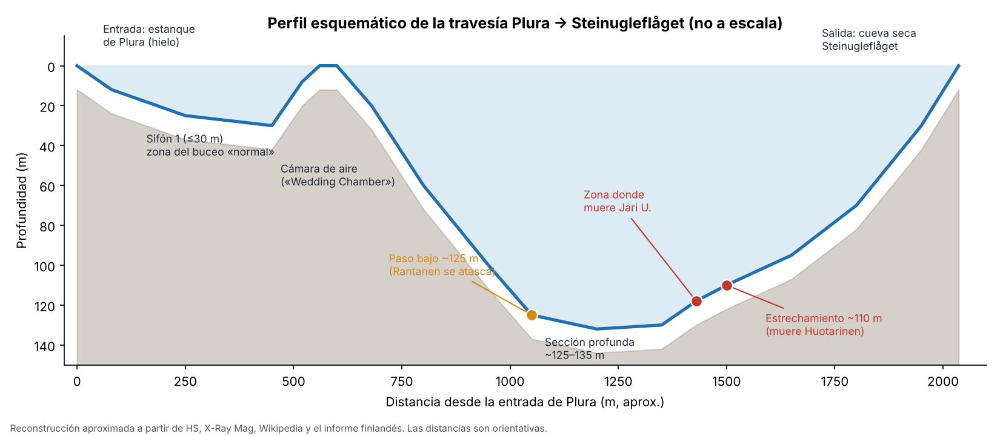
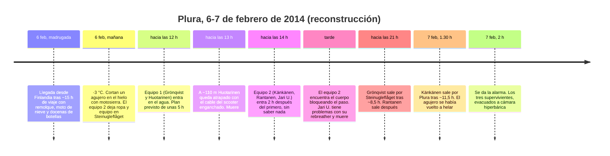
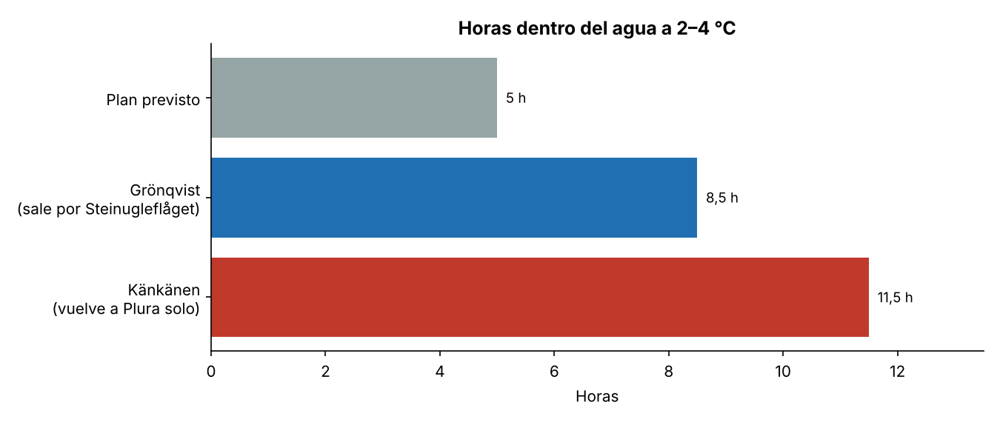
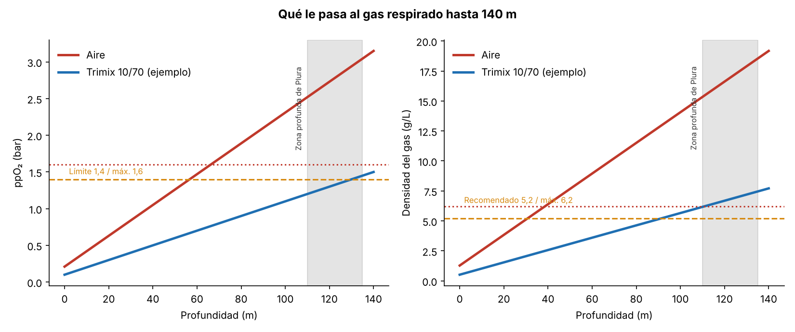

# 🧊 La tragedia de la cueva de Plura (Noruega, 2014)

### Dos muertes a 110–130 m bajo el hielo, un rescate oficial abandonado y la operación secreta de sus amigos

> 🇬🇧 **[English version](README.en.md)**

> **Estudio divulgativo** · Autor: Óscar Ramírez Martín · Noviembre 2026
> Elaborado a partir de fuentes públicas contrastadas y de cálculos propios.

> 🔗 **Estudio relacionado:** [La tragedia de la cueva de Vaavu (Maldivas, 2026)](https://github.com/Oskillar28/cueva-vaavu-maldivas). Los buzos que recuperaron los cuerpos en Maldivas son los protagonistas de este caso.

> ⚠️ **Nota de respeto.** Este estudio trata la muerte real de dos buceadores finlandeses. No incluye imágenes de las víctimas ni enlaces a las grabaciones de sus cámaras en el momento del accidente. El objetivo es entender **qué pasó**, **por qué** y **qué se aprendió**.

*El río Plura atravesando el valle de Plurdalen (Rana, Nordland, Noruega), julio de 2007. Bajo este valle corre la cueva inundada más profunda del norte de Europa. Foto: Sandivas, CC BY-SA 3.0, vía Wikimedia Commons.*

---

## 📑 Índice

1. [Por qué este caso](#1-por-qué-este-caso)
2. [El caso en 30 segundos](#2-el-caso-en-30-segundos)
3. [Quiénes eran](#3-quiénes-eran)
4. [La cueva de Plura](#4-la-cueva-de-plura)
5. [Cronología del 6 y 7 de febrero de 2014](#5-cronología-del-6-y-7-de-febrero-de-2014)
6. [Qué falló: análisis punto por punto](#6-qué-falló-análisis-punto-por-punto)
7. [La cadena de sucesos](#7-la-cadena-de-sucesos)
8. [¿Se podría haber evitado?](#8-se-podría-haber-evitado)
9. [El rescate oficial y la prohibición](#9-el-rescate-oficial-y-la-prohibición)
10. [La operación secreta](#10-la-operación-secreta)
11. [De Plura a Vaavu: el hilo que une los dos estudios](#11-de-plura-a-vaavu-el-hilo-que-une-los-dos-estudios)
12. [Otros accidentes y curiosidades de Plura](#12-otros-accidentes-y-curiosidades-de-plura)
13. [El documental y los vídeos](#13-el-documental-y-los-vídeos)
14. [Contraste de fuentes: datos que no coinciden](#14-contraste-de-fuentes-datos-que-no-coinciden)
15. [Mitos frente a realidad](#15-mitos-frente-a-realidad)
16. [Glosario técnico](#16-glosario-técnico)
17. [Lecciones](#17-lecciones)
18. [Metodología, límites y nivel de confianza](#18-metodología-límites-y-nivel-de-confianza)
19. [Fuentes](#19-fuentes)
20. [Créditos de las imágenes](#20-créditos-de-las-imágenes)

---

## 1. Por qué este caso

En mayo de 2026, cuando cinco buceadores italianos murieron en la cueva de Vaavu (Maldivas), DAN Europe envió a tres especialistas finlandeses para recuperarlos: **Sami Paakkarinen, Patrik Grönqvist y Jenni Westerlund**. Los dos primeros eran conocidos en todo el mundo por algo que pasó doce años antes en Noruega.

En febrero de 2014, Grönqvist vio morir a su amigo atrapado en un estrechamiento a 110 m de profundidad. Semanas después, cuando las autoridades noruegas dieron por imposible el rescate y cerraron la cueva, él y Paakkarinen organizaron con otros buceadores una **operación secreta** para sacar los cuerpos. La historia se contó en el documental *Diving Into the Unknown* (2016).

Los dos casos son opuestos y por eso se explican el uno al otro:

- En **Vaavu**, un grupo **sin formación de cuevas** entró con equipo de turismo y murió por falta de preparación.
- En **Plura**, cinco buceadores **con la formación más alta que existe** (espeleobuceo completo con *rebreather*) murieron o casi mueren en una inmersión planificada al detalle. Plura enseña que, a esas profundidades, **incluso haciéndolo todo bien queda un riesgo que no se puede eliminar**.

---

## 2. El caso en 30 segundos

| Dato | Valor más fiable |
|---|---|
| **Fecha** | Jueves 6 de febrero de 2014 |
| **Lugar** | Cueva de Plura (*Pluragrotta*), valle de Plurdalen, municipio de Rana, Nordland (Noruega), cerca de Mo i Rana, junto al círculo polar |
| **Coordenadas** | 66°13′10″ N · 14°46′21″ E ([ver en OpenStreetMap](https://www.openstreetmap.org/?mlat=66.21944&mlon=14.77250#map=13/66.21944/14.77250)) |
| **Objetivo** | Travesía completa de **~2 km bajo el agua**: entrar por el estanque de Plura y salir por la cueva seca de Steinugleflåget |
| **Profundidad máxima prevista** | ~129–135 m |
| **Temperatura del agua** | ~2–4 °C, entrando por un agujero cortado en el hielo |
| **Equipo** | *Rebreathers* de circuito cerrado (CCR) con trimix, *scooters* (propulsores) y botellas y *rebreathers* de rescate |
| **Formación** | Los cinco, espeleobuceadores completos con CCR (*CCR Full Cave*) |
| **Víctimas** | **2 muertos** (Jari Huotarinen y Jari U.) y **3 supervivientes** tratados por enfermedad descompresiva |
| **Causa** | Huotarinen quedó atrapado en un estrechamiento a ~110 m, con el cable de su *scooter* enganchado, y se ahogó al fallar el cambio a gas de rescate. Jari U. tuvo problemas con su *rebreather* poco después, cerca del mismo punto |
| **Rescate oficial** | Tres buzos británicos de élite (Stanton, Volanthen y Mallinson) lo abandonaron por demasiado peligroso. La policía cerró la cueva |
| **Rescate real** | Un equipo finlandés-noruego sacó los cuerpos **sin autorización** a finales de marzo de 2014: 101 horas de buceo |

**En una frase:** la cueva no perdonó un cable enganchado a 110 m; y sus amigos, contra la orden de la policía, volvieron a por ellos.

---

## 3. Quiénes eran

| Nombre | Edad | Quién era | Qué le pasó |
|---|---|---|---|
| **Patrik Grönqvist** («Patte») | 42 | Bombero de Porvoo. En 2013 hizo la primera travesía de la cueva | Equipo 1. Vio morir a su compañero y salió por Steinugleflåget tras ~8,5 h |
| **Jari Huotarinen** («Hamsteri») | 40 | Jefe de producción de Valkeakoski. Buceador tranquilo; años antes había logrado con Känkänen un récord finlandés no oficial | Equipo 1. Su primera travesía. **Murió** atrapado a ~110 m |
| **Kai Känkänen** («Kaitsu») | 46 | Contratista eléctrico de Vantaa. Había perdido a su compañero de buceo en una cantera finlandesa un año antes | Equipo 2. Volvió solo hasta la entrada de Plura: ~11,5 h en el agua |
| **Vesa Rantanen** («Vesku») | 33 | Diseñador eléctrico de Hämeenlinna | Equipo 2. Se quitó equipo para pasar junto al cuerpo de Huotarinen. Enfermedad descompresiva |
| **Jari U.** | 34 | Ingeniero mecánico de Espoo. Sin experiencia previa en Plura, pero descrito como un buceador metódico y prudente | Equipo 2. **Murió** tras problemas con su *rebreather* cerca del estrechamiento |
| **Sami Paakkarinen** | — | El más veterano del grupo. Estaba dando un curso en México el día del accidente | Lideró, con Grönqvist, la recuperación secreta de los cuerpos |

*El periódico finlandés Helsingin Sanomat no publicó el apellido de Jari U. a petición de su familia. Este estudio respeta esa decisión, aunque otros medios sí lo publicaron.*

> 🧠 **Razonamiento:** a diferencia de Vaavu, aquí no hay «exceso de confianza de aficionados». Los cinco tenían la formación técnica más alta, equipo redundante y un plan escrito. Lo que falló fue el margen: a 110 m, en agua a 2 °C y dentro de un paso estrecho, **un solo problema mecánico** puede consumir todo el margen en minutos.

---

## 4. La cueva de Plura

### 4.1 El lugar

- **Plura** (*Pluragrotta*) está en el valle de **Plurdalen**, cerca de la granja de Jordbru, en el municipio de **Rana** (Nordland), cerca de la ciudad de Mo i Rana y justo al sur del **círculo polar ártico**.
- Es una cueva **kárstica** en caliza y mármol, excavada por el río Plura. Rana tiene unas 200 cuevas, pero casi ninguna se puede bucear.
- Tiene **dos entradas**: el estanque de **Plura** (agua) y la cueva seca de **Steinugleflåget**, a la que en invierno se llega en moto de nieve y que exige bajar más de 100 m en vertical hasta el lago interior.
- Mide unos **3 km** de galerías y alcanza **al menos 135 m** de profundidad: es la **cueva más profunda del norte de Europa** y la más visitada por espeleobuceadores de Escandinavia.
- El agua está a **2–4 °C** y la visibilidad puede llegar a **20 m**. Los peligros: pasos estrechos, rocas cortantes, frío y galerías laterales donde perderse.

### 4.2 La estructura

*Perfil esquemático de la travesía de 2014. No está a escala: es una reconstrucción aproximada a partir de las fuentes. Elaboración propia.*

| Tramo | Qué hay | Profundidad |
|---|---|---|
| **Sifón 1** | Primer tramo inundado desde el estanque, unos 500 m. Aquí llega la mayoría de buceadores | ≤ 30 m |
| **Cámara de aire** | Gran sala con aire, conocida como «Wedding Chamber» (ver [§12](#12-otros-accidentes-y-curiosidades-de-plura)) | Superficie |
| **Sifón profundo** | El túnel cae en vertical hacia la zona más honda | Hasta ~130–135 m |
| **Paso bajo** | Abertura de menos de 1 m de alto | ~125 m |
| **Estrechamiento** | El paso donde quedó atrapado Huotarinen, ya en la subida | ~110 m |
| **Subida a Steinugleflåget** | Conexión que sube hasta el lago interior de la cueva seca | De ~130 m a superficie |
| **Total de la travesía** | **2.036 m** bajo el agua | |

### 4.3 Historia de la exploración

| Año | Hito |
|---|---|
| Años 60 | La presa del lago Kallvatnet reduce el caudal del río y hace posible bucear la cueva |
| 1980 | Primera inmersión conocida (Svein Grundstrøm y Bjørn Fagertun) |
| 1987–1997 | Diez buceadores noruegos, casi todos bomberos de Oslo, topografían casi 3 km por su cuenta |
| 2002 → | Equipos noruegos (Reel Action Diving) continúan la exploración |
| Sept./oct. 2013 | Buceadores finlandeses (Paakkarinen, Grönqvist, Känkänen) descubren la conexión con Steinugleflåget y hacen la **primera travesía** |
| 6 feb. 2014 | Intento de **segunda travesía**: dos muertos |

Durante años hubo **rivalidad** entre los equipos noruegos y finlandeses que exploraban la cueva.

---

## 5. Cronología del 6 y 7 de febrero de 2014

*Lo previsto frente a lo real. Datos de Helsingin Sanomat. Elaboración propia.*

### 5.1 Equipo 1: Grönqvist y Huotarinen

1. Pasan la parte más profunda (~130 m) y empiezan a subir.
2. Grönqvist cruza un estrechamiento y, al mirar atrás, ve la linterna de Huotarinen moviéndose arriba y abajo: la señal de **problema**.
3. Vuelve. Huotarinen está **atascado**: el cable que lo une a su *scooter* se ha enganchado bajo una roca. El *scooter* acaba arrancado y perdido.
4. Huotarinen pide gas de circuito abierto (*bailout*). Grönqvist le pasa su propia boquilla dos o tres veces. En un momento en que se queda sin boquilla, Grönqvist purga un regulador para dárselo, pero **Huotarinen inhala agua y muere**.
5. El ordenador de Grönqvist marca **más de 400 minutos** de descompresión obligatoria. Decide seguir hacia Steinugleflåget.

### 5.2 Equipo 2: Känkänen, Rantanen y Jari U.

1. Rantanen lleva **cinco botellas de rescate grandes**, lo que los ralentiza en los pasos estrechos.
2. A ~125 m Rantanen se atasca en una abertura de menos de 1 m de alto y se quita dos botellas para pasar. Una aleta se le engancha en el hilo guía y Jari U. lo libera.
3. Rantanen oye la **alarma de un *rebreather***: es el de Huotarinen. Su cuerpo **bloquea el paso**. Intenta moverlo, no puede, y acaba quitándose equipo para pasar junto a él.
4. Detrás, Jari U. empieza a nadar de forma errática y cambia de su *rebreather* al gas de rescate. Känkänen intenta ayudarle sin saber qué le pasa. **Jari U. muere** poco después.
5. Känkänen grita a Rantanen que vuelva. Rantanen sigue adelante. Känkänen, convencido de que Grönqvist también ha muerto, **da la vuelta solo**.

### 5.3 El regreso de Känkänen

Känkänen deshace el camino hasta Plura. En la cámara de aire respira el aire atrapado para ahorrar oxígeno. Su *scooter* se estropea y un tramo que debía durar 15 minutos le lleva 45. Sale a la 1:30 de la madrugada, tras unas **11,5 horas** en agua a 2 °C, y encuentra el agujero del hielo **cubierto de nuevo por 1 cm de hielo**. No sabía si era el único superviviente.

---

## 6. Qué falló: análisis punto por punto

Los números de esta sección son cálculos propios con fórmulas estándar del buceo ([`scripts/calculos_y_figuras.py`](scripts/calculos_y_figuras.py), resultados en [`calculos.txt`](calculos.txt)).

### 6.1 La presión a 110–130 m

$$P_{\text{absoluta}} = 1 + \frac{\text{profundidad (m)}}{10}$$

| Profundidad | Presión absoluta | Un litro de gas de superficie ocupa… |
|---|---|---|
| 30 m (fin del sifón 1) | 4 bar | 0,25 L |
| 110 m (estrechamiento) | 12 bar | 0,08 L |
| **130 m** (zona más profunda) | **14 bar** | **0,07 L** |

*(En agua dulce la presión sube algo más despacio que en el mar, ~1 bar cada 10,3 m. Aquí se redondea a 10 m.)*

### 6.2 Por qué no se puede respirar aire ahí abajo

| A 130 m | Aire | Trimix 10/70 (ejemplo) |
|---|---|---|
| ppO₂ | **2,94 bar** (convulsiones casi seguras) | 1,40 bar |
| Narcosis (profundidad equivalente) | Como una borrachera muy fuerte | Como estar a ~25 m |
| Densidad del gas | **17,9 g/L** | **7,2 g/L** |

*Presión parcial de oxígeno y densidad del gas para aire y para un trimix de ejemplo. La franja gris es la zona profunda de Plura. Cálculo propio.*

Por eso se bucea con **trimix** (oxígeno + helio + nitrógeno) dentro de un ***rebreather***, que mantiene el oxígeno en un valor fijo y recicla el gas espirado. Pero fíjate en la gráfica de la derecha: **incluso con trimix, la densidad del gas a 130 m supera el límite recomendado** (5,2 g/L) y roza o pasa el máximo (6,2 g/L).

### 6.3 El CO₂: el enemigo silencioso del *rebreather*

Un *rebreather* elimina el CO₂ con un filtro químico (cal sodada). Con un gas tan denso:

- Cuesta más mover el gas por los pulmones y por los tubos del aparato.
- Si el buceador **se agita y respira deprisa**, el filtro puede no dar abasto y el **CO₂ se acumula** (hipercapnia).
- El exceso de CO₂ provoca **sensación de ahogo, pánico y confusión**, y el pánico hace respirar todavía más rápido.

La BBC lo explicó así al contar el caso: los *rebreathers* se pueden saturar si el buceador respira rápido, y a esa profundidad es más difícil controlar la respiración. Es la explicación más probable de por qué Huotarinen, atrapado y nervioso, **pidió gas de circuito abierto**, y de por qué Jari U. empezó a nadar de forma errática.

### 6.4 Cuánto dura una botella de rescate a 130 m

Cuando un *rebreather* falla, el buceador pasa a **circuito abierto** (*bailout*): respira de una botella y expulsa el gas al agua. A 14 bar, cada respiración gasta 14 veces más que en superficie. Ejemplo con una botella típica de 11 L a 200 bar (2.200 L):

| Situación | Consumo en superficie | Consumo a 130 m | Minutos |
|---|---|---|---|
| Relajado | 15 L/min | 210 L/min | **≈ 10** |
| Normal | 20 L/min | 280 L/min | **≈ 8** |
| Esfuerzo | 30 L/min | 420 L/min | **≈ 5** |
| Estrés | 45 L/min | 630 L/min | **≈ 3,5** |
| Pánico | 60 L/min | 840 L/min | **≈ 2,5** |

> ⚖️ **Conclusión:** atrapado y con estrés, una botella de rescate dura **pocos minutos**. Y salir de 130 m exige **horas** de descompresión. Por eso en Plura se lleva tanto gas de rescate, y por eso Rantanen cargaba cinco botellas.

### 6.5 El estrechamiento y el cable del *scooter*

- Un ***scooter*** (propulsor submarino) se lleva atado al cuerpo con un cable o correa para no perderlo.
- En un paso estrecho, **cualquier cosa que cuelgue se puede enganchar**: el cable, una botella, una aleta, el hilo guía. Al propio Rantanen se le enganchó una aleta en el hilo guía poco antes.
- A 110 m, atrapado, el buceador no puede **subir**, no puede **girarse** con facilidad y no puede **salir a superficie**. Solo puede resolver el problema allí mismo, con el gas que lleve encima y con el compañero que tenga al lado.

### 6.6 Un cuerpo bloqueando el único camino

La segunda muerte está ligada a la primera. El cuerpo de Huotarinen quedó **en el paso por el que tenía que pasar el equipo 2**, que no sabía nada porque entró dos horas después. Encontrar a un amigo muerto a 110 m, en un paso estrecho y con un rescate imposible, es uno de los escenarios de estrés más extremos que existen. La policía noruega cree que **Jari U. entró en pánico** al llegar al lugar del primer accidente. Las fuentes técnicas añaden que también tuvo problemas con su *rebreather*.

### 6.7 La descompresión y el frío

- Tras pasar por 130 m, los supervivientes necesitaban **horas** de paradas de descompresión. Grönqvist tenía más de 400 minutos pendientes cuando murió su compañero.
- Los tres tuvieron que **acortar** la descompresión. Rantanen sufrió dolor en el brazo y la rodilla (enfermedad descompresiva) y más tarde hormigueo y problemas para caminar.
- Pasar **8 a 11 horas en agua a 2 °C** exige trajes secos y calefacción. El frío cansa, acelera la respiración y dificulta pensar.

### 6.8 Las decisiones bajo presión

- **Grönqvist** no podía volver por donde había venido (tenía que cruzar otra vez la zona más profunda) y decidió seguir hacia la salida.
- **Känkänen** decidió **volver** en lugar de cruzar el estrechamiento con el cuerpo de su amigo: no sabía qué otros bloqueos había por delante. Rantanen decidió **seguir**. Los dos sobrevivieron.
- En una cueva así no hay una decisión «correcta» universal. La regla del espeleobuceo es que **cada buceador debe poder salir solo**, y los tres lo hicieron.

---

## 7. La cadena de sucesos

```mermaid
flowchart LR
    A["1️⃣ Objetivo extremo<br/>travesía de 2 km<br/>a 130 m y 2 °C"] --> B["2️⃣ Paso estrecho<br/>a ~110 m"]
    B --> C["3️⃣ Cable del scooter<br/>enganchado"]
    C --> D["4️⃣ Estrés + gas denso<br/>→ CO₂ y ahogo"]
    D --> E["5️⃣ Cambio a bailout<br/>fallido"]
    E --> F["💀 Muere Huotarinen"]
    F --> G["6️⃣ Cuerpo bloqueando<br/>el único paso"]
    G --> H["7️⃣ Problema con el<br/>rebreather + estrés"]
    H --> I["💀 Muere Jari U."]
    style F fill:#222,color:#fff
    style I fill:#222,color:#fff
    style C fill:#d64545,color:#fff
```

| Eslabón | ¿Comprobado? | Confianza |
|---|---|---|
| Huotarinen atrapado en un estrechamiento a ~110 m | Sí: todas las fuentes | 0,9 |
| Cable del *scooter* enganchado | Sí: Helsingin Sanomat, BBC | 0,85 |
| Fallo al pasar a gas de rescate (inhaló agua) | Sí: relato de Grönqvist en HS | 0,8 |
| Acumulación de CO₂ como factor | Probable: física y explicación de la BBC; no hay autopsia pública | 0,6 |
| Problemas con el *rebreather* de Jari U. | Sí: informe finlandés y HS | 0,75 |
| Pánico de Jari U. al ver el primer accidente | Hipótesis de la policía noruega | 0,6 |
| Los tres supervivientes acortaron la descompresión | Sí: informe finlandés | 0,85 |

---

## 8. ¿Se podría haber evitado?

Esta pregunta es más difícil que en Vaavu, porque aquí **casi todo se hizo bien**. Lo honesto es separar lo que sí se hizo de lo que se podría haber hecho distinto.

| Buena práctica | ¿Se hizo? |
|---|---|
| Formación completa de cuevas con *rebreather* | ✅ Los cinco |
| Gas adecuado (trimix) y *rebreather* | ✅ |
| Gas y *rebreathers* de rescate | ✅ |
| Hilo guía instalado | ✅ La ruta estaba tendida desde la travesía de 2013 |
| Equipos pequeños y dejar posar el sedimento | ✅ Dos equipos separados dos horas |
| Plan escrito y apoyo en ambas salidas | ✅ Equipo y ropa en Steinugleflåget |

| Lo que se podría haber hecho distinto | Por qué |
|---|---|
| **Más experiencia previa en esa ruta** antes de intentar la travesía | Para Huotarinen era la primera travesía, y Jari U. no había buceado nunca en Plura. La travesía solo se había hecho una vez, cinco meses antes |
| **Configuración más «limpia»** en los pasos estrechos | Nada colgando: cables del *scooter* recogidos o soltables con una mano, botellas bien sujetas. Un mosquetón que se suelta rápido puede salvar una vida |
| **Menos gas denso** (más helio) en el tramo profundo | Bajar la densidad reduce el riesgo de CO₂ y el esfuerzo respiratorio. A 130 m es difícil llegar a valores seguros (ver [§6.2](#62-por-qué-no-se-puede-respirar-aire-ahí-abajo)) |
| **Comunicación entre equipos** | El equipo 2 no sabía que el paso estaba bloqueado. En una cueva de 2 km no hay forma sencilla de avisar: solo dejar marcas o notas en el hilo |
| **Aceptar que el objetivo tiene un riesgo residual alto** | Una travesía de 2 km a 130 m y 2 °C está en el límite de lo que se puede hacer. Los propios protagonistas lo dicen en el documental |

> 🧭 **Diferencia clave con Vaavu:** en Vaavu, **una sola** capa de seguridad bien puesta (un hilo guía, una segunda botella, una regla de los tercios) probablemente los habría salvado. En Plura estaban **todas** las capas, y aun así un cable enganchado bastó para empezar la cadena. Por eso el espeleobuceo profundo sigue siendo una de las actividades más peligrosas del mundo.

*Buceador de cuevas desenrollando un hilo guía. En Plura el hilo estaba instalado: el peligro fue otro. Foto: Ryan Cantey, CC BY-SA 3.0, vía Wikimedia Commons.*

---

## 9. El rescate oficial y la prohibición

| Fecha | Qué pasó |
|---|---|
| 7 feb. 2014 | La policía de Helgeland moviliza a 14 especialistas. Noticia en Finlandia y Noruega. Los supervivientes declaran ante la policía |
| ~20–21 feb. | Llegan **Rick Stanton, John Volanthen y Jason Mallinson**, buzos británicos de rescate en cuevas (los mismos que en 2018 encontrarían a los niños de la cueva de Tham Luang, en Tailandia) |
| 21–25 feb. | Entran por Steinugleflåget e inspeccionan el lugar. **No consiguen liberar el cuerpo de Huotarinen**, y pasar el estrechamiento para llegar a Jari U. les parece demasiado peligroso |
| 25 feb. | La operación se **abandona**. Stanton explica que sería una operación larga, con muchas inmersiones profundas y frías, fuera de lo que les correspondía. La única alternativa era otra travesía desde Plura, y se descartó |
| Después | La policía mantiene la **prohibición de bucear** y cierra la zona. Los cuerpos se quedan en la cueva |

> 🧭 **La regla de oro del rescate:** no crear más víctimas. La decisión de los británicos fue profesional y correcta: recuperar cuerpos nunca justifica arriesgar a los vivos.

---

## 10. La operación secreta

### 10.1 «Kaveria ei jätetä»

Los soldados finlandeses de la Guerra de Invierno (1939–1940) contra la URSS tenían un lema: ***kaveria ei jätetä***, «no se deja atrás a un compañero». Los supervivientes lo hicieron suyo. Tenían además motivos prácticos:

- Que las familias pudieran **enterrar** a sus muertos.
- Que se pudieran resolver **seguros y herencias**, que se complican sin cuerpo.
- Que la cueva **se reabriera**: con dos cuerpos dentro, la prohibición podía ser permanente.

Lo mantuvieron en **secreto** porque creían que, si la policía se enteraba, les impediría bucear.

### 10.2 La operación

| Aspecto | Dato |
|---|---|
| Fecha | Finales de marzo de 2014: los cuerpos se sacan el **26 de marzo**, unas **siete semanas** después del accidente; la operación duró unos 5 días |
| Líderes | **Sami Paakkarinen y Patrik Grönqvist** |
| Participantes | Según la fuente, 10 buceadores (dos de ellos mujeres) y 7 ayudantes, o 17 finlandeses y 10 noruegos |
| Tiempo de buceo | **101 horas** en total |
| Preparación | **26 botellas de rescate** dejadas en la cueva y un **hábitat submarino** (una «campana» con aire donde descansar durante la descompresión) |
| Método | Entraron equipos desde **las dos entradas**. Grönqvist y Paakkarinen liberaron los cuerpos y los llevaron hasta la cueva seca |
| Apoyo local | Una docena de vecinos ayudó a sacar el material; el dueño de la granja les calentó la sauna |
| Aviso | A la mañana siguiente, Paakkarinen avisó a la policía. Rescatadores noruegos sacaron los cuerpos de la cueva seca |

### 10.3 La reacción de las autoridades

- La policía de Helgeland confirmó que el equipo finlandés **les había avisado ellos mismos** de que habían sacado a los dos buceadores.
- La policía dijo que la prohibición seguía vigente pero que **procesar al equipo no era una prioridad**. Paakkarinen contó que notó a los agentes contentos con el resultado, aunque le dejaron claro que habría investigación.
- El grupo esperó unos **seis meses** hasta quedar libre de cargos.
- La prohibición se **levantó el 31 de marzo de 2014**, cuatro días después.
- Los funerales se celebraron a finales de abril. Grönqvist llevó el féretro de su amigo. Pocos días después, los tres supervivientes se fueron de viaje a bucear cuevas en España y Francia, incluida **Pozo Azul** (Burgos).

---

## 11. De Plura a Vaavu: el hilo que une los dos estudios

| | **Plura (Noruega, 2014)** | **Vaavu (Maldivas, 2026)** |
|---|---|---|
| Profundidad | 110–135 m | 47–70 m |
| Agua | Dulce, **2–4 °C**, bajo el hielo | Salada, **~28 °C** |
| Formación | Espeleobuceo completo con CCR | Sin formación de cuevas conocida |
| Equipo | *Rebreathers*, trimix, *scooters*, mucho gas de rescate | Aire, una botella de 12 L |
| Hilo guía | Instalado | No |
| Qué falló | Atrapamiento en un paso estrecho + CO₂/*rebreather* | Desorientación en un túnel ciego + aire agotado |
| Muertos | 2 | 5 + 1 rescatador |
| Primer intento de recuperación | Buzos británicos: **abandonado** por peligroso | Buzos militares maldivos: **murió uno** |
| Quién sacó los cuerpos | **Paakkarinen y Grönqvist** (y otros) | **Paakkarinen, Grönqvist** y Westerlund (DAN Europe) |
| Lección | Incluso haciéndolo todo bien queda riesgo | Sin preparación, el riesgo es casi seguro |

*Rebreather de circuito cerrado modelo Inspiration, uno de los modelos que aparecen en el documental. Foto: EMDX, CC BY-SA 4.0, vía Wikimedia Commons.*

> 🔗 **Doce años después.** Los hombres que en 2014 tuvieron que esconderse de la policía para recuperar a sus amigos fueron en 2026 el equipo **oficial** que un gobierno y DAN Europe llamaron para recuperar a cinco desconocidos. Tras Maldivas, el presidente italiano les concedió la Orden del Mérito. La experiencia de Plura (hábitats, *scooters*, recuperaciones en pasos estrechos) es lo que hizo posible Vaavu.

---

## 12. Otros accidentes y curiosidades de Plura

| Fecha | Suceso |
|---|---|
| Agosto 1988 | Un buceador se rompe el traje seco con una roca y sufre hipotermia leve. Sobrevive |
| **16 agosto 2006** | Muere el noruego **Ståle Tveitane**, de 37 años, a unos 1.300 m de la entrada y tras bajar a ~110 m; el accidente ocurre en la vuelta, hacia los 75 m. Un equipo británico dirigido por Mark Dougherty recupera el cuerpo el 28 de agosto, porque la normativa noruega no permitía a sus propios buzos asumir ese riesgo. Tras este accidente se funda la **Sociedad Noruega de Espeleobuceo** |
| **6 febrero 2014** | Mueren Jari Huotarinen y Jari U. (este estudio) |
| 10 agosto 2019 | **Boda bajo tierra** en la cámara de aire, con 69 participantes: récord Guinness. Los novios eran el finlandés Jani Santala y la noruega Ina Trælnes. Desde entonces se la conoce como «Wedding Chamber» |
| **3 abril 2024** | Muere el estadounidense **Jared Hires**, de 33 años, director de la marca Dive Rite. Sufrió una **convulsión** en la vuelta desde la cámara de aire. El informe preliminar de DAN la atribuyó a un **problema médico**, no a un fallo del equipo. Rana no cerró la cueva |

Un detalle curioso: se cree que **no hay peces** en la cueva, pero en una escena del documental se ve claramente uno.

---

## 13. El documental y los vídeos

### 13.1 *Diving Into the Unknown* (2016)

*Haz clic en la imagen para ver el tráiler oficial en YouTube.*

| Dato | Valor |
|---|---|
| Título original | *Takaisin pintaan* («De vuelta a la superficie») |
| Director | **Juan Reina** (su primer largometraje; no era buceador) |
| Productora | Monami Agency (productor: Juho Harjula) |
| Idea original | Los espeleobuceadores Antti Apunen y Janne Suhonen. Iba a ser un documental sobre un **récord de distancia** en cuevas; el accidente lo cambió todo |
| Imágenes | Sobre todo de las **GoPro** de los propios buceadores |
| Estreno | DocPoint Helsinki, 27 de enero de 2016 |
| Duración | 82–85 min según la versión |
| Protagonistas | Sami Paakkarinen, Kai Känkänen, Patrik Grönqvist, Vesa Rantanen |
| Premios | Entre otros, el EUROTEK Media Award 2016 |
| Críticas | 5/5 en CineVue; 8/10 en Film Threat; IMDb ~7,0 |

### 13.2 Dónde verlo y vídeos relacionados

| Vídeo | Enlace |
|---|---|
| 🎬 Tráiler oficial | [YouTube](https://www.youtube.com/watch?v=mEDOeS782rc) |
| 🎬 Tráiler del Reino Unido (2017) | [YouTube](https://www.youtube.com/watch?v=L5Qj91QGulM) |
| 🎬 Teaser del director | [Vimeo](https://vimeo.com/152946560) · [tráiler en Vimeo](https://vimeo.com/147712008) |
| 🎙️ Extra: Sami Paakkarinen habla sobre el buceo | [YouTube](https://www.youtube.com/watch?v=Y4Z1ZYN1JNA) |
| 📺 Película completa | Apple TV, Amazon Prime Video, YouTube (alquiler), Tubi o Filmzie, según el país. Disponibilidad comprobada en reseñas de 2026; puede cambiar |
| 📰 Reportaje interactivo de Helsingin Sanomat (en inglés), con mapa de la cueva | [dynamic.hs.fi/2014/deep](https://dynamic.hs.fi/2014/deep/) |

> ⚠️ En internet circulan fragmentos de las cámaras de los buceadores grabados durante el accidente. Este estudio **no los enlaza** por respeto a las víctimas y a sus familias.

---

## 14. Contraste de fuentes: datos que no coinciden

| Dato | Versión A | Versión B | Más probable y por qué |
|---|---|---|---|
| **Profundidad del problema** | «~130 m» (primer aviso en el foro Rebreather World) | ~110 m (informe finlandés, HS, X-Ray Mag) | **~110 m** para el estrechamiento; 130 m es la zona más profunda que acababan de cruzar |
| **Apellido de Jari U.** | No se publica (HS, a petición de la familia) | Uusimäki (BBC, otros medios) | Se respeta la decisión de la familia |
| **Hospital** | Tromsø, los tres (informe finlandés, prensa noruega) | Rantanen tratado en Bergen (HS) | Probablemente **Tromsø** al principio; el dato de Bergen no está confirmado por otra fuente |
| **Horas de Känkänen** | ~11,5 h (HS) | 11 h (Film Threat) · 10 h (Dive Pacific) | **~11,5 h**: HS da hora de entrada y de salida |
| **Fecha de la 1.ª travesía** | Septiembre 2013 (Wikipedia, HS) | Octubre 2013 (resumen en ScubaBoard) | **Otoño de 2013** |
| **Participantes en el rescate secreto** | 10 buceadores + 7 ayudantes (HS) | 17 finlandeses + 10 noruegos (X-Ray Mag) | **Sin determinar**; puede depender de si se cuentan los apoyos en superficie |
| **Año del rescate secreto** | Marzo de **2014** (HS, policía, Wikipedia) | «2016» (reseña de *Undercurrent*, 2026) | **2014**: 2016 es el año del documental. La misma reseña confunde Plura y Maldivas |
| **Duración del documental** | 82 min (*Undercurrent*) · 83 (EIDF) | 85 min (X-Ray Mag, Rotten Tomatoes) · 90 (Filmuforia) | Distintas versiones; **~85 min** la más citada |
| **Longitud de la cueva** | ~3 km (Wikipedia) | Sistema de 2 km (Divernet) | 2 km es la **travesía**; ~3 km el total topografiado |

---

## 15. Mitos frente a realidad

| Mito | Realidad | Confianza |
|---|---|---|
| «Eran imprudentes o novatos» | Tenían la formación más alta; todas las fuentes los describen como experimentados y nada temerarios | 0,9 |
| «Se quedaron sin aire» | No respiraban aire: usaban *rebreathers* con trimix. Fallaron el atrapamiento, el CO₂ y el paso a gas de rescate | 0,8 |
| «La policía los detuvo por el rescate» | No: hubo investigación, pero procesarlos no era prioridad y quedaron libres de cargos | 0,8 |
| «El rescate secreto fue en 2016» | Fue en marzo de 2014; 2016 es el año del documental | 0,95 |
| «Los británicos no se atrevieron» | Hicieron inmersiones de inspección y decidieron, con criterio profesional, que el riesgo no se justificaba | 0,9 |
| «Plura está cerrada desde entonces» | Se reabrió el 31 de marzo de 2014 y sigue abierta, incluso tras la muerte de 2024 | 0,95 |

---

## 16. Glosario técnico

| Término | Significado |
|---|---|
| **Bailout** | Gas de rescate en circuito abierto (o un segundo *rebreather*) para cuando el principal falla |
| **Cal sodada** | Producto químico que absorbe el CO₂ dentro del *rebreather* |
| **CCR** (*rebreather* de circuito cerrado) | Equipo que recicla el gas espirado, elimina el CO₂ y añade oxígeno. Gasta muy poco gas |
| **Circuito abierto** | Buceo «normal»: se respira de la botella y el gas se expulsa al agua |
| **Densidad del gas** | Masa por litro del gas respirado. A más densidad, más esfuerzo y más CO₂ |
| **Descompresión** | Paradas en la subida para eliminar el gas disuelto sin formar burbujas |
| **Enfermedad descompresiva** (EDC) | Lesiones por burbujas de gas al subir o acortar las paradas |
| **Estrechamiento** (*restriction*) | Paso tan estrecho que obliga a pasar de lado, quitarse botellas o empujar el equipo por delante |
| **Hábitat submarino** | Campana o bolsa llena de gas donde los buzos descansan, comen o se calientan durante largas descompresiones |
| **Hipercapnia** | Exceso de CO₂ en sangre: ahogo, pánico, confusión |
| **Hilo guía** | Cabo continuo que marca el camino en la cueva |
| **Karst** | Paisaje de rocas solubles (caliza, mármol) con cuevas excavadas por el agua |
| **Narcosis** | Efecto anestésico de los gases a presión, sobre todo del nitrógeno |
| **ppO₂** | Presión parcial de oxígeno. Por encima de ~1,4–1,6 bar puede causar convulsiones |
| ***Scooter*** (DPV) | Propulsor submarino eléctrico que arrastra al buceador |
| **Sifón** (*sump*) | Tramo de cueva totalmente inundado entre dos zonas con aire |
| **Travesía** (*traverse*) | Entrar por una boca de la cueva y salir por otra |
| **Trimix** | Mezcla de oxígeno, helio y nitrógeno para inmersiones profundas |

---

## 17. Lecciones

1. **La formación no elimina el riesgo; lo reduce.** A 130 m y 2 °C, el margen es de minutos.
2. **Nada debe colgar en un paso estrecho.** Todo cable o correa debe poder soltarse con una mano.
3. **Un *rebreather* tiene límites físicos.** Gas denso + respiración agitada = CO₂. Controlar la respiración es parte del equipo.
4. **Practica el cambio a gas de rescate** hasta que sea automático, también atrapado y en mala postura.
5. **Experiencia progresiva en cada ruta.** La primera travesía no debería ser la más profunda de tu vida.
6. **Cada buceador debe poder salir solo.** Los tres supervivientes lo hicieron.
7. **En un rescate, la primera vida es la del rescatador.** Los británicos lo aplicaron en 2014; en Vaavu, en 2026, se aprendió por las malas.
8. **No se deja atrás a un compañero**, pero se vuelve a por él solo con el plan, el equipo y el tiempo necesarios. La operación secreta tardó siete semanas en prepararse.

---

## 18. Metodología, límites y nivel de confianza

**Cómo se ha hecho:**

1. Se ha dividido el caso en partes: lugar, cueva, protagonistas, accidente, física, rescate oficial, rescate secreto, documental y relación con Vaavu.
2. Cada dato se ha contrastado con al menos dos fuentes cuando ha sido posible (finlandesas, noruegas, británicas y de revistas de buceo). Las discrepancias están en la [§14](#14-contraste-de-fuentes-datos-que-no-coinciden).
3. Los cálculos de presión, ppO₂, densidad y autonomía se pueden reproducir con el script del repositorio. El trimix 10/70 y la botella de 11 L son **ejemplos**: las mezclas y botellas exactas de cada buceador no se han publicado.
4. Todo el texto es redacción propia, sin copiar párrafos de ninguna fuente.

**Límites:**

- El informe oficial finlandés y la investigación noruega no se han consultado completos; se conocen a través de resúmenes.
- No hay autopsias públicas: el papel exacto del CO₂ o de un fallo del equipo **no está confirmado**.
- El perfil de la cueva es **esquemático**.
- Los cálculos son **divulgativos** y no sirven para planificar inmersiones.

**Confianza global:**

| Bloque | Confianza |
|---|---|
| Hechos básicos (quién, cuándo, dónde) | 0,95 |
| Secuencia del accidente | 0,75 |
| Causas técnicas exactas | 0,6 |
| Rescate oficial y secreto | 0,85 |
| Física (cálculos) | 0,95 |
| Relación con Vaavu | 0,95 |

---

## 19. Fuentes

**El accidente y el rescate**

- Wikipedia (en). *Pluragrotta*. https://en.wikipedia.org/wiki/Pluragrotta
- **Helsingin Sanomat** (2014). *The Finns' fateful cave dive in Norway was a ghastly struggle* (reportaje interactivo en inglés). https://dynamic.hs.fi/2014/deep/
- **BBC** (mayo 2016). *The cave divers who went back for their friends*, reproducido por *The Daily Star*: https://www.thedailystar.net/world/the-cave-divers-who-went-back-their-friends-1221010
- **X-Ray Magazine**. *"Diving Into the Unknown" film now available to all*. https://old.xray-mag.com/node/8103
- **The Local Norway** (07/02/2014). *Two Finnish divers killed in Norway's Plura caves*. https://www.thelocal.com/20140207/two-finnish-divers-killed-in-norways-plura-caves
- **Scubaverse**. *Finnish divers recover bodies of countrymen from Norwegian cave system*. https://scubaverse.com/finnish-divers-recover-bodies-countymen-norwegian-cave-system/
- **Life in Norway**. *Plura Cave Disaster: When Cave Diving Went Wrong*. https://www.lifeinnorway.net/plura-cave-disaster
- **Dive Pacific**. *Cave rescue documentary: Diving into the unknown*. https://divepacific.co.nz/post/cave-rescue-documentary-diving-into-the-unknown
- ScubaBoard. Resumen de los accidentes de 2006 y 2014 a partir del informe finlandés (Sukeltajaliitto). https://scubaboard.com/community/goto/post?id=7047793
- AP / KSL (02/2014). *2 Finns killed in Norway cave-diving accident*. https://www.ksl.com/article/28632417/2-finns-killed-in-norway-cave-diving-accident

**El documental**

- **Divernet**. *Diving Into The Unknown, directed by Juan Reina*. https://divernet.com/scuba-diving/diving-into-the-unknown-directed-by-juan-reina/
- **Undercurrent** (junio 2026). Reseña de John Bantin. https://undercurrent.org/UCnow/dive_magazine/2026/DivingIntoTheUnknown202606.html
- **Rotten Tomatoes**. https://www.rottentomatoes.com/m/diving_into_the_unknown
- **CineVue** (Edimburgo 2016). https://cine-vue.com/2016/06/edinburgh-2016-diving-into-the-unknown-review.html
- **Film Threat** (2017). https://filmthreat.com/reviews/diving-into-the-unknown/

**El enlace con Vaavu**

- **Divernet** (05/2026). *Finnish cave divers reach Maldives on recovery mission*. https://divernet.com/scuba-news/health-safety/death/finnish-cave-divers-reach-maldives-on-recovery-mission/
- Estudio propio: *La tragedia de la cueva de Vaavu (Maldivas, 2026)*. https://github.com/Oskillar28/cueva-vaavu-maldivas

**Otros accidentes**

- **DIVE Magazine** (04/2024). *Dive Rite's Jared Hires dies in Norway's Plura cave system* y *Jared Hires' cause of death – DAN preliminary report*. https://divemagazine.com/scuba-diving-news/dive-rites-jared-hires-dies-in-norways-plura-cave-system
- **X-Ray Magazine** (04/2024). *Jared Hires Dies at Plura Cave*. https://xray-mag.com/content/jared-hires-dies-plura-cave

**Física y fisiología**

- DDRC Healthcare. *Gas Density and SCUBA* (Anthony y Mitchell, 2016). https://www.ddrc.org/gas-density-and-scuba/
- Ver también la sección de física del estudio de Vaavu.

---

## 20. Créditos de las imágenes

| Imagen | Autor | Licencia | Página original |
|---|---|---|---|
| Río Plura en Plurdalen (portada) | Sandivas | CC BY-SA 3.0 | [Commons](https://commons.wikimedia.org/wiki/File:Plura_G.JPG) |
| Buceador con hilo guía | Ryan Cantey | CC BY-SA 3.0 | [Commons](https://commons.wikimedia.org/wiki/File:Cave_diver_running_a_reel.jpg) |
| Rebreather Inspiration | EMDX | CC BY-SA 4.0 | [Commons](https://commons.wikimedia.org/wiki/File:Plongee-RecycleurInspiration_20040221-153656.jpg) |
| Miniatura del tráiler | Monami Agency / Juan Reina | © sus autores (enlace al vídeo oficial) | [YouTube](https://www.youtube.com/watch?v=mEDOeS782rc) |
| Perfil, gráficas y esquemas (`figs/`) | Óscar Ramírez Martín | CC BY-SA 4.0 | Elaboración propia |

> **Licencia de este documento:** texto y gráficas propias bajo **CC BY-SA 4.0**. Cada fotografía conserva la licencia de su autor.

---

*En memoria de Jari Huotarinen y Jari U. Y en reconocimiento a quienes volvieron a por ellos.*
