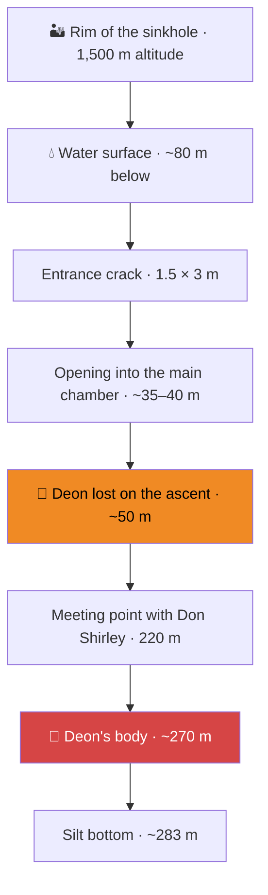
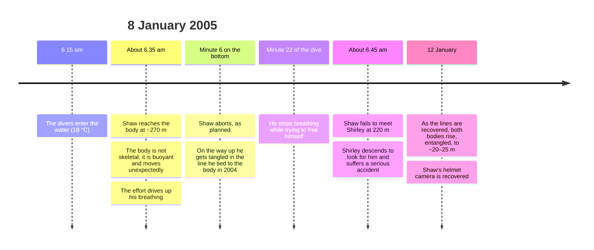
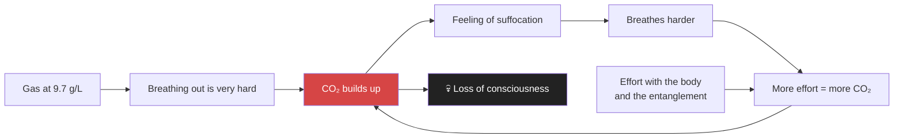

# 🕳️ The Deon Dreyer and Dave Shaw case at Boesmansgat

### Two deaths, ten years and 270 metres of fresh water in a cave in the South African desert

> 🇪🇸 **[Versión en español](README.md)**

> **Popular-science study** · Author: Óscar Ramírez Martín · November 2026
> Based on cross-checked public sources and my own calculations.

> 📄 **PDF version:** [Deon_Dreyer_Boesmansgat_Study.pdf](Deon_Dreyer_Boesmansgat_Study.pdf) (14 pages, for reading or printing; includes the Sheck Exley section).

> ⚠️ **A note on respect.** This study is about the real deaths of two people, a 20-year-old and a 50-year-old pilot, and their families' grief. It does not link to or reproduce the footage of Dave Shaw's death and includes no photographs of the bodies. The aim is to understand **why** it happened, so that it does not happen again.

> 📚 **Series of studies on diving accidents** by the same author:
> [Dahab Blue Hole (Yuri Lipski, 2000)](https://github.com/Oskillar28/blue-hole-dahab-yuri-lipski) · **Boesmansgat (Deon Dreyer and Dave Shaw, 1994–2005)** (this study) · [Zacatón (Sheck Exley, 1994)](https://github.com/Oskillar28/zacaton-cenote-mexico) · [Plura cave (Norway, 2014)](https://github.com/Oskillar28/plura-cueva-noruega) · [Vaavu cave (Maldives, 2026)](https://github.com/Oskillar28/cueva-vaavu-maldivas)

---

## 📑 Contents

1. [The case in 30 seconds](#1-the-case-in-30-seconds)
2. [The site: Boesmansgat](#2-the-site-boesmansgat)
3. [Who Deon Dreyer was](#3-who-deon-dreyer-was)
4. [17 December 1994: Deon's death](#4-17-december-1994-deons-death)
5. [Ten years on the bottom](#5-ten-years-on-the-bottom)
6. [Who Dave Shaw was](#6-who-dave-shaw-was)
7. [28 October 2004: the discovery](#7-28-october-2004-the-discovery)
8. [8 January 2005: the recovery that went wrong](#8-8-january-2005-the-recovery-that-went-wrong)
9. [Why Dave Shaw died: a physical analysis](#9-why-dave-shaw-died-a-physical-analysis)
10. [Why Deon Dreyer died: what is known and what is not](#10-why-deon-dreyer-died-what-is-known-and-what-is-not)
11. [The chain of errors](#11-the-chain-of-errors)
12. [How it could have been avoided](#12-how-it-could-have-been-avoided)
13. [Myths vs. reality](#13-myths-vs-reality)
14. [Conflicting sources](#14-conflicting-sources-data-that-do-not-match)
15. [Glossary](#15-glossary)
16. [Conclusions](#16-conclusions)
17. [Methodology and confidence level](#17-methodology-limitations-and-confidence-level)
18. [Sources](#18-sources)

---

## 1. The case in 30 seconds

| Fact | Most reliable value |
|---|---|
| **First victim** | Deon Dreyer, 20, South African recreational diver (~200 dives) |
| **Date** | 17 December 1994 |
| **What he was doing** | A practice dive as a **support** diver for a team preparing a descent to 150 m |
| **Where he was lost** | During the **ascent**, at around **50 m** |
| **Where the body ended up** | ~270 m, at the bottom of the cave, for **ten years** |
| **Who found him** | Dave Shaw, Australian, Cathay Pacific pilot, on 28 October 2004 |
| **Second victim** | Dave Shaw, 50, on 8 January 2005, while trying to bring the body up |
| **Cause of Shaw's death** | **CO₂** build-up (hypercapnia) from breathing very dense gas under exertion, made worse by becoming tangled in the line |
| **Ending** | On 12 January 2005, as the lines were being recovered, **both bodies came up together**, entangled |

**In one sentence:** a young man died on a support dive at 50 m and sank to 270 m; ten years later an elite diver found him, promised to bring him home to his family and died trying, because at that depth the gas is so dense that **doing physical work is almost incompatible with breathing**.

---

## 2. The site: Boesmansgat

**Boesmansgat** (Afrikaans for "Bushman's hole"; in English *Bushman's Hole*) is a flooded freshwater **sinkhole** in South Africa's Northern Cape province, on **Mount Carmel** farm, about 30 km from Daniëlskuil, on the edge of the Kalahari.

| Feature | Measurement | Source |
|---|---|---|
| Altitude | ~1,500–1,550 m above sea level | Wikipedia, GUE, Nuno Gomes |
| Water surface | ~80 m below the rim of the sinkhole | GUE |
| Entrance | A crack of ~1.5 × 3 m below the pool | GUE |
| Opening into the main chamber | ~35–40 m | GUE |
| Main chamber | ~1.2 km in circumference at its widest | GUE |
| Bottom | ~283–286 m, with ~1.5 m of silt | Wikipedia, GUE |
| Water temperature | ~18–19 °C | *Mail & Guardian*, GUE |
| Visibility | Very clear water, but brown mud walls that "swallow" the light | GUE |
| Rock | Dolomite (magnesium-rich limestone) of the plateau | Local geological sources |

### 2.1 Why it is so difficult

1. **It is a cave:** the entrance has a **ceiling**. You cannot freely ascend vertically.
2. **It is at altitude.** At 1,500 m the air pressure is ~0.85 bar. Decompression is more demanding than at sea: Nuno Gomes calculated that his 282 m dive was equivalent, in decompression terms, to **a ~330 m dive at sea level**.
3. **It is fresh water**, less dense than salt water: computers and tables have to be corrected.
4. **There is no usable bottom** in the chamber: you descend "into the black" following a line.
5. **Extreme logistics:** dozens of cylinders have to be lowered down a wall to the water.

### 2.2 History of the records

| Year | Who | Depth | Note |
|---|---|---|---|
| 1977 | Mike Rathbourne | — | First known exploration |
| 1988 | Nuno Gomes | 123 m | African record |
| 1993 | **Eben Leyden** | — | First death: blacked out at around 60 m |
| Aug 1993 | **Sheck Exley** (USA) | **263 m** | **First to touch the bottom**, on the chamber's slope. HPNS from ~210 m (see [§2.3](#23-sheck-exley-the-first-to-reach-the-bottom-1993-and-his-death-at-zacatón-1994)) |
| 1994 | Nuno Gomes | 230 and 252 m | With decompression problems |
| 1994 | **Deon Dreyer** | — | Dies on the ascent at ~50 m |
| 23/08/1996 | Nuno Gomes | **282.6 m** | World cave-diving record (Guinness). 12 h 15 min, 15 min descent |
| 2001 | Verna van Schaik | 186 m | Women's cave record |
| 2004 | Verna van Schaik | 221 m | Guinness women's record |
| 28/10/2004 | **Dave Shaw** | ~270 m | Rebreather records; finds Deon |
| 08/01/2005 | **Dave Shaw** | — | Dies trying to recover Deon |
| 2022 | Karen van den Oever | 246.65 m | New women's open-circuit record |

### 2.3 Sheck Exley: the first to reach the bottom (1993) and his death at Zacatón (1994)

Before Nuno Gomes and Dave Shaw, the diver who opened the way at Boesmansgat was **Sheck Exley** (1949–1994), a Florida maths teacher, cave-diving pioneer and author of *Basic Cave Diving: A Blueprint for Survival*, the manual that spread rules such as the rule of thirds.

| Date | What happened |
|---|---|
| **August 1993** | Invited by Charles Maxwell, with Nuno Gomes on the support team, he dives Boesmansgat for about **7.5 hours** and touches the bottom at **263 m** (863 ft) on the chamber's sloping floor: the first person to do so. From about 210 m he suffers **high-pressure nervous syndrome (HPNS)**: distorted vision, itching and stinging all over his body around 224 m, then increasingly strong tremors. The symptoms disappear on the way up, by about 102 m. During that expedition Gomes runs a sonar scan showing the cave is far larger than believed |
| **6 April 1994** | With **Jim Bowden** he tries to go beyond **300 m** (1,000 ft) in the **Zacatón** cenote (Tamaulipas, Mexico), each on his own line a few metres apart. Bowden finds he has breathed far more gas than planned and turns at **282 m** (925 ft): the world record at the time. Exley does not come back |
| **8 or 9 April 1994** | Two or three days later (sources disagree), when the line with the unused decompression cylinders is hauled up, Exley's body comes up **wrapped in the line**, around his arms and his cylinder valves. He had reached between **268 and 276 m** (879–906 ft): the 1994 medical analysis gives 268 m and other sources 276 m |
| **December 1994** | Eight months later Deon Dreyer dies at Boesmansgat ([§4](#4-17-december-1994-deons-death)) |

The cause of his death **could not be determined**. The team that analysed it (including Bowden and Ann Kristovich) pointed to the stress of HPNS made worse by nitrogen narcosis at that depth.

> 🔗 **Why it matters for this case:** Bowden and other experts believe Exley wrapped the line around himself on purpose so his body could be recovered **without anyone having to go down for it** (hypothesis, confidence 0.5). Eleven years later Dave Shaw died doing exactly that: going down to ~270 m to recover a body.

> 🧠 **Reasoning:** Exley did more than anyone to spread rules like the rule of thirds, and he still died. It is the same lesson as Plura: at those depths, pressure, helium and decompression leave a risk that **no rule removes**. Rules widen the margin; they do not guarantee it.

**Videos about Sheck Exley**

| Video | Channel · year · language | What it adds |
|---|---|---|
| 🎬 [*The Legend Who Chose to Die at 900 Feet (Sheck Exley)*](https://www.youtube.com/watch?v=KtPZujNwOl8) | Waterline Stories · 2025 · English · 25 min | Also covers his 1993 dive **at Boesmansgat** and the HPNS symptoms |
| 🎬 [*La última inmersión de la leyenda Sheck Exley*](https://www.youtube.com/watch?v=XznOAbeYGC4) | Aterrador y Fascinante · 2024 · Spanish · 31 min | The day at Zacatón: descent plan, cylinders, the search and the recovery |
| 🎬 [*Sheck Exley: su último descenso a 270 metros*](https://www.youtube.com/watch?v=ZYQts00VPBM) | Archivo Subterráneo · 2026 · Spanish · 26 min | Explains the rule of thirds and why it stops being enough at extreme depth |

> ⚠️ **Video figures that do not match the written sources:** one says Bowden began his ascent at 281 m (sources say 282 m) and another gives 270 m for Exley (written sources give between 268 and 276 m). This study uses the figures from the written sources.

---

## 3. Who Deon Dreyer was

- Born on **7 August 1974**, he grew up in **Vereeniging**, south of Johannesburg.
- Son of **Theo and Marie Dreyer**. His father ran a two-way radio business.
- He loved adventure: hunting, motorbikes, souped-up cars and very loud car stereos.
- He had about **200 logged dives**. He was an **experienced recreational** diver, not a deep-cave technical diver.
- For Christmas 1994 he was invited to join divers from the **South African Cave Diving Association** at Boesmansgat as a **support diver**. He was thrilled.
- According to *Outside*, his mother **begged him not to go**: a year earlier, in 1993, the cave had already killed Eben Leyden.
- His father later recalled Deon saying that, if he could choose how to go, he would want it to be while diving.

> 🧠 **Reasoning:** 200 recreational dives build confidence, but they do **not** prepare you for a cave at 1,500 m altitude with mixed gases. It is the same pattern as in the Yuri Lipski case: real experience, but outside the range one is trained for.

---

## 4. 17 December 1994: Deon's death

- The team, built around **Nuno Gomes**, was preparing a descent to **150 m** for later that week.
- Deon was on a **practice dive** to set up conditions (placing equipment and markers).
- According to the divers with him, **he was lost during the ascent, at around 50 m**.
- Several later reconstructions say his light was seen moving away downwards. He sank to the bottom of the chamber.
- **Nobody knows for certain what killed him.** The hypothesis reported by *Outside* is a **deep-water blackout from CO₂ build-up**.

### 4.1 The search

- **Two weeks later**, his father hired a small **remotely operated vehicle (ROV)** used by the mining company **De Beers**. It found Deon's **helmet** on the bottom, but **not his body**.
- A police diver, **Theo van Eeden**, spent years urging Nuno Gomes to go down and look for him. Gomes refused at first; in the end he agreed on one condition: *"It will be a world-record dive."*
- In **1996**, Gomes reached **282.6 m** but **did not find Deon**. On the bottom he got stuck in the mud for about two minutes before freeing himself.

---

## 5. Ten years on the bottom

- His parents placed a **plaque** on the rock wall above the entry pool.
- Theo Dreyer came to accept the cave as **his son's grave**. He even described it as the most majestic grave in the country.
- According to Phillip Finch's book, the plaque was one of the reasons the case affected the community so much: most dead divers are recovered, and the plaque was a reminder that Deon was still down there.

> 🧭 **Ethical reflection:** the family had already grieved and accepted an ending. This part of the story matters for understanding what came next: **the recovery was not a necessity, it was a gift** that someone chose to offer.

---

## 6. Who Dave Shaw was

| Aspect | Detail |
|---|---|
| Name | David John Shaw, born 20 July 1954 |
| Profession | Airline pilot for **Cathay Pacific** (Hong Kong) |
| Nationality | Australian |
| Experience | Just over **5 years** of diving; the dive on which he died was his **333rd** |
| Equipment | **Mk15.5** rebreather (Biomarine) for dives beyond 150 m; Cis-Lunar Mk5P for shallower caves |
| Friend and partner | **Don Shirley**, British, living in South Africa, technical-diving instructor in Badplaas |

> 🧠 **Reasoning:** Shaw progressed **extraordinarily fast**. In five years he went from a basic certification to world records at 270 m. He was meticulous and highly capable, but he had relatively few hours with the type of equipment and at the depths he was working at. Some instructors later pointed to this as a factor.

---

## 7. 28 October 2004: the discovery

- Shaw dived Boesmansgat on his rebreather and set several records: **depth on a rebreather**, **in a cave**, **at altitude** and **running a line**. The dive lasted **9 h 40 min**.
- He breathed several mixes: trimix 4/80, 10/70, 15/55, 17/40, 26/25, air, nitrox 50 and pure oxygen.
- Near the bottom, at about **270 m**, his light picked out **a body**: lying on its back, arms stretched towards the surface.
- He tied his line reel to the body. According to *The Guardian*, he explained that what mattered was that **Deon was no longer lost**.
- He could not bring him up: **Deon's cylinders were stuck in the mud**.
- After the dive, Shaw and Shirley identified the body as Deon and called **Theo Dreyer**. They promised to bring his son home.

---

## 8. 8 January 2005: the recovery that went wrong

### 8.1 The plan

| Phase | Plan |
|---|---|
| Shaw's descent | ~17–20 min to the body |
| Work on the bottom | Put the body in a **bag**, cut it free of its gear with a **knife**, ~5 min |
| Abort rule | If not done within **6 minutes**, abandon and ascend |
| Hand-off | Don Shirley would wait at **220 m**; eight staged divers would relay the bag upwards |
| Shaw's ascent | ~**12 hours** of decompression |
| Team | Volunteer technical divers (IANTD), police divers, paramedics; Verna van Schaik on the surface; Gordon Hiles filming |

The technical coordinator called it a "small military operation". There was a dress rehearsal.

### 8.2 What happened

### 8.3 Don Shirley: almost the third victim

Shirley went down from 220 m to look for his friend. He ran into trouble at depth and suffered severe **inner-ear decompression sickness**. He survived, but with **permanent damage to his balance**. His case appears in the medical literature (Trytko and Mitchell, 2005) as an example of the decompression risks of deep technical diving.

### 8.4 The ending

- The police announced they would not search for Shaw's body: it was too deep to put more people at risk.
- Four days later, while **recovering the lines and cylinders**, divers saw **both bodies** at about 20–25 m. They were joined by the lines and gear, in a single loop.
- Shaw's **camera** was still working. Its footage made it possible to reconstruct what happened.
- **Shaw kept his promise**, though not as he had expected: Deon returned to the surface.

---

## 9. Why Dave Shaw died: a physical analysis

This is the best-documented case in history of **what gas density does to breathing**. Physician Simon Mitchell and colleagues published it in 2007, based on the video.

### 9.1 Pressure, corrected for altitude and fresh water

In fresh water, each metre adds ~0.098 bar. At altitude, the starting pressure is not 1 bar but ~0.85 bar.

$$P_{\text{absolute}} \approx 0.85 + 0.098 \times \text{depth (m)}$$

| Depth | Absolute pressure | Sea depth with the same pressure |
|---|---|---|
| 0 m | 0.85 bar | — |
| 50 m (Deon) | **5.75 bar** | ~47 m |
| 220 m (Shirley) | 22.4 bar | ~211 m |
| 264 m (Shaw dies) | **26.8 bar** | ~254 m |
| 270 m (Deon's body) | 27.3 bar | ~260 m |

*My own calculation. The pressure is slightly lower than at sea, but **decompression** is harder because of the altitude.*

### 9.2 Gas density: the factor that killed him

According to Mitchell's paper, the diluent was **82% helium and 14% nitrogen**, with oxygen set at **1.3 bar**. With those figures:

| Gas and depth | Density | Compared with the limit |
|---|---|---|
| Air at the surface | ~1.2 g/L | — |
| Desirable limit (Anthony and Mitchell) | 5.2 g/L | — |
| Maximum limit | 6.2 g/L | — |
| **Shaw's gas at 264 m** | **~9.7 g/L** | **~1.6 times the maximum** |

*My own calculation at 18 °C.*

Although helium is very light, at 27 bar even trimix is **eight times denser** than the air we breathe. This causes:

1. **Turbulent flow** in the airways: however hard the diver tries, he **cannot breathe out any faster**. This is called **dynamic airway compression**; on the video it can be heard as a small cough at the end of each breath.
2. **CO₂ does not get out.** Each breath removes less CO₂ than the body produces.
3. **Physical effort** (handling a body, cutting straps, fighting a line) = more CO₂ produced.

Mitchell describes it as a **spiral**: breathlessness, rising CO₂ and wasted breathing effort that produces even more CO₂, until unconsciousness.

### 9.3 The rebreather

- The forensic report (IANTD) said that **overfilling** the rebreather appears to have prevented him from exhaling properly.
- Mitchell and other Mk15.5 instructors pointed to **non-standard** changes: moisture pads of **dense felt** instead of light foam, and a CO₂ absorbent with a **finer grain** than recommended. Both increase resistance to gas flow.
- The back-mounted counterlung adds a **negative lung load**: the diver has to "pull" harder on the gas.
- The unit was examined and **worked**: it was not a breakdown, but a configuration that, combined with the depth, left very little margin.

> 🔍 According to Mitchell, the absorbent probably **never even got the chance** to remove that CO₂: the problem was in the lungs, which could not get it out.

### 9.4 Narcosis

Even with a lot of helium, the nitrogen at 27 bar had an estimated narcotic effect equivalent to an **air dive to 44 m**, which grew worse as CO₂ rose. Solving an entanglement in those conditions is like trying to untie a knot drunk, out of breath and in the dark.

### 9.5 The body was not as expected

The plan assumed **skeletal** remains. But the cold, oxygen-poor water with no scavengers had preserved the body (a process called **saponification** or **adipocere** formation), which inside the suit was **more buoyant** than expected. Once freed, it moved and started to rise, and the lines became a trap.

### 9.6 The entanglement

Shaw **aborted in time**, as he had promised. But on the way up he got tangled in the **line he had tied to the body** in 2004. While trying to free himself, with his breathing already at its limit, he stopped breathing at about 22 minutes into the dive.

---

## 10. Why Deon Dreyer died: what is known and what is not

| Question | Answer | Confidence |
|---|---|---|
| Where was he lost? | On the ascent, at around 50 m | 0.85 |
| Was he alone? | No; he was diving with the team but became separated | 0.7 |
| What gas was he breathing? | **Not stated** in the sources consulted | — |
| Cause? | Probable CO₂ blackout, according to *Outside*. Other sources mention oxygen toxicity. **No published autopsy** | 0.5 |

**What the numbers tell us.** If he was breathing **air** at 50 m in Boesmansgat (not confirmed):

| Quantity | Value at 50 m (my calculation) | Limit |
|---|---|---|
| ppO₂ | ~1.21 bar | 1.4 bar → below the limit |
| ppN₂ (narcosis) | ~4.5 bar | Narcosis clearly present |
| Gas density | **~7.0 g/L** | **6.2 g/L → above the maximum** |

> 🧠 **Reasoning:** on air, oxygen toxicity at 50 m is **unlikely**, but the **gas density already exceeds the maximum limit**. That fits the CO₂ hypothesis: the same physics that killed Shaw at 264 m, in a milder form, but in a less prepared diver. **It is a consistent hypothesis, not a certainty.**

The case of **Eben Leyden** (1993), who also blacked out at around 60 m, points in the same direction: Boesmansgat is especially unforgiving to anyone diving the 50–60 m range without suitable gases and training.

---

## 11. The chain of errors

### 11.1 Deon Dreyer (1994)

### 11.2 Dave Shaw (2005)

| Link (Shaw) | Confirmed? | Confidence |
|---|---|---|
| CO₂ build-up as the cause | IANTD report and peer-reviewed medical paper | 0.9 |
| Gas density far above the limit | Calculation with the paper's data | 0.9 |
| Rebreather configuration that increased resistance | Report and instructors' accounts | 0.75 |
| Entanglement in the line on the ascent | Report and video | 0.9 |
| The body was more buoyant than expected | Several secondary sources | 0.7 |
| Short experience for that depth | Objective data; its weight is debatable | 0.6 |

---

## 12. How it could have been avoided

### 12.1 Deon's death

1. **Training suited to the environment:** cave, altitude and depth require specific technical certifications, not just recreational experience.
2. **The right gas:** using helium mixes already at 50 m reduces density and narcosis. Today gas **density** is planned for, not just oxygen.
3. **Contact with the buddy on the ascent:** the ascent is when most people get lost; stay together by sight or by line.
4. **A continuous guideline** to the surface and buoyancy control so that, if someone blacks out, they do not sink unchecked.
5. **Heed the previous year's warning:** Eben Leyden's death in 1993 in the same depth range was a warning.

### 12.2 Shaw's death

1. **Do not turn a recovery into an obligation.** The family had accepted the cave as a grave. The golden rule of rescue: **do not create a second victim**.
2. **Consider options without a diver:** an ROV, surface-operated lifting systems, or leaving the body where it was.
3. **Minimise physical work on the bottom:** at 270 m, every movement produces CO₂ that cannot be removed. A 5-minute task involving exertion is too much.
4. **Plan for gas density.** Since Anthony and Mitchell (2016) there are limits: 5.2 g/L desirable, 6.2 g/L maximum. At 270 m **no breathable mix meets them**.
5. **Standard, checked rebreather configuration:** no improvised parts that increase resistance.
6. **Line management:** no loose lines near an object that is going to be moved, cutters within reach on both sides, and practised disentanglement.
7. **Anticipate the state of the body:** in cold, oxygen-poor water a body can be preserved for years and behave unpredictably.
8. **A realistic rescue plan:** the support diver should not have to go beyond his plan. Shirley nearly died trying to help.

---

## 13. Myths vs. reality

| Myth | Reality | Confidence |
|---|---|---|
| "Deon died at 270 m" | He was lost at ~50 m; his body **sank** to 270 m | 0.85 |
| "Shaw ran out of air" | He had gas; what he could not do was **get rid of CO₂** | 0.9 |
| "The rebreather failed" | The equipment worked; the problem was the physics of dense gas plus a higher-resistance configuration | 0.8 |
| "Shaw died on the bottom struggling with the body" | He aborted in time; he died **on the ascent**, entangled | 0.85 |
| "Deon's body was found as a skeleton" | It was surprisingly well preserved | 0.7 |
| "Shaw deliberately tied himself to the body so it would come up when he died" | The bodies rose because they were tangled in the lines being recovered | 0.8 |
| "Boesmansgat is the deepest cave in the world" | It is one of the deepest freshwater caves (usually cited as the third) | 0.8 |

---

## 14. Conflicting sources: data that do not match

| Fact | Version A | Version B | Most likely |
|---|---|---|---|
| Depth of Deon's body | 270 m (*Mail & Guardian*, Wikipedia Boesmansgat) | 271 / 272 m (other sources) | **~270 m** |
| Depth where Shaw died | 264 m (Mitchell et al., 2007) | 270 m (press) | **264 m** in the water; 270 m is the body |
| Shaw's age | 50 (Wikipedia, *SCMP*) | 51 (Divernet) | **50**: born July 1954 |
| Bottom of the cave | 283 m (Wikipedia) | 286 m (GUE) | **~283–286 m**, depending on water level |
| Gomes's record | 282.6 m (Guinness) | 286.2 m (another source) | **282.6 m**, the ratified figure |
| Year of Deon's accident | 1994 (almost all) | 1995 (Gadling) | **1994** |
| Who Deon was diving with | Nuno Gomes's team / SACDA | "with his father" (*Mail & Guardian*) | **With the team**; no other source confirms his father |
| Cause of Deon's death | CO₂ (*Outside*) | Oxygen toxicity (blogs) | **CO₂**, more consistent with 50 m; unconfirmed |
| Exley's depth at Zacatón | 276 m / 906 ft (Wikipedia, *Valdosta Daily Times*, Undercurrent) | 268 m / 879 ft (medical analysis in *Pressure*, UHMS, 1994) | **Between 268 and 276 m**: cannot be resolved. More detail in the [Zacatón study](https://github.com/Oskillar28/zacaton-cenote-mexico) |
| Day Exley's body was found | 8 April, two days later (*Pressure*) | 9 April, three days later (Undercurrent) | **8 or 9 April 1994** |
| Mary Ellen Eckhoff's relation to Exley (support team) | Wife (videos, Northwestern) | Ex-wife (*LADbible*) | **Unconfirmed** |

---

## 15. Glossary

| Term | Meaning |
|---|---|
| **HPNS** (high-pressure nervous syndrome) | Tremors, visual disturbances and dizziness that appear below ~150 m when breathing helium and descending fast. It goes away on ascent |
| **Adipocere / saponification** | Transformation of body fat into a waxy substance that preserves the body in cold, oxygen-poor water |
| **Blackout** | Loss of consciousness underwater, often without warning |
| **Dynamic airway compression** | The airways narrow when forcefully exhaling a dense gas; air does not come out faster however hard you push |
| **Counterlung** | Flexible bag in the rebreather that the diver breathes from and into |
| **Gas density** | Mass per litre (g/L); rises with pressure and makes breathing harder |
| **Diluent** | Gas mixed with oxygen in a rebreather (here, mostly helium) |
| **Sinkhole (doline)** | A shaft formed by the dissolution of limestone or dolomite |
| **Inner-ear decompression sickness** | Bubbles in the inner ear causing vertigo and loss of balance |
| **Hypercapnia** | Excess CO₂ in the blood: breathlessness, confusion and, eventually, unconsciousness |
| **Narcosis** | Anaesthetic effect of gases under pressure; similar to drunkenness |
| **ppO₂** | Partial pressure of oxygen; above ~1.4–1.6 bar it can cause convulsions |
| **Rebreather (CCR)** | Equipment that recycles exhaled gas, removes CO₂ with an absorbent and adds oxygen |
| **ROV** | Remotely operated underwater vehicle |
| **Trimix** | A mix of oxygen, helium and nitrogen for deep dives |

---

## 16. Conclusions

1. **Two deaths, the same physics.** Everything suggests that Deon (probably) and Shaw (certainly) died of the same thing: **being unable to get rid of CO₂** while breathing a gas that was too dense. At 50 m on air, density already exceeds the limit; at 264 m, not even the best trimix meets it.
2. **Depth punishes effort.** Getting to 270 m is possible; **working** there almost is not. Shaw's plan was flawless in its logistics, but it required physical effort where the body cannot compensate.
3. **Experience does not replace specific training.** Deon had 200 recreational dives; Shaw, 5 years and 333 dives. Both were good divers **outside the range in which they had a margin**.
4. **Lines save lives and take them.** The same line Shaw tied so that Deon would "no longer be lost" was the one that trapped him.
5. **Do not create a second victim.** The family had accepted the cave as a grave. A recovery like this only makes sense if the risk to the living is acceptable, and at 270 m it was not.
6. **His death saved lives.** Shaw's video is now training material worldwide. Together with Anthony and Mitchell's research, it helped make **gas density** a limit that is planned for, just like oxygen or narcosis.

---

## 17. Methodology, limitations and confidence level

**How it was done:** the case was split into parts (site, Deon, discovery, recovery, physics, prevention), each fact was checked against at least two sources where possible, and the pressure and density calculations were done with standard formulas in Python.

**Limitations:**

- I could not read the full *Outside* article (2005) or the original forensic report; summaries and third-party quotations were used.
- It is not known what gas Deon Dreyer was breathing, and no autopsy of his case has been published.
- The density calculation for Shaw uses the composition published by Mitchell and a temperature of 18 °C.
- I have not watched Shaw's video; it is described from written sources.

| Block | Confidence |
|---|---|
| Basic facts (dates, place, people) | 0.9 |
| Cause of Shaw's death | 0.9 |
| Cause of Deon's death | 0.5 |
| Physics and calculations | 0.9 |
| Exact details of the sequence on the bottom | 0.6 |

---

## 18. Sources

**Medicine and reports**

- Mitchell, S. J.; Cronjé, F. J.; Meintjes, W. A. J.; Britz, H. C. (2007). *Fatal respiratory failure during a "technical" rebreather dive at extreme pressure*. Aviation, Space and Environmental Medicine, 78: 81–86. https://www.ingentaconnect.com/contentone/asma/asem/2007/00000078/00000002/art00001
- Trytko, B.; Mitchell, S. (2005). *Extreme survival: a serious technical diving accident*. SPUMS Journal, 35: 23–27. https://www.dhmjournal.com/images/IndividArticles/35March/Trytko_dhm.35.1.23.27.pdf
- Divernet. *Dave Shaw died from carbon dioxide black-out* (summarises the IANTD report). https://divernet.com/scuba-news/dave-shaw-died-from-carbon-dioxide-black-out/
- DAN. *Gas density for divers*. https://dan.org/?p=12020
- DAN. *Performance Under Pressure*. https://dan.org/alert-diver/article/performance-under-pressure/

**Press**

- *Mail & Guardian* (07/01/2005). *Diver's body to be raised from the deep*. https://mg.co.za/article/2005-01-07-divers-body-to-be-raised-from-the-deep/
- *Mail & Guardian* (09/01/2005). *Boesmansgat: 'Dave's not coming up'*. https://mg.co.za/article/2005-01-09-boesmansgat-daves-not-coming-up/
- *Mail & Guardian* (13/01/2005). *Cave divers' bodies found at Boesmansgat*. https://mg.co.za/?p=390829
- *South China Morning Post*. *Dead diver fulfils his last mission*. https://amp.scmp.com/article/485486/dead-diver-fulfils-his-last-mission
- Zimmermann, T. (01/08/2005). *Raising the Dead*. **Outside**. https://www.outsideonline.com/outdoor-adventure/water-activities/raising-dead/
- NPR, *Talk of the Nation*: interview with Tim Zimmermann. https://www.npr.org/transcripts/4783879

**The site and the records**

- Wikipedia (en). *Boesmansgat*, *Deon Dreyer*, *Dave Shaw*, *Nuno Gomes (diver)*.
- Wikipedia (en). *Sheck Exley*. https://en.wikipedia.org/wiki/Sheck_Exley
- Nuno Gomes. *Boesmansgat* (Exley's 1993 dive and HPNS symptoms). https://nunogomes.co.za/page-8.html
- Gilliam, B. (2013). *Zacaton: The Tragic Death of Sheck Exley*. **Undercurrent**. https://www.undercurrent.org/blog/2013/11/15/zacaton-the-tragic-death-of-sheck-exley/
- *Eulogy for an Explorer* (Northwestern University). https://sites.northwestern.edu/monroyrios/resources/sheck_exley
- **Valdosta Daily Times**. *Remembering Suwannee: Exley dies attempting world record dive*. https://valdostadailytimes.com/?p=510594
- aquaCORPS / TDI. *Jim Bowden*. https://www.tdisdi.com/aquacorps/jim-bowden/
- YouTube videos listed in [§2.3](#23-sheck-exley-the-first-to-reach-the-bottom-1993-and-his-death-at-zacatón-1994).
- GUE. *Out of Africa*. https://www.gue.com/out-africa
- Guinness World Records. *Deepest scuba dive in a fresh-water cave*. https://www.guinnessworldrecords.com/world-records/67817-deepest-scuba-dive-in-a-fresh-water-cave
- Nuno Gomes. *A brief history of deep technical diving*. https://nunogomes.co.za/history.htm
- Bansko Film Fest (2015). *Nuno Gomes (South Africa)*. https://archive.banskofilmfest.com/en/stars-of-banskofilmfest-2015-nuno-gomes-south-africa/

**Books and documentaries**

- Finch, P. (2008). *Diving into Darkness: A True Story of Death and Survival*. St. Martin's Press.
- ABC, *Australian Story*: *To Boldly Go* (2005).
- Malak, J. (2020). *Dave Not Coming Back* (documentary). Review: https://www.austinchronicle.com/daily/screens/2020-10-27/aff-review-dave-not-coming-back

---

> **Licence:** original text and diagrams under **CC BY-SA 4.0**.

*In memory of Deon Dreyer, Dave Shaw and Eben Leyden.*
