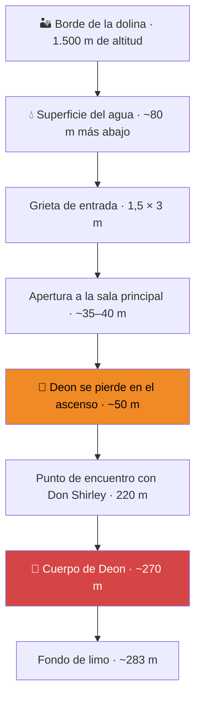
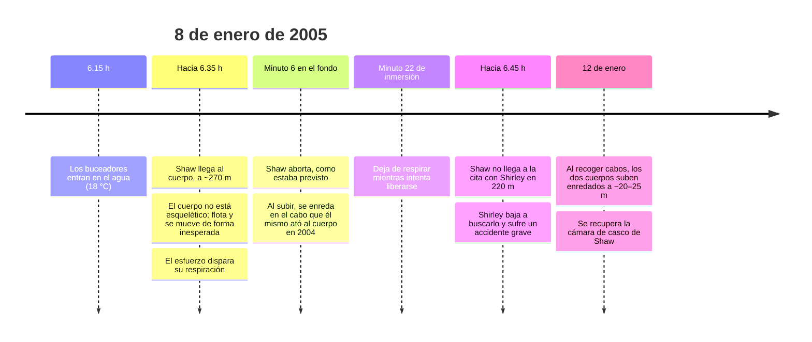
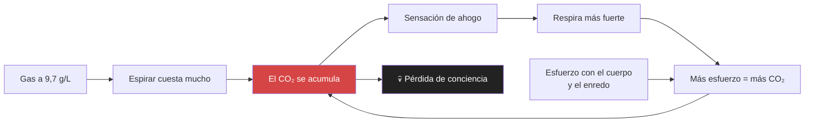
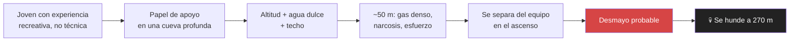

# 🕳️ El caso Deon Dreyer y Dave Shaw en Boesmansgat

### Dos muertes, diez años y 270 metros de agua dulce en una cueva del desierto sudafricano

> 🇬🇧 **[English version](README.en.md)**

> **Estudio divulgativo** · Autor: Óscar Ramírez Martín · Noviembre 2026
> Elaborado a partir de fuentes públicas contrastadas y de cálculos propios.

> 📄 **Estudio en PDF:** [Estudio_Deon_Dreyer_Boesmansgat.pdf](Estudio_Deon_Dreyer_Boesmansgat.pdf) (14 páginas, para leer o imprimir; incluye la sección de Sheck Exley).

> ⚠️ **Nota de respeto.** Este estudio trata la muerte real de dos personas, un chico de 20 años y un piloto de 50, y el duelo de sus familias. No enlaza ni reproduce la grabación de la muerte de Dave Shaw y no incluye fotografías de los cuerpos. El objetivo es entender **por qué** ocurrió, para que no vuelva a ocurrir.

> 📚 **Serie de estudios sobre accidentes de buceo** del mismo autor:
> [Blue Hole de Dahab (Yuri Lipski, 2000)](https://github.com/Oskillar28/descubrimientos/tree/main/blue-hole-dahab-yuri-lipski) · **Boesmansgat (Deon Dreyer y Dave Shaw, 1994–2005)** (este estudio) · [Zacatón (Sheck Exley, 1994)](https://github.com/Oskillar28/descubrimientos/tree/main/zacaton-cenote-mexico) · [Cueva de Plura (Noruega, 2014)](https://github.com/Oskillar28/descubrimientos/tree/main/plura-cueva-noruega) · [Cueva de Vaavu (Maldivas, 2026)](https://github.com/Oskillar28/descubrimientos/tree/main/cueva-vaavu-maldivas)

---

## 📑 Índice

1. [El caso en 30 segundos](#1-el-caso-en-30-segundos)
2. [El lugar: Boesmansgat](#2-el-lugar-boesmansgat)
3. [Quién era Deon Dreyer](#3-quién-era-deon-dreyer)
4. [17 de diciembre de 1994: la muerte de Deon](#4-17-de-diciembre-de-1994-la-muerte-de-deon)
5. [Diez años en el fondo](#5-diez-años-en-el-fondo)
6. [Quién era Dave Shaw](#6-quién-era-dave-shaw)
7. [28 de octubre de 2004: el hallazgo](#7-28-de-octubre-de-2004-el-hallazgo)
8. [8 de enero de 2005: la recuperación que salió mal](#8-8-de-enero-de-2005-la-recuperación-que-salió-mal)
9. [Por qué murió Dave Shaw: análisis físico](#9-por-qué-murió-dave-shaw-análisis-físico)
10. [Por qué murió Deon Dreyer: lo que se sabe y lo que no](#10-por-qué-murió-deon-dreyer-lo-que-se-sabe-y-lo-que-no)
11. [La cadena de errores](#11-la-cadena-de-errores)
12. [Cómo se podría haber evitado](#12-cómo-se-podría-haber-evitado)
13. [Mitos frente a realidad](#13-mitos-frente-a-realidad)
14. [Contraste de fuentes](#14-contraste-de-fuentes-datos-que-no-coinciden)
15. [Glosario](#15-glosario)
16. [Conclusiones](#16-conclusiones)
17. [Metodología y nivel de confianza](#17-metodología-límites-y-nivel-de-confianza)
18. [Fuentes](#18-fuentes)

---

## 1. El caso en 30 segundos

| Dato | Valor más fiable |
|---|---|
| **Primera víctima** | Deon Dreyer, 20 años, buceador recreativo sudafricano (~200 inmersiones) |
| **Fecha** | 17 de diciembre de 1994 |
| **Qué hacía** | Inmersión de práctica como buceador de **apoyo** para un equipo que preparaba un descenso a 150 m |
| **Dónde se perdió** | Durante el **ascenso**, hacia los **50 m** |
| **Dónde quedó el cuerpo** | ~270 m, en el fondo de la cueva, durante **diez años** |
| **Quién lo encontró** | Dave Shaw, australiano, piloto de Cathay Pacific, el 28 de octubre de 2004 |
| **Segunda víctima** | Dave Shaw, 50 años, el 8 de enero de 2005, intentando subir el cuerpo |
| **Causa de la muerte de Shaw** | Acumulación de **CO₂** (hipercapnia) por respirar gas muy denso mientras hacía esfuerzo, agravada por enredarse en el cabo |
| **Final** | El 12 de enero de 2005, al recoger los cabos, **los dos cuerpos subieron juntos**, enredados |

**En una frase:** un chico murió en una inmersión de apoyo a 50 m y se hundió hasta 270 m; diez años después, un buceador de élite lo encontró, prometió devolverlo a su familia y murió en el intento, porque a esa profundidad el gas es tan denso que **trabajar es casi incompatible con respirar**.

---

## 2. El lugar: Boesmansgat

**Boesmansgat** («agujero del bosquimano» en afrikáans; en inglés *Bushman's Hole*) es una **dolina inundada** de agua dulce en la provincia del Cabo Septentrional (Sudáfrica), en la granja **Mount Carmel**, a unos 30 km de Daniëlskuil, en el borde del Kalahari.

| Elemento | Medida | Fuente |
|---|---|---|
| Altitud | ~1.500–1.550 m sobre el mar | Wikipedia, GUE, Nuno Gomes |
| Superficie del agua | ~80 m por debajo del borde de la dolina | GUE |
| Entrada | Grieta de ~1,5 × 3 m bajo la poza | GUE |
| Apertura a la sala principal | ~35–40 m | GUE |
| Sala principal | ~1,2 km de perímetro en su parte más ancha | GUE |
| Fondo | ~283–286 m, con ~1,5 m de limo | Wikipedia, GUE |
| Temperatura del agua | ~18–19 °C | *Mail & Guardian*, GUE |
| Visibilidad | Agua muy clara, pero paredes de lodo marrón que «se comen» la luz | GUE |
| Roca | Dolomía (caliza magnésica) del altiplano | Fuentes geológicas locales |

### 2.1 Por qué es tan difícil

1. **Es una cueva:** tiene **techo** en la entrada. No se puede subir en vertical libremente.
2. **Está en altitud.** A 1.500 m la presión del aire es ~0,85 bar. La descompresión es más exigente que en el mar: Nuno Gomes calculó que su inmersión de 282 m equivalía, en descompresión, a **una de ~330 m en el mar**.
3. **Es agua dulce**, menos densa que la salada: hay que corregir los ordenadores y las tablas.
4. **No hay fondo útil** en la sala: se baja «en el negro» siguiendo un cabo.
5. **Logística extrema:** hay que bajar decenas de botellas por una pared hasta el agua.

### 2.2 Historia de los récords

| Año | Quién | Profundidad | Nota |
|---|---|---|---|
| 1977 | Mike Rathbourne | — | Primera exploración conocida |
| 1988 | Nuno Gomes | 123 m | Récord africano |
| 1993 | **Eben Leyden** | — | Primera muerte: se desmayó hacia los 60 m |
| Ago. 1993 | **Sheck Exley** (EE. UU.) | **263 m** | **Primero en tocar el fondo**, en la pendiente de la sala. HPNS desde ~210 m (ver [§2.3](#23-sheck-exley-el-primero-en-llegar-al-fondo-1993-y-su-muerte-en-zacatón-1994)) |
| 1994 | Nuno Gomes | 230 y 252 m | Con problemas de descompresión |
| 1994 | **Deon Dreyer** | — | Muere en el ascenso a ~50 m |
| 23/08/1996 | Nuno Gomes | **282,6 m** | Récord mundial en cueva (Guinness). 12 h 15 min, 15 min de descenso |
| 2001 | Verna van Schaik | 186 m | Récord femenino en cueva |
| 2004 | Verna van Schaik | 221 m | Récord femenino Guinness |
| 28/10/2004 | **Dave Shaw** | ~270 m | Récords con recirculador; encuentra a Deon |
| 08/01/2005 | **Dave Shaw** | — | Muere intentando recuperar a Deon |
| 2022 | Karen van den Oever | 246,65 m | Nuevo récord femenino en circuito abierto |

### 2.3 Sheck Exley: el primero en llegar al fondo (1993) y su muerte en Zacatón (1994)

Antes que Nuno Gomes y Dave Shaw, el que abrió el camino en Boesmansgat fue **Sheck Exley** (1949–1994), profesor de matemáticas de Florida, pionero del buceo en cuevas y autor de *Basic Cave Diving: A Blueprint for Survival*, el manual que difundió reglas como la de los tercios.

| Fecha | Qué pasó |
|---|---|
| **Agosto 1993** | Invitado por Charles Maxwell y con Nuno Gomes en el equipo de apoyo, baja a Boesmansgat en una inmersión de unas **7,5 horas** y toca el fondo a **263 m** (863 pies), en la pendiente de la sala: es el primero en hacerlo. Hacia los 210 m sufre **síndrome nervioso de alta presión (HPNS)**: la visión se le distorsiona, hacia los 224 m siente picor y escozor por todo el cuerpo y luego temblores cada vez más fuertes. Los síntomas desaparecen al subir, hacia los 102 m. En esa expedición Gomes hace un sonar que demuestra que la cueva es mucho mayor de lo que se creía |
| **6 abril 1994** | Con **Jim Bowden** intenta superar los **300 m** (1.000 pies) en el cenote de **Zacatón** (Tamaulipas, México), cada uno por su propio cabo y a pocos metros del otro. Bowden ve que ha gastado mucho más gas del previsto y se da la vuelta a **282 m** (925 pies): récord mundial de la época. Exley no vuelve |
| **8 o 9 abril 1994** | Dos o tres días después (las fuentes no coinciden), al subir el cabo con las botellas de descompresión que no se usaron, aparece el cuerpo de Exley **enrollado en el cabo**, alrededor de los brazos y de las válvulas de sus botellas. Llegó a entre **268 y 276 m** (879–906 pies): el análisis médico de 1994 da 268 m y otras fuentes, 276 m |
| **Diciembre 1994** | Ocho meses después muere Deon Dreyer en Boesmansgat ([§4](#4-17-de-diciembre-de-1994-la-muerte-de-deon)) |

La causa de su muerte **no se pudo determinar**. El equipo que lo analizó (entre ellos Bowden y Ann Kristovich) apuntó al estrés del HPNS agravado por la narcosis del nitrógeno a esa profundidad.

> 🔗 **Por qué importa para este caso:** Bowden y otros expertos creen que Exley se enrolló el cabo a propósito para que su cuerpo se pudiera recuperar **sin que nadie tuviera que bajar a buscarlo** (hipótesis, confianza 0,5). Once años después, Dave Shaw murió precisamente haciendo eso: bajar a ~270 m a recuperar un cuerpo.

> 🧠 **Razonamiento:** Exley fue quien más hizo por difundir reglas como la de los tercios, y aun así murió. Pasa lo mismo que en Plura: a esas profundidades, la presión, el helio y la descompresión dejan un riesgo que **ninguna regla elimina**. Las reglas amplían el margen; no lo garantizan.

**Vídeos sobre Sheck Exley**

| Vídeo | Canal · año · idioma | Qué aporta |
|---|---|---|
| 🎬 [*The Legend Who Chose to Die at 900 Feet (Sheck Exley)*](https://www.youtube.com/watch?v=KtPZujNwOl8) | Waterline Stories · 2025 · inglés · 25 min | Cuenta también su inmersión de 1993 **en Boesmansgat** y los síntomas de HPNS |
| 🎬 [*La última inmersión de la leyenda Sheck Exley*](https://www.youtube.com/watch?v=XznOAbeYGC4) | Aterrador y Fascinante · 2024 · castellano · 31 min | Narra el día de Zacatón: plan de descenso, botellas, la búsqueda y la recuperación |
| 🎬 [*Sheck Exley: su último descenso a 270 metros*](https://www.youtube.com/watch?v=ZYQts00VPBM) | Archivo Subterráneo · 2026 · castellano · 26 min | Explica la regla de los tercios y por qué deja de bastar a grandes profundidades |

> ⚠️ **Datos de los vídeos que no coinciden con las fuentes escritas:** uno dice que Bowden empezó a subir a 281 m (las fuentes dicen 282 m) y otro da 270 m para Exley (las fuentes escritas dan entre 268 y 276 m). En este estudio se usan las cifras de las fuentes escritas.

---

## 3. Quién era Deon Dreyer

- Nació el **7 de agosto de 1974** y creció en **Vereeniging**, al sur de Johannesburgo.
- Hijo de **Theo y Marie Dreyer**. Su padre tenía un negocio de radios bidireccionales.
- Le gustaba la aventura: la caza, las motos, los coches preparados y los equipos de sonido de coche muy potentes.
- Tenía unas **200 inmersiones** registradas. Era un buceador **recreativo con experiencia**, no un buceador técnico de cueva profunda.
- Para las Navidades de 1994 le invitaron a unirse a buceadores de la **South African Cave Diving Association** en Boesmansgat como **buceador de apoyo**. Estaba encantado.
- Según *Outside*, su madre le **rogó que no fuera**: un año antes, en 1993, la cueva ya había matado a Eben Leyden.
- Su padre recordaría después que Deon decía que, si pudiera elegir cómo irse, querría que fuera buceando.

> 🧠 **Razonamiento:** 200 inmersiones recreativas dan soltura, pero **no** preparan para una cueva a 1.500 m de altitud con gases mezclados. Es el mismo patrón que en el caso de Yuri Lipski: experiencia real, pero fuera del rango para el que uno está formado.

---

## 4. 17 de diciembre de 1994: la muerte de Deon

- El equipo, organizado alrededor de **Nuno Gomes**, preparaba un descenso a **150 m** para esa misma semana.
- Deon hacía una **inmersión de práctica** para preparar las condiciones (colocar material y referencias).
- Según los testigos que buceaban con él, **se perdió durante el ascenso, hacia los 50 m**.
- Varias reconstrucciones posteriores cuentan que su luz se vio alejarse hacia abajo. Se hundió hasta el fondo de la sala.
- **Nadie sabe con certeza qué le mató.** La hipótesis que recoge *Outside* es un **desmayo en profundidad por acumulación de CO₂**.

### 4.1 La búsqueda

- **Dos semanas después**, su padre alquiló un pequeño **submarino teledirigido (ROV)** que usaba la minera **De Beers**. Encontró el **casco** de Deon en el fondo, pero **no el cuerpo**.
- Un buceador de la policía, **Theo van Eeden**, insistió durante años a Nuno Gomes para que bajara a buscarlo. Gomes se negó al principio; al final aceptó con una condición: *«Será una inmersión de récord»*.
- En **1996**, Gomes llegó a **282,6 m**, pero **no encontró a Deon**. En el fondo se quedó atrapado en el lodo unos dos minutos antes de liberarse.

---

## 5. Diez años en el fondo

- Los padres colocaron una **placa** en la pared de roca sobre la poza de entrada.
- Theo Dreyer acabó aceptando que la cueva sería **la tumba de su hijo**. Llegó a describirla como la tumba más majestuosa del país.
- Según el libro de Phillip Finch, la placa fue una de las razones por las que el caso marcó tanto a la comunidad: la mayoría de buceadores muertos se recuperan, y la placa recordaba que Deon seguía abajo.

> 🧭 **Reflexión ética:** la familia ya había hecho un duelo y había aceptado un final. Esta parte de la historia importa mucho para entender lo que vino después: **la recuperación no era una necesidad, era un regalo** que alguien decidió ofrecer.

---

## 6. Quién era Dave Shaw

| Aspecto | Dato |
|---|---|
| Nombre | David John Shaw, nacido el 20 de julio de 1954 |
| Profesión | Piloto de línea en **Cathay Pacific** (Hong Kong) |
| Nacionalidad | Australiano |
| Experiencia | Algo más de **5 años** buceando; la inmersión de su muerte fue la **n.º 333** |
| Equipo | Recirculador **Mk15.5** (Biomarine) para más de 150 m; Cis-Lunar Mk5P para cuevas más someras |
| Amigo y compañero | **Don Shirley**, británico residente en Sudáfrica, instructor técnico en Badplaas |

> 🧠 **Razonamiento:** Shaw progresó **extraordinariamente rápido**. En cinco años pasó de la titulación básica a récords mundiales a 270 m. Era meticuloso y muy capaz, pero tenía relativamente pocas horas en el tipo de equipo y de profundidad en que trabajaba. Algunos instructores lo señalaron después como un factor.

---

## 7. 28 de octubre de 2004: el hallazgo

- Shaw bajó a Boesmansgat con su recirculador y batió varios récords: **profundidad con recirculador**, **en cueva**, **en altitud** y **tendiendo cabo**. La inmersión duró **9 h 40 min**.
- Respiró varias mezclas: trimix 4/80, 10/70, 15/55, 17/40, 26/25, aire, nitrox 50 y oxígeno puro.
- Cerca del fondo, a unos **270 m**, su linterna iluminó **un cuerpo**: tumbado boca arriba, con los brazos extendidos hacia la superficie.
- Ató el carrete de su cabo al cuerpo. Según *The Guardian*, explicó que lo importante era que **Deon ya no estaba perdido**.
- No pudo subirlo: las **botellas de Deon estaban hundidas en el lodo**.
- Tras la inmersión, Shaw y Shirley identificaron que era Deon y llamaron a **Theo Dreyer**. Le prometieron traer a su hijo a casa.

---

## 8. 8 de enero de 2005: la recuperación que salió mal

### 8.1 El plan

| Fase | Plan |
|---|---|
| Descenso de Shaw | ~17–20 min hasta el cuerpo |
| Trabajo en el fondo | Meter el cuerpo en una **bolsa**, liberarlo de su equipo con un **cuchillo**, ~5 min |
| Regla de aborto | Si no lo conseguía en **6 minutos**, abandonar y subir |
| Relevo | Don Shirley esperaría en **220 m**; ocho buceadores escalonados subirían la bolsa por relevos |
| Ascenso de Shaw | ~**12 horas** de descompresión |
| Equipo | Buceadores técnicos voluntarios (IANTD), buzos de la policía, paramédicos; Verna van Schaik en superficie; Gordon Hiles grabando |

Fue un «pequeño operativo militar», en palabras del coordinador técnico. Hubo ensayo general.

### 8.2 Lo que pasó

### 8.3 Don Shirley: casi la tercera víctima

Shirley bajó desde 220 m a buscar a su amigo. Tuvo problemas en el fondo y una **enfermedad descompresiva grave del oído interno**. Sobrevivió, pero con **daños permanentes en el equilibrio**. Su caso aparece en la literatura médica (Trytko y Mitchell, 2005) como ejemplo de los riesgos de la descompresión en buceo técnico profundo.

### 8.4 El final

- La policía anunció que no buscaría el cuerpo de Shaw: era demasiado profundo para arriesgar a más gente.
- Cuatro días después, al **recoger los cabos y las botellas**, los buzos vieron **los dos cuerpos** a unos 20–25 m. Estaban unidos por los cabos y el equipo, en un solo lazo.
- La **cámara** de Shaw seguía funcionando. Su vídeo permitió reconstruir lo que pasó.
- **Shaw cumplió su promesa**, aunque no como esperaba: Deon volvió a la superficie.

---

## 9. Por qué murió Dave Shaw: análisis físico

Este es el caso mejor documentado de la historia sobre **lo que la densidad del gas hace a la respiración**. El médico Simon Mitchell y sus colegas lo publicaron en 2007 a partir del vídeo.

### 9.1 La presión, corregida por altitud y agua dulce

En agua dulce, cada metro añade ~0,098 bar. En altitud, la presión de partida no es 1 bar sino ~0,85 bar.

$$P_{\text{absoluta}} \approx 0{,}85 + 0{,}098 \times \text{profundidad (m)}$$

| Profundidad | Presión absoluta | Profundidad en el mar con la misma presión |
|---|---|---|
| 0 m | 0,85 bar | — |
| 50 m (Deon) | **5,75 bar** | ~47 m |
| 220 m (Shirley) | 22,4 bar | ~211 m |
| 264 m (Shaw muere) | **26,8 bar** | ~254 m |
| 270 m (cuerpo de Deon) | 27,3 bar | ~260 m |

*Cálculo propio. La presión es algo menor que en el mar, pero la **descompresión** es más dura por la altitud.*

### 9.2 Densidad del gas: el factor que lo mató

Según el artículo de Mitchell, el diluyente era **82 % helio y 14 % nitrógeno**, con el oxígeno fijado en **1,3 bar**. Con esos datos:

| Gas y profundidad | Densidad | Comparación con el límite |
|---|---|---|
| Aire en superficie | ~1,2 g/L | — |
| Límite deseable (Anthony y Mitchell) | 5,2 g/L | — |
| Límite máximo | 6,2 g/L | — |
| **Gas de Shaw a 264 m** | **~9,7 g/L** | **~1,6 veces el máximo** |

*Cálculo propio a 18 °C.*

Aunque el helio es muy ligero, a 27 bar incluso el trimix es **ocho veces más denso** que el aire que respiramos. Esto provoca:

1. **Flujo turbulento** en las vías respiratorias: por mucho que se esfuerce, el buceador **no puede espirar más rápido**. Se llama **compresión dinámica de la vía aérea**; en el vídeo se oye como una pequeña tos al final de cada respiración.
2. **El CO₂ no sale.** Cada respiración retira menos CO₂ del que el cuerpo produce.
3. **Esfuerzo físico** (manipular un cuerpo, cortar correas, luchar contra un cabo) = más CO₂ producido.

Mitchell lo describe como una **espiral**: falta de aire, CO₂ en aumento y esfuerzo respiratorio desperdiciado que genera aún más CO₂, hasta la inconsciencia.

### 9.3 El recirculador

- El informe forense (IANTD) señaló que el **llenado excesivo** del recirculador parece haberle impedido espirar bien.
- Mitchell y otros instructores de Mk15.5 señalaron cambios **no estándar**: almohadillas de humedad de **fieltro denso** en lugar de espuma ligera, y material absorbente de CO₂ de **grano más fino** que el recomendado. Ambos aumentan la resistencia al paso del gas.
- El pulmón artificial (contrapulmón) a la espalda añade **carga pulmonar negativa**: hay que «tirar» más del gas.
- La unidad se examinó y **funcionaba**: no fue una avería, sino una configuración que, sumada a la profundidad, dejaba muy poco margen.

> 🔍 Según Mitchell, el absorbente probablemente **ni llegó a tener la oportunidad** de retirar ese CO₂: el problema estaba en los pulmones, que no conseguían sacarlo.

### 9.4 Narcosis

Aun con mucho helio, el nitrógeno a 27 bar tenía un efecto narcótico estimado equivalente a una **inmersión con aire a 44 m**, que aumentó a medida que subía el CO₂. Resolver un enredo en esas condiciones es como intentar desatar un nudo bebido, sin aire y a oscuras.

### 9.5 El cuerpo no estaba como esperaban

El plan contaba con unos restos **esqueléticos**. Pero el agua fría, sin oxígeno y sin carroñeros había conservado el cuerpo (un proceso llamado **saponificación** o **adipocira**), que dentro del traje tenía **más flotabilidad** de lo previsto. Al liberarlo, se movió y empezó a subir, y los cabos se convirtieron en una trampa.

### 9.6 El enredo

Shaw **abortó a tiempo**, como prometió. Pero al subir se enredó en el **cabo que había atado al cuerpo** en 2004. Mientras intentaba soltarse, con la respiración ya al límite, dejó de respirar a los ~22 minutos de inmersión.

---

## 10. Por qué murió Deon Dreyer: lo que se sabe y lo que no

| Pregunta | Respuesta | Confianza |
|---|---|---|
| ¿Dónde se perdió? | En el ascenso, hacia los 50 m | 0,85 |
| ¿Estaba solo? | No; buceaba con el equipo, pero se separó | 0,7 |
| ¿Qué gas respiraba? | **No consta** en las fuentes consultadas | — |
| ¿Causa? | Probable desmayo (*blackout*) por CO₂, según *Outside*. Otras fuentes citan toxicidad del oxígeno. **No hay autopsia publicada** | 0,5 |

**Qué nos dicen los números.** Si respiraba **aire** a 50 m en Boesmansgat (no está confirmado):

| Magnitud | Valor a 50 m (cálculo propio) | Límite |
|---|---|---|
| ppO₂ | ~1,21 bar | 1,4 bar → por debajo del límite |
| ppN₂ (narcosis) | ~4,5 bar | Narcosis claramente presente |
| Densidad del gas | **~7,0 g/L** | **6,2 g/L → por encima del máximo** |

> 🧠 **Razonamiento:** con aire, a 50 m la toxicidad del oxígeno es **poco probable**, pero la **densidad del gas ya supera el límite máximo**. Eso encaja con la hipótesis del CO₂: la misma física que mató a Shaw a 264 m, en versión más suave, pero en un buceador menos preparado. **Es una hipótesis compatible, no una certeza.**

El caso de **Eben Leyden** (1993), que también se desmayó hacia los 60 m, apunta en la misma dirección: Boesmansgat castiga especialmente a quien bucea en el rango de 50–60 m sin gases y formación adecuados.

---

## 11. La cadena de errores

### 11.1 Deon Dreyer (1994)

### 11.2 Dave Shaw (2005)

| Eslabón (Shaw) | ¿Comprobado? | Confianza |
|---|---|---|
| Acumulación de CO₂ como causa | Informe IANTD y artículo médico revisado | 0,9 |
| Densidad del gas muy por encima del límite | Cálculo con los datos del artículo | 0,9 |
| Configuración del recirculador que aumentaba la resistencia | Informe y testimonios de instructores | 0,75 |
| Enredo en el cabo en el ascenso | Informe y vídeo | 0,9 |
| El cuerpo tenía más flotabilidad de lo previsto | Varias fuentes secundarias | 0,7 |
| Experiencia corta para esa profundidad | Datos objetivos; su peso es opinable | 0,6 |

---

## 12. Cómo se podría haber evitado

### 12.1 La muerte de Deon

1. **Formación adecuada al entorno:** cueva, altitud y profundidad requieren titulaciones técnicas específicas, no solo experiencia recreativa.
2. **Gas adecuado:** usar mezclas con helio ya a 50 m reduce la densidad y la narcosis. Hoy se planifica la **densidad** del gas, no solo el oxígeno.
3. **Contacto con el compañero en el ascenso:** el ascenso es el momento en que más gente se pierde; ir unido por contacto visual o cabo.
4. **Cabo guía continuo** hasta la superficie y control de flotabilidad para que, si alguien se desmaya, no se hunda sin freno.
5. **Escuchar la señal del año anterior:** la muerte de Eben Leyden en 1993 en el mismo rango de profundidad era un aviso.

### 12.2 La muerte de Shaw

1. **No convertir una recuperación en una obligación.** La familia había aceptado la cueva como tumba. La regla de oro de los rescates: **no crear una segunda víctima**.
2. **Valorar alternativas sin buceador:** ROV, sistemas de izado por cabo desde superficie o dejar el cuerpo donde estaba.
3. **Minimizar el trabajo físico en el fondo:** a 270 m, cada movimiento produce un CO₂ que no se puede eliminar. Una tarea de 5 minutos con esfuerzo es demasiado.
4. **Planificar la densidad del gas.** Hoy (desde Anthony y Mitchell, 2016) existen límites: 5,2 g/L deseable, 6,2 g/L máximo. A 270 m **no hay mezcla respirable que los cumpla**.
5. **Configuración estándar y comprobada del recirculador:** sin piezas improvisadas que aumenten la resistencia.
6. **Gestión de cabos:** no dejar cabos sueltos cerca de un objeto que se va a mover, llevar cortadores accesibles en ambos lados y entrenar el desenredo.
7. **Prever el estado del cuerpo:** en agua fría y sin oxígeno, un cuerpo puede conservarse durante años y comportarse de forma imprevisible.
8. **Plan de rescate realista:** que el buceador de apoyo no tenga que bajar más allá de su plan. Shirley casi muere por intentar ayudar.

---

## 13. Mitos frente a realidad

| Mito | Realidad | Confianza |
|---|---|---|
| «Deon murió a 270 m» | Se perdió a ~50 m; el cuerpo **se hundió** hasta 270 m | 0,85 |
| «Shaw se quedó sin aire» | Tenía gas; lo que no podía era **expulsar el CO₂** | 0,9 |
| «Falló el recirculador» | El equipo funcionaba; el problema fue la física del gas denso más una configuración con más resistencia | 0,8 |
| «Shaw murió en el fondo luchando con el cuerpo» | Abortó a tiempo; murió **en el ascenso**, enredado | 0,85 |
| «Encontraron el cuerpo de Deon hecho esqueleto» | Estaba sorprendentemente conservado | 0,7 |
| «Shaw ató el cuerpo a propósito para subirlo al morir» | Los cuerpos subieron porque estaban enredados en los cabos que se recogieron | 0,8 |
| «Boesmansgat es la cueva más profunda del mundo» | Es una de las más profundas de agua dulce (se suele citar como la tercera) | 0,8 |

---

## 14. Contraste de fuentes: datos que no coinciden

| Dato | Versión A | Versión B | Más probable |
|---|---|---|---|
| Profundidad del cuerpo de Deon | 270 m (*Mail & Guardian*, Wikipedia Boesmansgat) | 271 / 272 m (otras fuentes) | **~270 m** |
| Profundidad donde murió Shaw | 264 m (Mitchell et al., 2007) | 270 m (prensa) | **264 m** en el agua; 270 m es el cuerpo |
| Edad de Shaw | 50 (Wikipedia, *SCMP*) | 51 (Divernet) | **50**: nació en julio de 1954 |
| Fondo de la cueva | 283 m (Wikipedia) | 286 m (GUE) | **~283–286 m**, según el nivel del agua |
| Récord de Gomes | 282,6 m (Guinness) | 286,2 m (otra fuente) | **282,6 m**, cifra homologada |
| Año del accidente de Deon | 1994 (casi todas) | 1995 (Gadling) | **1994** |
| Con quién buceaba Deon | Equipo de Nuno Gomes / SACDA | «con su padre» (*Mail & Guardian*) | **Con el equipo**; lo de su padre no lo confirma ninguna otra fuente |
| Causa de la muerte de Deon | CO₂ (*Outside*) | Toxicidad del oxígeno (blogs) | **CO₂**, más compatible con 50 m; sin confirmar |
| Profundidad de Exley en Zacatón | 276 m / 906 pies (Wikipedia, *Valdosta Daily Times*, Undercurrent) | 268 m / 879 pies (análisis médico en *Pressure*, UHMS, 1994) | **Entre 268 y 276 m**: no se puede resolver. Más detalle en el [estudio del Zacatón](https://github.com/Oskillar28/descubrimientos/tree/main/zacaton-cenote-mexico) |
| Día en que apareció el cuerpo de Exley | 8 de abril, dos días después (*Pressure*) | 9 de abril, tres días después (Undercurrent) | **8 o 9 de abril de 1994** |
| Vínculo con Mary Ellen Eckhoff, en el equipo de apoyo | Esposa (vídeos, Northwestern) | Exesposa (*LADbible*) | **Sin confirmar** |

---

## 15. Glosario

| Término | Significado |
|---|---|
| **HPNS** (síndrome nervioso de alta presión) | Temblores, alteraciones de la vista y mareo que aparecen por debajo de ~150 m al respirar helio y bajar deprisa. Desaparece al subir |
| **Adipocira / saponificación** | Transformación de la grasa corporal en una sustancia cerosa que conserva el cuerpo en agua fría y sin oxígeno |
| **Blackout** | Pérdida de conciencia bajo el agua, a menudo sin aviso |
| **Compresión dinámica de la vía aérea** | Las vías respiratorias se estrechan al espirar con fuerza un gas denso; el aire no sale más rápido por mucho que se empuje |
| **Contrapulmón** | Bolsa flexible del recirculador desde la que se inspira y a la que se espira |
| **Densidad del gas** | Masa por litro (g/L); aumenta con la presión y dificulta la respiración |
| **Diluyente** | Gas que se mezcla con el oxígeno en un recirculador (aquí, sobre todo helio) |
| **Dolina** | Pozo formado por la disolución de roca caliza o dolomía |
| **Enfermedad descompresiva del oído interno** | Burbujas en el oído interno que causan vértigo y pérdida de equilibrio |
| **Hipercapnia** | Exceso de CO₂ en sangre: ahogo, confusión y, al final, inconsciencia |
| **Narcosis** | Efecto anestésico de los gases a presión; se parece a la embriaguez |
| **ppO₂** | Presión parcial de oxígeno; por encima de ~1,4–1,6 bar puede causar convulsiones |
| **Recirculador (CCR)** | Equipo que recicla el gas espirado, retira el CO₂ con un absorbente y añade oxígeno |
| **ROV** | Vehículo submarino teledirigido |
| **Trimix** | Mezcla de oxígeno, helio y nitrógeno para inmersiones profundas |

---

## 16. Conclusiones

1. **Dos muertes, una misma física.** Todo apunta a que Deon (probablemente) y Shaw (con seguridad) murieron por lo mismo: **no poder expulsar el CO₂** respirando un gas demasiado denso. A 50 m con aire, la densidad ya supera el límite; a 264 m, ni el mejor trimix lo cumple.
2. **La profundidad castiga el esfuerzo.** Bajar a 270 m es posible; **trabajar** allí, casi no. El plan de Shaw era impecable en logística, pero exigía esfuerzo físico donde el cuerpo no puede compensarlo.
3. **La experiencia no sustituye a la formación específica.** Deon tenía 200 inmersiones recreativas; Shaw, 5 años y 333 inmersiones. Ambos eran buenos buceadores **fuera del rango en que tenían margen**.
4. **Los cabos salvan y matan.** El mismo cabo que Shaw ató para que Deon «no estuviera perdido» fue el que le atrapó.
5. **No crear una segunda víctima.** La familia había aceptado la cueva como tumba. Una recuperación así solo tiene sentido si el riesgo para los vivos es aceptable, y a 270 m no lo era.
6. **Su muerte salvó vidas.** El vídeo de Shaw es hoy material de formación en todo el mundo. Junto con los estudios de Anthony y Mitchell, contribuyó a que la **densidad del gas** se convirtiera en un límite que se planifica, igual que el oxígeno o la narcosis.

---

## 17. Metodología, límites y nivel de confianza

**Cómo se ha hecho:** se dividió el caso en partes (lugar, Deon, hallazgo, recuperación, física, prevención), cada dato se contrastó en al menos dos fuentes cuando fue posible y los cálculos de presión y densidad se hicieron con fórmulas estándar en Python.

**Límites:**

- No se ha podido leer el artículo completo de *Outside* (2005) ni el informe forense original; se usan resúmenes y citas de terceros.
- No consta qué gas respiraba Deon Dreyer ni hay autopsia publicada de su caso.
- El cálculo de densidad de Shaw usa la composición publicada por Mitchell y una temperatura de 18 °C.
- No se ha visto el vídeo de Shaw; se describe a partir de fuentes escritas.

| Bloque | Confianza |
|---|---|
| Hechos básicos (fechas, lugar, personas) | 0,9 |
| Causa de la muerte de Shaw | 0,9 |
| Causa de la muerte de Deon | 0,5 |
| Física y cálculos | 0,9 |
| Detalles exactos de la secuencia en el fondo | 0,6 |

---

## 18. Fuentes

**Medicina e informes**

- Mitchell, S. J.; Cronjé, F. J.; Meintjes, W. A. J.; Britz, H. C. (2007). *Fatal respiratory failure during a "technical" rebreather dive at extreme pressure*. Aviation, Space and Environmental Medicine, 78: 81–86. https://www.ingentaconnect.com/contentone/asma/asem/2007/00000078/00000002/art00001
- Trytko, B.; Mitchell, S. (2005). *Extreme survival: a serious technical diving accident*. SPUMS Journal, 35: 23–27. https://www.dhmjournal.com/images/IndividArticles/35March/Trytko_dhm.35.1.23.27.pdf
- Divernet. *Dave Shaw died from carbon dioxide black-out* (resume el informe de IANTD). https://divernet.com/scuba-news/dave-shaw-died-from-carbon-dioxide-black-out/
- DAN. *Gas density for divers*. https://dan.org/?p=12020
- DAN. *Performance Under Pressure*. https://dan.org/alert-diver/article/performance-under-pressure/

**Prensa**

- *Mail & Guardian* (07/01/2005). *Diver's body to be raised from the deep*. https://mg.co.za/article/2005-01-07-divers-body-to-be-raised-from-the-deep/
- *Mail & Guardian* (09/01/2005). *Boesmansgat: 'Dave's not coming up'*. https://mg.co.za/article/2005-01-09-boesmansgat-daves-not-coming-up/
- *Mail & Guardian* (13/01/2005). *Cave divers' bodies found at Boesmansgat*. https://mg.co.za/?p=390829
- *South China Morning Post*. *Dead diver fulfils his last mission*. https://amp.scmp.com/article/485486/dead-diver-fulfils-his-last-mission
- Zimmermann, T. (01/08/2005). *Raising the Dead*. **Outside**. https://www.outsideonline.com/outdoor-adventure/water-activities/raising-dead/
- NPR, *Talk of the Nation*: entrevista a Tim Zimmermann. https://www.npr.org/transcripts/4783879

**El lugar y los récords**

- Wikipedia (en). *Boesmansgat*, *Deon Dreyer*, *Dave Shaw*, *Nuno Gomes (diver)*.
- Wikipedia (en). *Sheck Exley*. https://en.wikipedia.org/wiki/Sheck_Exley
- Nuno Gomes. *Boesmansgat* (inmersión de Exley en 1993 y síntomas de HPNS). https://nunogomes.co.za/page-8.html
- Gilliam, B. (2013). *Zacaton: The Tragic Death of Sheck Exley*. **Undercurrent**. https://www.undercurrent.org/blog/2013/11/15/zacaton-the-tragic-death-of-sheck-exley/
- *Eulogy for an Explorer* (Northwestern University). https://sites.northwestern.edu/monroyrios/resources/sheck_exley
- **Valdosta Daily Times**. *Remembering Suwannee: Exley dies attempting world record dive*. https://valdostadailytimes.com/?p=510594
- aquaCORPS / TDI. *Jim Bowden*. https://www.tdisdi.com/aquacorps/jim-bowden/
- Vídeos de YouTube citados en [§2.3](#23-sheck-exley-el-primero-en-llegar-al-fondo-1993-y-su-muerte-en-zacatón-1994).
- GUE. *Out of Africa*. https://www.gue.com/out-africa
- Guinness World Records. *Deepest scuba dive in a fresh-water cave*. https://www.guinnessworldrecords.com/world-records/67817-deepest-scuba-dive-in-a-fresh-water-cave
- Nuno Gomes. *A brief history of deep technical diving*. https://nunogomes.co.za/history.htm
- Bansko Film Fest (2015). *Nuno Gomes (South Africa)*. https://archive.banskofilmfest.com/en/stars-of-banskofilmfest-2015-nuno-gomes-south-africa/

**Libros y documentales**

- Finch, P. (2008). *Diving into Darkness: A True Story of Death and Survival*. St. Martin's Press.
- ABC, *Australian Story*: *To Boldly Go* (2005).
- Malak, J. (2020). *Dave Not Coming Back* (documental). Reseña: https://www.austinchronicle.com/daily/screens/2020-10-27/aff-review-dave-not-coming-back

---

> **Licencia:** texto y diagramas propios bajo **CC BY-SA 4.0**.

*En memoria de Deon Dreyer, Dave Shaw y Eben Leyden.*
