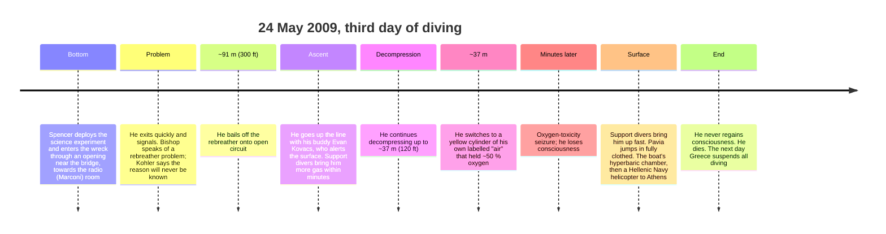
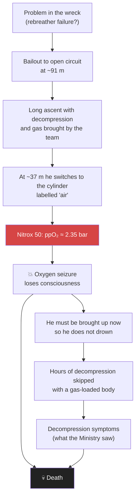

# ⚓ Carl Spencer and HMHS Britannic: the last dive on Titanic's sister

### The ship, the wreck at 120 m, the expeditions, Carl Spencer's death in 2009, and why some sources say oxygen and others say decompression

> 🇪🇸 **[Versión en castellano](README.md)**

> **Popular-science study** · Author: Óscar Ramírez Martín, an amateur diver researching the case · November 2026
> I am not an expert in technical diving or deep wrecks. This work brings together cross-checked public sources and my own calculations with standard formulas, and says at each point what is confirmed and what is not.

> 📄 **PDF version:** [Britannic_Carl_Spencer_Study.pdf](Britannic_Carl_Spencer_Study.pdf)

> ⚠️ **A note of respect.** This study deals with the real death of Carl Spencer (2009) and, more briefly, those of Tim Saville and Vincent Hong (2019). Their families may read it. It contains no images of their bodies and does not set out to blame anyone. Anything not confirmed by an official source is presented as a **hypothesis**, with a confidence level (0–1).

> 📚 **Series of studies on diving accidents** by the same author:
> [Blue Hole, Dahab (Yuri Lipski, 2000)](https://github.com/Oskillar28/blue-hole-dahab-yuri-lipski) · [Boesmansgat (Deon Dreyer and Dave Shaw, 1994–2005)](https://github.com/Oskillar28/boesmansgat-deon-dreyer) · [Zacatón (Sheck Exley, 1994)](https://github.com/Oskillar28/zacaton-cenote-mexico) · **Britannic (Carl Spencer, 2009)** (this study) · [Plura cave (Norway, 2014)](https://github.com/Oskillar28/plura-cueva-noruega) · [Vaavu cave (Maldives, 2026)](https://github.com/Oskillar28/cueva-vaavu-maldivas)
> A follow-up to [RMS Titanic: from the shipyard to the abyss](https://github.com/Oskillar28/titanic-pecio-historia).

<p align="center">
  
  <br><sub><i>HMHS Britannic painted white with red crosses and a green band during the First World War. Unknown author, public domain (PD-US), via Wikimedia Commons.</i></sub>
</p>

---

## 📑 Contents

1. [The case in 30 seconds](#1-the-case-in-30-seconds)
2. [The ship: the third Olympic](#2-the-ship-the-third-olympic)
3. [The sinking: 21 November 1916](#3-the-sinking-21-november-1916)
4. [The wreck today](#4-the-wreck-today)
5. [History of the expeditions (1975–2025)](#5-history-of-the-expeditions-19752025)
6. [Who Carl Spencer was](#6-who-carl-spencer-was)
7. [The Britannic divers](#7-the-britannic-divers)
8. [24 May 2009: the last dive](#8-24-may-2009-the-last-dive)
9. [Oxygen or decompression? Analysing the two versions](#9-oxygen-or-decompression-analysing-the-two-versions)
10. [After Spencer: bell, submersibles and new deaths](#10-after-spencer-bell-submersibles-and-new-deaths)
11. [Every expedition: good and bad](#11-every-expedition-good-and-bad)
12. [Cross-checking sources: figures that disagree](#12-cross-checking-sources-figures-that-disagree)
13. [Myths and reality](#13-myths-and-reality)
14. [Photos, maps and videos](#14-photos-maps-and-videos)
15. [Glossary](#15-glossary)
16. [Conclusions](#16-conclusions)
17. [Method, limits and confidence](#17-method-limits-and-confidence)
18. [Sources](#18-sources)

---

## 1. The case in 30 seconds

| Item | Most reliable value |
|---|---|
| **The ship** | **HMHS Britannic**, the third and last White Star Line Olympic-class liner, sister of Olympic and Titanic |
| **Launch** | 26 February 1914, Harland & Wolff (Belfast) |
| **Actual use** | Never carried passengers: she was a Royal Navy **hospital ship** (1915–1916) |
| **Sinking** | 21 November 1916, Kea Channel (Aegean Sea, Greece). A **mine** laid by the German submarine U-73. **55 minutes** |
| **Victims in 1916** | **30 dead** out of 1,066 people aboard |
| **Wreck** | ~**120 m** deep, lying on her starboard side, almost intact. Discovered by **Jacques Cousteau** in 1975 |
| **Owner** | British historian **Simon Mills**, since 1996 |
| **Carl Spencer** | British technical diver (1970–2009), "just a plumber from Cannock". Led the 2003 and 2009 expeditions |
| **His death** | **24 May 2009**, the third day of the National Geographic expedition |
| **Most likely cause** | **Oxygen toxicity**: at ~37 m he breathed from a cylinder labelled "air" that actually held ~50 % oxygen. *Confidence 0.8* |
| **The other version** | The 2009 press, quoting Greece's Merchant Marine Ministry, reported **decompression sickness** ("the bends") |

**In one sentence:** an expert who knew Britannic better than almost anyone survived a problem at 90 m and an ascent lasting hours, then died less than 40 m from the surface because of a mislabelled cylinder. The two versions of his death probably do not contradict each other: the oxygen seizure forced an emergency ascent, and that explains the decompression symptoms.

---

## 2. The ship: the third Olympic

<p align="center">
  
  <br><sub><i>Britannic in the great gantry at Harland & Wolff, ready for launch (21/2/1914). Photo: Robert Welch, Public Domain Mark, via Wikimedia Commons.</i></sub>
</p>

| Item | Value | Source |
|---|---|---|
| Ordered | 1911 | Wikipedia |
| Keel laid | 30 November 1911, yard number 433 | Wikipedia |
| Launched | 26 February 1914 | Wikipedia |
| Completed | 12 December 1915 | Wikipedia |
| Length | 269.1 m (882 ft 9 in) | Wikipedia |
| Beam | 94 ft (~28.7 m), wider than her sisters | Wikipedia |
| Gross tonnage | 48,158 | Wikipedia |
| Lifeboats | 48 (five of the eight planned gantry davits were fitted) | Wikipedia |
| Hospital beds | 3,309 | Wikipedia |
| Captain | **Charles Alfred Bartlett** | Wikipedia |

### 2.1 What changed after Titanic

Britannic was being designed while the Titanic sinking (1912) was investigated, and she was modified before launch:

- A **double hull** along the engine and boiler rooms.
- **Six** of the 15 watertight bulkheads raised to B Deck.
- Strengthened compartments so that **six could flood** without the ship sinking.
- **Lifeboats for everyone**, with giant gantry davits.

> 🧠 **Reasoning:** on paper Britannic was safer than Titanic, yet she sank **about three times faster** (55 minutes against 2 h 40 min). That paradox is the ship's great technical mystery and the reason behind almost every diving expedition (§5).

### 2.2 Was she going to be called "Gigantic"?

Some sources say the planned name was *Gigantic* and that it was changed out of caution after Titanic. According to Wikipedia, White Star Line and Harland & Wolff denied this. Simon Mills, the wreck's owner, cites a copy of the shipyard's order book. *Confidence that "Gigantic" was the official name: 0.3.*

### 2.3 Hospital ship

| Date | Event |
|---|---|
| 13/11/1915 | Requisitioned by the Admiralty; painted white with red crosses and a green band |
| 23/12/1915 | First voyage: Liverpool → Mudros (island of Lemnos), the base for the Gallipoli wounded |
| 6/6/1916 | Returned to Belfast for conversion to a liner; the government paid £75,000 |
| 26/8/1916 | Recalled as a hospital ship |
| 12/11/1916 | Left Southampton on her sixth and final voyage |

---

## 3. The sinking: 21 November 1916

```mermaid
timeline
    title 21 November 1916, Kea Channel
    21 Oct 1916 : Submarine U-73 (Gustav Sieß) lays mines in the Kea Channel
    08:12 : Explosion on the starboard side, forward
    Minutes later : Water floods through open watertight doors and through portholes the nurses had opened for ventilation
    First boats : Third Officer Francis Laws lowers two boats without permission; the still-turning propellers destroy them
    Evacuation : 35 boats are launched successfully. Kea fishermen and the destroyers Scourge, Heroic, Foxhound and Foresight help
    09:07 : Britannic sinks, 55 minutes after the explosion
```

| Item | Value |
|---|---|
| People aboard | **1,066** (crew and medical staff; she was not carrying wounded on that outbound voyage) |
| Dead | **30**, almost all in the two boats drawn into the propellers |
| Survivors | 1,036 (38 injured) |
| Cause | A **mine** from U-73, not a torpedo. The survivors believed they had been torpedoed |

**Well-known survivors:**

- **Violet Jessop**, stewardess and nurse, who also survived Titanic and was aboard Olympic when she collided with HMS Hawke.
- **Sheila MacBeth Mitchell**, a nurse, who spoke to Cousteau in 1976 and died in 1994 aged 103.
- **George Perman**, the last survivor, died on 24 May 2000.

<p align="center">
  
  <br><sub><i>Britannic survivors aboard the destroyer HMS Scourge, 21/11/1916. Photo: Royal Navy, public domain (UK Government), via Wikimedia Commons.</i></sub>
</p>

> 🔍 **Check:** in the same area U-73 left the mine that sank the French liner **Burdigala** a week earlier. That wreck, at ~76 m, appears again in the 2019 accident (§10).

---

## 4. The wreck today

<p align="center">
  
  <br><sub><i>The Kea Channel seen from the International Space Station, with the wreck site marked with an X. Image: NASA, derivative work by Cléééston, public domain, via Wikimedia Commons.</i></sub>
</p>

| Item | Value | Source |
|---|---|---|
| Position | 37°42′05″ N · 24°17′02″ E, about 4 nautical miles off Kea | Wikipedia, Divernet |
| Seabed depth | **~119–122 m** | Nick Hope (119 m), Wikipedia (122 m) |
| Highest part of the hull | ~**90 m** (the ship is over 28 m wide and lies on her side) | Kohler (≈300 ft), Bishop (bell at ~90 m on the hull) |
| Position on the seabed | On her **starboard** side, almost intact | Wikipedia |
| Damage | The **bow** buckled on hitting the bottom: the ship was longer than the water was deep | Gurr 1997, Wikipedia |
| Debris outside the hull | Funnels 2, 3 and 4 in the debris field, coal beside the hull | Kea Divers |
| Record | The **largest sunken liner** in the world | Wikipedia |
| Water | Very clear, but with **strong currents** (2–3 knots) | Sidetracked, DAN |

### 4.1 Who controls the wreck

- **Owner:** Simon Mills bought the legal title from the British government in **August 1996**, for about **£15,000** according to Mares. His aim, in his own words: to leave it as it is.
- **Permits:** diving requires authorisation from the **Greek Ministry of Culture** (Ephorate of Underwater Antiquities) and from Mills.
- **2025:** objects were recovered for the first time, with the Ministry's permission (§10.3).

---

## 5. History of the expeditions (1975–2025)

| Year | Expedition | What it achieved | Source |
|---|---|---|---|
| **1975** | **Jacques-Yves Cousteau** (*Calypso*) | Locates the wreck with sonar | Wikipedia, Titanic Connections |
| **1976** | Cousteau | First dives; documentary *Calypso's Search for the Britannic* (aired 1977) | Titanic Connections, Tenacious |
| **1995** | **Robert Ballard** (NOVA) | Studies it with vehicles and the NR-1 nuclear submarine, without divers | Wikipedia, Divernet |
| **Nov 1997** | **Kevin Gurr** (with Kirk Kavalaris, Kevin and Mirja Denlay and others) | First **technical-diving** expedition: open-circuit trimix, almost a month, video of the bow | Divernet, InDepth, Titanic Connections |
| **1998** | **Nick Hope** (*Britannic 98*, Starfish Enterprise team, with **Leigh Bishop**) | **78 manned dives**, with scooters (DPVs); Bishop circumnavigates the whole wreck | Divernet (Bishop), Bubblevision |
| **Aug 1999** | **GUE**, Jarrod Jablonski | First extensive penetration; video for the Greek Ministry | Wikipedia, GUE, InDepth |
| **Sep 2003** | **Carl Spencer** | First expedition with **every bottom diver on a rebreather**. Richie Stevenson films **open watertight doors** in boiler room 6. Bill Smith finds the **mine anchors** by sonar | Kea Divers, Divernet (Bishop) |
| **2006** | History Channel: **John Chatterton and Richie Kohler** (15 divers, including Spencer and Bishop) | Penetrate the boiler rooms. Cut short by a permit problem | Kohler, Encyclopedia Titanica |
| **~2008** | University of Patras (George Papatheodorou) | Sonar images of the wreck | Hydro International *(confidence 0.6)* |
| **May 2009** | **National Geographic, Carl Spencer** | **Spencer dies** (24/5). Kohler reaches boiler room 4. Greece suspends diving | Kohler, DAN, Divernet |
| **2012** | Several teams (Paul Lijnen; Kostas Thoctarides) | Study of bacterial corrosion of the iron; photos | Wikipedia, Divernet, Wreckdiving.gr |
| **Jun 2015** | **Kohler, Barnette, Kovacs, Pavia** with U-Group (*U-Boat Navigator*) | First use of a **diving bell** and support submersible. They say they solved why she sank so fast, without publishing the answer | DAN, Sidetracked |
| **2016** | **Centenary**: Kohler, Kovacs, U-Boat Group, BBC (Andy Torbet) | Commercial wet bell, 70-page protocol, BBC documentary | DAN, Divernet |
| **Sep 2019** | **Kea Divers** expedition | **Vincent Hong** (on Burdigala) and **Tim Saville** (on Britannic) die | Divernet, Yorkshire Post |
| **6–13 May 2025** | **Simon Mills** with the Ministry of Culture (safety: Tzavelakos, Kovacs, Kohler) | First **recovery of objects**: the lookout bell, the port navigation lamp, binoculars, Turkish-bath tiles, a porcelain washbasin | Protothema, Euronews, Western Front Association |

> 🧠 **Reasoning:** in 1999 GUE wrote that only three groups had been granted access to the wreck since 1975. Britannic is not a "tourist" wreck: every expedition needs permits, a moored boat and weeks of logistics. That is why they can be counted almost one by one, unlike the dives in a cenote such as Zacatón. *Confidence 0.7.*

---

## 6. Who Carl Spencer was

| Item | Value | Source |
|---|---|---|
| Born | **10 March 1970**, Cannock (Staffordshire, England) | BAFTA, Diving Almanac, Stevenrlarson |
| Job | Heating and air-conditioning engineer; director of **Spencair** (Hednesford) | Telegraph (via Neutral Dive Gear), Free Library |
| His phrase | "I'm only a plumber from Cannock" | Telegraph, Divernet |
| Family | His widow, Victoria Ann Spencer-Kibble, and his children **Georgia** and **Ben** (also a diver) | Express & Star 2022 |
| Death | **24 May 2009**, aged **39** | DAN, Divernet, Telegraph |

### 6.1 His career

| Year | Project |
|---|---|
| **2000–2001** | **Bluebird Project** (Coniston Water): first video surveys of Donald Campbell's hydroplane. In 2007 he recovered a missing piece of the frame |
| **2003** | Leads the **Britannic** expedition that proves the mine and the open doors |
| **2003** | Descends to **Titanic** in a MIR submersible (with Kevin Gurr). British Diver says it was at James Cameron's invitation *(confidence 0.6; not confirmed by a second source)* |
| **2006** | Diver on the History Channel Britannic expedition; teaches Kohler to dive to that depth |
| **2007–2008** | Expedition to **Carpathia**, the ship that rescued Titanic's survivors, at ~150 m |
| — | **X5** (midget submarine) project and joint expeditions with the Royal Navy and British Army |
| **2009** | Leads the **National Geographic** expedition to Britannic. Dies on it |

### 6.2 Honours

- The **Explorers Club** in New York paid tribute to him in 2009.
- **BAFTA** remembers him in its *In Memory* list as an underwater cameraman.
- In 2012 his personal effects were auctioned for more than £10,000.
- In **2022** he was posthumously awarded the **Golden Trident** of the International Academy of Underwater Sciences and Techniques, the "Oscar of the underwater world". He was only the second person to receive it posthumously.

---

## 7. The Britannic divers

| Person | Country | Role |
|---|---|---|
| **Jacques-Yves Cousteau** | France | Discoverer (1975) and first dives (1976) |
| **Kevin Gurr** | UK | First technical expedition (1997) |
| **Nick Hope** | UK | Leader of *Britannic 98* |
| **Leigh Bishop** | UK | Photographer in 1998, 2003, 2006, 2009 and 2016; Spencer's best friend |
| **Jarrod Jablonski** | USA | Founder of GUE; 1999 and 2009 expeditions |
| **Carl Spencer** | UK | Leader of the 2003 and 2009 expeditions |
| **Richie Stevenson** | UK | Filmed the open watertight doors (2003) and entered the boiler rooms (2009) |
| **Bill Smith** | UK | Sonar expert; found the mine anchors (2003) |
| **Richie Kohler** | USA | Co-leader in 2006; 2009, 2015, 2016 and 2025 expeditions; book *Mystery of the Last Olympian* (2016) |
| **John Chatterton** | USA | Co-leader in 2006 |
| **Evan Kovacs** | USA | Cameraman; Spencer's buddy on 24/5/2009 |
| **Edoardo Pavia** | Italy | Safety officer in 2009; 2006, 2015 and 2016 expeditions |
| **Michael C. Barnette** | USA | 2006, 2015 and 2016 expeditions; author of articles in *Alert Diver* (DAN) |
| **Simon Mills** | UK | Historian and owner of the wreck |

---

## 8. 24 May 2009: the last dive

### 8.1 The expedition

- **Organisation:** National Geographic with the Greek government and the Woods Hole Oceanographic Institution (WHOI), under the **Explorers Club** flag.
- **Divers:** Carl Spencer, Leigh Bishop and Richie Stevenson (UK); Evan Kovacs, Jarrod Jablonski, Casey McKinlay and Richie Kohler (USA); Edoardo Pavia (Italy); Danny Huyge (Belgium) and Pete Mesley (New Zealand). Also aboard: WHOI imaging technicians, DAN hyperbaric doctors (including Dr Petar Denoble), Simon Mills and the historians Parks Stephenson and Marty Morgan.
- **Goals:** film the **Turkish baths**; reach **boiler room 5** to see whether its watertight door was open; recover the **Marconi telegraph** (if Greece allowed it); retrieve a 2006 science experiment and deploy a new one; enter the engine room through the skylights; make the first **photomosaic** of the ship.

### 8.2 What happened



### 8.3 The cylinder

This is the key detail, and **three independent sources** agree on it (Kohler, Barnette in DAN and Sidetracked):

| Item | What the sources say |
|---|---|
| Label | "**Air**" |
| Actual contents | About **50 % oxygen** (nitrox 50) |
| Whose it was | Spencer's; it was **not** part of the team programme, and nobody had filled, analysed or checked it (Kohler) |
| What it was for | He had staged it on the down line before the dive; Sidetracked says it was for a **lift-bag experiment** |
| Switch depth | ~**37 m** (120 ft): "approximately 120 feet" (DAN), "after reaching 120 ft" (Kohler) |

> 🧭 **Why an "air" cylinder raised no suspicion.** Air is a normal decompression gas at 37 m: there its oxygen partial pressure is ~1.0 bar, which is safe. Filling lift bags with air is also standard. With a correct label, taking that cylinder was reasonable. **The error was not the decision at that moment but the label.** *Confidence 0.7.*

> ⚠️ **What I do not know.** I have found no published autopsy and no official (Greek or British) investigation into Spencer's death. Barnette writes that he made "a series of mistakes" but only details the last one. David Concannon attributes the mix-up partly to Spencer being exhausted and overwhelmed. This remains a **hypothesis**.

---

## 9. Oxygen or decompression? Analysing the two versions

### 9.1 What each source says

| Source | Date | Cause | Type of source |
|---|---|---|---|
| Greek Merchant Marine Ministry (spokeswoman Aspa Papadopoulou) | 24–25/5/2009 | Found "unconscious with decompression sickness symptoms" | Official, first hours |
| *The Guardian*, *Telegraph*, Express & Star, Greeka | 25–26/5/2009 | "Believed" to have died of **decompression sickness** (the bends) | Press, quoting the Ministry |
| Express & Star | 26/5/2009 | Convulsed and lost consciousness; died in a naval hospital in Athens | Press |
| **Richie Kohler** (in the water that day) | After 2009 | **Oxygen-toxicity seizure** after breathing from the nitrox 50 cylinder labelled "air" | Witness and team member |
| **Michael Barnette** (*Alert Diver*, DAN) | November 2015 | Mislabelled cylinder → **oxygen seizure** at ~120 ft | Britannic diver, DAN magazine |
| **Leigh Bishop** (Divernet) | 2016 | Rebreather problem → bailout → low on gas → wrong mix → **fatal oxygen hit** | Witness and team member |
| Sidetracked (Kim Frank, with David Concannon) | 2015 | "Air" cylinder with 50 % O₂ → **convulsions** | Journalism with team sources |
| Staffordshire Live | 2022 | Died after a **seizure** | Press |

### 9.2 The numbers (my own calculation)

Pressure in seawater: *P ≈ 1.013 + 0.1006 × depth (m)*.

| Depth | Pressure | ppO₂ on **air** (21 %) | ppO₂ on **nitrox 50** |
|---|---|---|---|
| 6 m | 1.62 bar | 0.34 bar | 0.81 bar |
| 21 m | 3.12 bar | 0.66 bar | 1.56 bar |
| 30 m | 4.03 bar | 0.85 bar | **2.01 bar** |
| **36.6 m (120 ft)** | **4.69 bar** | **0.99 bar** ✅ | **2.35 bar** ❌ |

- The **maximum operating depth** of nitrox 50 is **~18 m** at the working limit (1.4 bar) and **~22 m** at the decompression limit (1.6 bar).
- At 37 m Spencer was breathing **~2.35 bar** of oxygen: almost **1.5 times** the accepted maximum. At that pressure the risk of a **seizure within minutes** is very high, all the more so with the effort, stress and accumulated CO₂ of a long emergency.

*My own calculation in Python. Check on the method: with the same formula, the air in the 2016 bell at 90 m gives 2.11 bar, and Leigh Bishop writes that the ppO₂ there "exceeded 2.0". They match.*

### 9.3 The two versions fit together



1. **The initial cause was oxygen.** The three witnesses or team members who have written about it say so independently, and the physics explains it. *Confidence 0.8.*
2. **Decompression was a consequence, not the initial cause.** A diver who convulses at 37 m can drown if he is not brought up. His companions surfaced him quickly, skipping the decompression still owed after a dive to 120 m, and that does produce decompression symptoms, or an arterial gas embolism if the glottis is closed during the seizure. *Confidence 0.6.*
3. **Why the press said "the bends".** The first official report described what the doctors and the hyperbaric chamber saw: an unconscious diver with decompression symptoms. The cylinder only became known hours or days later, and the press never corrected the story. *Confidence 0.7.*
4. **What cannot be known:** exactly what failed in the rebreather, whether there was an additional medical problem, and the final cause of death (drowning, embolism or injury from the seizure). *No data.*

| Link | Verified? | Confidence |
|---|---|---|
| Cylinder labelled "air" with ~50 % O₂ | Three independent sources | 0.85 |
| Gas switch at ~37 m | Kohler and Barnette | 0.8 |
| ppO₂ ≈ 2.35 bar at that depth | Calculation | 0.95 |
| Oxygen-toxicity seizure | Witnesses + physics | 0.8 |
| Earlier rebreather failure | Bishop only; Kohler does not say so | 0.5 |
| Decompression symptoms from the emergency ascent | Greek Ministry + logic of events | 0.6 |
| Decompression sickness as the **main cause** | 2009 press only | 0.15 |

> 🔍 **The same as Boesmansgat.** Dave Shaw (2005) also died through a chain of events: a task on the bottom, more effort than planned and a gas that left no margin. On Britannic the last link was not depth but something that happened **close to the surface**, when the worst seemed to be over.

> 🧠 **Reasoning:** the rule taught on every technical course is **to analyse every cylinder and mark it with its mix and maximum depth**. Spencer knew it inside out. That it happened to him shows the weight of fatigue after hours of emergency, and why the 2015 and 2016 teams designed safety so that an error like this **did not depend on a single person**. This is a general lesson, not a judgement on him.

---

## 10. After Spencer: bell, submersibles and new deaths

### 10.1 2015–2016: a new way to dive Britannic

Barnette wrote in 2015 that, on seeing the *U-Boat Navigator*'s equipment, the group thought Spencer might have survived had he had those tools.

| Measure | Purpose |
|---|---|
| **Diving bell** at ~90 m on the hull (2016) | Decompress inside, in the dry, without a mask, drinking water and watched by a doctor |
| Three-person **submersible** and **ROV** | Light, film and monitor the divers live from the ship |
| Multiplace **hyperbaric chamber** and clinic aboard | Immediate treatment |
| **70-page** protocol | Agreed emergency procedures |
| Only **four divers** per day, with **40–45 minutes** of bottom time | Limit the risk and the decompression (5–8 hours) |
| Gases (2016) | Trimix 9/73 diluent; 13/60, 20/30 and pure oxygen bailouts |

*My calculation for the 9/73 diluent at 120 m: ppO₂ ≈ 1.18 bar and density ≈ 5.9 g/L, just below the recommended 6.2 g/L limit. Air at that depth would weigh ~15.6 g/L and have a ppO₂ of 2.75 bar.*

### 10.2 2019: Tim Saville and Vincent Hong

| | Vincent Hong | Tim Saville |
|---|---|---|
| Age | 53, anaesthetist and hyperbaric doctor (Yorkshire) | 61, businessman (Yorkshire), trimix and rebreather instructor |
| Date | 27/9/2019 | **29/9/2019** |
| Where | **Burdigala** (~76 m), a work-up dive | **Britannic** (~116–120 m) |
| What happened | Ascending from 63 m he became entangled in the line, lost his mouthpiece and became unresponsive | At ~12 minutes he was seen kneeling with his mouthpiece out; he did not respond |
| Carbon monoxide | 11 % in the tissues (non-smoker) | 15 % in the tissues (non-smoker) |
| Conclusion of the British inquest (coroner Paul Marks, Hull, August 2023) | **Open verdict**: death "related to scuba diving" | **Open verdict**: death "related to scuba diving", with hypertension as a factor |

- The second post-mortem found heart disease in both men.
- The coroner criticised the fact that in Greece **no blood samples were taken and the gas in the cylinders was not analysed**, and said the families had been "let down by Greek authorities".
- The owner of **Kea Divers** was charged in Greece with negligent manslaughter, with a trial scheduled for January 2024. **I have not found the outcome of the trial**: it should be treated as an unresolved case, and as far as I can verify nobody has been found guilty.

> ⚠️ **Hypotheses, not conclusions.** High carbon monoxide in two divers from the same group suggests contaminated gas, but no other diver had symptoms, and the coroner could not determine the cause. *Confidence that CO was the cause: 0.3.*

### 10.3 2025: the first objects

Between **6 and 13 May 2025**, a team of 11 rebreather divers, organised by Simon Mills and supervised by the Ephorate of Underwater Antiquities, used lift bags to raise:

- the **lookout bell**,
- the **port navigation lamp**,
- a pair of **binoculars**,
- silver-plated first-class trays,
- **tiles** from the Turkish baths,
- a second-class **porcelain washbasin**.

It was announced on 15 September 2025. The objects are being conserved in Athens for the future **Museum of Underwater Archaeology in Piraeus**. Some planned objects could not be raised because of currents and poor visibility.

> 🔗 This links to the debate in the [Titanic study](https://github.com/Oskillar28/titanic-pecio-historia) on whether objects should be raised from a wreck: on Britannic it has been done with state permission, as a small selection and for a public museum.

---

## 11. Every expedition: good and bad

> ⚠️ **Important limit:** there is no public log of every dive. Only the 1998 expedition gave a number (78 dives). Since the 2010s there have also been trips by technical divers with local operators that do not appear in this table.

**Key:** ✅ no serious incident · ⚠️ incident without deaths · ❌ fatal

| # | Year | Expedition | Outcome |
|---|---|---|---|
| 1 | 1976 | Cousteau | ✅ |
| 2 | 1995 | Ballard (no divers) | ✅ |
| 3 | 1997 | Kevin Gurr | ✅ (a ship passed very close to the RIB on the first dive) |
| 4 | 1998 | Nick Hope, 78 dives | ✅ |
| 5 | 1999 | GUE | ✅ |
| 6 | 2003 | Carl Spencer | ✅ |
| 7 | 2006 | History Channel | ✅ (cut short by permits) |
| 8 | 2009 | National Geographic | ❌ **Carl Spencer**. ⚠️ The same day a wire caught on Kohler's oxygen valve at 110 m; he freed himself two minutes late |
| 9 | 2012 | Several teams | ✅ |
| 10 | 2015 | Kohler and U-Group | ✅ (only one diving day because of currents) |
| 11 | 2016 | Centenary, BBC | ✅ |
| 12 | 2019 | Kea Divers | ❌ **Tim Saville** (Britannic) · ❌ Vincent Hong (Burdigala, same expedition) |
| 13 | 2025 | Recovery of objects | ✅ |

### 11.1 Tally

| | Number |
|---|---|
| Documented expeditions | 13 |
| Without deaths | 11 |
| Deaths **on Britannic** | **2** (Spencer 2009, Saville 2019) |
| Deaths on the same expedition, on another wreck | 1 (Hong, Burdigala) |
| Deaths in the 1916 sinking | 30 |

> 🔍 **Check:** Kohler writes that Spencer was "the first diver to die on Britannic". I found no earlier death on the wreck. *Confidence 0.85.*

---

## 12. Cross-checking sources: figures that disagree

| Item | Version A | Version B | Most likely |
|---|---|---|---|
| Cause of Spencer's death | Decompression: Greek Ministry and 2009 press | Oxygen toxicity: Kohler, Barnette, Bishop, Sidetracked | **Oxygen as the initial cause**; decompression as a consequence (§9) |
| Spencer's age | **37**: Greek Ministry, *Guardian*, Express & Star | **39**: *Telegraph*; born 10/3/1970 (BAFTA, Diving Almanac) | **39** |
| Date of death | **23/5/2009**: BAFTA | **24/5/2009**: DAN, Divernet, Greeka, Bluebird Project | **24 May 2009** |
| Where he died | In a naval hospital in Athens: Express & Star, Kohler | Already dead when pulled from the water: Sidetracked | **Cannot be resolved** from public sources |
| What failed first | The rebreather: Bishop | "Will never be clearly known": Kohler | **Some problem on the bottom**; the specific cause is unknown |
| Size and length of the expedition | 17 people, nine days: *Telegraph* | 21 days: Sidetracked; ten divers in Kohler's roster | **10 divers** and a larger support team |
| Who filmed the open doors (2003) | Richie Stevenson: Bishop | Spencer, "the first to film them": *Telegraph* | **Stevenson**, on the expedition Spencer led |
| Discovery of the wreck | 13/11/1975: Wikipedia | 3/12/1975: Titanic Connections | **Late 1975** |
| Ballard's visit | 1995: Wikipedia, Divernet | 1996: Hydro International | **1995** |
| People aboard in 1916 | **1,066**: Wikipedia, Kea Divers | "Almost 1,100" (Tenacious) or "about 1,300" (Bluelife) | **1,066** |
| Time to sink | **55 minutes**: Wikipedia | "Last 40 minutes" (Oceanliner Designs video) | **55 minutes** from the explosion |
| Depth | 119 m (Hope) · 120 m (Divernet) · 122 m (Wikipedia) | "400 ft" (122 m) | **~120 m** |
| Depth of Saville's dive | 116 m (*Guardian*) · 120 m (Divernet) | 106 m (*Yorkshire Post*) | **~116–120 m** |

---

## 13. Myths and reality

| Myth | Reality | Confidence |
|---|---|---|
| "Britannic was torpedoed" | It was a **mine** from U-73; Bill Smith found the anchors in 2003 | 0.95 |
| "Spencer died of the bends" | The initial cause was **oxygen toxicity**; decompression came afterwards | 0.8 |
| "Spencer died on the bottom" | He died after a seizure at ~37 m, near the end of his decompression | 0.8 |
| "Britannic was a copy of Titanic" | She was **larger and safer**, with a double hull and boats for everyone | 0.9 |
| "She was going to be called Gigantic" | Not confirmed; the shipyard and the line denied it | 0.7 |
| "She never carried passengers" | True: she was only a hospital ship | 0.95 |
| "Nothing has been raised from Britannic" | Since **May 2025** it has: a small selection with Greek state permission | 0.9 |
| "She sank fast only because of the mine" | The mine plus **open watertight doors and portholes** | 0.8 |

---

## 14. Photos, maps and videos

> ⚠️ The photos in §14.1 have a **verified free licence** on Wikimedia Commons. There are no freely licensed underwater photos of the wreck; those in §14.2 belong to their authors and are only linked. **No material showing the bodies of Spencer or the other victims is linked.**

### 14.1 Freely licensed photos (Wikimedia Commons)

Licences checked on 16/11/2026 on each file's page. To reuse them, credit the author and the licence.

| Photo | Author · date | Licence |
|---|---|---|
| [HMHS Britannic as a hospital ship](https://commons.wikimedia.org/wiki/File:HMHS_Britannic.jpg) | Unknown · 1915–1916 | Public domain (PD-US) |
| [Britannic in the Harland & Wolff gantry](https://commons.wikimedia.org/wiki/File:Britannic_under_construction.jpg) | Robert Welch · 21/2/1914 | Public Domain Mark |
| [Britannic and Olympic together in Southampton](https://commons.wikimedia.org/wiki/File:HMHS_Britannic_%26_HMT_Olympic_Sisters_Together_in_Southampton.jpg) | Unknown; restoration by HefePine23 · 1915–1916 | CC BY-SA 4.0 |
| [Britannic's lifeboats](https://commons.wikimedia.org/wiki/File:Lifeboats_of_HMHS_Britannic.jpg) | Unknown · 1915–1916 | Public Domain Mark |
| [Captain Charles Alfred Bartlett](https://commons.wikimedia.org/wiki/File:Charles_Alfred_Bartlett.jpg) | Unknown · c. 1916–1920 | CC0 |
| [Survivors aboard HMS Scourge](https://commons.wikimedia.org/wiki/File:Britannic%27s_survivors.jpg) | Royal Navy · 21/11/1916 | Public domain (UK Government) |
| [The Kea Channel with the wreck site](https://commons.wikimedia.org/wiki/File:Canal_de_Kea_Britannic.png) | NASA; derivative work by Cléééston · 2015 | Public domain |

There are more than 50 files in the [category *Britannic (ship, 1915)*](https://commons.wikimedia.org/wiki/Category:Britannic_(ship,_1915)).

### 14.2 Photos of the wreck (links only)

| Resource | What it contains |
|---|---|
| [Richie Kohler's gallery](https://www.richiekohler.com/gallery/britannic-gallery/) | Photos from 2006 and 2009 (some by Leigh Bishop): the team, the interior, the dive platform and a tribute to Spencer |
| [Greek Ministry of Culture via AP (2025)](https://www.euronews.com/2025/09/17/extraordinary-artefacts-recovered-from-titanics-sister-ship-the-britannic-after-109-years) | Photos of the lit interior and of the recovery of objects |
| [Sidetracked: *The Siren Song of the Britannic*](https://www.sidetracked.com/the-siren-song-of-the-britannic/) | Photos from the 2015 expedition (Concannon, Barnette, Tomashov) |
| [Mares: *Diving the HMHS Britannic*](https://blog.mares.com/?p=4741) | Photos by Derk Remmers: the bow, the bridge and the Cousteau plaque |
| [Divernet: *The Million-Dollar Dive*](https://divernet.com/world-dives/the-million-dollar-dive/) | Leigh Bishop's 2016 photos with the submersibles |
| [DAN: *The Logistics of Exploration*](https://dan.org/alert-diver/article/the-logistics-of-exploration/) | Photos of the bell and the lit propellers (2016) |

### 14.3 Videos

Checked in November 2026 (title, channel and date confirmed on YouTube):

| Video | Channel · language · date · length | What it adds |
|---|---|---|
| 🎬 [*Inside the Britannic Wreck with Richie Kohler*](https://www.youtube.com/watch?v=uGiwkgPiu2I) | Deep Wreck Diver · English · 12/10/2025 · 47 min | Kohler talks through his expeditions, including 2009 |
| 🎬 [*Never Before Seen Britannic Wreck Footage!*](https://www.youtube.com/watch?v=2jWdGiXUi5U) | Deep Wreck Diver · English · 9/11/2025 · 32 min | Kohler's unpublished footage: engine room and Turkish baths |
| 🎬 [*HMHS Britannic at 120m: Diving the Giant Propellers*](https://www.youtube.com/watch?v=71GOp4F8Ap0) | Deep Wreck Diver · English · 26/4/2026 · 37 min · ~430,000 views | A dive to the stern and propellers |
| 🎬 [*The Reality of Diving Titanic's Sister Ship HMHS Britannic*](https://www.youtube.com/watch?v=8SeyJ7yxF8Q) | Deep Wreck Diver · English · 21/6/2026 · 1 h 12 min | Interview on the logistics of a 120 m dive |
| 🎬 [*Final Plunge: Britannic's HARROWING Last 40 Minutes*](https://www.youtube.com/watch?v=sHBe1lCPSGc) | Oceanliner Designs · English · 20/11/2025 · 28 min | Animated reconstruction of the 1916 sinking |

Others (not checked one by one):

- [*Diving HMHS Britannic Wreck – May 2025*](https://www.youtube.com/watch?v=RYYNhdQ5seo), [*HMHS Britannic - Titanic's Prettier Sister* (Mark Powell)](https://www.youtube.com/watch?v=IpJlRrZUOzk) and [*Diving the HMHS Britannic (Without a Golden Ticket)* (Brett Eldridge)](https://www.youtube.com/watch?v=rJ0vHNVvF-E).
- [Nick Hope's *Britannic 98* video](https://bubblevision.com/underwater-videos/HMHS-Britannic.htm), on his website.
- *When a technical dive goes horribly wrong: Carl Spencer's last dive*, an interview with Leigh Bishop by **Submerge Productions** (2011). The original link no longer seems active.

**Television documentaries** (search streaming platforms; I found no official copies on YouTube):

| Title | Year | Channel |
|---|---|---|
| *The Cousteau Odyssey: Calypso's Search for the Britannic* | 1977 | Cousteau |
| *Titanic's Tragic Sister* | 2007 | History Channel |
| *Titanic's Achilles Heel* | 2007 | History Channel |
| *Titanic's Tragic Twin: The Britannic Disaster* | 2016 | BBC |

> ⚠️ **The videos contain errors.** The Oceanliner Designs video speaks of a 40-minute sinking, and the 2009 press repeats decompression as the cause. This study uses the figures from written sources.

---

## 15. Glossary

| Term | Meaning |
|---|---|
| **HMHS** | *His Majesty's Hospital Ship* |
| **Olympic class** | The White Star Line's three sister liners: Olympic, Titanic and Britannic |
| **Watertight bulkhead** | An internal wall dividing the ship into compartments that keep water out |
| **Rebreather (CCR)** | Closed-circuit equipment that recycles exhaled gas, removes CO₂ and adds oxygen |
| **Diluent** | The gas the rebreather mixes with oxygen; at 120 m it is usually trimix |
| **Bailout** | Open-circuit emergency gas in case the rebreather fails |
| **Nitrox 50 (EAN50)** | A mix of 50 % oxygen and 50 % nitrogen, for decompression shallower than ~21 m |
| **ppO₂** | Partial pressure of oxygen; above ~1.6 bar it can cause convulsions |
| **Oxygen toxicity (CNS)** | The effect of oxygen under pressure on the brain: seizures without warning |
| **MOD** | Maximum depth at which a mix can be breathed without exceeding the ppO₂ limit |
| **Decompression sickness** | Gas bubbles in the body from ascending too fast |
| **Arterial gas embolism** | Gas entering the blood when the lung ruptures on a fast ascent |
| **Wet bell** | A bell open at the bottom with air inside, where divers decompress without a mask |
| **DPV** | Diver propulsion vehicle ("scooter") |
| **Trimix 9/73** | 9 % oxygen, 73 % helium and the rest nitrogen |

---

## 16. Conclusions

1. **Britannic was the best of the three** and yet sank in 55 minutes, because of a mine and open watertight doors and portholes. Divers proved this in 2003.
2. **The wreck is one of the great challenges of technical diving:** 120 m, currents, permits and hours of decompression.
3. **Carl Spencer died through a chain of events**, not because of the depth: a problem on the bottom, a long emergency ascent and, at the end, a cylinder labelled "air" holding 50 % oxygen at 37 m.
4. **The two versions are not mutually exclusive.** The oxygen seizure was the first blow; the emergency ascent explains the decompression symptoms in the official report.
5. **His death changed the way Britannic is dived.** Bells, monitoring submersibles and detailed protocols in 2015 and 2016.
6. **He was not the only one.** In 2019 Tim Saville died on Britannic and Vincent Hong on Burdigala, and the British inquest could not determine why.
7. **The general lesson:** the basic rules (analyse and label every cylinder) matter more the more tired and the more expert you are, because the expert trusts what he already knows.

---

## 17. Method, limits and confidence

**How it was done:** the subject was split into parts (ship, sinking, wreck, expeditions, Spencer, the 2009 accident, versions, later accidents, media). Each fact was cross-checked in at least two sources where possible. The pressure, ppO₂ and gas-density calculations were done in Python ([`scripts/calculos.py`](scripts/calculos.py)).

**Limits:**

- I found no published autopsy, official report or court investigation into Spencer's death. The oxygen version rests on team members, not on an official document.
- The accounts by Kohler, Bishop and Barnette were written years later and do not agree on every detail (the rebreather failure, the time in the water).
- I could not read the original *Guardian* or *Telegraph* articles, only their reproductions and summaries.
- I did not find the outcome of the trial against Kea Divers.
- The list of expeditions is not complete: since the 2010s there have been technical trips that are not recorded.
- For the calculations I assumed seawater (1.025 kg/L) and 18 °C at 120 m.

| Block | Confidence |
|---|---|
| History of the ship and the sinking | 0.9 |
| Wreck data | 0.85 |
| Expedition timeline | 0.8 |
| Spencer's biography | 0.8 |
| Sequence of the 2009 accident | 0.75 |
| Cause: oxygen toxicity | 0.8 |
| Physics calculations | 0.95 |
| The 2019 deaths | 0.8 (cause: unknown) |

---

## 18. Sources

**Carl Spencer's death**

- Kohler, R. *National Geographic Britannic Expedition*. https://www.richiekohler.com/project-files/national-geographic-britannic-expedition/
- Kohler, R. *History Channel Britannic Expedition* (2006). https://www.richiekohler.com/?p=829
- Barnette, M. C. (1/11/2015). *Back to Britannic*. *Alert Diver*, DAN. https://dan.org/alert-diver/article/back-to-britannic/
- Bishop, L. *The Million-Dollar Dive*. Divernet. https://divernet.com/world-dives/the-million-dollar-dive/
- Frank, K. (2015). *The Siren Song of the Britannic*. Sidetracked. https://www.sidetracked.com/the-siren-song-of-the-britannic/
- Pearse, D. (25/5/2009). *National Geographic diver dies from the bends*. *The Guardian* (reproduced on ScubaBoard). https://scubaboard.com/community/threads/carl-spencer.286426
- Express & Star (25 and 26/5/2009). *Diver killed filming ship* · *Tributes paid to tragic diver Carl*. https://www.expressandstar.com/news/2009/05/25/diver-killed-filming-ship · https://www.expressandstar.com/news/2009/05/26/tributes-paid-to-tragic-diver-carl
- Free Library. *Company boss dies in wreck diving tragedy*. https://www.thefreelibrary.com/Company+boss+dies+in+wreck+diving+tragedy-a0200533809
- Greeka (2009). *Diver died on a Brittanic expedition*. https://www.greeka.com/cyclades/kea/news/general/diver-died-on-a-brittanic-expedition/
- *Telegraph* obituary (2009), reproduced by Neutral Dive Gear. https://neutraldivegear.blogspot.com/2009/06/carl-spencer-modest-professional.html

**Carl Spencer: biography and honours**

- BAFTA. *In memory of: Carl Spencer*. https://www.bafta.org/heritage/in-memory-of/carl-spencer
- Diving Almanac. *Spencer, Carl*. https://divingalmanac.com/spencer-carl
- Bluebird Project. *Meet the team*. https://www.bluebirdproject.info/copy-of-they-also-served
- Divernet (2022). *Carl Spencer awarded 'Trident in Memoriam'*. https://divernet.com/scuba-news/carl-spencer-awarded-trident-in-memoriam/
- Staffordshire Live (2022). *Story of Titanic explorer from Staffordshire who died in diving tragedy*. https://www.staffordshire-live.co.uk/news/local-news/story-titanic-explorer-staffordshire-who-7101329
- British Diver (2012). *Carl Spencer auction fetches £10k*. https://britishdiver.co.uk/?p=1038
- Advanced Diver Magazine. *RMS Carpathia*. https://advanceddivermagazine.com/carpathia.html

**The ship and the wreck**

- Wikipedia (en). *HMHS Britannic*. https://en.wikipedia.org/wiki/HMHS_Britannic
- Kea Divers. *Britannic*. https://keadivers.com/kea-underwater-historic-site/30-wrecks/89-brittanic.html
- Titanic Connections. *The Wreck of the Britannic*. https://titanicconnections.com/the-wreck-of-the-britannic/
- Archaeology.wiki. *Britannic*. https://www.archaeology.wiki/?p=83012
- Hydro International (2008). *Ghostly Images of HMHS Britannic*. https://www.hydro-international.com/content/article/ghostly-images-of-hmhs-britannic
- Tenacious. *HMHS Britannic's Lost Bell*. https://dvtenacious.com/h-m-h-s-britannics-lost-bell/
- Mares (2017). *Diving the HMHS Britannic*. https://blog.mares.com/?p=4741

**Expeditions**

- Divernet. *Project Britannic* (1997 and 2012). https://www.divernet.com/wrecks/1525484/Project_britannic.html
- InDepth. *20 Years: The Secrets of the Britannic* (GUE 1999). https://indepthmag.com/20-years-the-secrets-of-the-britannic
- Hope, N. *Britannic 98*. https://bubblevision.com/underwater-videos/HMHS-Britannic.htm
- Divernet. *The Truth About the Britannic Wreck* (2003). https://divernet.com/scuba-news/wrecks/britannic-wreck-truth/
- DAN (2016). *The Logistics of Exploration*. https://dan.org/alert-diver/article/the-logistics-of-exploration/
- DeeperBlue. *A Chat With Britannic Diver Richie Kohler*. https://deeperblue.com/a-chat-with-britannic-diver-richie-kohler

**2019 and 2025**

- Divernet (5/10/2019). *British diver dies on Britannic*. https://divernet.com/2019/10/05/british-diver-dies-on-britannic/
- Divernet (1/9/2023). *Britannic expedition deaths: 'Let down by Greek authorities'*. https://divernet.com/scuba-news/health-safety/britannic-expedition-deaths-let-down-by-greek-authorities/
- *Yorkshire Post* (2023). https://www.yorkshirepost.co.uk/news/people/dr-vincent-hong-and-timothy-saville-families-of-divers-who-died-on-mediterranean-trip-were-let-down-by-greek-authorities-4274893
- Protothema (15/9/2025). *Kea: Research on the "Britannic"*. https://origin01-en.protothema.gr/2025/09/15/kea-research-on-the-britannic-that-sank-in-1916-in-greece-impressive-video-and-findings
- Euronews / AP (17/9/2025). https://www.euronews.com/2025/09/17/extraordinary-artefacts-recovered-from-titanics-sister-ship-the-britannic-after-109-years
- Western Front Association (16/9/2025). https://www.westernfrontassociation.com/news/2025/september/artefacts-from-hmhs-britannic-retrieved-for-display-in-greek-museum/

**Books**

- Mills, S. (2019). *Exploring the Britannic*. Adlard Coles.
- Kohler, R. (2016). *Mystery of the Last Olympian: Titanic's Tragic Sister Britannic*.
- Matsen, B. (2008). *Titanic's Last Secrets*.

---

> **Licence:** original text and diagrams under **CC BY-SA 4.0**. Photos keep the licence stated in each caption.

*In memory of Carl Spencer (1970–2009), Tim Saville and Vincent Hong (2019), and the 30 people who died on Britannic in 1916.*
