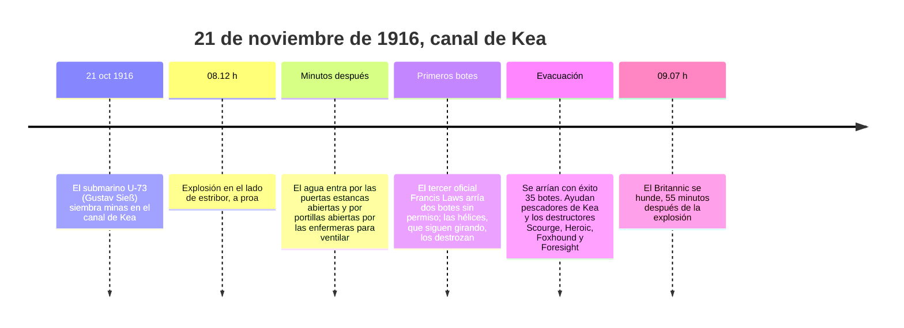
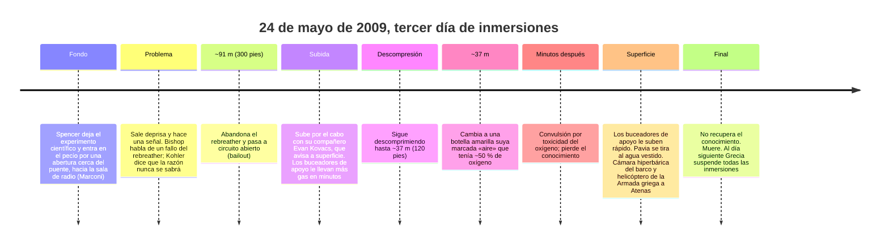
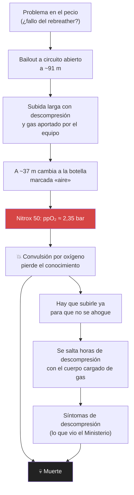

# ⚓ Carl Spencer y el HMHS Britannic: la última inmersión en el gemelo del Titanic

### El barco, el pecio a 120 m, las expediciones, la muerte de Carl Spencer en 2009 y por qué unas fuentes hablan de oxígeno y otras de descompresión

> 🇬🇧 **[English version](README.en.md)**

> **Estudio divulgativo** · Autor: Óscar Ramírez Martín, buceador aficionado que investiga el caso · Noviembre 2026
> No soy experto en buceo técnico ni en pecios profundos. Este trabajo reúne fuentes públicas contrastadas y cálculos propios con fórmulas estándar, y señala en cada punto qué está confirmado y qué no.

> 📄 **Versión PDF:** [Estudio_Britannic_Carl_Spencer.pdf](Estudio_Britannic_Carl_Spencer.pdf)

> ⚠️ **Nota de respeto.** Este estudio trata la muerte real de Carl Spencer (2009) y, más brevemente, las de Tim Saville y Vincent Hong (2019). Sus familias pueden leerlo. No incluye imágenes de sus cuerpos ni pretende señalar culpables. Todo lo que no está confirmado por una fuente oficial aparece como **hipótesis**, con un nivel de confianza (0–1).

> 📚 **Serie de estudios sobre accidentes de buceo** del mismo autor:
> [Blue Hole de Dahab (Yuri Lipski, 2000)](https://github.com/Oskillar28/blue-hole-dahab-yuri-lipski) · [Boesmansgat (Deon Dreyer y Dave Shaw, 1994–2005)](https://github.com/Oskillar28/boesmansgat-deon-dreyer) · [Zacatón (Sheck Exley, 1994)](https://github.com/Oskillar28/zacaton-cenote-mexico) · **Britannic (Carl Spencer, 2009)** (este estudio) · [Cueva de Plura (Noruega, 2014)](https://github.com/Oskillar28/plura-cueva-noruega) · [Cueva de Vaavu (Maldivas, 2026)](https://github.com/Oskillar28/cueva-vaavu-maldivas)
> Continuación de [RMS Titanic: del astillero al abismo](https://github.com/Oskillar28/titanic-pecio-historia).

  
   <i>El HMHS Britannic pintado de blanco, con cruces rojas y franja verde, durante la Primera Guerra Mundial. Autor desconocido, dominio público (PD-US), vía Wikimedia Commons.</i>

---

## 📑 Índice

1. [El caso en 30 segundos](#1-el-caso-en-30-segundos)
2. [El barco: el tercer Olympic](#2-el-barco-el-tercer-olympic)
3. [El hundimiento: 21 de noviembre de 1916](#3-el-hundimiento-21-de-noviembre-de-1916)
4. [El pecio hoy](#4-el-pecio-hoy)
5. [Historia de las expediciones (1975–2025)](#5-historia-de-las-expediciones-19752025)
6. [Quién era Carl Spencer](#6-quién-era-carl-spencer)
7. [Los buceadores del Britannic](#7-los-buceadores-del-britannic)
8. [24 de mayo de 2009: la última inmersión](#8-24-de-mayo-de-2009-la-última-inmersión)
9. [¿Oxígeno o descompresión? Análisis de las dos versiones](#9-oxígeno-o-descompresión-análisis-de-las-dos-versiones)
10. [Después de Spencer: campana, submarinos y nuevas muertes](#10-después-de-spencer-campana-submarinos-y-nuevas-muertes)
11. [Todas las expediciones: buenas y malas](#11-todas-las-expediciones-buenas-y-malas)
12. [Contraste de fuentes: datos que no coinciden](#12-contraste-de-fuentes-datos-que-no-coinciden)
13. [Mitos frente a realidad](#13-mitos-frente-a-realidad)
14. [Fotos, mapas y vídeos](#14-fotos-mapas-y-vídeos)
15. [Glosario](#15-glosario)
16. [Conclusiones](#16-conclusiones)
17. [Metodología, límites y nivel de confianza](#17-metodología-límites-y-nivel-de-confianza)
18. [Fuentes](#18-fuentes)

---

## 1. El caso en 30 segundos

| Dato | Valor más fiable |
|---|---|
| **El barco** | **HMHS Britannic**, tercer y último transatlántico de la clase Olympic de la White Star Line, hermano del Olympic y del Titanic |
| **Botadura** | 26 de febrero de 1914, astilleros Harland & Wolff (Belfast) |
| **Uso real** | Nunca llevó pasajeros: fue **buque hospital** de la Royal Navy (1915–1916) |
| **Hundimiento** | 21 de noviembre de 1916, canal de Kea (mar Egeo, Grecia). Una **mina** del submarino alemán U-73. **55 minutos** |
| **Víctimas de 1916** | **30 muertos** de 1.066 personas a bordo |
| **Pecio** | ~**120 m** de profundidad, tumbado sobre estribor, casi entero. Descubierto por **Jacques Cousteau** en 1975 |
| **Propietario** | El historiador británico **Simon Mills**, desde 1996 |
| **Carl Spencer** | Buceador técnico británico (1970–2009), «solo un fontanero de Cannock». Lideró las expediciones de 2003 y 2009 |
| **Su muerte** | **24 de mayo de 2009**, tercer día de la expedición de National Geographic |
| **Causa más probable** | **Toxicidad por oxígeno**: respiró a ~37 m de una botella marcada «aire» que en realidad tenía ~50 % de oxígeno. *Confianza 0,8* |
| **La otra versión** | La prensa de 2009, citando al Ministerio de Marina Mercante griego, habló de **enfermedad descompresiva** («the bends») |

**En una frase:** un experto que conocía el Britannic mejor que casi nadie superó un fallo a 90 m y una subida de horas, y murió a menos de 40 m de la superficie por una botella mal etiquetada. Las dos versiones de su muerte probablemente no se contradicen: la convulsión por oxígeno obligó a subirle de golpe, y eso explica los síntomas de descompresión.

---

## 2. El barco: el tercer Olympic

  
   <i>El Britannic en el gran pórtico de Harland & Wolff, listo para la botadura (21/2/1914). Foto: Robert Welch, Public Domain Mark, vía Wikimedia Commons.</i>

| Dato | Valor | Fuente |
|---|---|---|
| Encargo | 1911 | Wikipedia |
| Quilla | 30 de noviembre de 1911, número de astillero 433 | Wikipedia |
| Botadura | 26 de febrero de 1914 | Wikipedia |
| Terminado | 12 de diciembre de 1915 | Wikipedia |
| Eslora | 269,1 m (882 pies y 9 pulgadas) | Wikipedia |
| Manga | 94 pies (~28,7 m), más que sus hermanos | Wikipedia |
| Arqueo bruto | 48.158 toneladas | Wikipedia |
| Botes | 48 (cinco grandes pescantes de pórtico de los ocho previstos) | Wikipedia |
| Camas de hospital | 3.309 | Wikipedia |
| Capitán | **Charles Alfred Bartlett** | Wikipedia |

### 2.1 Lo que cambió después del Titanic

El Britannic se diseñó mientras se investigaba el hundimiento del Titanic (1912), y se reformó antes de botarlo:

- **Doble casco** a lo largo de las salas de máquinas y de calderas.
- **Seis** de los 15 mamparos estancos se subieron hasta la cubierta B.
- Compartimentos reforzados para poder **inundarse seis** sin hundirse.
- **Botes para todos**, con pescantes gigantes de pórtico.

> 🧠 **Razonamiento:** el Britannic era más seguro que el Titanic sobre el papel y aun así se hundió **unas tres veces más rápido** (55 minutos frente a 2 h 40 min). Esa paradoja es el gran misterio técnico del barco y la razón de casi todas las expediciones de buceo (§5).

### 2.2 ¿Se iba a llamar «Gigantic»?

Algunas fuentes dicen que el nombre previsto era *Gigantic* y que se cambió por prudencia tras el Titanic. Según Wikipedia, la White Star Line y Harland & Wolff lo negaron. Simon Mills, el dueño del pecio, cita una copia del libro de encargos del astillero. *Confianza en que «Gigantic» fuera el nombre oficial: 0,3.*

### 2.3 Buque hospital

| Fecha | Hecho |
|---|---|
| 13/11/1915 | Requisado por el Almirantazgo; pintado de blanco con cruces rojas y una franja verde |
| 23/12/1915 | Primer viaje: Liverpool → Mudros (isla de Lemnos), base de los heridos de Galípoli |
| 6/6/1916 | Vuelve a Belfast para convertirlo en transatlántico; el gobierno paga 75.000 £ |
| 26/8/1916 | Lo llaman de nuevo como buque hospital |
| 12/11/1916 | Sale de Southampton en su sexto y último viaje |

---

## 3. El hundimiento: 21 de noviembre de 1916

| Dato | Valor |
|---|---|
| Personas a bordo | **1.066** (tripulación y personal sanitario; no llevaba heridos en ese viaje de ida) |
| Muertos | **30**, casi todos en los dos botes absorbidos por las hélices |
| Supervivientes | 1.036 (38 heridos) |
| Causa | **Mina** del U-73, no un torpedo. Los supervivientes creyeron que les habían torpedeado |

**Supervivientes conocidos:**

- **Violet Jessop**, camarera y enfermera, que también sobrevivió al Titanic y estuvo a bordo del Olympic cuando chocó con el HMS Hawke.
- **Sheila MacBeth Mitchell**, enfermera, que habló con Cousteau en 1976 y murió en 1994 con 103 años.
- **George Perman**, el último superviviente, murió el 24 de mayo de 2000.

  
   <i>Supervivientes del Britannic a bordo del destructor HMS Scourge, 21/11/1916. Foto: Royal Navy, dominio público (Gobierno del Reino Unido), vía Wikimedia Commons.</i>

> 🔍 **Comprobación:** el U-73 dejó en la misma zona la mina que hundió el transatlántico francés **Burdigala** una semana antes. Ese pecio, a ~76 m, aparece de nuevo en el accidente de 2019 (§10).

---

## 4. El pecio hoy

  
   <i>El canal de Kea visto desde la Estación Espacial Internacional, con la posición del pecio marcada con una X. Imagen: NASA, obra derivada de Cléééston, dominio público, vía Wikimedia Commons.</i>

| Dato | Valor | Fuente |
|---|---|---|
| Posición | 37°42′05″ N · 24°17′02″ E, a unos 4 millas náuticas de Kea | Wikipedia, Divernet |
| Profundidad del fondo | **~119–122 m** | Nick Hope (119 m), Wikipedia (122 m) |
| Parte más alta del casco | ~**90 m** (el barco mide más de 28 m de manga y está tumbado) | Kohler (≈300 pies), Bishop (campana a ~90 m sobre el casco) |
| Postura | Sobre el costado de **estribor**, casi entero | Wikipedia |
| Daños | La **proa** se dobló al chocar con el fondo: el barco medía más que la profundidad | Gurr 1997, Wikipedia |
| Restos fuera del casco | Chimeneas 2, 3 y 4 en el campo de restos, carbón junto al casco | Kea Divers |
| Récord | Es el **mayor transatlántico hundido** del mundo | Wikipedia |
| Agua | Muy clara, pero con **corrientes fuertes** (2–3 nudos) | Sidetracked, DAN |

### 4.1 Quién manda en el pecio

- **Propietario:** Simon Mills compró el título legal al gobierno británico en **agosto de 1996**, por unas **15.000 £** según Mares. Su idea, en sus palabras: dejarlo como está.
- **Permisos:** para bucear hace falta la autorización del **Ministerio de Cultura griego** (Eforado de Antigüedades Subacuáticas) y la de Mills.
- **2025:** por primera vez se recuperaron objetos, con permiso del Ministerio (§10.3).

---

## 5. Historia de las expediciones (1975–2025)

| Año | Expedición | Qué consiguió | Fuente |
|---|---|---|---|
| **1975** | **Jacques-Yves Cousteau** (*Calypso*) | Localiza el pecio con sonar | Wikipedia, Titanic Connections |
| **1976** | Cousteau | Primeras inmersiones; documental *Calypso's Search for the Britannic* (emitido en 1977) | Titanic Connections, Tenacious |
| **1995** | **Robert Ballard** (NOVA) | Lo estudia con vehículos y el submarino nuclear NR-1, sin buceadores | Wikipedia, Divernet |
| **Nov. 1997** | **Kevin Gurr** (con Kirk Kavalaris, Kevin y Mirja Denlay y otros) | Primera expedición de **buceo técnico**: trimix en circuito abierto, casi un mes, vídeo de la proa | Divernet, InDepth, Titanic Connections |
| **1998** | **Nick Hope** (*Britannic 98*, equipo Starfish Enterprise, con **Leigh Bishop**) | **78 inmersiones** con personas, con propulsores (DPV); Bishop rodea todo el pecio | Divernet (Bishop), Bubblevision |
| **Ago. 1999** | **GUE**, Jarrod Jablonski | Primera penetración amplia; vídeo para el Ministerio griego | Wikipedia, GUE, InDepth |
| **Sep. 2003** | **Carl Spencer** | Primera expedición con **todos los buceadores de fondo en rebreather**. Richie Stevenson filma **puertas estancas abiertas** en la sala de calderas 6. Bill Smith localiza con sonar los **anclajes de las minas** | Kea Divers, Divernet (Bishop) |
| **2006** | History Channel: **John Chatterton y Richie Kohler** (15 buceadores, entre ellos Spencer y Bishop) | Penetran en las salas de calderas. Se corta por un problema de permisos | Kohler, Encyclopedia Titanica |
| **~2008** | Universidad de Patras (George Papatheodorou) | Imágenes de sonar del pecio | Hydro International *(confianza 0,6)* |
| **Mayo 2009** | **National Geographic, Carl Spencer** | **Muere Spencer** (24/5). Kohler llega a la sala de calderas 4. Grecia suspende las inmersiones | Kohler, DAN, Divernet |
| **2012** | Varios equipos (Paul Lijnen; Kostas Thoctarides) | Estudio de la corrosión bacteriana del hierro; fotos | Wikipedia, Divernet, Wreckdiving.gr |
| **Jun. 2015** | **Kohler, Barnette, Kovacs, Pavia** con U-Group (*U-Boat Navigator*) | Primer uso de **campana de buceo** y submarino de apoyo. Dicen haber resuelto por qué se hundió tan rápido, sin publicar la respuesta | DAN, Sidetracked |
| **2016** | **Centenario**: Kohler, Kovacs, U-Boat Group, BBC (Andy Torbet) | Campana húmeda comercial, protocolo de 70 páginas, documental de la BBC | DAN, Divernet |
| **Sep. 2019** | Expedición de **Kea Divers** | Mueren **Vincent Hong** (en el Burdigala) y **Tim Saville** (en el Britannic) | Divernet, Yorkshire Post |
| **6–13 mayo 2025** | **Simon Mills** con el Ministerio de Cultura (seguridad: Tzavelakos, Kovacs, Kohler) | Primera **recuperación de objetos**: la campana del vigía, el farol de babor, prismáticos, azulejos de los baños turcos, un lavabo de porcelana | Protothema, Euronews, Western Front Association |

> 🧠 **Razonamiento:** en 1999 la GUE escribió que solo tres grupos habían tenido permiso para acceder al pecio desde 1975. El Britannic no es un pecio «de turismo»: cada expedición necesita permisos, un barco fondeado y semanas de logística. Por eso se pueden contar casi una a una, a diferencia de las inmersiones en un cenote como el Zacatón. *Confianza 0,7.*

---

## 6. Quién era Carl Spencer

| Dato | Valor | Fuente |
|---|---|---|
| Nacimiento | **10 de marzo de 1970**, Cannock (Staffordshire, Inglaterra) | BAFTA, Diving Almanac, Stevenrlarson |
| Oficio | Ingeniero de calefacción y aire acondicionado; director de la empresa **Spencair** (Hednesford) | Telegraph (vía Neutral Dive Gear), Free Library |
| Su frase | «Solo soy un fontanero de Cannock» | Telegraph, Divernet |
| Familia | Su viuda, Victoria Ann Spencer-Kibble, y sus hijos **Georgia** y **Ben** (también buceador) | Express & Star 2022 |
| Muerte | **24 de mayo de 2009**, con **39 años** | DAN, Divernet, Telegraph |

### 6.1 Su trayectoria

| Año | Proyecto |
|---|---|
| **2000–2001** | **Bluebird Project** (lago Coniston): primeros reconocimientos en vídeo del hidroavión de Donald Campbell. En 2007 recuperó una pieza perdida del bastidor |
| **2003** | Lidera la expedición al **Britannic** que demuestra la mina y las puertas abiertas |
| **2003** | Baja al **Titanic** en un sumergible MIR (con Kevin Gurr). British Diver dice que fue por invitación de James Cameron *(confianza 0,6; no lo he confirmado con una segunda fuente)* |
| **2006** | Buceador de la expedición del History Channel al Britannic; enseña a Kohler a bucear a esa profundidad |
| **2007–2008** | Expedición al **Carpathia**, el barco que rescató a los náufragos del Titanic, a ~150 m |
| — | Proyecto **X5** (submarino enano) y expediciones conjuntas con la Royal Navy y el Ejército británico |
| **2009** | Lidera la expedición de **National Geographic** al Britannic. Muere en ella |

### 6.2 Reconocimientos

- El **Explorers Club** de Nueva York le rindió homenaje en 2009.
- **BAFTA** lo recuerda en su lista *In Memory* como cámara submarino.
- En 2012 se subastaron sus objetos personales por más de 10.000 £.
- En **2022** recibió a título póstumo el **Tridente de Oro** de la Academia Internacional de Ciencias y Técnicas Subacuáticas, el «Óscar del mundo submarino». Fue la segunda persona en recibirlo póstumamente.

---

## 7. Los buceadores del Britannic

| Persona | País | Papel |
|---|---|---|
| **Jacques-Yves Cousteau** | Francia | Descubridor (1975) y primeras inmersiones (1976) |
| **Kevin Gurr** | Reino Unido | Primera expedición técnica (1997) |
| **Nick Hope** | Reino Unido | Jefe de *Britannic 98* |
| **Leigh Bishop** | Reino Unido | Fotógrafo en 1998, 2003, 2006, 2009 y 2016; mejor amigo de Spencer |
| **Jarrod Jablonski** | EE. UU. | Fundador de GUE; expediciones de 1999 y 2009 |
| **Carl Spencer** | Reino Unido | Jefe de las expediciones de 2003 y 2009 |
| **Richie Stevenson** | Reino Unido | Filmó las puertas estancas abiertas (2003) y entró en las calderas (2009) |
| **Bill Smith** | Reino Unido | Experto en sonar; encontró los anclajes de las minas (2003) |
| **Richie Kohler** | EE. UU. | Coliderazgo en 2006; expediciones de 2009, 2015, 2016 y 2025; libro *Mystery of the Last Olympian* (2016) |
| **John Chatterton** | EE. UU. | Coliderazgo en 2006 |
| **Evan Kovacs** | EE. UU. | Cámara; compañero de Spencer el 24/5/2009 |
| **Edoardo Pavia** | Italia | Oficial de seguridad en 2009; expediciones de 2006, 2015 y 2016 |
| **Michael C. Barnette** | EE. UU. | Expediciones de 2006, 2015 y 2016; autor de artículos en *Alert Diver* (DAN) |
| **Simon Mills** | Reino Unido | Historiador y propietario del pecio |

---

## 8. 24 de mayo de 2009: la última inmersión

### 8.1 La expedición

- **Organización:** National Geographic con el gobierno griego y la Woods Hole Oceanographic Institution (WHOI), bajo la bandera del **Explorers Club**.
- **Buceadores:** Carl Spencer, Leigh Bishop y Richie Stevenson (Reino Unido); Evan Kovacs, Jarrod Jablonski, Casey McKinlay y Richie Kohler (EE. UU.); Edoardo Pavia (Italia); Danny Huyge (Bélgica) y Pete Mesley (Nueva Zelanda). A bordo, además, técnicos de imagen de WHOI, médicos hiperbáricos de DAN (entre ellos el Dr. Petar Denoble), Simon Mills y los historiadores Parks Stephenson y Marty Morgan.
- **Objetivos:** filmar los **baños turcos**; llegar a la **sala de calderas 5** para ver si su puerta estanca estaba abierta; recuperar el **telégrafo Marconi** (si Grecia lo permitía); recoger un experimento científico de 2006 y dejar otro nuevo; entrar en la sala de máquinas por las claraboyas; hacer el primer **fotomosaico** del barco.

### 8.2 Lo que pasó

### 8.3 La botella

Es el detalle clave, y en él coinciden **tres fuentes independientes** (Kohler, Barnette en DAN y Sidetracked):

| Dato | Lo que dicen las fuentes |
|---|---|
| Etiqueta | «**Air**» (aire) |
| Contenido real | Alrededor de **50 % de oxígeno** (nitrox 50) |
| De quién era | De Spencer; **no** era del programa del equipo y nadie la había llenado, analizado ni revisado (Kohler) |
| Para qué | La había dejado en el cabo de descenso antes de la inmersión; Sidetracked dice que era para un **experimento con un globo de elevación** |
| Profundidad del cambio | ~**37 m** (120 pies): «a unos 120 pies» (DAN), «tras llegar a 120 pies» (Kohler) |

> 🧭 **Por qué una botella de «aire» no levantaba sospechas.** El aire es un gas de descompresión normal a 37 m: allí su presión parcial de oxígeno es ~1,0 bar, segura. Llenar globos de elevación con aire también es lo habitual. Con la etiqueta correcta, coger esa botella era razonable. **El error no estaba en la decisión de ese momento, sino en la etiqueta.** *Confianza 0,7.*

> ⚠️ **Lo que no sé.** No he encontrado una autopsia publicada ni una investigación oficial (griega o británica) sobre la muerte de Spencer. Barnette escribe que cometió «una serie de errores» pero solo detalla el último. David Concannon atribuye la confusión, en parte, a que Spencer estaba agotado y desbordado. Esto queda como **hipótesis**.

---

## 9. ¿Oxígeno o descompresión? Análisis de las dos versiones

### 9.1 Qué dice cada fuente

| Fuente | Fecha | Causa | Tipo de fuente |
|---|---|---|---|
| Ministerio de Marina Mercante griego (portavoz Aspa Papadopoulou) | 24–25/5/2009 | Hallado «inconsciente, con síntomas de enfermedad descompresiva» | Oficial, primeras horas |
| *The Guardian*, *Telegraph*, Express & Star, Greeka | 25–26/5/2009 | «Se cree» que murió por **descompresión** (the bends) | Prensa, citando al Ministerio |
| Express & Star | 26/5/2009 | Convulsiones y pérdida de conocimiento; murió en un hospital naval de Atenas | Prensa |
| **Richie Kohler** (estaba en el agua ese día) | Después de 2009 | **Convulsiones por toxicidad del oxígeno** tras respirar de la botella de nitrox 50 marcada «aire» | Testigo y miembro del equipo |
| **Michael Barnette** (*Alert Diver*, DAN) | Noviembre 2015 | Botella mal etiquetada → **convulsión por oxígeno** a ~120 pies | Buceador del Britannic, revista de DAN |
| **Leigh Bishop** (Divernet) | 2016 | Fallo del rebreather → bailout → se queda corto de gas → mezcla equivocada → **golpe de oxígeno mortal** | Testigo y miembro del equipo |
| Sidetracked (Kim Frank, con David Concannon) | 2015 | Botella «aire» con 50 % de O₂ → **convulsiones** | Periodismo con fuentes del equipo |
| Staffordshire Live | 2022 | Murió tras una **convulsión** | Prensa |

### 9.2 Los números (cálculo propio)

Presión en agua de mar: *P ≈ 1,013 + 0,1006 × profundidad (m)*.

| Profundidad | Presión | ppO₂ con **aire** (21 %) | ppO₂ con **nitrox 50** |
|---|---|---|---|
| 6 m | 1,62 bar | 0,34 bar | 0,81 bar |
| 21 m | 3,12 bar | 0,66 bar | 1,56 bar |
| 30 m | 4,03 bar | 0,85 bar | **2,01 bar** |
| **36,6 m (120 pies)** | **4,69 bar** | **0,99 bar** ✅ | **2,35 bar** ❌ |

- La **profundidad máxima** del nitrox 50 es de **~18 m** con el límite de trabajo (1,4 bar) y **~22 m** con el de descompresión (1,6 bar).
- A 37 m, Spencer respiraba **~2,35 bar** de oxígeno: casi **1,5 veces** el máximo aceptado. Con esa presión, el riesgo de **convulsión en pocos minutos** es muy alto, y más con el esfuerzo, el estrés y el CO₂ acumulado de una emergencia larga.

*Cálculo propio con Python. Comprobación del método: con la misma fórmula, el aire de la campana de 2016 a 90 m da 2,11 bar, y Leigh Bishop escribe que allí la ppO₂ «superaba 2,0». Coincide.*

### 9.3 Las dos versiones encajan

1. **La causa inicial fue el oxígeno.** Lo dicen los tres testigos o personas del equipo que han escrito sobre ello, de forma independiente, y la física lo explica. *Confianza 0,8.*
2. **La descompresión fue una consecuencia, no la causa inicial.** Un buceador que convulsiona a 37 m puede ahogarse si no se le saca. Sus compañeros lo subieron deprisa, saltándose la descompresión que le quedaba después de una inmersión a 120 m, y eso sí produce síntomas de descompresión, o una embolia gaseosa si la glotis está cerrada durante la convulsión. *Confianza 0,6.*
3. **Por qué la prensa dijo «the bends».** El primer parte oficial describía lo que vieron los médicos y la cámara hiperbárica: un buceador inconsciente con síntomas de descompresión. La botella no se conoció hasta horas o días después, y la prensa ya no corrigió la noticia. *Confianza 0,7.*
4. **Lo que no se puede saber:** qué falló exactamente en el rebreather, si hubo un problema médico añadido y cuál fue la causa final de la muerte (ahogamiento, embolia o lesión por la convulsión). *Sin datos.*

| Eslabón | ¿Comprobado? | Confianza |
|---|---|---|
| Botella marcada «aire» con ~50 % de O₂ | Tres fuentes independientes | 0,85 |
| Cambio de gas a ~37 m | Kohler y Barnette | 0,8 |
| ppO₂ ≈ 2,35 bar a esa profundidad | Cálculo | 0,95 |
| Convulsión por toxicidad del oxígeno | Testigos + física | 0,8 |
| Fallo previo del rebreather | Solo Bishop; Kohler no lo afirma | 0,5 |
| Síntomas de descompresión por la subida de emergencia | Ministerio griego + lógica de los hechos | 0,6 |
| Enfermedad descompresiva como **causa principal** | Solo la prensa de 2009 | 0,15 |

> 🔍 **Lo mismo que en Boesmansgat.** Dave Shaw (2005) también murió por una cadena: una tarea en el fondo, más esfuerzo del previsto y un gas que ya no daba margen. En el Britannic el último eslabón no fue la profundidad, sino algo que pasó **cerca de la superficie**, cuando lo peor parecía superado.

> 🧠 **Razonamiento:** la regla que se enseña en todos los cursos técnicos es **analizar cada botella y marcarla con su mezcla y su profundidad máxima**. Spencer la conocía de sobra. Que le pasara a él muestra el peso del cansancio después de horas de emergencia, y por qué los equipos de 2015 y 2016 diseñaron la seguridad para que un error así **no dependiera de una sola persona**. Esto es una lección general, no un juicio sobre él.

---

## 10. Después de Spencer: campana, submarinos y nuevas muertes

### 10.1 2015–2016: otra forma de bucear el Britannic

Barnette escribió en 2015 que, al ver el equipo del *U-Boat Navigator*, el grupo pensó que Spencer quizá habría sobrevivido de haber contado con esos medios.

| Medida | Para qué |
|---|---|
| **Campana de buceo** a ~90 m sobre el casco (2016) | Descomprimir dentro, en seco, sin máscara, bebiendo agua y vigilados por un médico |
| **Submarino** de tres plazas y **ROV** | Iluminar, filmar y vigilar a los buceadores en directo desde el barco |
| **Cámara hiperbárica** multiplaza y clínica a bordo | Tratamiento inmediato |
| Protocolo de **70 páginas** | Procedimientos de emergencia acordados |
| Solo **cuatro buceadores** por día, con **40–45 minutos** de fondo | Limitar el riesgo y la descompresión (5–8 horas) |
| Gases (2016) | Diluyente trimix 9/73; bailouts 13/60, 20/30 y oxígeno puro |

*Mi cálculo del diluyente 9/73 a 120 m: ppO₂ ≈ 1,18 bar y densidad ≈ 5,9 g/L, justo por debajo del límite recomendado de 6,2 g/L. El aire a esa profundidad pesaría ~15,6 g/L y tendría una ppO₂ de 2,75 bar.*

### 10.2 2019: Tim Saville y Vincent Hong

| | Vincent Hong | Tim Saville |
|---|---|---|
| Edad | 53 años, anestesista y médico hiperbárico (Yorkshire) | 61 años, empresario (Yorkshire), instructor de trimix y rebreather |
| Fecha | 27/9/2019 | **29/9/2019** |
| Dónde | **Burdigala** (~76 m), inmersión de preparación | **Britannic** (~116–120 m) |
| Qué pasó | Subiendo desde 63 m, se enredó en el cabo, perdió la boquilla y quedó inconsciente | A los ~12 minutos lo vieron de rodillas con la boquilla fuera; no respondió |
| Monóxido de carbono | 11 % en los tejidos (no fumador) | 15 % en los tejidos (no fumador) |
| Conclusión de la investigación británica (forense Paul Marks, Hull, agosto de 2023) | **Veredicto abierto**: muerte «relacionada con el buceo» | **Veredicto abierto**: muerte «relacionada con el buceo», con la hipertensión como factor |

- La segunda autopsia encontró enfermedad cardiaca en los dos.
- El forense criticó que en Grecia **no se tomaran muestras de sangre ni se analizara el gas** de las botellas, y dijo que las familias habían quedado «defraudadas por las autoridades griegas».
- El dueño de **Kea Divers** fue acusado en Grecia de homicidio por negligencia, con juicio previsto para enero de 2024. **No he encontrado el resultado del juicio**: debe considerarse un caso sin resolver y nadie ha sido declarado culpable en lo que he podido comprobar.

> ⚠️ **Hipótesis, no conclusiones.** El monóxido de carbono alto en dos buceadores del mismo grupo hace pensar en un gas contaminado, pero ningún otro buceador tuvo síntomas, y el forense no pudo determinar la causa. *Confianza en que el CO fuera la causa: 0,3.*

### 10.3 2025: los primeros objetos

Entre el **6 y el 13 de mayo de 2025**, un equipo de 11 buceadores con rebreather, organizado por Simon Mills y supervisado por el Eforado de Antigüedades Subacuáticas, subió con globos de elevación:

- la **campana del vigía**,
- el **farol de navegación de babor**,
- unos **prismáticos**,
- bandejas plateadas de primera clase,
- **azulejos** de los baños turcos,
- un **lavabo de porcelana** de segunda clase.

Se anunció el 15 de septiembre de 2025. Los objetos se conservan en Atenas para el futuro **Museo de Arqueología Subacuática del Pireo**. Algunos objetos previstos no se pudieron subir por las corrientes y la poca visibilidad.

> 🔗 Enlaza con el debate del [estudio del Titanic](https://github.com/Oskillar28/titanic-pecio-historia) sobre si se deben subir objetos de un pecio: en el Britannic se ha hecho con permiso del Estado, una selección pequeña y destino a un museo público.

---

## 11. Todas las expediciones: buenas y malas

> ⚠️ **Límite importante:** no existe un registro público de todas las inmersiones. Solo la de 1998 dio un número (78 inmersiones). Desde los años 2010 también hay viajes de buceadores técnicos con operadores locales que no aparecen en esta tabla.

**Leyenda:** ✅ sin incidentes graves · ⚠️ incidente sin muertos · ❌ mortal

| # | Año | Expedición | Resultado |
|---|---|---|---|
| 1 | 1976 | Cousteau | ✅ |
| 2 | 1995 | Ballard (sin buceadores) | ✅ |
| 3 | 1997 | Kevin Gurr | ✅ (un barco pasó muy cerca de la neumática en la primera inmersión) |
| 4 | 1998 | Nick Hope, 78 inmersiones | ✅ |
| 5 | 1999 | GUE | ✅ |
| 6 | 2003 | Carl Spencer | ✅ |
| 7 | 2006 | History Channel | ✅ (cortada por permisos) |
| 8 | 2009 | National Geographic | ❌ **Carl Spencer**. ⚠️ El mismo día, un cable se enganchó a la válvula de oxígeno de Kohler a 110 m; se soltó con dos minutos de retraso |
| 9 | 2012 | Varios equipos | ✅ |
| 10 | 2015 | Kohler y U-Group | ✅ (solo un día de inmersión por las corrientes) |
| 11 | 2016 | Centenario, BBC | ✅ |
| 12 | 2019 | Kea Divers | ❌ **Tim Saville** (Britannic) · ❌ Vincent Hong (Burdigala, misma expedición) |
| 13 | 2025 | Recuperación de objetos | ✅ |

### 11.1 Balance

| | Número |
|---|---|
| Expediciones documentadas | 13 |
| Sin muertos | 11 |
| Muertes **en el Britannic** | **2** (Spencer 2009, Saville 2019) |
| Muertes en la misma expedición, en otro pecio | 1 (Hong, Burdigala) |
| Muertes del hundimiento de 1916 | 30 |

> 🔍 **Comprobación:** Kohler escribe que Spencer fue «el primer buceador que murió en el Britannic». No he encontrado ninguna muerte anterior en el pecio. *Confianza 0,85.*

---

## 12. Contraste de fuentes: datos que no coinciden

| Dato | Versión A | Versión B | Más probable |
|---|---|---|---|
| Causa de la muerte de Spencer | Descompresión: Ministerio griego y prensa de 2009 | Toxicidad del oxígeno: Kohler, Barnette, Bishop, Sidetracked | **Oxígeno como causa inicial**; la descompresión, como consecuencia (§9) |
| Edad de Spencer | **37 años**: Ministerio griego, *Guardian*, Express & Star | **39 años**: *Telegraph*; nacido el 10/3/1970 (BAFTA, Diving Almanac) | **39 años** |
| Fecha de la muerte | **23/5/2009**: BAFTA | **24/5/2009**: DAN, Divernet, Greeka, Bluebird Project | **24 de mayo de 2009** |
| Dónde murió | En un hospital naval de Atenas: Express & Star, Kohler | Ya muerto al sacarlo del agua: Sidetracked | **No se puede resolver** con las fuentes públicas |
| Qué falló primero | El rebreather: Bishop | «Nunca se sabrá»: Kohler | **Algún problema en el fondo**; la causa concreta, desconocida |
| Tamaño y duración de la expedición | 17 personas, nueve días: *Telegraph* | 21 días: Sidetracked; diez buceadores en la lista de Kohler | **10 buceadores** y un equipo de apoyo mayor |
| Quién filmó las puertas abiertas (2003) | Richie Stevenson: Bishop | Spencer, «el primero en filmarlas»: *Telegraph* | **Stevenson**, en la expedición que dirigía Spencer |
| Descubrimiento del pecio | 13/11/1975: Wikipedia | 3/12/1975: Titanic Connections | **Finales de 1975** |
| Visita de Ballard | 1995: Wikipedia, Divernet | 1996: Hydro International | **1995** |
| Personas a bordo en 1916 | **1.066**: Wikipedia, Kea Divers | «Unas 1.100» (Tenacious) o «unas 1.300» (Bluelife) | **1.066** |
| Duración del hundimiento | **55 minutos**: Wikipedia | «Últimos 40 minutos» (vídeo de Oceanliner Designs) | **55 minutos** desde la explosión |
| Profundidad | 119 m (Hope) · 120 m (Divernet) · 122 m (Wikipedia) | «400 pies» (122 m) | **~120 m** |
| Profundidad de la inmersión de Saville | 116 m (*Guardian*) · 120 m (Divernet) | 106 m (*Yorkshire Post*) | **~116–120 m** |

---

## 13. Mitos frente a realidad

| Mito | Realidad | Confianza |
|---|---|---|
| «Al Britannic lo torpedearon» | Fue una **mina** del U-73; Bill Smith encontró los anclajes en 2003 | 0,95 |
| «Spencer murió de descompresión» | La causa inicial fue la **toxicidad del oxígeno**; la descompresión vino después | 0,8 |
| «Spencer murió en el fondo» | Murió tras una convulsión a ~37 m, ya cerca del final de la descompresión | 0,8 |
| «El Britannic era una copia del Titanic» | Era **más grande y más seguro**, con doble casco y botes para todos | 0,9 |
| «Se iba a llamar Gigantic» | No está confirmado; el astillero y la naviera lo negaron | 0,7 |
| «Nunca llevó pasajeros» | Cierto: solo fue buque hospital | 0,95 |
| «Del Britannic no se ha subido nada» | Desde **mayo de 2025** sí: una selección pequeña con permiso del Estado griego | 0,9 |
| «Se hundió rápido solo por la mina» | La mina más las **puertas estancas y portillas abiertas** | 0,8 |

---

## 14. Fotos, mapas y vídeos

> ⚠️ Las fotos de §14.1 tienen **licencia libre comprobada** en Wikimedia Commons. No hay fotos libres del pecio bajo el agua; las de §14.2 son de sus autores y solo se enlazan. **No se enlaza ningún material del cuerpo de Spencer ni de las otras víctimas.**

### 14.1 Fotos con licencia libre (Wikimedia Commons)

Licencias comprobadas el 16/11/2026 en la página de cada archivo. Para reutilizarlas hay que citar al autor y la licencia.

| Foto | Autor · fecha | Licencia |
|---|---|---|
| [El HMHS Britannic como buque hospital](https://commons.wikimedia.org/wiki/File:HMHS_Britannic.jpg) | Desconocido · 1915–1916 | Dominio público (PD-US) |
| [El Britannic en el pórtico de Harland & Wolff](https://commons.wikimedia.org/wiki/File:Britannic_under_construction.jpg) | Robert Welch · 21/2/1914 | Public Domain Mark |
| [Britannic y Olympic juntos en Southampton](https://commons.wikimedia.org/wiki/File:HMHS_Britannic_%26_HMT_Olympic_Sisters_Together_in_Southampton.jpg) | Desconocido; restauración de HefePine23 · 1915–1916 | CC BY-SA 4.0 |
| [Los botes del Britannic](https://commons.wikimedia.org/wiki/File:Lifeboats_of_HMHS_Britannic.jpg) | Desconocido · 1915–1916 | Public Domain Mark |
| [El capitán Charles Alfred Bartlett](https://commons.wikimedia.org/wiki/File:Charles_Alfred_Bartlett.jpg) | Desconocido · hacia 1916–1920 | CC0 |
| [Supervivientes a bordo del HMS Scourge](https://commons.wikimedia.org/wiki/File:Britannic%27s_survivors.jpg) | Royal Navy · 21/11/1916 | Dominio público (Gobierno del Reino Unido) |
| [El canal de Kea con la posición del pecio](https://commons.wikimedia.org/wiki/File:Canal_de_Kea_Britannic.png) | NASA; obra derivada de Cléééston · 2015 | Dominio público |

Hay más de 50 archivos en la [categoría *Britannic (ship, 1915)*](https://commons.wikimedia.org/wiki/Category:Britannic_(ship,_1915)).

### 14.2 Fotos del pecio (solo enlaces)

| Recurso | Qué contiene |
|---|---|
| [Galería de Richie Kohler](https://www.richiekohler.com/gallery/britannic-gallery/) | Fotos de 2006 y 2009 (algunas de Leigh Bishop): el equipo, el interior, la plataforma de buceo y un recuerdo a Spencer |
| [Ministerio de Cultura griego vía AP (2025)](https://www.euronews.com/2025/09/17/extraordinary-artefacts-recovered-from-titanics-sister-ship-the-britannic-after-109-years) | Fotos del interior iluminado y de la recuperación de objetos |
| [Sidetracked: *The Siren Song of the Britannic*](https://www.sidetracked.com/the-siren-song-of-the-britannic/) | Fotos de la expedición de 2015 (Concannon, Barnette, Tomashov) |
| [Mares: *Diving the HMHS Britannic*](https://blog.mares.com/?p=4741) | Fotos de Derk Remmers: la proa, el puente y la placa de Cousteau |
| [Divernet: *The Million-Dollar Dive*](https://divernet.com/world-dives/the-million-dollar-dive/) | Fotos de Leigh Bishop de 2016 con los submarinos |
| [DAN: *The Logistics of Exploration*](https://dan.org/alert-diver/article/the-logistics-of-exploration/) | Fotos de la campana y de las hélices iluminadas (2016) |

### 14.3 Vídeos

Comprobados en noviembre de 2026 (título, canal y fecha confirmados en YouTube):

| Vídeo | Canal · idioma · fecha · duración | Qué aporta |
|---|---|---|
| 🎬 [*Inside the Britannic Wreck with Richie Kohler*](https://www.youtube.com/watch?v=uGiwkgPiu2I) | Deep Wreck Diver · inglés · 12/10/2025 · 47 min | Kohler cuenta sus expediciones, incluida la de 2009 |
| 🎬 [*Never Before Seen Britannic Wreck Footage!*](https://www.youtube.com/watch?v=2jWdGiXUi5U) | Deep Wreck Diver · inglés · 9/11/2025 · 32 min | Imágenes inéditas de Kohler: sala de máquinas y baños turcos |
| 🎬 [*HMHS Britannic at 120m: Diving the Giant Propellers*](https://www.youtube.com/watch?v=71GOp4F8Ap0) | Deep Wreck Diver · inglés · 26/4/2026 · 37 min · ~430.000 visitas | Inmersión a la popa y las hélices |
| 🎬 [*The Reality of Diving Titanic's Sister Ship HMHS Britannic*](https://www.youtube.com/watch?v=8SeyJ7yxF8Q) | Deep Wreck Diver · inglés · 21/6/2026 · 1 h 12 min | Entrevista sobre la logística de una inmersión a 120 m |
| 🎬 [*Final Plunge: Britannic's HARROWING Last 40 Minutes*](https://www.youtube.com/watch?v=sHBe1lCPSGc) | Oceanliner Designs · inglés · 20/11/2025 · 28 min | Reconstrucción animada del hundimiento de 1916 |

Otros (no comprobados uno a uno):

- [*Diving HMHS Britannic Wreck – May 2025*](https://www.youtube.com/watch?v=RYYNhdQ5seo), [*HMHS Britannic - Titanic's Prettier Sister* (Mark Powell)](https://www.youtube.com/watch?v=IpJlRrZUOzk) y [*Diving the HMHS Britannic (Without a Golden Ticket)* (Brett Eldridge)](https://www.youtube.com/watch?v=rJ0vHNVvF-E).
- [Vídeo de *Britannic 98*, de Nick Hope](https://bubblevision.com/underwater-videos/HMHS-Britannic.htm), en su web.
- *When a technical dive goes horribly wrong: Carl Spencer's last dive*, entrevista a Leigh Bishop de **Submerge Productions** (2011). El enlace original ya no parece activo.

**Documentales de televisión** (buscar en plataformas; no he encontrado copias oficiales en YouTube):

| Título | Año | Cadena |
|---|---|---|
| *The Cousteau Odyssey: Calypso's Search for the Britannic* | 1977 | Cousteau |
| *Titanic's Tragic Sister* | 2007 | History Channel |
| *Titanic's Achilles Heel* | 2007 | History Channel |
| *Titanic's Tragic Twin: The Britannic Disaster* | 2016 | BBC |

> ⚠️ **Los vídeos tienen errores.** El de Oceanliner Designs habla de 40 minutos de hundimiento y la prensa de 2009 repite la descompresión como causa. En este estudio se usan las cifras de las fuentes escritas.

---

## 15. Glosario

| Término | Significado |
|---|---|
| **HMHS** | *His Majesty's Hospital Ship*: buque hospital de Su Majestad |
| **Clase Olympic** | Los tres transatlánticos gemelos de la White Star Line: Olympic, Titanic y Britannic |
| **Mamparo estanco** | Pared interior que divide el barco en compartimentos que no dejan pasar el agua |
| **Rebreather (CCR)** | Equipo de circuito cerrado que recicla el gas exhalado, quita el CO₂ y añade oxígeno |
| **Diluyente** | Gas que el rebreather mezcla con el oxígeno; a 120 m suele ser trimix |
| **Bailout** | Gas de emergencia en circuito abierto, por si falla el rebreather |
| **Nitrox 50 (EAN50)** | Mezcla de 50 % de oxígeno y 50 % de nitrógeno, para descompresión por encima de ~21 m |
| **ppO₂** | Presión parcial de oxígeno; por encima de ~1,6 bar puede causar convulsiones |
| **Toxicidad del oxígeno (SNC)** | Efecto del oxígeno a presión sobre el cerebro: convulsiones sin aviso |
| **MOD** | Profundidad máxima a la que se puede respirar una mezcla sin superar la ppO₂ límite |
| **Enfermedad descompresiva** | Burbujas de gas en el cuerpo por subir demasiado rápido |
| **Embolia gaseosa arterial** | Gas que entra en la sangre al romperse el pulmón en una subida rápida |
| **Campana húmeda** | Campana abierta por abajo con aire, donde los buceadores descomprimen sin máscara |
| **DPV** | Propulsor submarino («scooter») |
| **Trimix 9/73** | 9 % de oxígeno, 73 % de helio y el resto nitrógeno |

---

## 16. Conclusiones

1. **El Britannic era el mejor de los tres** y aun así se hundió en 55 minutos, por una mina y por puertas estancas y portillas abiertas. Lo demostraron los buceadores en 2003.
2. **El pecio es uno de los grandes retos del buceo técnico:** 120 m, corrientes, permisos y horas de descompresión.
3. **Carl Spencer murió por una cadena de hechos**, no por la profundidad: un problema en el fondo, una subida de emergencia larga y, al final, una botella marcada «aire» con 50 % de oxígeno a 37 m.
4. **Las dos versiones no se excluyen.** La convulsión por oxígeno fue el primer golpe; la subida de urgencia explica los síntomas de descompresión del parte oficial.
5. **Su muerte cambió la forma de bucear el Britannic.** Campanas, submarinos de vigilancia y protocolos detallados en 2015 y 2016.
6. **No ha sido la única.** En 2019 murieron Tim Saville en el Britannic y Vincent Hong en el Burdigala, y la investigación británica no pudo determinar por qué.
7. **La lección general:** las reglas básicas (analizar y etiquetar cada botella) importan más cuanto más cansado y experto se está, porque el experto confía en lo que ya conoce.

---

## 17. Metodología, límites y nivel de confianza

**Cómo se ha hecho:** se dividió el tema en partes (barco, hundimiento, pecio, expediciones, Spencer, accidente de 2009, versiones, accidentes posteriores, medios). Cada dato se contrastó en al menos dos fuentes cuando fue posible. Los cálculos de presión, ppO₂ y densidad del gas se hicieron con Python ([`scripts/calculos.py`](scripts/calculos.py)).

**Límites:**

- No he encontrado una autopsia, un informe oficial ni una investigación judicial publicada sobre la muerte de Spencer. La versión del oxígeno se basa en personas del equipo, no en un documento oficial.
- Los relatos de Kohler, Bishop y Barnette se escribieron años después y no coinciden en todos los detalles (el fallo del rebreather, el tiempo en el agua).
- No he podido leer los artículos originales del *Guardian* ni del *Telegraph*, sino sus reproducciones y resúmenes.
- No he encontrado el resultado del juicio contra Kea Divers.
- La lista de expediciones no es completa: desde los años 2010 hay viajes técnicos que no constan.
- Para los cálculos supuse agua de mar (1,025 kg/L) y 18 °C a 120 m.

| Bloque | Confianza |
|---|---|
| Historia del barco y del hundimiento | 0,9 |
| Datos del pecio | 0,85 |
| Cronología de expediciones | 0,8 |
| Biografía de Spencer | 0,8 |
| Secuencia del accidente de 2009 | 0,75 |
| Causa: toxicidad del oxígeno | 0,8 |
| Cálculos físicos | 0,95 |
| Muertes de 2019 | 0,8 (causa: desconocida) |

---

## 18. Fuentes

**La muerte de Carl Spencer**

- Kohler, R. *National Geographic Britannic Expedition*. https://www.richiekohler.com/project-files/national-geographic-britannic-expedition/
- Kohler, R. *History Channel Britannic Expedition* (2006). https://www.richiekohler.com/?p=829
- Barnette, M. C. (1/11/2015). *Back to Britannic*. *Alert Diver*, DAN. https://dan.org/alert-diver/article/back-to-britannic/
- Bishop, L. *The Million-Dollar Dive*. Divernet. https://divernet.com/world-dives/the-million-dollar-dive/
- Frank, K. (2015). *The Siren Song of the Britannic*. Sidetracked. https://www.sidetracked.com/the-siren-song-of-the-britannic/
- Pearse, D. (25/5/2009). *National Geographic diver dies from the bends*. *The Guardian* (reproducido en ScubaBoard). https://scubaboard.com/community/threads/carl-spencer.286426
- Express & Star (25 y 26/5/2009). *Diver killed filming ship* · *Tributes paid to tragic diver Carl*. https://www.expressandstar.com/news/2009/05/25/diver-killed-filming-ship · https://www.expressandstar.com/news/2009/05/26/tributes-paid-to-tragic-diver-carl
- Free Library. *Company boss dies in wreck diving tragedy*. https://www.thefreelibrary.com/Company+boss+dies+in+wreck+diving+tragedy-a0200533809
- Greeka (2009). *Diver died on a Brittanic expedition*. https://www.greeka.com/cyclades/kea/news/general/diver-died-on-a-brittanic-expedition/
- *Telegraph*, necrológica (2009), reproducida por Neutral Dive Gear. https://neutraldivegear.blogspot.com/2009/06/carl-spencer-modest-professional.html

**Carl Spencer: biografía y homenajes**

- BAFTA. *In memory of: Carl Spencer*. https://www.bafta.org/heritage/in-memory-of/carl-spencer
- Diving Almanac. *Spencer, Carl*. https://divingalmanac.com/spencer-carl
- Bluebird Project. *Meet the team*. https://www.bluebirdproject.info/copy-of-they-also-served
- Divernet (2022). *Carl Spencer awarded 'Trident in Memoriam'*. https://divernet.com/scuba-news/carl-spencer-awarded-trident-in-memoriam/
- Staffordshire Live (2022). *Story of Titanic explorer from Staffordshire who died in diving tragedy*. https://www.staffordshire-live.co.uk/news/local-news/story-titanic-explorer-staffordshire-who-7101329
- British Diver (2012). *Carl Spencer auction fetches £10k*. https://britishdiver.co.uk/?p=1038
- Advanced Diver Magazine. *RMS Carpathia*. https://advanceddivermagazine.com/carpathia.html

**El barco y el pecio**

- Wikipedia (en). *HMHS Britannic*. https://en.wikipedia.org/wiki/HMHS_Britannic
- Kea Divers. *Britannic*. https://keadivers.com/kea-underwater-historic-site/30-wrecks/89-brittanic.html
- Titanic Connections. *The Wreck of the Britannic*. https://titanicconnections.com/the-wreck-of-the-britannic/
- Archaeology.wiki. *Britannic*. https://www.archaeology.wiki/?p=83012
- Hydro International (2008). *Ghostly Images of HMHS Britannic*. https://www.hydro-international.com/content/article/ghostly-images-of-hmhs-britannic
- Tenacious. *HMHS Britannic's Lost Bell*. https://dvtenacious.com/h-m-h-s-britannics-lost-bell/
- Mares (2017). *Diving the HMHS Britannic*. https://blog.mares.com/?p=4741

**Expediciones**

- Divernet. *Project Britannic* (1997 y 2012). https://www.divernet.com/wrecks/1525484/Project_britannic.html
- InDepth. *20 Years: The Secrets of the Britannic* (GUE 1999). https://indepthmag.com/20-years-the-secrets-of-the-britannic
- Hope, N. *Britannic 98*. https://bubblevision.com/underwater-videos/HMHS-Britannic.htm
- Divernet. *The Truth About the Britannic Wreck* (2003). https://divernet.com/scuba-news/wrecks/britannic-wreck-truth/
- DAN (2016). *The Logistics of Exploration*. https://dan.org/alert-diver/article/the-logistics-of-exploration/
- DeeperBlue. *A Chat With Britannic Diver Richie Kohler*. https://deeperblue.com/a-chat-with-britannic-diver-richie-kohler

**2019 y 2025**

- Divernet (5/10/2019). *British diver dies on Britannic*. https://divernet.com/2019/10/05/british-diver-dies-on-britannic/
- Divernet (1/9/2023). *Britannic expedition deaths: 'Let down by Greek authorities'*. https://divernet.com/scuba-news/health-safety/britannic-expedition-deaths-let-down-by-greek-authorities/
- *Yorkshire Post* (2023). https://www.yorkshirepost.co.uk/news/people/dr-vincent-hong-and-timothy-saville-families-of-divers-who-died-on-mediterranean-trip-were-let-down-by-greek-authorities-4274893
- Protothema (15/9/2025). *Kea: Research on the "Britannic"*. https://origin01-en.protothema.gr/2025/09/15/kea-research-on-the-britannic-that-sank-in-1916-in-greece-impressive-video-and-findings
- Euronews / AP (17/9/2025). https://www.euronews.com/2025/09/17/extraordinary-artefacts-recovered-from-titanics-sister-ship-the-britannic-after-109-years
- Western Front Association (16/9/2025). https://www.westernfrontassociation.com/news/2025/september/artefacts-from-hmhs-britannic-retrieved-for-display-in-greek-museum/

**Libros**

- Mills, S. (2019). *Exploring the Britannic*. Adlard Coles.
- Kohler, R. (2016). *Mystery of the Last Olympian: Titanic's Tragic Sister Britannic*.
- Matsen, B. (2008). *Titanic's Last Secrets*.

---

> **Licencia:** texto y diagramas propios bajo **CC BY-SA 4.0**. Las fotos conservan la licencia indicada en cada pie.

*En memoria de Carl Spencer (1970–2009), Tim Saville y Vincent Hong (2019), y de las 30 personas que murieron en el Britannic en 1916.*
