# 🚂 SS Thistlegorm: the Second World War museum on the floor of the Red Sea

### The ship, the 1941 bombing, Cousteau, the rediscovery, millions of dives, the life that covers it, how it is falling apart and whether anything should be brought to the surface

> 🇪🇸 **[Versión en castellano](README.md)**

> **Popular-science study** · Author: Óscar Ramírez Martín, amateur diver who researches · November 2026
> I am not an archaeologist or a marine biologist. This work brings together cross-checked public sources (scientific papers, diving press, Wikipedia and project websites), my own calculations with standard formulas and step-by-step reasoning. For each point I state what is confirmed and with what confidence (0–1).

> ⚠️ **A note of respect.** The Thistlegorm is the grave of **nine men** who died on 6 October 1941. This study does not encourage anyone to touch or take anything from the wreck.

> 🎬 **Video of the study in English (8 min):** [oskillar28.github.io/descubrimientos/thistlegorm-pecio-mar-rojo/en.html](https://oskillar28.github.io/descubrimientos/thistlegorm-pecio-mar-rojo/en.html) · [Spanish version (7 min)](https://oskillar28.github.io/descubrimientos/thistlegorm-pecio-mar-rojo/)

> 📚 **Series of studies on wrecks and diving accidents** by the same author:
> [RMS Titanic](https://github.com/Oskillar28/descubrimientos/tree/main/titanic-pecio-historia) · [Britannic (Carl Spencer, 2009)](https://github.com/Oskillar28/descubrimientos/tree/main/britannic-carl-spencer) · **SS Thistlegorm** (this study) · [Blue Hole, Dahab](https://github.com/Oskillar28/descubrimientos/tree/main/blue-hole-dahab-yuri-lipski) · [Boesmansgat](https://github.com/Oskillar28/descubrimientos/tree/main/boesmansgat-deon-dreyer) · [Zacatón](https://github.com/Oskillar28/descubrimientos/tree/main/zacaton-cenote-mexico) · [Plura cave](https://github.com/Oskillar28/descubrimientos/tree/main/plura-cueva-noruega) · [Vaavu cave](https://github.com/Oskillar28/descubrimientos/tree/main/cueva-vaavu-maldivas)

  
   <i>The SS Thistlegorm wreck, Red Sea (Egypt), 29/3/2022. Photo: Diego Delso, CC BY-SA 4.0, via Wikimedia Commons.</i>

---

## 📑 Contents

1. [The wreck in 30 seconds](#1-the-wreck-in-30-seconds)
2. [The ship](#2-the-ship)
3. [The last voyage (June–October 1941)](#3-the-last-voyage-juneoctober-1941)
4. [The night of 6 October 1941](#4-the-night-of-6-october-1941)
5. [The cargo: what she really carried](#5-the-cargo-what-she-really-carried)
6. [Cousteau and the first discovery](#6-cousteau-and-the-first-discovery)
7. [The rediscovery and the diving boom](#7-the-rediscovery-and-the-diving-boom)
8. [How many times has it been dived?](#8-how-many-times-has-it-been-dived)
9. [Scientific expeditions: what worked and what did not](#9-scientific-expeditions-what-worked-and-what-did-not)
10. [What the dive is like today](#10-what-the-dive-is-like-today)
11. [Accidents and risks for divers](#11-accidents-and-risks-for-divers)
12. [Animals and "vegetation" on the wreck](#12-animals-and-vegetation-on-the-wreck)
13. [The state of the wreck: how it is falling apart](#13-the-state-of-the-wreck-how-it-is-falling-apart)
14. [What people have already taken](#14-what-people-have-already-taken)
15. [Should anything be touched or raised?](#15-should-anything-be-touched-or-raised)
16. [Source comparison: data that do not match](#16-source-comparison-data-that-do-not-match)
17. [Myths and reality](#17-myths-and-reality)
18. [Photos and videos](#18-photos-and-videos)
19. [Technical glossary](#19-technical-glossary)
20. [Conclusions](#20-conclusions)
21. [Method, limits and originality check](#21-method-limits-and-originality-check)
22. [Sources](#22-sources)

---

## 1. The wreck in 30 seconds

| Item | Most reliable value |
|---|---|
| **Ship** | **SS Thistlegorm**, armed British freighter (not a warship) |
| **Name** | Gaelic for "blue thistle" |
| **Built** | J.L. Thompson & Sons, Sunderland (England). Launched **9 April 1940** |
| **Length** | **126.5 m** |
| **Sinking** | **6 October 1941, around 01:30**, two bombs from a German Heinkel He 111 |
| **Dead** | **9** (4 merchant seamen and 5 Royal Navy gunners) |
| **Where** | Strait of Gubal, northern Red Sea (Egypt), near Sha'ab Ali, ~40 km from Sharm el-Sheikh |
| **Published position** | 27° 48.849′ N · 33° 55.222′ E (Divernet) |
| **Depth** | Sand seabed at **~30–32 m**; deck at ~16–17 m |
| **First discovery** | **Jacques-Yves Cousteau**, around **1955** (dates vary, §16) |
| **Rediscovery** | **1992**, thanks to an Israeli fisherman and the dive boat *Poolster* |
| **Fame** | One of the most-dived wrecks in the world: **thousands to tens of thousands of divers a year** |
| **Legal protection** | **No specific protection** according to the latest scientific study (2025) |

**In one sentence:** a freighter that never delivered its trucks, motorcycles, rifles and locomotives to British troops in Egypt has become an artificial reef full of life and an underwater museum, but the same tourism that makes it famous is slowly destroying it.

---

## 2. The ship

  
   <i>View aft from the bridge area. Photo: Woodym555 (English Wikipedia), 2007, CC BY-SA 3.0, via Wikimedia Commons.</i>

| Item | Value | Source |
|---|---|---|
| Yard | J.L. Thompson & Sons, Sunderland, yard number 599 | Wikipedia |
| Launched | 9 April 1940 | Wikipedia, Thistlegorm Project |
| Completed | 24 June 1940 | Wikipedia |
| Owner | **Albyn Line** (Albyn, Black & Co.), Sunderland company founded in 1901 | Wikipedia, Thistlegorm Project |
| Funding | Partly by the British **Ministry of War Transport** | Wikipedia |
| Tonnage | 4,898 gross register tons (GRT) | Wikipedia |
| Size | 126.5 m long × 17.7 m beam | Wikipedia |
| Engine | One 1,850 hp **triple-expansion** steam engine, one propeller | Wikipedia, Divernet |
| Armament | One stern gun and one heavy anti-aircraft machine gun (calibre varies by source, §16) | Wikipedia, Divernet |

### 2.1 Why "SS" and not "HMS"?

**SS** means *steamship*. She was a **private merchant ship**, although armed for defence, so she was not "HMS", the prefix of Royal Navy ships. The gunners on board were **DEMS**: naval personnel serving on merchant ships (§19).

### 2.2 Earlier voyages

Before her last voyage she made **three** trips: to the **United States** (steel rails and aircraft parts), to **Argentina** (grain) and to the **West Indies** (rum). Divernet gives another order (Africa and India). All sources agree she did **not** sink on her maiden voyage, as dive briefings sometimes say. Before her final departure she spent about two months under repair on the Clyde (Glasgow).

---

## 3. The last voyage (June–October 1941)

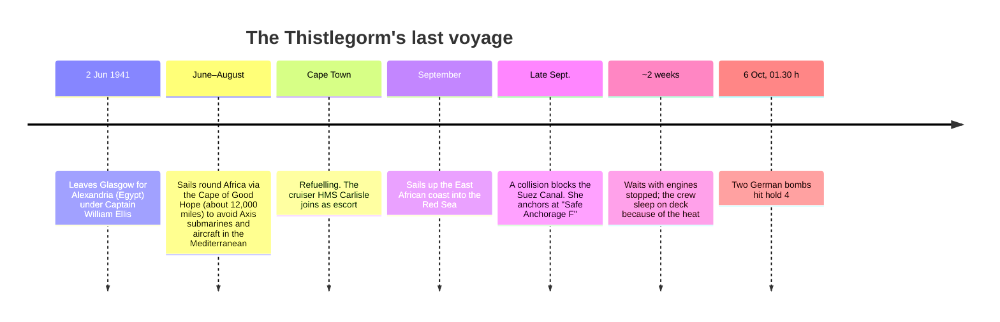

> 🧠 **Reasoning:** the anchorage was called "safe" because it was thought to be out of reach of German bombers. But by 1941 the Luftwaffe was flying from **Crete**, more than 1,000 km away, with aircraft able to get there. A large, motionless ship full of ammunition was an ideal target. *Confidence 0.8.*

---

## 4. The night of 6 October 1941

### 4.1 Why they attacked

German military intelligence (**Abwehr**) believed a large **troopship** —some sources say the *Queen Mary*— was bringing reinforcements to Egypt. The Luftwaffe sent **two Heinkel He 111 bombers** of **II./KG 26** from Crete to find it. They failed. One of them, already short of fuel, spotted the anchored ships and chose **the largest**: the Thistlegorm.

### 4.2 What happened

| Event | Detail | Confidence |
|---|---|---|
| Time | ~01:30 on 6 October | 0.9 |
| Bombs | **Two**, both in **hold 4**, near the stern | 0.9 |
| Explosion | The bombs set off the **ammunition** in hold 4; the blast split the ship | 0.9 |
| Sinking | Very fast; an eyewitness on the *Carlisle* spoke of under a minute | 0.6 |
| Final position | The ship settled **upright on her keel**, with the stern displaced and twisted | 0.85 |
| Locomotives | The two on deck were blown off, one to each side | 0.9 |
| The German aircraft | According to Divernet, it was shot down on the way back; two of its five crew survived, including Lieutenant **Heinrich Menge**, who became a prisoner of war | 0.5 |

> 🔍 **Check:** I have only found Menge's name in Divernet (2006) and in dive-centre websites that seem to copy it. One adds that he emigrated to Argentina and gave an interview in 1992; I could not confirm this. I leave it as a **hypothesis**. *Confidence 0.4.*

### 4.3 The victims

**Nine men** died. The names on the memorial listed by the Thistlegorm Project are:

| Name | Age |
|---|---|
| Arthur Cain | 26 |
| Archibald Giffin | 18 |
| Alfred Oswald Kean | 68 |
| Donald Masterson | 32 |
| Joseph Munro Rolfe | 17 |
| Kahil Sakando | 49 |
| Christopher Todds | 25 |
| Alexander Neil Brian Watt | 21 |
| Thomas Woolaghan | 24 |

- The oldest was **68** and the youngest **17**.
- Most of the dead were gunners at the **stern** guns, next to the impact.
- Many crew sleeping on deck because of the heat probably **reduced** the death toll.
- Survivors were picked up by **HMS Carlisle**.
- Captain **William Ellis** received the **OBE**.
- Seaman **Angus McLeay** received the **George Medal** and the Lloyd's War Medal for saving a shipmate.
- According to Divernet, the company stopped the crew's wages from the moment of sinking, and survivors paid their own way home, as was customary.

### 4.4 An indirect victim: the Rosalie Moller

Two days later, on **8 October 1941**, German aircraft sank the freighter **Rosalie Moller** in the same area; she was carrying coal from Durban to Alexandria. Two people died. Divernet suggests the Thistlegorm fire may have given away the anchorage. *Confidence in that link: 0.4 (hypothesis).* She is now another famous, deeper wreck (~50 m).

---

## 5. The cargo: what she really carried

The manifest only said "motor transport", but the real cargo was far more varied. Combining Wikipedia, the Thistlegorm Project and Divernet:

| Type | Material | Where it is seen today |
|---|---|---|
| **Vehicles** | **Bedford**, Morris Commercial, Albion, Leyland, Tilling-Stevens and Ford trucks; Morris cars | Holds 1 and 2 |
| **Tankers** | Fuel and water tanker trucks (Bedford OCY, Albion) | Hold 1, lower level |
| **Tracked vehicles** | **Universal Carriers** (Bren Carriers): small tracked armoured vehicles | Near the blast area |
| **Motorcycles** | **BSA M20**, **Norton 16H** and Matchless G3L | Holds 1 and 2 |
| **Weapons** | **Bren** guns, **Lee-Enfield .303** rifles, ammunition, mines, shells | Holds and seabed at the stern |
| **Aviation** | Lysander wings, Bristol Mercury engine parts, Blenheim tailplanes | Hold 2 |
| **Railway** | **Two LMS Stanier 8F locomotives** with coal and water tenders, and wagons | Seabed, port and starboard |
| **Other** | **Wellington boots**, radios, hospital equipment, RAF accumulators, "Pundit lights" (signal beacons) | Hold 1 and others |

  
   <i>Motorcycles in a hold of the Thistlegorm. Photo: Roland Unger, 16/9/2007, CC BY-SA 3.0, via Wikimedia Commons.</i>

### 5.1 Who was it for?

- The **locomotives** were for **Egyptian National Railways**.
- The rest was for the **Western Desert Force**, which soon afterwards became part of the **Eighth Army**.

> 🔍 **Myth check:** it is often said the cargo was for "Montgomery's Eighth Army". Montgomery only took command in **August 1942**, almost a year after the sinking. *Confidence the myth is false: 0.9.*

### 5.2 The mystery of the boots

The Wellington boots have inspired legends (all left-footed, or giant to scare the enemy). Divernet gives a practical explanation: they helped **prevent static electricity** when ground crews refuelled aircraft. *Confidence 0.6* (one source, but consistent with military use of rubber).

### 5.3 The ammunition and guns today

Shells, ammunition boxes, cordite and the ship's two guns are still on the wreck. **They must not be touched**: old ammunition can be unstable (§11).

| Photo | What you see | Author · date | Licence |
|---|---|---|---|
|  | Shells in hold 4 that did not explode in the bombing | Diver ZorG · 22/9/2010 | CC BY-SA 4.0 |
|  | Ammunition on the wreck | Roland Unger · 16/9/2007 | CC BY-SA 3.0 |
|  | Stern anti-aircraft gun | Roland Unger · 27/7/2008 | CC BY-SA 3.0 |
|  | The stern gun, described by the photographer as a 4-inch anti-aircraft gun | Tim Sheerman-Chase · 4/9/2007 | CC BY 2.0 |

---

## 6. Cousteau and the first discovery

| Source | What it says |
|---|---|
| Wikipedia and Thistlegorm Project | Cousteau found it in the early 1950s using information from local fishermen |
| Divernet (2006) | Discovery credited to **1955**; part of the ship still reached close to the surface |
| Brown & Henderson (2025) | A BSA M20 motorcycle disappeared "around Cousteau's **1954** visit" |
| Thistlegorm Project | The wreck already appeared on a **1948 Admiralty chart** update |

**What Cousteau did:**

- He dived with his team from the *Calypso* and filmed the wreck.
- According to Wikipedia, he raised **a motorcycle, the captain's safe and the bell**.
- **National Geographic, February 1956**, published photos with the bell still in place and divers in the lantern room.
- He described the dives in his book *The Living Sea*.
- Divernet adds that he removed the part of the mast that stuck out and published **wrong coordinates**, perhaps so nobody else would find the wreck.

> 🧠 **Reasoning:** in the 1950s today's idea of "underwater heritage" did not exist; taking a souvenir was normal exploration practice. Even so, several authors regard Cousteau as **the first looter** of the Thistlegorm, because he started a habit thousands of divers followed. *Both things are true at once.*

> 🔍 **Check:** I could not confirm that the Thistlegorm appears in the film *The Silent World* (1956), although it was partly filmed in the Red Sea from the *Calypso*. Marked as **unconfirmed**.

---

## 7. The rediscovery and the diving boom

- After Cousteau, the wreck was known only to **Bedouin fishermen**, who fished over it because it gathered so many fish.
- In the early 1990s **Sharm el-Sheikh** became a major diving destination.
- In **1992**, using information from an **Israeli fishing-boat captain**, the dive boat ***Poolster*** dived it again. That same year the Egyptian authorities designated it an **official recreational dive site** (Brown & Henderson 2025).
- In **2007** *The Times* listed it among the **world's top ten wreck dives**.

  
   <i>A diver by the covered walkway below the bridge. Photo: Trewornan (English Wikipedia), 2006, public domain, via Wikimedia Commons.</i>

---

## 8. How many times has it been dived?

**Nobody keeps an official count.** Published figures:

| Source | Figure |
|---|---|
| PADI (blog) | About **200 divers a day** |
| Lee *et al.* (PLOS ONE, 2023), citing Brown *et al.* (2021) | **Up to 175,000 divers a year** |
| Thistlegorm Project (2017) | An average of **eight boats a day** from Sharm and Hurghada in summer |
| Brown & Henderson (2025) | At least five charter boats every other day in summer; sometimes **more than 15 boats moored at once** |
| HEPCA (2026) | "Thousands of divers each year" |
| Brown & Henderson (2025) | The wreck brings about **€4 million a year** to the local economy |

### 8.1 My own estimate (1992–2026)

| Scenario | Divers per year | Total over 34 years |
|---|---|---|
| Low | 30,000 | ~1.0 million |
| Medium (~200 a day) | 73,000 | ~2.5 million |
| High (highest figure cited) | 175,000 | ~6.0 million |

*My own calculation ([`scripts/calculos.py`](scripts/calculos.py)). It assumes similar numbers every year, which is not true: tourism fell after the Arab Spring (2011), the 2015 bombing of the Russian airliner and the 2020 pandemic.*

> 🧠 **Conclusion:** the most reasonable statement is **between one and several million dives** since 1992. *Confidence in the order of magnitude: 0.6; in an exact figure: 0.1.*

---

## 9. Scientific expeditions: what worked and what did not

| Year | Who | Achieved | Not achieved |
|---|---|---|---|
| **~1955** | Cousteau (*Calypso*) | First photos and film; National Geographic article (1956) | Bell and other objects lost; wrong coordinates |
| **1992** | *Poolster* | Rediscovery and opening to recreational diving | No protection plan at all |
| **Dec. 2007** | **HEPCA** (Hurghada environmental association) | Closed the wreck for a month, installed **32 seabed moorings** and drilled holes to let divers' air escape | By **2009 none remained**: blocks too light, lines too long for the strong currents |
| **2007–2014** | University of Bologna, **STE** programme | 8 years of fauna data from **390 questionnaires** by volunteer divers | Little data in later years as tourism dropped |
| **Jul. 2017** | **Thistlegorm Project** (Universities of Nottingham, Alexandria and Ain Shams; Jon Henderson, Simon Brown) | One of the largest **photogrammetric** surveys of a wreck: **24,307 photos** on **12 dives** (13 h 43 min underwater) plus 360° video | — |
| **2018** | Henderson, Alex Mustard, Simon Brown, Mike Postons | Digital 3D book (*iBook*) | — |
| **2021** | Simon Brown | Royal Photographic Society award for an orthophoto made from **15,005 frames** | — |
| **2021** | Henderson and others | Book *Diving the Thistlegorm* (Dived Up) | — |
| **May 2022** | Brown & Henderson | **Second 3D survey**, to compare with 2017 | — |
| **2023** | University of Bologna | **PLOS ONE** paper on the fauna | — |
| **2024** | Brown & Henderson | Paper on the photogrammetric method | — |
| **Nov. 2025** | Brown & Henderson (*Heritage*) | **First quantitative measurement of deterioration** between 2017 and 2022 (§13) | — |
| **2026** | HEPCA with Egypt's Ministry of Environment and CDWS | **23 mooring buoys** around the wreck | It remains to be seen if they last longer than those of 2007 |

> 🔍 **Lesson from 2007:** installing moorings is not enough; they must withstand the Strait of Gubal currents and someone must maintain them. *Confidence 0.8.*

---

## 10. What the dive is like today

  
   <i>The stern gun. Photo: Woodym555, 28/8/2007, CC BY-SA 3.0, via Wikimedia Commons.</i>

### 10.1 The route

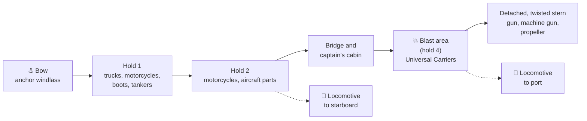

- Usually there are **two dives**: an **exterior** one (hull, stern and locomotives) and an **interior** one (holds 1 and 2).
- Lonely Planet rates it **intermediate–advanced**, 17 to 30 m.
- According to PADI, operators usually ask for at least **Advanced Open Water** and **more than 20 logged dives**; Discover Wildlife gives the same figure. *I found no published official Egyptian rule: it depends on the dive centre.*

### 10.2 The numbers of a dive (my own calculation)

| Depth | Pressure | ppO₂ on air | ppO₂ on nitrox 32 | Gas lasts… |
|---|---|---|---|---|
| 17 m (deck) | 2.7 bar | 0.57 bar | 0.87 bar | 2.7 times less than at the surface |
| 24 m (holds) | 3.4 bar | 0.72 bar | 1.10 bar | 3.4 times less |
| 30 m (seabed) | 4.0 bar | 0.85 bar | 1.29 bar | 4 times less |
| 32 m (max) | 4.2 bar | 0.89 bar | **1.35 bar** | 4.2 times less |

- The **maximum operating depth of nitrox 32** at 1.4 bar ppO₂ is **~33 m**: just below the Thistlegorm's seabed. That is why nitrox 32 is the typical mix for this wreck. With nitrox 36 the limit (~29 m) would be **above** the seabed.
- With a 12 L cylinder at 200 bar and a relaxed surface consumption of 20 L/min, at **30 m** you reach a 50 bar reserve in about **23 minutes**. With current or nerves, much sooner.

*Calculated in Python ([`scripts/calculos.py`](scripts/calculos.py)) with standard seawater formulas. For guidance only: real planning is done by the diver with their computer and training.*

---

## 11. Accidents and risks for divers

### 11.1 Diver deaths on the Thistlegorm

> ⚠️ **What I found:** there is **no public register** of accidents on the wreck. I found accounts on diving forums (for example a blog about "a fatal accident on the Thistlegorm" discussed on ScubaBoard), but **no official or reliable press source with names, dates and causes** that I could cross-check. I do not include any specific case to avoid spreading false information about real people. *Confidence that serious accidents have happened over millions of dives: 0.8. Confidence in any specific case: no data.*

### 11.2 The real risks

| Risk | Why | Source |
|---|---|---|
| **Current** | The Strait of Gubal has strong currents; divers descend on the line and must be able to get back to it | Forums, dive centres |
| **Propellers** | With many boats together, a diver at the surface can end up near a propeller that starts turning | ScubaBoard (accounts) |
| **Crowding** | Up to 15 boats moored and dozens of divers in the holds | Brown & Henderson 2025 |
| **Penetration** | Inside the wreck: little light, silt and weakening structures | Aquarius, scubadiving.com |
| **Collapses** | Parts of the hull "at risk of breaking off" | CDWS, November 2023 |
| **Unexploded ordnance** | Shells, mines and cordite remain on the wreck | Brown & Henderson 2025 |
| **Boat safety** | There have been sinkings of tourist and liveaboard boats in the Red Sea (e.g. *Sea Story*, 2024, 11 dead) | Wikipedia |

> 🧠 **Reasoning:** the Thistlegorm is shallow for a famous wreck, but that does not make it easy. The difficulty is not the depth but **the current, the number of people and the inside of the ship**.

---

## 12. Animals and "vegetation" on the wreck

  
   <i>Orbicular batfish (<i>Platax orbicularis</i>) on the Thistlegorm, 29/3/2022. Photo: Diego Delso, CC BY-SA 4.0, via Wikimedia Commons.</i>

### 12.1 A reef nobody planted

The Thistlegorm lies on a **sandy seabed**. Before 1941 there was little to cling to. The ship's steel gave corals and other animals a **hard surface** to grow on: an **accidental artificial reef**.

### 12.2 What science says (PLOS ONE, 2023)

The team of **Chloe Lee and Stefano Goffredo** (University of Bologna) analysed **390 questionnaires** from volunteer divers between **2007 and 2014**:

- **72 groups** of easy-to-recognise animals and algae were monitored. **71** were seen; only the **manta ray** was missing.
- The community **changed from year to year** but **without a declining trend**: the authors describe it as **stable and well developed**.
- The most prominent were **soft tree coral** (*Dendronephthya*) and the **giant moray** (*Gymnothorax javanicus*).
- They conclude the wreck could act as a **refuge** for Red Sea life.
- Limitation: the data come from **amateurs**, not biologists, and fell sharply after the Arab Spring.

### 12.3 Animals you can see

Click each photo to open its Wikimedia Commons page, with the full image, author and licence. Those marked 📍 were taken **on the Thistlegorm itself**; the rest show the **same species in the Red Sea** (or nearby), so you can see what the animal looks like. My own photos from the wreck (batfish, lionfish, scorpionfish, soldierfish, sergeant major) are in [§18.0](#180-my-own-photos-of-the-thistlegorm-2425-may-2021).

| Photo | Animal | Scientific name | Usually where | Author · licence |
|---|---|---|---|---|
|  | **Batfish 📍** | *Platax* spp. | Schools above the deck | Diego Delso · CC BY-SA 4.0 |
|  | **Giant moray** | *Gymnothorax javanicus* | Holes in the structure | Diego Delso · CC BY-SA 4.0 |
|  | **Squirrelfish** | *Sargocentron* spp. | Shade and holds | Hatem Moushir (aquarium) · CC BY-SA 4.0 |
|  | **Red Sea clownfish** | *Amphiprion bicinctus* | In anemones | Diego Delso · CC BY-SA 4.0 |
|  | **Napoleon wrasse** | *Cheilinus undulatus* | Around the hull | Diego Delso · CC BY-SA 4.0 |
|  | **Bluefin trevally (jack)** | *Caranx melampygus* | Hunting in open water | Diego Delso · CC BY-SA 4.0 |
|  | **Dogtooth tuna** | *Gymnosarda unicolor* | Open water | Diego Delso · CC BY-SA 4.0 |
|  | **Barracuda** | *Sphyraena barracuda* | Open water | Kora27 · CC BY-SA 4.0 |
|  | **Lionfish** | *Pterois miles* | On the structure | Diego Delso · CC BY-SA 4.0 |
|  | **Stonefish (venomous, don't touch!)** | *Synanceia verrucosa* | Camouflaged on the metal | NasserHalaweh · CC BY-SA 4.0 |
|  | **Scorpionfish 📍** | *Scorpaenopsis oxycephala* | Camouflaged on the metal | Roland Unger · CC BY-SA 3.0 |
|  | **Crocodilefish** | *Papilloculiceps longiceps* | Camouflaged on the seabed | Diego Delso · CC BY-SA 4.0 |
|  | **Hawksbill turtle** | *Eretmochelys imbricata* | Sometimes, by the hull | Kora27 · CC BY-SA 4.0 |
|  | **Grouper (Red Sea coral grouper)** | *Plectropomus pessuliferus* | Mainly early in the day | Hectonichus · CC BY-SA 4.0 |
|  | **Blacktip reef shark** | *Carcharhinus melanopterus* | Occasional, around the wreck | Daviddarom · Public domain |
|  | **Glassfish (pygmy sweepers)** | *Parapriacanthus ransonneti* | Clouds inside the holds | Ditch Townsend · CC BY-SA 4.0 |

> ℹ️ The squirrelfish photo was taken in an aquarium (Red Sea Aquarium, Hurghada) and the barracuda photo gives no location: they show the same species seen on the wreck, not the wreck itself.

### 12.4 Is there "vegetation"?

At 30 m under the sea there are **no plants** as on land. What looks like vegetation is mostly **animals**:

| Photo | What you see | What it really is | Author · licence |
|---|---|---|---|
|  | Colourful «little trees» | **Soft corals** (*Dendronephthya*): colonial animals. The most prominent group on the wreck (PLOS ONE) | Diego Delso · CC BY-SA 4.0 |
|  | Fans | **Gorgonians**: corals with a flexible skeleton | Derek Keats · CC BY 2.0 |
|  | Hard branches or crusts | **Hard corals** (here *Acropora*): build a calcium skeleton | Diego Delso · CC BY-SA 4.0 |
|  | Pink crusts | **Coralline algae**: these really are algae, with calcium in their walls | Derek Keats · CC BY 2.0 |
|  | Green or brown «fuzz» or tufts | **Algae**, which photosynthesise with the light that reaches down (Red Sea example: brown alga *Turbinaria*) | Diego Delso · CC BY-SA 4.0 |
|  | Lumps with holes | **Sponges**: filter-feeding animals | Diego Delso · CC BY-SA 4.0 |

> 🧠 **Why light gets there:** Red Sea water is very clear. At 30 m there is still enough light for algae and for corals with **zooxanthellae** (microscopic algae inside the coral). That is why there is colour, although red is lost in the first few metres and everything looks blue without a torch. *Confidence 0.85.*

  
   <i>Corals on the structure. Photo: Roland Unger, 16/9/2007, CC BY-SA 3.0, via Wikimedia Commons.</i>

---

## 13. The state of the wreck: how it is falling apart

The key data come from the paper by **Simon Brown and Jon Henderson** (*Heritage*, November 2025), comparing the 3D models of **2017** and **2022**:

| Change measured | 2017 → 2022 |
|---|---|
| **Debris field** | From ~10.9 to **at least 21.9 hectares** (double), with pieces up to **200 m** from the ship. *Note: the old figure was based on unverified positions* |
| **Propeller shaft** | **203 mm** at its narrowest; designed for about **317 mm**. *My calculation: ~59 % of its cross-section lost* |
| **Port anchor** | The chain failed in **2019** and the **3.5-tonne** anchor fell to the seabed |
| **Locomotive wheels** | A **2-tonne** assembly rotated about **29°** |
| **Starboard machine gun** | Its mounting rotated **~90°** |
| **Hold 1** | **Almost unchanged**: the most stable part of the ship |
| **Stern** | Displaced ~7 m since the sinking; part of hold 5 peeled back over the superstructure |

### 13.1 The causes

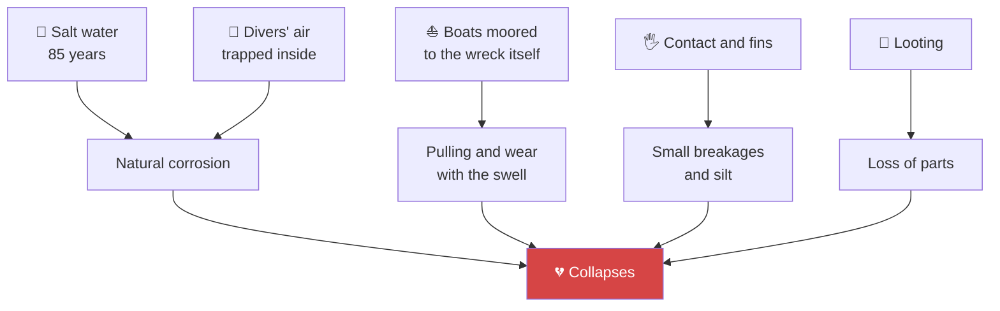

- **Mooring:** boats tie on to the wreck. In a swell, every pull tears or bends metal. Because ropes are cut by sharp edges, some operators began using **steel wire**, which cuts into the hull even more (Thistlegorm Project).
- **Trapped air:** the air divers exhale collects under the ceilings of the holds. The oxygen and air–water mix **speed up corrosion**. That is why HEPCA drilled holes in 2007.
- **Official warnings:** in **February 2012** CDWS received complaints about a guide who tied on to the stern gun. In **November 2023** it warned that some parts were damaged and others "at risk of breaking off".

> 🧠 **Reasoning:** hold 1 barely changing while the stern does fits expectations: the stern was already wrecked in 1941 and is where many boats moor and divers gather. *Confidence 0.6.*

### 13.2 Is it legally protected?

| Source | What it says |
|---|---|
| Brown & Henderson (2025) | **No legal protection**. The 2001 UNESCO Convention only covers remains **more than 100 years** old; the Thistlegorm reaches 100 in **2041** |
| Lee *et al.* (2023) | The wreck has no legal protection, hence looting |
| PADI (blog) | Describes it as a designated **war grave** |

> 🔍 **Check:** I found no law or decree officially designating it a war grave. My reading: **morally** it is a war grave (nine men died), but **legally** no specific protection is recorded. *Confidence 0.7.*

---

## 14. What people have already taken

Parts lost or removed according to Brown & Henderson (2025) and other sources:

| Item | When | Source |
|---|---|---|
| **Ship's bell** | Cousteau era; whereabouts unknown | Wikipedia, Brown & Henderson |
| Captain's safe | Cousteau era | Wikipedia |
| A **BSA M20** motorcycle | Around Cousteau's visit | Brown & Henderson |
| Part of the **mast** | Cousteau, and another part in the late 1970s | Divernet, Brown & Henderson |
| A radio mast of about 2 m | Reportedly ended up in a garden in Sharm el-Sheikh | Brown & Henderson |
| Steering wheel of a **Morris** car | 2008–2009 | Brown & Henderson |
| Fuel filters from the Bedford tankers | Early 2015 | Brown & Henderson |
| Brass valves from the Albion tankers | — | Brown & Henderson |
| A large copper cable drum from hold 5 | Before 2022 | Brown & Henderson |
| A stern-gun handwheel and a bathtub tap | — | Brown & Henderson |
| Graffiti and bulkheads cut by divers | — | Brown & Henderson |

> 🧠 **Pattern:** what disappears most is **non-ferrous metal** (brass, copper, bronze): it does not rust, it shines, and it has value as a souvenir or scrap. The iron stays… and corrodes. *Confidence 0.75.*

---

## 15. Should anything be touched or raised?

### 15.1 Arguments

| For raising some objects | Against |
|---|---|
| The wreck **is falling apart**: what is not rescued will be lost | It is the **grave of nine men** |
| If a museum does not raise it, **a looter will take it** | Out of the water, iron is **quickly destroyed** unless treated (§19, desalination) |
| In a museum **everyone** can see it, not only divers | Conserving a large piece costs **a lot of money** and years of work |
| Allows study of wartime materials and methods | The wreck's value is seeing things **in place**: a truck in a hold tells more than in a display case |
| — | Many objects are already **home to animals** (§12) |
| — | There is **unexploded ammunition** |
| — | Dive tourism brings ~**€4 million a year**: an empty wreck attracts fewer people |

### 15.2 Object by object (my assessment)

| Object | Raise it? | Why | Confidence |
|---|---|---|---|
| Trucks, motorcycles, carriers | **No** | The soul of the wreck; very heavy; the iron would break; covered in coral | 0.8 |
| Locomotives | **No** | Tonnes of corroded iron; impossible to conserve whole | 0.85 |
| Ammunition, mines, cordite | **Do not touch** | Real risk of explosion; specialists only | 0.95 |
| Human remains (if any) | **Never** | Respect for the dead | 1.0 |
| Small brass or copper items (valves, taps, plates) | **Only by an official museum, with Egyptian permission** | They are stolen first; they keep better than iron | 0.6 |
| Pieces already **fallen to the seabed** away from the ship | **Perhaps, after 3D documentation** | Already moved; being lost in the sand | 0.5 |
| Ship's bell | Already gone; it would need to be **found** and returned to a museum | The most symbolic object | 0.7 |

> 🔗 **Comparison with the rest of the series:** on the [Titanic](https://github.com/Oskillar28/descubrimientos/tree/main/titanic-pecio-historia), at 3,800 m, thousands of objects were raised amid huge debate. On the [Britannic](https://github.com/Oskillar28/descubrimientos/tree/main/britannic-carl-spencer), a small selection was raised in 2025 with Greek state permission for a public museum. The Thistlegorm is the opposite: **any diver can reach it**, so the problem is not who raises objects officially but **who takes them without permission**.

> 🧠 **My conclusion (reasoned opinion, not a truth):** the best option is to **leave the wreck in place** and protect it with (1) **mooring buoys** that are maintained, (2) **legal protection** before 2041, (3) **supervision and guides** who do not allow touching, and (4) **repeated 3D models** to measure change. Only small pieces at immediate risk of theft should be raised, by an Egyptian museum with conservation ready. *Confidence 0.65.*

---

## 16. Source comparison: data that do not match

| Item | Version A | Version B | Most likely |
|---|---|---|---|
| Launch | April 1940 (Wikipedia, Thistlegorm Project) | June 1940 (Divernet, scubadiving.com) | **9/4/1940** launch; **24/6/1940** delivery |
| Cousteau's discovery | Early 1950s (Wikipedia) · 1954 (Brown & Henderson) | 1955 (Divernet) · 1956 (PADI, another Divernet article) | **Around 1955**; published in 1956 |
| Time to sink | Under a minute (*Carlisle* eyewitness, Thistlegorm Project) | Under 10 minutes (PADI Spanish blog) | **Very fast**; exact figure unverifiable |
| People on board | 41 (Wikipedia, Aquarius) | 42 (Divernet, scubadiving.com) | **41–42** |
| Stern gun | 4.7 in (Thistlegorm Project, Wikipedia text) | 4 in (Wikipedia infobox) · 4.5 in (Divernet) | **Unresolved** |
| Earlier voyages | USA, Argentina, West Indies (Wikipedia) | USA, Africa, India (Divernet) | **Three voyages**; destinations uncertain |
| Length | 126.5 m (Wikipedia) | 129 m (Lonely Planet) · 131 m (French blog) | **126.5 m** |
| Locomotives | 2 (almost all sources) | 3 (some briefings' myth) | **2** |
| Distance from Sharm | ~40 km (Brown & Henderson) | ~70 km by boat (PLOS ONE) | **40 km straight line**; more by boat route |
| Divers | ~200 a day (PADI) | Up to 175,000 a year (PLOS ONE) | **Tens of thousands a year** |
| War grave | Yes (PADI) | No legal protection (Brown & Henderson) | **Morally yes; legally not recorded** |

---

## 17. Myths and reality

| Myth | Reality | Confidence |
|---|---|---|
| "She sank on her maiden voyage" | It was her **fourth** voyage | 0.9 |
| "A submarine torpedoed her" | **Two bombs** from an aircraft sank her | 0.95 |
| "She carries tanks" | She carries **Universal Carriers** (small tracked armoured vehicles), not tanks | 0.85 |
| "There are three locomotives" | There are **two**; the "third" is part of one of them | 0.85 |
| "The cargo was for Montgomery" | Montgomery arrived in **1942** | 0.9 |
| "The boots were all left-footed" | No evidence; probably to prevent static electricity | 0.6 |
| "The spaghetti on the seabed is food" | It is **cordite**, an artillery propellant | 0.7 |
| "It is protected by law" | No specific legal protection is recorded | 0.7 |
| "You need to be a technical diver" | Advanced recreational level is enough, but with current experience | 0.8 |

---

## 18. Photos and videos

### 18.0 My own photos of the Thistlegorm (24–25 May 2021)

Photos I took on my dives on the wreck, posted on my Instagram ([@oskillar28](https://www.instagram.com/oskillar28/)) with the location "SS Thistlegorm". Camera: Olympus Tough TG-6.

<table>
<tr><td align="center" width="33%"><a href="fotos/mastil-cabos-amarre.jpg">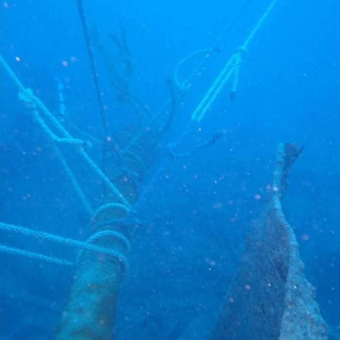</a> The mast with dive-boat mooring lines tied to the wreck (see §13)</td><td align="center" width="33%"><a href="fotos/motos-bodega.jpg">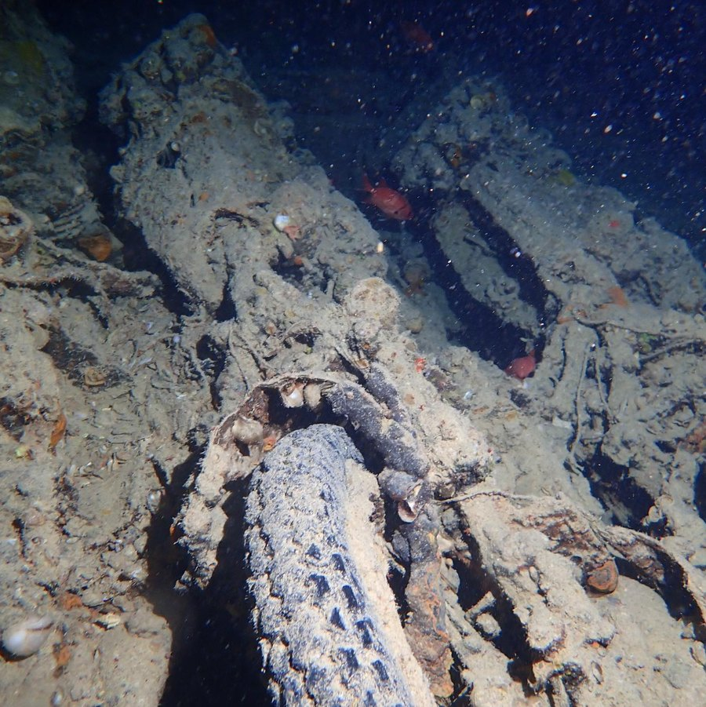</a> Motorcycles from the cargo in a hold, covered in silt</td><td align="center" width="33%"><a href="fotos/rueda-camion.jpg">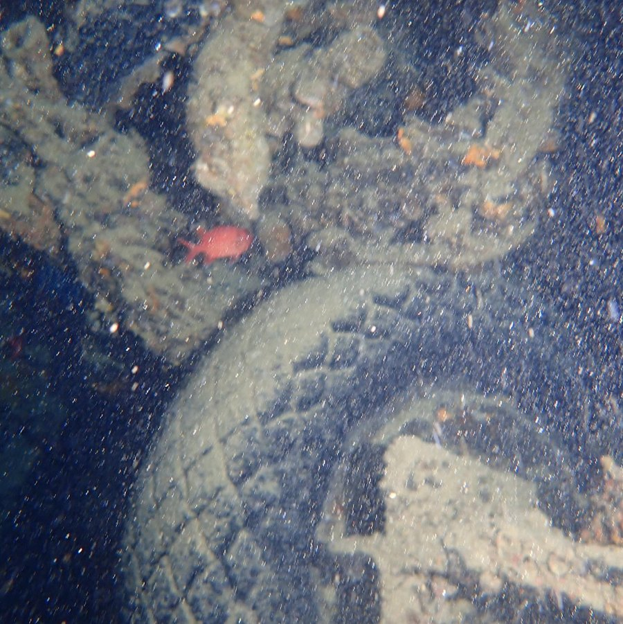</a> A truck wheel in the hold and a soldierfish</td></tr>
<tr><td align="center" width="33%"><a href="fotos/pez-murcielago.jpg">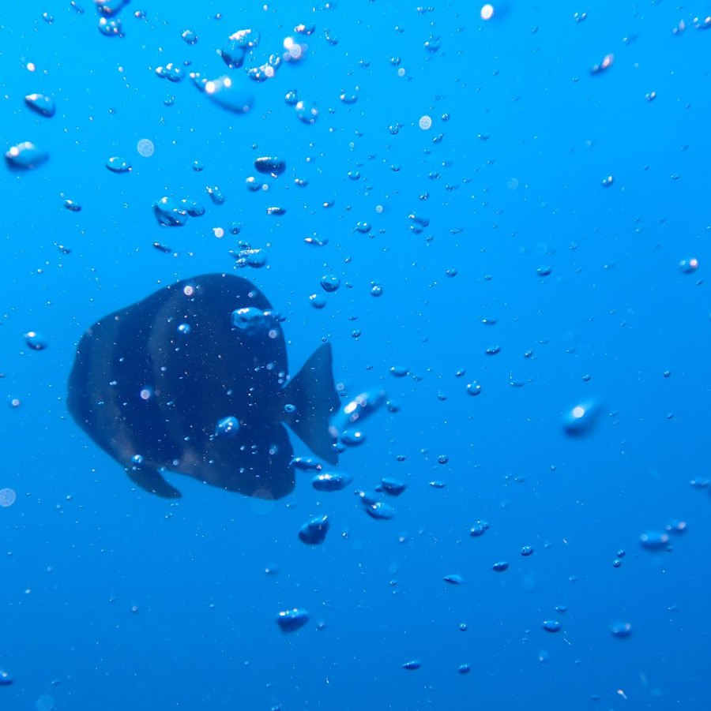</a> Batfish (<i>Platax</i>) among divers' bubbles</td><td align="center" width="33%"><a href="fotos/pez-leon.jpg">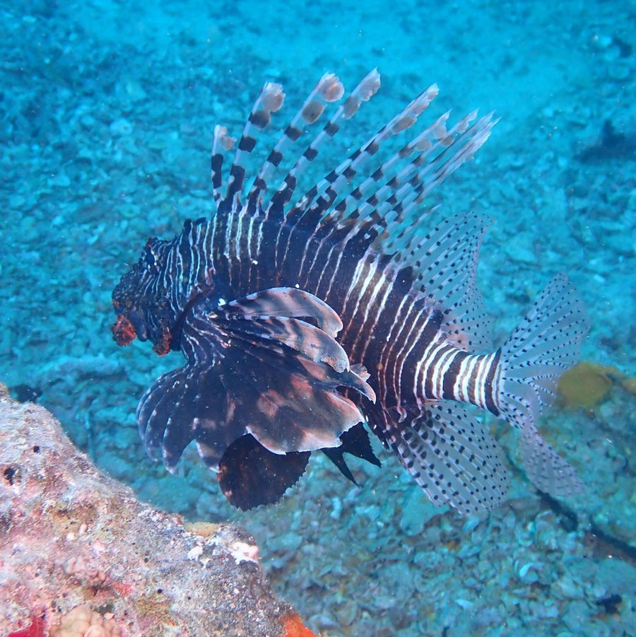</a> Lionfish (<i>Pterois miles</i>)</td><td align="center" width="33%"><a href="fotos/pez-escorpion.jpg">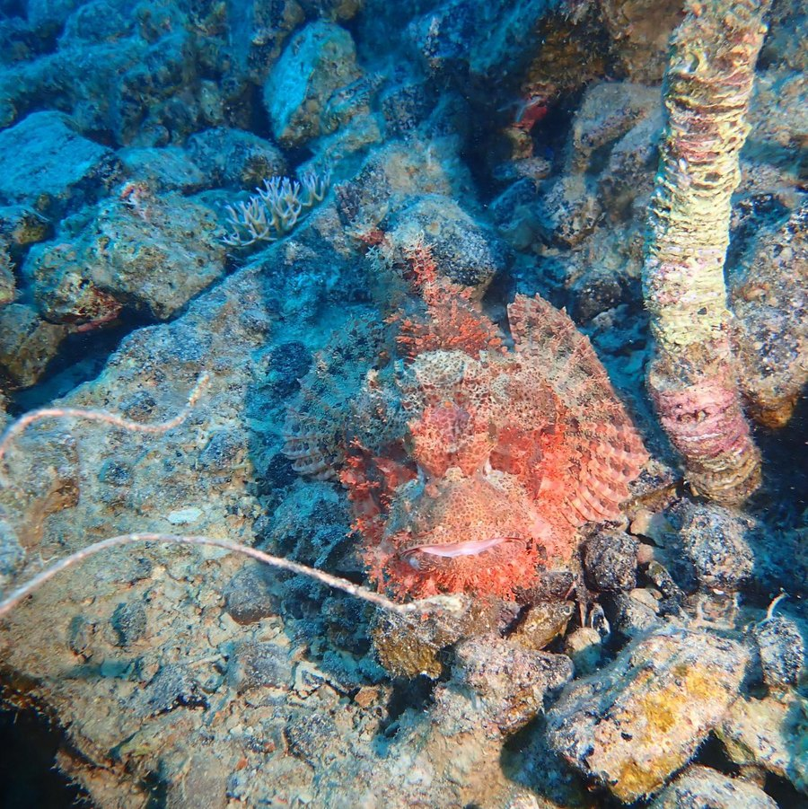</a> Camouflaged scorpionfish</td></tr>
<tr><td align="center" width="33%"><a href="fotos/pez-sargento.jpg">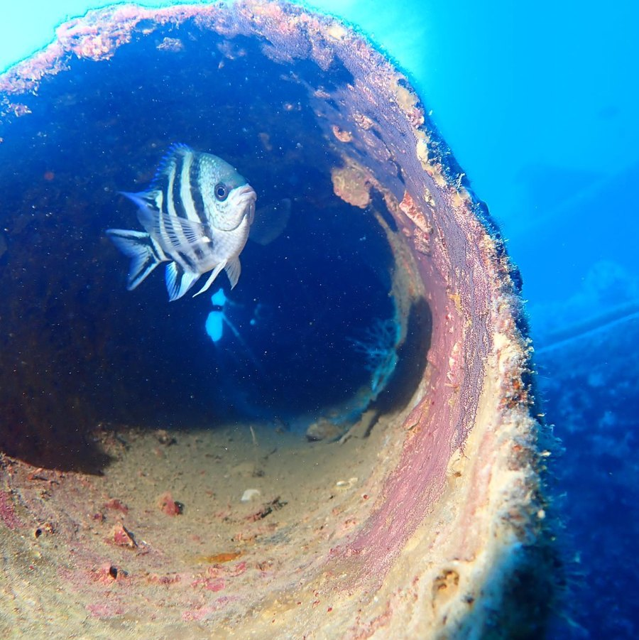</a> Sergeant major (<i>Abudefduf</i>) inside a pipe of the ship</td><td align="center" width="33%"><a href="fotos/peces-soldado.jpg">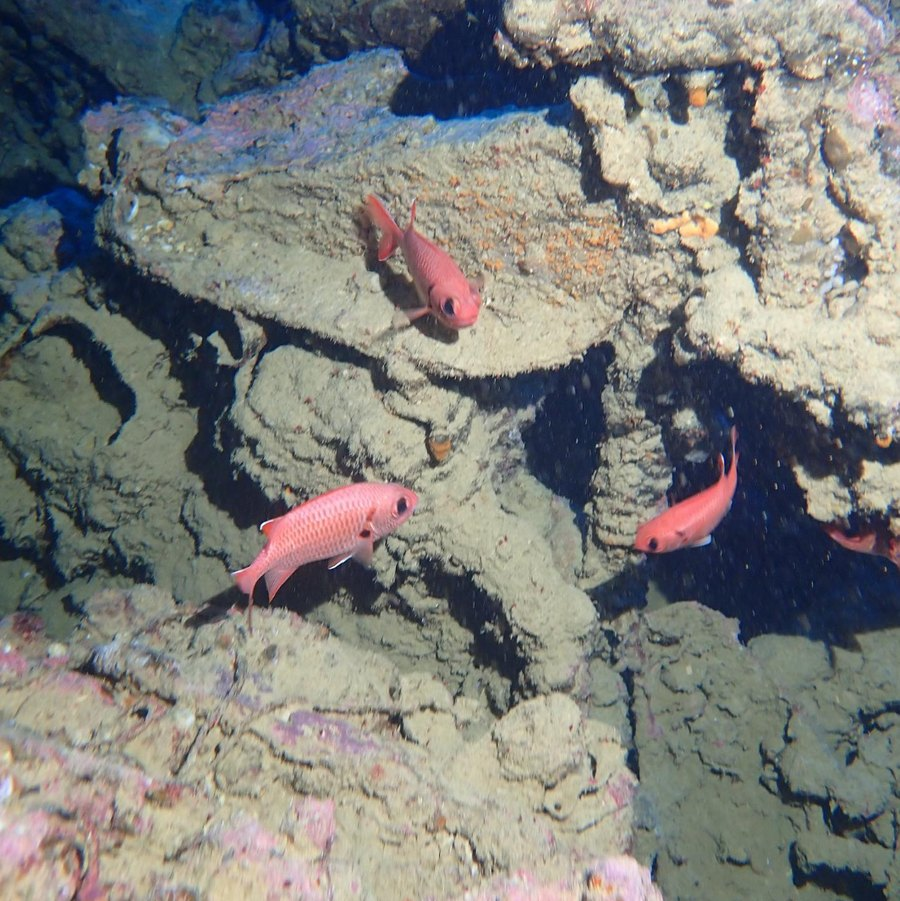</a> Soldierfish (squirrelfish family, probably <i>Myripristis</i>) on the structure</td><td align="center" width="33%"><a href="fotos/coral.jpg">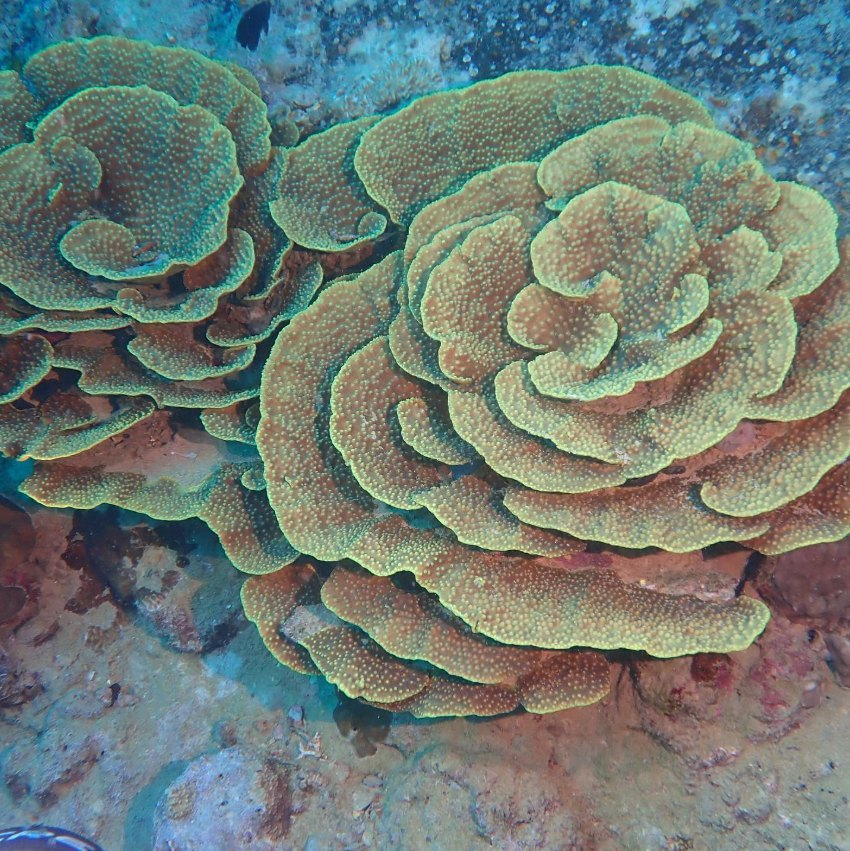</a> Plate-shaped hard coral</td></tr>
</table>

> 📷 **© Óscar Ramírez Martín.** These photos are not covered by the text's free licence: ask me before reusing them. The coral and lionfish photos were posted with the wreck's location but may come from the nearby reef on the same trip.

### 18.1 Freely licensed photos (Wikimedia Commons)

Licences checked on **25/11/2026** in each file's metadata. To reuse them outside GitHub, credit the author and licence.

| Photo | Author · date | Licence |
|---|---|---|
| [The wreck in 2022 (overview)](https://commons.wikimedia.org/wiki/File:Pecio_SS_Thistlegorm,_mar_Rojo,_Egipto,_2022-03-29,_DD_01.jpg) | Diego Delso · 29/3/2022 | CC BY-SA 4.0 |
| [The wreck in 2022 (another view)](https://commons.wikimedia.org/wiki/File:Pecio_SS_Thistlegorm,_mar_Rojo,_Egipto,_2022-03-29,_DD_06.jpg) | Diego Delso · 29/3/2022 | CC BY-SA 4.0 |
| [The wreck in 2022 (detail)](https://commons.wikimedia.org/wiki/File:Pecio_SS_Thistlegorm,_mar_Rojo,_Egipto,_2022-03-29,_DD_12.jpg) | Diego Delso · 29/3/2022 | CC BY-SA 4.0 |
| [Batfish](https://commons.wikimedia.org/wiki/File:Peces_murci%C3%A9lago_orbiculares_(Platax_orbicularis),_SS_Thistlegorm,_mar_Rojo,_Egipto,_2022-03-29,_DD_24.jpg) | Diego Delso · 29/3/2022 | CC BY-SA 4.0 |
| [View aft from the bridge](https://commons.wikimedia.org/wiki/File:Aft_view_Thistlegorm.jpg) | Woodym555 · 2007 | CC BY-SA 3.0 |
| [Stern gun](https://commons.wikimedia.org/wiki/File:Thistlegorm_stern_gun.jpg) | Woodym555 · 28/8/2007 | CC BY-SA 3.0 |
| [Propeller](https://commons.wikimedia.org/wiki/File:Thistlegorm_propellor.jpg) | Woodym555 · 28/4/2007 | CC BY-SA 3.0 |
| [Parts on the deck](https://commons.wikimedia.org/wiki/File:Thistlegorm_train_parts.jpg) | Woody · 28/4/2007 | CC BY-SA 3.0 |
| [Diver below the bridge](https://commons.wikimedia.org/wiki/File:Thistlegorm.jpg) | Trewornan · 2006 | Public domain |
| [Motorcycles on the wreck](https://commons.wikimedia.org/wiki/File:Ssthistlegorm.jpg) | Javi Pérez · May 2006 | Public domain |
| [Motorcycles in the hold](https://commons.wikimedia.org/wiki/File:ThistlegormMotorbikes.jpg) | Roland Unger · 16/9/2007 | CC BY-SA 3.0 |
| [Ammunition](https://commons.wikimedia.org/wiki/File:ThistlegormMunition.jpg) | Roland Unger · 16/9/2007 | CC BY-SA 3.0 |
| [Water tanker](https://commons.wikimedia.org/wiki/File:ThistlegormTankwagen.jpg) | Roland Unger · 16/9/2007 | CC BY-SA 3.0 |
| [Corals](https://commons.wikimedia.org/wiki/File:ThistlegormCorals.jpg) | Roland Unger · 16/9/2007 | CC BY-SA 3.0 |
| [Scorpionfish](https://commons.wikimedia.org/wiki/File:ThistlegormDrachenkopf.jpg) | Roland Unger · 16/9/2007 | CC BY-SA 3.0 |
| [Truck](https://commons.wikimedia.org/wiki/File:Thistlegormtruck.jpg) | Albert Kok · undated | CC BY-SA 3.0 |
| [Windlass](https://commons.wikimedia.org/wiki/File:Winch_thistlegorm.jpg) | Albert Kok · undated | CC BY-SA 3.0 |
| [Upper deck](https://commons.wikimedia.org/wiki/File:SS_Thistlegorm_upper_deck.jpg) | Hagainativ · 8/10/2010 | CC BY-SA 3.0 |
| [Videographer inside the wreck](https://commons.wikimedia.org/wiki/File:Videographer_in_Thistlegorm.jpg) | Tim Sheerman-Chase · 4/9/2007 | CC BY 2.0 |

In addition, §5.3 has 4 photos of the ammunition and guns, and §12 has 16 animal photos and 6 "vegetation" photos, all freely licensed and linked to their pages.

There are more than 70 files when searching "Thistlegorm" on [Wikimedia Commons](https://commons.wikimedia.org/w/index.php?search=Thistlegorm&title=Special:MediaSearch&type=image).

  
   <i>One of the trucks in the cargo. Photo: Albert Kok, CC BY-SA 3.0, via Wikimedia Commons.</i>

### 18.2 3D models and copyrighted photos (links only)

| Resource | Contents |
|---|---|
| [The Thistlegorm Project](https://thethistlegormproject.com/) | 3D models, 360° videos and the ship's history |
| [Brown & Henderson, *Heritage* (2025)](https://www.mdpi.com/2571-9408/8/12/504) | 2017–2022 3D comparison with figures. *Open access CC BY 3.0: its figures could be reused with credit to the authors* |
| [Lee *et al.*, PLOS ONE (2023)](https://journals.plos.org/plosone/article?id=10.1371/journal.pone.0282239) | Fauna study (CC BY 4.0) |
| [Divernet: *The Truth Behind the Icon*](https://divernet.com/world-dives/middle-east/the-truth-behind-the-icon-dispelling-myths-of-the-thistlegorm-65-years-later/) | Photos and myths of the wreck |
| [Discover Wildlife](https://www.discoverwildlife.com/animal-facts/marine-animals/thistlegorm-ship-egypt) | Wildlife gallery (Getty Images) |

### 18.3 Videos

> ⚠️ Found on YouTube in November 2026. **I have not watched them all in full**: I checked the title and link, not the whole content.

| Video | What it offers |
|---|---|
| 🎬 [*Diving the Thistlegorm (1/3) – Exterior Dive*](https://www.youtube.com/watch?v=1mLRKW7Y5vU) | Full exterior tour |
| 🎬 [*Diving the Thistlegorm (3/3) – Interior Dive*](https://www.youtube.com/watch?v=lFy6KPnzfng) | Holds and cargo |
| 🎬 [*SS Thistlegorm in 360° – Insta360 X4 Wreck Dive*](https://www.youtube.com/watch?v=am0zIoTcXDA) | 360° video |
| 🎬 [*World War II Wreck of the THISTLEGORM*](https://www.youtube.com/watch?v=malGCjXU6os) | Dive with history |
| 🎬 [*Scuba Diving The Greatest Wreck In THE WORLD SS THISTLEGORM!*](https://www.youtube.com/watch?v=ynZK7Oc3xRA) | From a liveaboard |
| 🎬 [*Thistlegorm wreck Red Sea scuba dive plans*](https://www.youtube.com/watch?v=q1vn1MGrJ8M) | Plans and dive planning |

---

## 19. Technical glossary

| Term | Meaning |
|---|---|
| **SS** | *Steamship*. Prefix for merchant ships, not warships |
| **HMS** | *His/Her Majesty's Ship*: Royal Navy ship |
| **GRT (gross register tonnage)** | A measure of the ship's internal **volume**, not its weight (1 register ton = 2.83 m³) |
| **Length / beam** | Length / width of the ship |
| **Port / starboard** | Left / right side looking forward |
| **Bow / stern** | Front / back |
| **Hold** | Large space below deck for cargo |
| **Bulkhead** | Internal wall separating compartments |
| **Superstructure** | Part of the ship above the main deck (bridge, cabins) |
| **Windlass** | Bow machine that raises and lowers the anchor |
| **Triple-expansion engine** | Steam engine that uses the steam three times in three cylinders of increasing size |
| **DEMS** | *Defensively Equipped Merchant Ships*: British scheme that armed merchant ships and put naval gunners aboard |
| **Convoy** | Group of ships sailing together with an escort |
| **Anchorage** | Area where ships anchor while waiting |
| **He 111** | Heinkel He 111, German twin-engine bomber |
| **KG 26** | *Kampfgeschwader 26*: Luftwaffe bomber wing 26 |
| **Abwehr** | German military intelligence service |
| **Universal Carrier** | Small British tracked armoured vehicle (also Bren Carrier) |
| **Bren** | British light machine gun |
| **Lee-Enfield .303** | British rifle; .303 is the calibre in inches |
| **Cordite** | Propellant explosive in cord form, used in artillery |
| **Stanier 8F** | British freight steam locomotive class |
| **OBE / George Medal** | British awards for service and bravery |
| **Wreck** | Remains of a sunken ship |
| **Penetration** | Going inside a wreck or cave, where you cannot ascend directly to the surface |
| **Nitrox (EAN32)** | Air enriched with oxygen (32 %). Less nitrogen and longer no-decompression time |
| **ppO₂** | Oxygen partial pressure. Above ~1.4–1.6 bar it can cause convulsions |
| **MOD** | Maximum depth at which a mix can be breathed without exceeding the ppO₂ limit |
| **Narcosis** | The "drunk" effect of nitrogen under pressure, noticeable from ~30 m |
| **Photogrammetry** | Technique that builds a 3D model from thousands of overlapping photos |
| **Orthophoto** | Image without perspective distortion, like a map, made by joining photos |
| **Artificial reef** | Human-made structure on which marine life grows |
| **Zooxanthellae** | Microscopic algae living inside corals and giving them energy from light |
| **Soft coral** | Coral without a hard calcium skeleton, flexible (like *Dendronephthya*) |
| **Gorgonian** | Fan-shaped coral |
| **Citizen science** | Research where volunteers (here, divers) collect data |
| **PERMANOVA** | Statistical test comparing species communities between groups (e.g. years) |
| **Desalination** | Removing salt from an object raised from the sea so it does not break up when it dries |
| **HEPCA** | Hurghada Environmental Protection and Conservation Association (Egypt) |
| **CDWS** | Egyptian Chamber of Diving and Water Sports |
| **UNESCO 2001 Convention** | Treaty protecting underwater cultural heritage more than 100 years old |

---

## 20. Conclusions

1. **The Thistlegorm sank through bad luck and miscalculation**: the Germans were looking for another ship, and the "safe" anchorage no longer was. *Confidence 0.8.*
2. **Its unique value is the cargo**: almost nothing has moved from the holds since 1941, which makes it a museum of the desert war. *0.9.*
3. **Cousteau made it known and also began to empty it**: the bell, the safe and a motorcycle left in the 1950s. *0.8.*
4. **It has been dived on the order of millions of times** since 1992, but nobody keeps count. *0.6.*
5. **It is a healthy artificial reef**: the 2023 study found a stable community, with 71 of 72 monitored groups. *0.75.*
6. **It is falling apart, and not only through time**: the debris field has doubled, the propeller shaft has lost more than half its cross-section and the anchor fell in 2019. Mooring to the wreck itself, trapped air and looting speed this up. *0.8.*
7. **It has no specific legal protection** and will not be covered by UNESCO until 2041. *0.7.*
8. **The best option is to leave it in place** and protect it with buoys, laws, guides and 3D monitoring. *Reasoned opinion, 0.65.*

---

## 21. Method, limits and originality check

### 21.1 How it was done

1. **Split the problem:** ship, last voyage, attack, victims, cargo, Cousteau, rediscovery, number of dives, science, fauna, deterioration, looting and the ethical debate.
2. **Solve each part** with at least two sources where possible, prioritising peer-reviewed papers (PLOS ONE 2023, *Heritage* 2025) and university projects.
3. **Check** dates and figures across sources (§16) and separate facts from opinions.
4. **Combine** with a confidence level for each point.
5. **Calculate** pressures, mixes, gas consumption and cumulative dives in Python ([`scripts/calculos.py`](scripts/calculos.py)).

### 21.2 Limits

- **There is no public register of diver accidents** on the wreck; I include no specific cases.
- The German pilot's name and later story have **a single source**.
- I have not watched the videos in full or read the book *Diving the Thistlegorm*.
- Diver numbers are **estimates** from different origins and years.
- The stern gun calibre remains **unresolved**.
- Calculations assume seawater (1.025 kg/L) and 20 L/min surface consumption.

### 21.3 Check that the text is not copied

- All text is **written in my own words** from the sources; no paragraphs are copied. The few quoted expressions are short and attributed.
- The **structure** (contents, confidence tables, source comparison, dive estimate, object-by-object assessment) is **my own** and follows the format of the rest of my series.
- I searched several characteristic sentences of the Spanish text (for example the object-by-object assessment and the cumulative-dive estimate) and **they do not appear published elsewhere**.
- The **data** (dates, figures, names) do appear in the cited sources, naturally: what is not copied is the wording.
- The photos **are not mine**: each has its author and licence.

| Block | Confidence |
|---|---|
| History of the ship and the attack | 0.85 |
| Victims | 0.85 |
| Cargo | 0.8 |
| Cousteau and discovery dates | 0.6 |
| Number of dives | 0.5 |
| Fauna (PLOS ONE) | 0.75 |
| Measured deterioration (*Heritage* 2025) | 0.85 |
| Physical calculations | 0.95 |
| Assessment on raising objects | 0.65 (opinion) |

---

## 22. Sources

**Scientific papers (open access)**

- Brown, S. & Henderson, J. C. (2025). *Documenting Change on the SS Thistlegorm, Red Sea, Egypt: Using Underwater Photogrammetry to Record Natural Deterioration and Human Impacts on a World War II Shipwreck*. *Heritage*, 8(12), 504. https://doi.org/10.3390/heritage8120504
- Lee, C., Caroselli, E., Toffolo, M. M., Mancuso, A., Marchini, C., Meschini, M. & Goffredo, S. (2023). *Eight years of community structure monitoring through recreational citizen science at the "SS Thistlegorm" wreck (Red Sea)*. *PLOS ONE*, 18(3), e0282239. https://doi.org/10.1371/journal.pone.0282239
- University of Edinburgh (2024). *Recording the SS Thistlegorm: Rapid multi-image underwater photogrammetric survey of a large Second World War wreck*. https://www.research.ed.ac.uk/en/publications/recording-the-ss-thistlegorm-rapid-multi-image-underwater-photogr/

**Projects and universities**

- The Thistlegorm Project. *Wreck History* and *Conservation*. https://thethistlegormproject.com/history/ · https://thethistlegormproject.com/conservation/
- University of Nottingham (2017). *Bringing the sunken secrets of WWII to the surface*. https://www.nottingham.ac.uk/news/pressreleases/2017/october/bringing-the-sunken-secrets-of-wwii-to-the-surface.aspx
- University of Nottingham (2018). *New iBook… SS Thistlegorm*. https://www.nottingham.ac.uk/news/pressreleases/2018/october/thistlegorm-ibook.aspx
- University of Edinburgh (2021). *New book on the detailed survey of one the most famous shipwrecks in the world*. https://hca.ed.ac.uk/news-events/news-archive/2021/new-book-most-famous-shipwreck

**Protection bodies**

- HEPCA (2026). *Underwater heritage protection* (23 buoys). https://www.hepca.org/news/almasry-alyoum-article-underwater-heritage-protection
- HEPCA / *Diver* (2008). Reopening after installing 32 moorings. https://www.hepca.org/files/resources/90e00-DIVER_208_FEB08_1450268601.pdf
- CDWS (15/11/2023). *Follow-up on announcement #55*. https://www.cdws.travel/news/fu-announcement-55-of-2023

**History and diving**

- Wikipedia. *SS Thistlegorm*. https://en.wikipedia.org/wiki/SS_Thistlegorm
- Tunney, J. (2006). *The Truth Behind the Icon: Dispelling Myths of the Thistlegorm 65 Years Later*. Divernet. https://divernet.com/world-dives/middle-east/the-truth-behind-the-icon-dispelling-myths-of-the-thistlegorm-65-years-later/
- PADI (2019). *A Brief History of the SS Thistlegorm*. https://blog.padi.com/a-brief-history-of-the-ss-thistlegorm/ · Spanish version: https://blog.padi.com/es/breve-historia-del-pecio-thistlegorm-egipto/
- Myers, R. (2017). *History of the Red Sea's Thistlegorm Shipwreck*. Scuba Diving. https://www.scubadiving.com/history-red-sea-thistlegorm-shipwreck
- British Diver (2012). *Thistlegorm mooring complaints*. https://britishdiver.co.uk/?p=662
- Gronfeldt, T. (2015). *Bubble Trouble on the Thistlegorm*. Scuba Diver Life. https://scubadiverlife.com/bubble-trouble/
- Discover Wildlife. *This giant ship sank off the Egyptian coast in 1941…* https://www.discoverwildlife.com/animal-facts/marine-animals/thistlegorm-ship-egypt
- Lonely Planet. *Thistlegorm*. https://www.lonelyplanet.com/egypt/sinai/sharm-el-sheikh-and-naama-bay/attractions/thistlegorm/a/poi-sig/1453637/1316052
- Divernet. *Observant divers fed Thistlegorm wildlife probe*. https://divernet.com/scuba-news/observant-divers-fed-thistlegorm-wildlife-probe/
- Wikipedia. *2024 Red Sea tourist boat disaster*. https://en.wikipedia.org/wiki/2024_Red_Sea_tourist_boat_disaster
- Wikipedia. *The Silent World*. https://en.wikipedia.org/wiki/The_Silent_World

**Books**

- Cousteau, J.-Y. (1963). *The Living Sea*. Harper & Row.
- Henderson, J., Mustard, A., Brown, S. & Postons, M. (2021). *Diving the Thistlegorm*. Dived Up.

---

> **Licence:** my own text, tables, diagrams and script under **CC BY-SA 4.0**. Photos keep the licence given in each caption.

*In memory of Arthur Cain, Archibald Giffin, Alfred Oswald Kean, Donald Masterson, Joseph Munro Rolfe, Kahil Sakando, Christopher Todds, Alexander Neil Brian Watt and Thomas Woolaghan, who died on 6 October 1941.*
